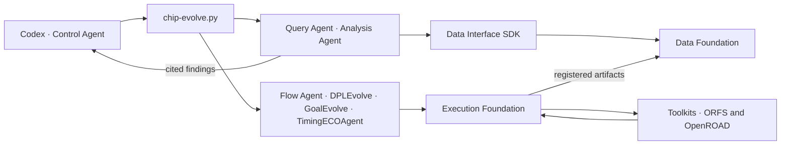

# Architecture

Codex is the **Control Agent** in the paper. It chooses the goal, starting point, specialist, allowed change, and budget. ChipEvolve supplies the tools for those decisions and a trace of what happened to the design.

## Follow one experiment

1. **Create a starting point.** `chip-evolve.py run --capability orfs` binds the RTL, constraints, Liberty, and toolchain. `chip_evolve/physical.py` submits it and requests post-route measurements through `chip_evolve/jobs.py`.
2. **Run and record.** Execution Foundation stages inputs, assigns resources, supervises the process, and registers outputs such as ODB, SDC, SPEF, and logs. Toolkits translates the task into native ORFS or OpenROAD calls. An ODB is a design checkpoint containing the physical design state that OpenROAD can load.
3. **Read facts.** The business entry point requests fact exports and imports them through `chip_evolve/design_facts.py`. Data Foundation stores snapshots and their source references. Data Interface exposes them through `EdaAiClient`. The Analysis Agent in `agent/query-agent/` uses the SDK to look up objects, compare metrics, and explain findings with evidence.
4. **Hand off.** Codex uses the [Agent dispatch table](agent/README.md) to choose a specialist, then passes a result and diagnosis to `chip-evolve.py run`. `chip_evolve/professional.py` binds the source, diagnosis, and objective. The specialist proposes candidates. The modules in `agent/` own the native search, actions, and scoring. The root package adapts each specialist's inputs and outputs to the common experiment flow.
5. **Close the loop.** Each candidate has execution and artifact references. Its design facts go through the same import and SDK path. Codex can compare them against the objective, request independent validation, select the result, or hand it to another specialist. Source and tool identities travel with the inputs and artifacts. Model records are produced by the Analysis Agent and specialist controllers at their call sites. Coverage varies by controller.

## Find the code

| If you want to change… | Start here |
|---|---|
| A CLI argument or command behavior | `chip_evolve/cli.py` and `chip_evolve/commands.py` |
| The source, goal, budget, or diagnosis handed to a specialist | `chip_evolve/professional.py` and `chip_evolve/handoff.py` |
| Flow or DPL delivery into the common platform | `chip_evolve/flow.py`, `chip_evolve/dpl.py`, and `chip_evolve/controller.py` |
| GoalEvolve or ECO delivery into the common platform | `chip_evolve/goal.py` or `chip_evolve/eco.py`; `native.py` retains the public import aliases |
| A placement, timing, or parameter-search algorithm | The relevant module inside `agent/` |
| Task lifecycle, limits, supervision, or artifact storage | `execution-foundation/` |
| Native commands and parsing of raw reports | `toolkits/` |
| Snapshot import, design facts, or joins | `data-foundation/` |
| An SDK method used by Query Agent or another caller | `data-interface/` |
| Evidence gathering or diagnosis | `agent/query-agent/` |

Modules exchange information through HTTP and installed wheels. Run state lives under the configured `var/` instance. The SDK is shipped as a Python package. Execution Foundation and Data Foundation run as separate local services for the GCD example.

The installer checks each module against its Git pin and builds wheels from those commits. The local stack selects the ORFS image and sets the execution capacity. DPLEvolve, GoalEvolve, and Timing ECO pass the configured threads to their native work. Common physical validation also uses the configured ORFS budget. Execution Foundation admits and supervises each build and measurement. DPLEvolve resumes CTS and routing through the shared physical adapter with the registered ORFS recipe.

## Root package layers

The root package has 49 implementation modules. Release cleanup gave shared
artifact inputs, source snapshots, container commands and business recovery
their own owners. Slice 4B adds explicit business contracts and three input
boundaries for results, handoffs and CLI-independent requests. Imports point toward the same
or a lower layer. Same-layer imports form an acyclic graph. The root architecture
tests inspect imports at every AST depth, including function-local imports.

| Layer | Responsibility | Modules |
|---|---|---|
| 0 | Contracts, values and shared execution primitives | `artifact_inputs`, `candidates`, `clock`, `comparison_facts`, `command_requests`, `config`, `contracts`, `handoff_io`, `jobs`, `lifecycle`, `metrics`, `native_process`, `progress`, `proof_policy`, `result_io`, `runtime`, `selection` |
| 1 | Design facts, recipes and source preparation | `code_evidence`, `design_facts`, `dpl_case`, `flow_recipe`, `source_snapshot`, `stage_facts` |
| 2 | Physical execution, proof and checkpoint delivery | `delivery`, `eqy`, `logic`, `native_physical`, `physical` |
| 3 | Specialist adapters, comparison commands and replay | `comparisons`, `dpl`, `eco`, `environment`, `flow`, `flow_delivery`, `flow_evidence`, `flow_replay`, `goal`, `goal_replay`, `native`, `validation` |
| 4 | Business orchestration and entry points | `candidate_facts`, `cli`, `commands`, `continuation`, `controller`, `diagnosis`, `handoff`, `professional`, `recovery` |

## Function ownership

| Operation | Implementation owner | Existing entry points |
|---|---|---|
| Snapshot export, import and SDK fact verification | `design_facts.publish`, `import_snapshot`, `query_facts` | `physical.publish`, `delivery.import_snapshot` and `validation.query_facts` export the same functions. |
| Saved checkpoint lookup | `delivery.replay_checkpoint` | `validation.replay_checkpoint` exports the same function. |
| Continue placement through CTS and routing | `physical.resume_layout` | `flow.resume_layout` exports the same function. |
| Flow source preparation and tool profile | `flow_recipe.flow_source`, `tool_profile` | `flow.flow_source` and `flow.tool_profile` export the same functions. |
| Prepared recipe qualification | `flow_replay.qualify_prepared_recipe` | Internal callers use this owner. |
| Business request recovery | `recovery.recover` | The `resume` command dispatches through this owner. |
| Deliver additional measured native candidates | `delivery.collect_code_candidates`, `maybe_collect` | `code_evidence.export_candidates`, `verify_candidate_producer` and `summarize_inventory` own the typed evidence boundaries. |
| Goal and ECO specialist adaptation | `goal.run_goal`, `eco.run_eco` | `native` explicitly re-exports the six original public objects, without a second implementation. |
| Completed or failed Flow candidate delivery | `flow_delivery.collect_completed`, `collect_failed_evidence`, `recover_config` | `flow.collect_flow`, `flow.recover_config` and `flow_evidence.collect` retain their public signatures. |
| Freeze native source and controller environment | `source_snapshot.freeze`, `inventory`, `environment` | `controller` exports the same functions. |
| Supervise a native controller process | `native_process.invoke` | `controller.invoke` exports the same function. |
| Registered input and archive checks | `artifact_inputs` | `handoff` exports the same functions. |
| Container command and timestamp construction | `runtime.container`, `now` | `physical` exports the same functions. |

`delivery.finish` reads frozen inputs, calls the physical continuation and
attaches native candidate evidence. `recovery.recover` selects the saved
business continuation and checks its original runtime identity before calling
delivery. CLI names, arguments and saved result schemas retain their existing
entry points. The [admin guide](admin/README.md) identifies the public install
and runtime tools and links their file catalog.

## Business input contracts

Start with `contracts.py` to see what constitutes a measured result, a physical
source, a candidate collection, a diagnosis, a handoff and a specialist request
or reply. These are immutable in-memory objects. `result_io.py` reads and
validates the existing JSON files and keeps each source file's raw-byte SHA256;
it does not rewrite saved receipts. `command_requests.py` separates CLI input
from normalized specialist budgets. `handoff_io.py` checks the receiver-specific
input variants; `artifact_inputs.py` still verifies actual EF registration.

Follow `cli.py` → `commands.py` → `professional.py` for a specialist dispatch.
Argparse ends at the CLI. After binding the physical source, objective and cited
context, all four public `run_*` adapters take the same six typed arguments and
return `SpecialistReply`. Native wire conversion is explicit within each adapter.
Flow collections require the caller to choose an individual measured branch;
a failed native search with measured evidence remains `evidence_only`.

Malformed fields fail before new tasks are submitted. Finite results that miss
a constraint remain valid evidence for comparison and diagnosis. Missing optional
historical observations remain unknown. The legacy low-level selection facade
continues to record rejection of invalid metrics and retains proof, exact replay,
incumbent and immutable-history checks. New comparison/adoption entry points use
validated `SingleResult` values and the same constraint policy.

Saved `request.json`, `result.json` and `handoff-input.json` keep their existing
wire layouts. Saved budgets and successful recovery are not re-normalized.
An unmeasured native checkpoint has its own input variant for explicit ORFS
replay; it is never presented as a complete final Result. Public Python specialist
callers must adopt the new request/result/reply types; the CLI arguments retain
their existing signatures. Slice 4C separates Goal/ECO ownership and removes the
five private cross-module calls. Environment ownership and physical folder
migration remain Slice 4D work; TUI and Web remain frozen.

## Read the business stages

The three reading entry points are **`cli.py`, `commands.py`, and
`professional.py`**. The remaining specialist modules adapt native agents,
replay saved work, or recover delivery. These responsibilities will remain the
reading guide for the future `workflow/` package; this slice does not move files.

`commands.run_experiment` first inspects a typed request, then creates and saves
one experiment, executes it under the business lock, and projects the original
output for the CLI. Its prepared union distinguishes a new ORFS baseline, a
physical replay, and a specialist dispatch. A pending task keeps its identity
and remains pending.

`professional.inspect_inputs` only reads and checks the source, objective,
context and required input roles. `prepare_inputs` materializes facts when
needed, binds the actual snapshot, freezes input hashes and writes the existing
handoff receipts. `dispatch_prepared` selects the current function from one of
the four specialist owners. Cancellation surrounds only the specialist call.
The two stage objects live in `professional.py`; they do not introduce another
wire protocol or a plugin registry.

`delivery.collect_code_candidates` freezes every candidate's evidence before
additional EDA can begin, validates saved progress, delivers remaining candidates
and summarizes the inventory. The output lock covers the whole transaction.
Completed manifest/result references must match their recorded hashes; damage
is rejected without a new submission or a historical-file repair. Failed
candidates stay failed, and native promotion remains separate from adoption.

Flow's successful and failed terminal paths share one delivery owner. It uses
`experiment/flow-delivery-lock/`; when both locks are needed, the original
experiment lock is acquired first. Failed or timed-out search evidence remains
`evidence_only`, even when its completed physical branches are delivered.

The Slice 4C engineering checks and short ECO runtime receipts are recorded in
`var/release/slice4c-20261128/`. Complete real Code evolution delivery and Flow
collector acceptance remain pending where historical materials have not been
qualified. Unit tests and an ECO no-op do not close those gaps. Business
acceptance is required before advancing to Slice 4D.
