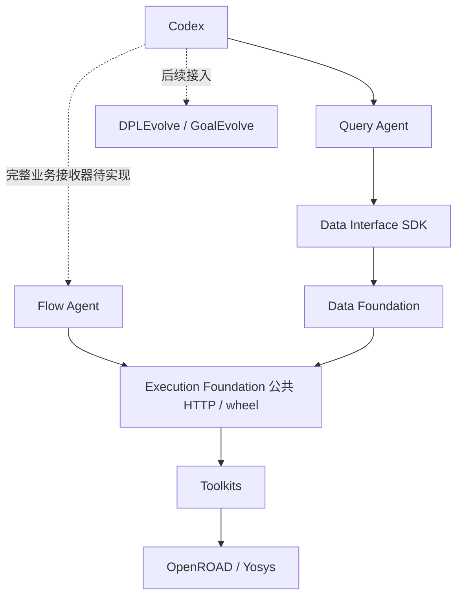
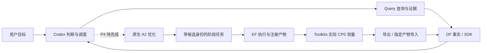
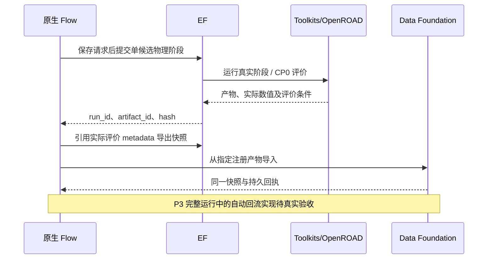
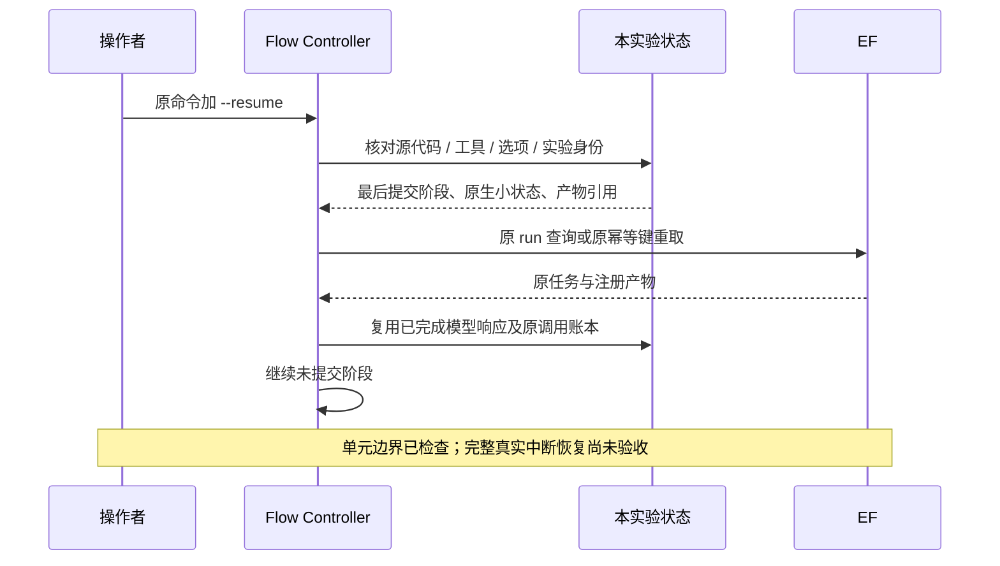

# 架构与源码边界

本页整理现有实现和已确认职责，不以预设架构强迫专业项目重构。源码证据、历史审计和接点依据见 [admin/INTEGRATION_MAP.md](admin/INTEGRATION_MAP.md)。更新：2026-10-10。

## 模块清单

| 模块 | 职责与实际边界 |
|---|---|
| Codex | 用户入口、全局目标、决策、判断、工具调用与下一步规划。 |
| Flow Agent | A2 原生候选生成、阶段屏障、DRP 替换/继承、固定 CP0 与功耗约束；平台接入不改优化算法。 |
| Execution Foundation | 幂等任务、资源调度、进程生命周期、日志和注册产物。 |
| Toolkits | 现有 OpenROAD/A2 阶段适配、真实评价和数据导出。 |
| Data Foundation | 统一事实快照、指标/对象/关系、来源与持久导入回执。 |
| Data Interface | 对外工具语义与已安装 SDK；不新增后台服务或数据库。 |
| Query Agent | 基于统一事实查证、比较、引用与归因上下文；完整因果分析能力待单独验收。 |
| Code Agent | 后续独立接入 DPLEvolve 和 GoalEvolve；当前未交付。 |

## 模块依赖

## 核心数据流

数据底座提供事实和来源；Query 提供解释与证据；Codex 负责业务判断。工具测量与开发验收脚本不是独立评测底座。

## 两个关键场景

## 对外接口及关键决策

- EF：已发布公共 client/contracts wheel 和 HTTP，提交、状态、取消、产物与上传输入；不访问其私有数据库。
- DF：`POST /snapshots/from-run` 指定注册产物导入，`GET /imports/{artifact_id}` 回执、快照/指标查询；POST 直接结果和 GET envelope 语义沿用现有契约。
- Data Interface：已发布 SDK 工具和来源读取。Query 通过 SDK 访问 DF；不直接读 sibling 源码。
- Flow：既有 `run.sh` 入口保留；新增 opt-in 平台运行和显式同 campaign 恢复。`-F` 是归档重开，不能冒充恢复。
- Query→Flow 的业务接收器仍未实现，不把 `contract_only` 标记改成完成。
- 运行状态放 `var`，模型 cache 不跨实验复用；保留未知调用成本和失败现场。
- 专业源码项目各自冻结工具链，不强行迁就 Flow 的工具版本。

## 已知缺口

P3 完整真实恢复、评价自动回流及四个中断窗口待验收；P4 自主闭环、Query 归因能力的业务验收、P5 源码优化、P6 干净安装与公平对照未完成。现有 Query 的查证/比较不能自动被包装为已证明的因果结论。
