# 架构与源码边界

## A24进行中：批量事实与所选设计对象（2026-10-16）

Flow原生搜索、阶段继承、全部候选和最终共同测量保持。批量候选先交付原ORFS完整最终指标/十项约束及OpenSTA时序事实，EF保留原ODB/SPEF/网表/阶段产物；未解析的对象索引以可选 `deferred_facts.opendb.publication_root` 明示，不生成假快照或空对象。实际Query诊断、专业接力、最终验证在入口调用根私有 `design_facts.ensure(deployment, source, frame)`，复用同一 `physical.publish(..., modes=("opendb",))`、EF导出和DF导入补齐；同一测量run/条件，原结果字节不改，扩展视图另存 `materialized-result.json`。旧调用默认三类事实，DF/SDK/公共HTTP接口不改；此策略由根交付层选择，不在Query或专业模块复制解析器。单位/条件和最终PPA不随对象索引时机改变。

七项针对测试、根323项回归及静态检查已通过；真实GCD“同状态七指标→轻交付→补齐→温态不增EDA”正在统一EF/DF排队验证，尚不据此声称端到端节约。当前JPEG旧根进程的原生搜索保持，只有正常收尾后才可恢复确定性交付。EF异步队列修复942e0ef也仍待任务排空后原位部署，详见 [A24检查点](admin/A24_QUEUE_PROGRESS_REPORT_20261016.md)。

## A23：已提交观察与原子续租（2026-10-16）

EF写连接继续独占事务来核验资源、领取、状态和失联；独立只读连接/读锁承载公开状态、证据索引及SDK所需EF读取，只能看到已提交WAL状态。heartbeat同一事务更新lease和worker presence，SQLite事务上下文负责提交/回滚；相同监控状态五秒合并、变化立即写入，原30秒lease/stale、EDA期限和派发/取消/回收不变。没有新服务、数据库、公共契约或模型循环。原目录三AES/JPEG与1725次查询验证、两个短health超时和10.7秒续租限制见 [A23报告](admin/A23_METADATA_STABILITY_REPORT_20261016.md)。原位更新后权威PID/命令在A23 `production-update.json`，DF保持原进程/路径/配置，旧回执不改写。

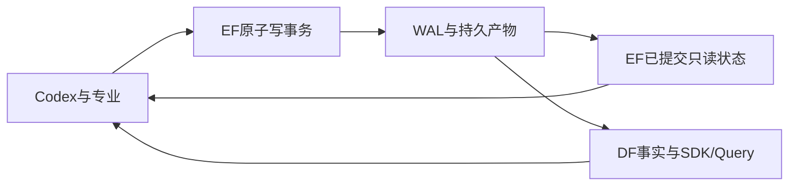

## A22：并发租约、交付恢复与持久状态位置（2026-10-16）

EF bundle 文件/字节托管移出共享连接锁，元数据和 first-writer 身份仍原子注册；worker 相同状态每秒合并写，PID/当前任务/状态变化立即记录，租约、失联隔离及SQLite持久化不变。根 `delivery.import_snapshot` 在首次回执查询故障后重查，明确无回执且本次未提交才发原POST；请求已发则只对账。函数签名、EF/DF/SDK路径及数据结构保持。

真实机械盘负例出现误失联和大导入期间读超时，源码门禁通过不代表运行门禁通过。已捕获 EF `runtime.db-wal` 的数秒 `fdatasync`、SQL持锁者及心跳等待；SSD仅用于隔离诊断，老板明确不提权，不迁移系统目录或临时SSD。原目录最终三AES/JPEG及791次持续读完成、无lost，已按空闲检查/完整备份原位更新EF runtime及DF主库WAL/FULL；路径/端口/旧archive不变。当前PID为EF2935185/DF2935255，实际命令在 `var/business/a22-lease-stability-20261016/production-update.json`。EF最长心跳调用仍30.7秒、两秒短health超时57次，长尾未解决，正式长轮次暂缓。实际完成和限制见 [A22报告](admin/A22_LEASE_STABILITY_REPORT_20261016.md)。

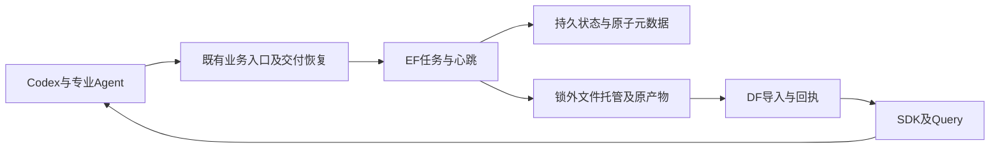

隔离脚本/fixture的故障注入和测量只用于验证，不安装进生产调用链；没有新增harness、后台服务、调度层或专业算法适配。相同PPA起点的存储诊断不计优化收益，也不代替正式同预算平台对照。

## A19–A21：阶段证据与有目的的固定重放（2026-10-16）

A20 已完成真实 Query 验证，报告 `admin/A20_NATIVE_STAGE_EVIDENCE_REPORT_20261016.md`。A21 四个固定功耗方法、两个匹配控制、完整输出证明/同值复测与分支取舍已完成，见 `admin/A21_FIXED_POWER_RELAY_REPORT_20261016.md`；A19 JPEG 的显式完整旋钮来源取得七PPA同值复制/SDK/冻结环境资格，见 `admin/A19_THIRD_DESIGN_REPORT_20261016.md`，不等于 JPEG 全专业搜索已通过。收尾实测暴露三个同时失联的物理阶段，有界恢复通过，租约根因尚未修复；不能将静态通过或可恢复当作稳定性全部通过。

`ensure_stage_facts(deployment, result_path) -> Path | None` 从根交付检查点定位所选 Goal producer，再用公开 EF 的归档/manifest核对阶段文件。阶段 JSON 必须引用同一次评价日志的 hash；保留原生 ns/pW、网表同值与指标同值的区别，并注册为当前结果的 analysis 证据。Query 优先读取小型阶段视图，原始日志可按需展开；不增加 DF 数据库、公共 HTTP/SDK 接口或通用 harness。

根 CLI 的固定方法入口：`run --capability goal --operation replay --source DESIGN_RESULT --code-source GOAL_SEARCH_RESULT`。旧 CLI 仅允许 DPL 的 `--code-source`，会拒绝 Goal，并非静默忽略。Goal 新参数读取既有成功搜索结果的实际源码、evaluation_mode、timing_recipe_id及原配方参数；DPL 原目录参数保持。`goal_replay.descriptor(deployment, result) -> dict` 核对共同工具链、原生产者和 701 文件实例对应的源码指纹（数量随实际方法），不凭目录名或版本串推断。

`--source` 是本次物理设计输入，`--code-source` 是跨设计可复用的专业源码方法，二者身份分开。根不导入相邻 Goal 源码；在原项目独立进程中调用原公开 `evaluate_parent`，私有复制、构建、原模式、原检查保持，全部确定性运算经 EF。固定 replay 不创建 Student 或新晋升。

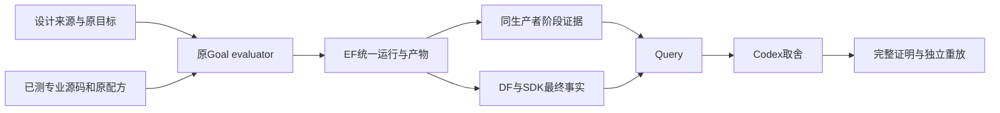

`admin/goal_route_control.py` 是独立的实验消融：从完成的方法另生成脚本，仅省略明确的 repair 调用，保留转换/placement/route、同输入/二进制及共同最终测量。保存原/控制脚本 hash，不修改专业原脚本、不把控制称为完整 Goal。实际约束通过和正式采用仍是独立门槛。

## A18：固定方法预检与本轮数据服务（2026-10-16）

本轮配置 `var/business/a18-preflight-20261016/runtime/local.json` 复用 EF `41151`，使用 A17 干净 wheel 的新 DF `43789`。DF 的新主库保存新快照，显式只读 archive 读取原历史库；旧 DF `53305` 保持运行，不重启也不静默切换其消费者。未构建或部署用户脏 DF/DI 代码。服务回执与 wheel 身份见本轮 `data-service.json`。

根内部 `flow_source(deployment: Deployment, experiment: Path, *, design_id: str) -> Path` 只准备当前设计；原实现遍历所有已登记设计，导致 AES 被无关缺失 picorv32 模板阻断。Flow 运行和旧来源布局续作两处传入当前 design；公共 API、专业算法和物理目标不变。已完成的 AES 专业操作沿原 key 恢复交付，没有改运行 controller 或重启搜索。

预检驱动只冻结输入和调用既有 CLI，报告全尝试与原约束事实；Codex 显式选源、判断是否接力及采用。GCD/AES 的 DPL framework、固定源码与 Goal p0 固定方法用于接点检查，不能代表新专业搜索；Goal p0 的时序修复不等于原 Goal 演化所得功耗优化能力。查证脚本调用原生 `codex exec`，没有自建模型/工具循环；修订题集显式列目标 run IDs，参考基线只作上下文。

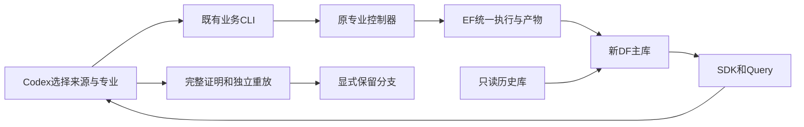

当前 Query 能查回同条件差值、约束和来源身份；本次查询未覆盖全部内部阶段因果证据，不能仅凭功耗差值归因于某个 Goal 动作。预实验实际结果与剩余门槛见 `admin/A18_PREFLIGHT_REPORT_20261016.md`，正式双核心实验仍待单独冻结和批准。以下“A18未启动”等表述是各历史切片收尾时状态。

## A16/A17：环境资格与可靠交付（2026-10-16）

`environment.py`冻结已登记来源、同值控制、镜像、实际工具能力、专业控制代码与私有研究二进制、库/SDC及部署绑定。`run --environment E`或部署`qualified_environments[design]`在任务启动前核对；新Flow默认source，旧legacy必须明确选择。Code保留共同基础上的专业增量。GCD/AES已通过；picorv32完整流程可跑，但复制结果与来源不同，环境资格拒绝，不能用于正式优化对照。

`lifecycle.py`只监督客户端等待：读取EF公开health/resources，区分无人消费、资源等待、worker忙碌、运行和终态。健康运行不增加客户端截止时间，不按日志静默杀任务。无法消费或服务持续不可达时抛出`WorkPending`，保留原run或幂等提交key，不取消任务；CLI退出3并保存pending状态。`watch --design D --run-id R`读取实时状态，`status`显示待处理生命周期引用。

`Jobs.submit`先校验原任务和输入内容，已有submission直接重接原run；首次提交响应未知时，恢复沿用原幂等key。`delivery.import_snapshot(jobs, producer, artifact, snapshot, subject)`先核对DF原artifact回执，导入响应丢失后有限查回执，成功后校验快照设计/subject身份。交付超时不重新发EDA；确定失败仍失败。`resume`继续原确定性交付，未完成的专业模型搜索仍保留其原会话，不承诺通用重启。

DF复现的大导入锁问题只修复`connections.py`：服务启动时初始化原有大小的只读连接池，并给读连接与既有写入相同的锁等待预算，避免在写事务中首次初始化reader；容量、数据库结构、公共API均不变。客户端自身仍有有限的请求和对账预算。EF/DF生产服务不重启；补丁从干净检出构建并在独立服务验证，用户26份文件不混入构建或提交。

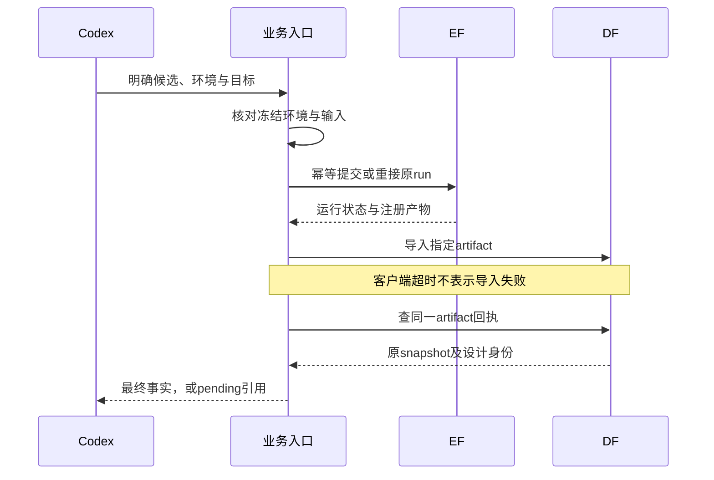

对应接口、故障实验、限制和改动清单见`admin/A14_A17_PREFORMAL_FIX_REPORT_20261016.md`。A18未启动；工程通过与老板业务验收分开。

## A14/A15：采用一致性与显式候选交付（2026-10-16）

`select --result R --validation V --reason ...` 必须绑定原结果hash、原目标、完整输出证明、独立同值重放及SDK回执。短暂的设计采用锁内重读当前结果并原子发布；按参考网表内容身份、目标和条件隔离scope，决定写入本轮`designs/<design>/decisions`，不修改历史实验的`adoption.json`。Codex继续决定取舍，探索不要求先通过最终采用验证。

Flow顶层`result.json`现在是`candidate-delivery.v1`集合，包含全候选引用／hash／事实／可行性，`selected_source=null`，不再按TNS同分选择第一项。专业执行和验证要求明确的单候选路径；`candidates`能展开冻结集合，通过SDK查回全部事实。单个候选入库不再覆盖campaign的顶层结果。

`handoff.input_contract`记录真实源字节、阶段转换及方法身份；Query导出保留原包并绑定确定性的source/reference/retained身份，新包重新计算内容ID，派发核对实际source。原专业算法和公共EF/DF/SDK不变。A14采用复现和真实GCD回执核查通过，A15真实AES六候选及三条既有实际接点复核通过；A16/A17状态见上节，A18未启动。

## A11/A12/A13：现代完整来源与实测接力（2026-10-16）

新增正式 `candidates --reference R --result C [--result C...] --key K`，由根 `candidate_facts.py` 组合已有公共入口：DF/SDK 核对最终指标和快照，EF 明确生产者提供原专业证据，紧凑视图/全文作为 analysis 产物登记，现有 diagnosis 优先交付给 Query。原生判定、最终物理可行性和 Codex 的业务决定分别记录；不新增服务、数据库、分数或模型循环。Flow 原生反馈保留实际 CP0/库/单位并合并相同反馈的多份来源引用，未知单位不补造。

显式 `--flow-recipe source` 从登记来源冻结实际输入、现代ORFS/Yosys物理树及平台共享映射，在EF内展开真实Make参数，再叠加原控制器；原参数域、搜索、继承、淘汰、CP0×0.9及TT评分保持。现代Yosys按SDC数字给ABC时钟，不自动换算ns/ps，正式模式拒绝静默转换；r3显式登记ps来源后，GCD/AES的物理复制及实际原生首行均七PPA同值，各完成两轮三候选。现代内置综合仍不支持原层次旋钮，完整能力未通过；legacy默认保留。

source布局接力携带真实`3_place.sdc`与recipe，重定位复制工作树中的生成配置路径；共同测量继续用原业务SDC及固定FF库，二者不能互相覆盖。`materialize_dpl_replay`将已有验证安装放入当前已挂载state，保留二进制、权限及原构建回执hash，不重编或改算法。实际新GCD输入的空接力七PPA同值；固定DPL源码相对Flow功耗再降0.700843%，18输出证明和独立七PPA同值通过。AES完整轮次结束但六候选均超原功耗/面积上限，保留历史合法Goal。来源切换与方法贡献分开，不把大幅基线变化归为调参收益。

紧凑候选事实使用既有`Jobs.command(extra_paths=...)`逐文件登记，解决只有归档、Query找不到摘要的问题；EF/DF/SDK无新增公共契约或服务。12个最终Flow候选三类快照/七指标已SDK核对。真实GCD中断复用原producer，零重复物理计算；AES导入超时后保持六native、五common及17模型请求身份，只补未执行的第六份共同测量。DF超时根因、Query摘要引用与身份一致性及路径索引比较元数据仍待独立切片；AESQuery曾混淆reference与Goal编号，该结论未用于采用。默认legacy、公共边界及26份用户文件保持。最终结果见`admin/A11_FINAL_REPORT_20261016.md`。

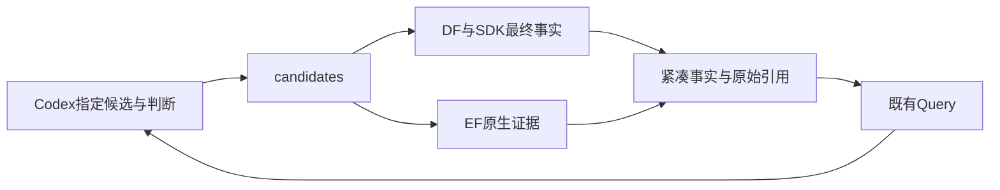

## A9：AES迁移接点与实测边界

Flow CP0 评分器补齐原 TT 角的 RVT/LVT/SLVT 库覆盖，并要求真实受约束 setup 路径，避免缺库时把空分析当 TNS=0；原专业评分、搜索与筛选不变。正式 flow_source 同步冻结评分脚本，避免继续复制旧模板。

逻辑验证增加可选部署工具 `tools.equivalence=eqy` / `tools.eqy`，复用镜像已有 EQY 的 SAT 分区归纳；默认 Yosys 保持。logic.py 继续核对固定库、端口和零端口物理单元证据；eqy.py 只生成原生工具配置并经 EF 执行、读取全局及每个分区的通过状态，不增加服务或判断层。AES同网表1072分区通过、单输出位翻转负控制被拒绝；真实DPL/Goal输出各129功能位/1071分区通过，独立DRT/RCX七项PPA同值、DF/SDK身份正确。DPL面积超限的失败状态保留，Goal合法采用，不能用工具执行成功替代业务约束。完整状态见当前A9报告。

AES完整DPL轮次发现平台选择器遗漏原生round-root，误将有效候选视为缺证据；正式选择器复用原orchestrator的runtime_with_round_outputs，不改晋升规则。professional.dpl_producer按原生成功回执中ODB内容hash及run tag定位实际试验，支持同一Student多次修订。历史错误选择与交付不可变，本轮用新交付记录重查已完成轮次并继续物理流程，不重启模型、不修改原runtime源码副本。

原生Teacher判定、CSV源指标、源码hash与阶段结果可由现有Jobs.command登记为测量结果的analysis子运行及raw_flow_metadata；既有scoped_analysis_references把原始证据交给固定scope的Query，不增加后台服务或评分。AES已验证真实Goal→ECO上下文交付及最终ORFS对比，Query读取原始判定而非只读功耗排序；Codex保留采用理由及incumbent。专业内部工作状态仍由各原项目管理，DF不替代其算法状态，EF管理原始产物与运行来源。

当前通用接点已在同一ASAP7的GCD/AES实测，未按设计名分支打补丁。A11已在显式source模式修复实际起点继承，旧legacy路径及原始综合路线差异保留；HPWL/原生功耗代理与最终RCX收益不一致、ECO在已闭合路径上空操作、原生观测开销及公平收益仍未验证。Query发现OpenSTA路径索引的corner/analysis/unit比较元数据不完整；可结合原始metrics、SDC与受限路径样本调查，不能把样本索引当作全路径匹配认证。本轮未改动用户正在开发的DF/DI文件，后续须独立切片补齐元数据。

## A8：正式本机恢复与验证（2026-10-15）

现有CLI增加resume/continue-goal/validate/compare。delivery保存原专业成功的输入hash、实际producer和原判定；resume只恢复确定性交付，EF原任务身份不变，不重跑模型搜索。原Goal续作和placement归档/消费核查迁入正式continuation/handoff模块，业务不依赖admin脚本。Jobs对嵌套验证任务隔离身份，对已冻结输入/命令作重接校验。单实验驱动锁不管理EDA进程，EDA仍由EF监管。

接口：checkpoint(experiment, *, design_id, odb, producer, objective, native_method, pdk=None, source=None)；recover(deployment, design_id, key)；validate(deployment, result_path, reference_path, key)。原EF/DF HTTP、DI SDK和部署schema不变。validate使用EF Yosys/路由/测量、DF源指标和scope，输出事实/证明/重放回执；Codex仍给出select理由。

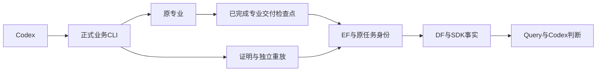

GCD真实恢复与验证通过，AES完整迁移为A9。技术债：未完成原生模型会话的恢复仍属于原项目；重复源码构建、专业适用范围和公平预算优势未解决。数字输出证明不代替物理检查；物理单元仅在已证实无端口连接时从证明模型排除。详细证据见admin/A8_LOCAL_WORKFLOW_REPORT_20261015.md；以下旧段落为历史检查点，最新状态以TASKS顶部及最新报告为准。

## A4：单机业务入口与诊断交付（最新）

根 `chip-evolve.py` / `chip_evolve` 是确定性业务组合入口，登记设计、目标、能力、预算和源实验；继续调用独立专业控制器。没有新增服务、通用规划循环或综合评分。EF管理任务/资源/原始产物，DF管理设计事实/快照/索引/来源，SDK提供统一查询，Query使用已有Codex调查机制提供诊断，Codex决定下一步及采用结果。

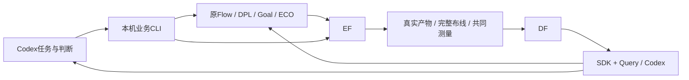

公共Toolkit `context`把固定源run的Query事实、假设、证据与限制送入原专业提示及EF任务身份；Query `ProfessionalContext`复用既有scope/handoff输入冻结，不新增编辑权限。Goal的公开design_id与原生top分离，DEF保持数据库精度；DPL的原CMake源前缀和当前ORFS前缀共同挂载；Flow保留分支原配置，导出排队使用剩余实验预算。专业评分/原晋升与共同最终验收分别记录。

对外接口为业务CLI `run/status/show/diagnose/select/collect-flow`、Query `export-professional-context`以及既有EF/DF/SDK公共接口；未变更公共HTTP签名。文件职责、函数签名、数据结构、决策及实测见 [A4报告](admin/LOCAL_BUSINESS_ENTRY_REPORT_20261014.md)。GCD四专业实际调用及AES ORFS→Goal/数据验证通过；不代表所有PDK、宏、多时钟或AES完整四专业搜索已验证。原生专业内部现场查询保留。比较端点的时序corner/单位元数据缺口、功耗活动假设缺口仍需明确，不伪造严格因果。

A5新增有限对照命令`chip_evolve.comparisons`：同条件事实差值、原Goal固定方法重放、固定Liberty模型下的Yosys网表等价；均由既有EF执行，没有后台评测服务或新综合分数。GCD/AES固定方法各7项PPA差值为零；完整Flow→DPL原框架→Goal新源码→ECO和数据回流实际完成，联合时序未闭合，保留Goal单项合法incumbent。原专业估计RC参数保留，最终RCX规则与镜像相同，不声称原搜索环境相同。DPL补充新轮次构建/三Student布局评价有效，但超出三小时预算未正常收尾，不能记完整原生验收通过。最终证据、成本和下一步需要独立决策的评分/最终route偏差见[A5报告](admin/LOCAL_PROFESSIONAL_COMPARISON_REPORT_20261014.md)。原失败、专业评分/晋升与Codex采用分别留存。

A5最终技术债：三个真实构建发生EF心跳租约过期，默认30s租约/guardian心跳覆盖需要可控复现后修正；不能宣称长构建稳定性已验收。证据通过公共API保留，不读私有数据库或关闭失控进程保护。本轮不改EF公共契约，后续优先处理这一独立接点。

以下各段是历史检查点；最新交付状态以A4/A5及TASKS为准，旧失败和审计更正不改写。

更新：2026-10-14。本页以本轮实际接口和 GCD 验收为准，历史状态保留在 Git 与各切片报告。最终工程回执见 `var/overnight/gcd-20261014/final-acceptance.json`；老板业务确认独立。

**A1审计更正：**旧N4的DPL→CTS交接未通过语义保真。新WORK_HOME下的`make finish`重新综合/布局，覆盖DPL候选；下游关键ODB与原Flow相同。因此旧“DPL候选真实继续CTS/route、完整专业接力通过”结论撤回。A2现已修复DPL→CTS/完整route并做匹配控制实验；这不恢复旧四专业联合收益结论。EF任务成功仅表示命令被执行，不能证明专业修改被下游保留；领域stage适配需记录真实消费起点和阶段改变。O2独立分支的改善和验证保持。详见 `admin/COLLABORATION_AUDIT_20261014.md`，其结论优先于本页保留的旧夜间状态。

## A2/A3修复检查点（2026-10-14）

布局交接复用现有Toolkit的阶段checkpoint与Make前置冻结；真实候选ODB、显式SDC进入CTS，再进入route_finish，校验保留hash和实际read_db消费。通用`resume`接收design/profile/config/checkpoint等输入，本机验收驱动仍针对GCD；没有改专业算法或扩大到通用业务receiver。

共同目标由公共Toolkit wheel中的`objectives`小模块携带：实际模型提示、Flow决策重放、Goal会话身份、EF任务留证和最终测量绑定同一objective_id；comparison condition_id含实际库/SDC内容及工具/时钟/寄生条件。DF/SDK沿用现有evaluation_conditions字段提供这些身份；没有新增评测服务。原专业评分与阶段探索保留，Codex决定最终采用。

四专业真实模型入口的目标送达、匹配DPL/无DPL完整布线和DF/SDK查询已核查。该DPL候选在共同阶段条件下使最终TNS绝对值增加约1.92%、功耗增加约3.41%、单元面积增加约1.85%，两分支也超出整体面积/时序边界，因此保留已有O2合法最好结果。详情与接口见`admin/HANDOFF_OBJECTIVES_REPORT_20261014.md`；本轮工程通过，待老板业务验收，完整联合PPA收益尚未达。

## 系统边界

O1 共同条件复测补充：相同工具版本或同名 PDK 文件不足以确定相同评价环境。实际库内容 hash、nominal 电压/温度、SDC 单位和完整约束、时钟传播及寄生来源一并记录。Flow 原生 TT/固定 CP0 的专业评分保持独立，最终共同 FF/310ps 收益由 Codex 根据统一测量判断；不能混算。新本机测量脚本读取共同基准已记录的实际 Liberty 并逐文件核对 hash，不新增评分/晋升底座。发现的旧 Flow FF 副本差异及优化结果见 `admin/GCD_OPTIMIZATION_REPORT_20261014.md`；历史实验不改写。

Codex 是入口、通用 harness、规划者与业务判断者。平台提供可复现执行、统一设计事实、Query 领域能力和四项专业能力，不新造通用 Agent harness 或评测底座。

根仓库以 Git 子模块固定九个独立项目，提交和上游来源见 `SOURCE_MANIFEST.json`。跨项目仅通过安装的公共 wheel / HTTP；Data Interface 是 SDK，无第三个后台服务或数据库。运行数据在 var，旧 ChipEvolve 在 discarded，不参与实际执行。

| 模块 | 职责与本轮实际接点 |
|---|---|
| Execution Foundation | 任务、排队、资源、进程树、取消、日志、输入身份和注册文件产物；所有平台 EDA / 构建 / 专业测量的入口 |
| Data Foundation | 设计 / 修订 / 运行 / 快照、对象 / 关系、指标、摘要、来源、持久导入回执 |
| Data Interface | 公共查询语义和 SDK；EF 提供运行目录，DF 提供设计事实，原文件仍由 EF 登记 |
| Query Agent | Codex 的垂直能力：领域工具、固定 scope、查证、比较、调查、证据与交接；不凭空推定因果 |
| Toolkits | 共同 OpenROAD / ORFS / A2 调用、实际测量和事实导出；不负责全局判断 |
| Flow Agent | A2-ORFO 的原候选、阶段继承、DRP / GWTW 与固定 CP0 评分；控制器只委派确定性阶段 |
| DPLEvolve | ReviewDSE 的同一工程实现；Teacher / Student、布局源码优化及原指标 / 筛选；集中 helper 委派 EF |
| GoalEvolve | Teacher / 四 Student / AST / EPD、功耗感知源码演化；集中 runner 委派 EF，SDK 输入上下文 |
| TimingECOAgent | ASU-VDA-Lab 的时序 ECO；保留原专业提示、操作、评分和回退；整个持续会话属于一个 EF 任务 |

## 模块依赖

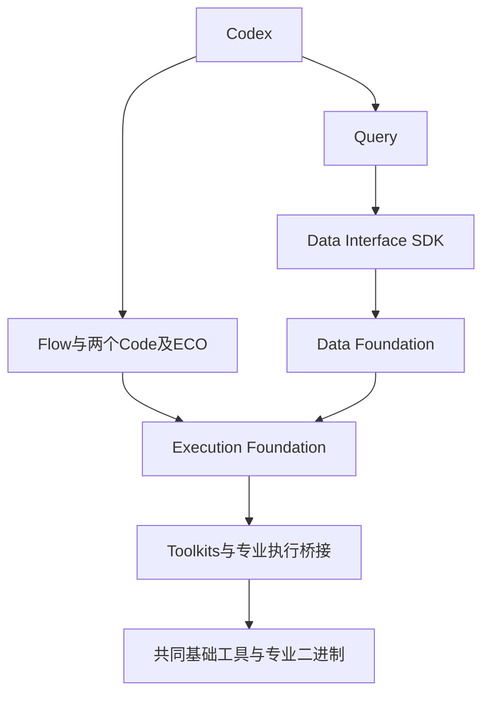

DF 引用 EF 的产物与实际生产者。专业内部原生上下文和工作文件仍在原项目会话内；跨项目输入、设计事实和产物通过公共入口。没有将所有原内部查询重写成远程 RPC。

## 数据流

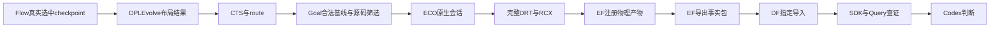

输入继承含 parent_run_id、snapshot_id、artifact_id、文件 hash、源 / 镜像 / 二进制身份及 PDK / SDC / SPEF。构建留证包与设计事实包区分。源码候选无合法晋升时保留原生合法基线，再继续专业接力；这不是源码收益。

## 核心场景

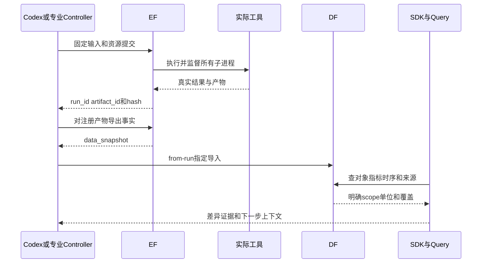

跨专业交接及调查时序、函数签名、HTTP 路径、数据结构和关键决定见 [admin/OVERNIGHT_GCD_INTERFACES_20261014.md](admin/OVERNIGHT_GCD_INTERFACES_20261014.md)。

## 已确认接口和决定

- EF 的 TaskSpec v3、KernelClient 提交 / 状态 / 资源 / 产物 / 取消接口沿用公共契约，不读取其内部数据库。
- DF 使用 `POST /snapshots/from-run` 指定 run_id / artifact_id 导入；SDK 根据 design、run、snapshot 和 stage 查询。
- 本机 HTTP 传控制和身份。大文件通过公开 locator 和磁盘复制，同步校验 hash；远程才走已有分块下载。历史17.6MB布局包本机取回约0.026秒的单次缓存测量保留，不作为稳定吞吐基准。
- 共同基础固定为 OpenROAD `27288f5c90` / ORFS `5105b0a77`、SIF digest `8e6ee7aac233da078364649fa8111dac5de33a3589f5445dcffd96f9d6d8dd39`。两个 Code 保留专业源码覆盖及私有二进制，不用 stock binary 替代专业命令。
- 专业循环保留，在确定性执行接点委派 EF。ECO 保留持续 OpenROAD 状态，避免拆散会话；新只读 probe 补齐上游提示已声明但缺失的命令。
- 两个 Code 和 ECO 的平台输入上下文由已安装 SDK 取得，绑定固定设计与指标快照。构建、解析、结构检查和版本查询也由 EF 执行；无平台 profile 的原生模式保留，平台失败不静默回落。
- Query 的明确快照对象 / 分析查询不被按 run 重新选择覆盖。按 run 比较从各类已索引快照读取指标 / 产物，核对所有权，保留歧义和不完整事实。
- OpenSTA JSON 时间是 SI 秒，原 ASAP7 Flow 为 ps，公共指标边界明确 ns / W / µm²。SDC 导出自带 `set_cmd_units -time ps`，最终310ps时钟经真实下游读取确认。
- 专业原生 ECO 一次 DRT 校准与完整 detailed_route / RCX 验收分开，完整验收记录实际 DRC、布局和 PPA。Flow TT / 固定 CP0、Goal GRT / ideal clocks、最终 FF / propagated clocks 的指标分开。
- EF 共享连接读锁修复与 Goal CSV 输出识别修复只针对实测故障；未改公共 API、资源规则或原算法。大构建64GiB / 2048进程 / 8核，物理阶段24GiB，专属服务32核 / 128GiB / 4workers，按任务配置而非固定小限额。

## 当前验证状态

O2 增量：固定 DF 时序/指标快照经 SDK 提供路径证据，由 Codex 选择 `u158` 的同尺寸 VT 动作；公开 EF 执行完整 DRT/RCX、测量、Yosys 等价及事实导出，结果经 DF 和 Query 查证。在共同 FF/310ps 下，新独立分支闭合 setup，功耗比原 ORFS 低0.1583%、单元面积低0.3846%，core/die 不变；独立重放逐值相同，与原 ORFS/ECO 的逻辑等价通过。这是本机 GCD 的新候选，待老板验收；专业算法、公共契约和旧完整链路状态未改。报告 `admin/GCD_TARGETED_REFINEMENT_REPORT_20261014.md`。

真实 Flow 两轮十二候选、DPL 三基线 / 已优化源码和后续 CTS-route、Goal 四份 C++ 候选 / 原生完整轮次 / 证据恢复、独立 ECO 和完整专业接力均已执行。最终 DRC / placement violations 为零，物理产物、对象、时序及指标均已回流；11个最终快照重启查询一致。公开目录记录335个运行及各自资源，全部终态，包含真实失败和取消。

Goal 原轮次因重复 CSV 输出误冻结而遮住指标；新桥接下八次重复解析成功，原恢复函数确认四候选结构检查和实际 metrics，原筛选仍因36–37个DRV拒绝，未晋升新源码。原轮次和 EPD 不覆盖。原 U4 AES 的已截止轮次仍未完成，这轮新的 GCD 收尾不改写其历史。

完整协同链路在共同条件下功耗降低约43.6%，但 TNS、单元面积和核心 / die footprint 退化，不晋升为全面 PPA 改善。独立 ECO 在原基准上闭合 setup 时序，功耗增加约1.1%。详细条件、全部指标和证据见 [admin/OVERNIGHT_GCD_REPORT_20261014.md](admin/OVERNIGHT_GCD_REPORT_20261014.md)。

## 已知技术债与后续边界

- 单项目候选收益不保证串联收益；后续优先提高电气约束可行率和跨阶段选优，不放宽原规则来晋升失败设计。
- 对象和采样时序索引不等于全部时序覆盖。29条证据的真实 Codex调查可给出差异与竞争解释，但尚未证明单一因果或完整signoff。
- 平台初次输入与跨项目交接统一；专业原生会话内部动态查询保留，没有逐条改写成 DF RPC。直接 Query→所有专业项目的一键通用接收器仍待后续契约 / 切片；这轮由 Codex 使用实际 SDK、公开产物和本机准备器调度。
- Root本机验收助手保留GCD、ASAP7和本机profile假设，源码 / 提示 / Tcl 身份有记录；更大设计、跨机器安装和公开产品化后续显式开展。
- 数据增强节省 token / 时间的公平因果对照、Tutorial、新用户安装与论文发布暂缓，不以调用总量声称节省比例。
- TimingECOAgent官方AES的LFS对象404，保留指针与来源；本轮用真实本机GCD，不冒称官方AES复现或第三方算法原创。
- 26份已有用户修改保持原状；运行数据、凭据、镜像、环境及未提交编辑不纳入源码发布。

## A6/A7：长任务和专业事实接点（2026-10-15）

EF attempt内部只保留一个独立租约续期对象，贯穿输入准备、guardian执行及证据/产物处理。慢采样/观察不会阻塞续租；对象随attempt收尾停止，原任务预算、取消、失联回收和资源规则保留。store在原连接锁内采样心跳时间。未改TaskSpec、数据库或公共HTTP/SDK。

根比较入口的professional_facts并列原native_method、最终metrics及最终constraint violations，原晋升和Codex采用分开。原Goal阶段日志从EF注册包校验后，以已有analysis_of_run_id归属于最终scope；Query消费公开证据与SDK，不读取内部数据库。Jobs.command新增可选analysis_parent/extra_paths，仅透传既有标签/产物声明。

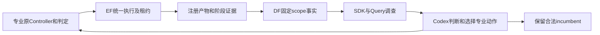

Goal平台桥接对已提交任务的GET状态读取遇到KernelUnavailable最多尝试三次，保留观察错误并服从原deadline；不重交任务、不自动延长工具或搜索预算、不改专业算法。首轮续作一次GET超时触发原取消的失败证据保留，新r2独立验证。旧历史失联仍不改写；真实长构建/数据前置通过不等于新DPL完整轮次或联合收益通过。

当前A7阶段事实已证明DPL→Goal在repair_power之后出现setup退化；四轮ECO实际只读动作的最终PPA与route-only控制逐值相同，不计新增收益。AES固定Goal方法7项PPA与原结果相同，SDK/真实Query反馈通过，不称AES四专业搜索。新DPL完整原生轮次和Goal一轮四Student时序恢复的收尾，以两份A6/A7报告及TASKS验收状态为准。

A6完整原生DPL轮次已通过工程验收，原规则无源码晋升：测量领先的候选因orientation/pin回滚缺陷被Teacher拒绝。默认方法的CTS/DRT/RCX、三scope和SDK查询均完成；原合法Goal单项继续保留。公开分析产物通过已有analysis_of_run_id提供拒绝原因。Goal冲突LTO旗修复后，真实链接1297.4秒、峰值4.821GB，actual argv只含显式-flto=1；source/libs/算法与原64GiB配额不改。A7四Student原生续作最终状态由TASKS及报告记录。

A7收尾发现产物登记仍在共享连接锁内进行耗时文件托管。A6补充修复将hash/复制/内容验证放在锁外，元数据批次继续在一个原子事务内提交；public API、数据库、lease期限、取消和fencing不变。验证包含并发续租/批次回滚、默认30秒lease下35秒托管停顿与真实120MB专业ELF并发托管。新wheel先在隔离EF资格服务验证，活跃原生轮次收尾后才更新本轮专属服务。历史A7新失联run-68f0cf…保留，不能将首批42项无失联概括为所有实验无失联，也没有凭现存回执声称事故唯一原因。

## A6/A7最终接口与决策收尾

最终EF381/根175项回归通过；新EF wheel在活跃原专业收尾后按原状态根更新，当前配置var/business/a7-quality-20261014/production-runtime/local.json，EF/DF HTTP路径不变。metadata事务锁不再包裹输入/产物hash与文件托管；独立attempt续租、取消/预算/fencing及原资源规则保留。原数据库、公共契约和九模块边界不变。

根scoped_analysis_references(deployment, frames)经EF公开runs/artifacts按analysis_of_run_id列出已绑定固定scope的成功analysis及raw_flow_metadata，诊断提示给出证据入口；原生父run权限不扩大。checkpoint_producer按源码与ODB是否真实继承定位原/新EF捕获；checkpoint_method并列实际阶段模式/metrics与lineage判定。stage collector验证选中测量方法，原Teacher/晋升记录保持。有限空目录验证新增可选pdk参数，允许复用实际上一实验冻结PDK，不造路径软链接或重跑搜索。

最终GCD组合分支已有源码的power_then_timing合法改善，经过18功能输出数字等价、七项空目录PPA同值及DF/SDK/Query反馈后采用；新Student源码无晋升，ECO无新增收益。Codex判断采用，原算法保留；不据此宣称公平总预算或所有设计的团队优越性。物理零端口单元与内部名称的输出证明处理由已有EF工具和已核验JSON完成，完整流程证据留在A7，不新增评测服务。
