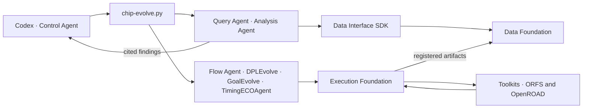

# Architecture

Codex is the **Control Agent** in the paper. It chooses the goal, starting point, specialist, allowed change, and budget. ChipEvolve supplies the tools for those decisions and a trace of what happened to the design.

## Follow one experiment

1. **Create a starting point.** `chip-evolve.py run --capability orfs` binds the RTL, constraints, Liberty, and toolchain. `chip_evolve/physical.py` submits it and requests post-route measurements through `chip_evolve/jobs.py`.
2. **Run and record.** Execution Foundation stages inputs, assigns resources, supervises the process, and registers outputs such as ODB, SDC, SPEF, and logs. Toolkits translates the task into native ORFS or OpenROAD calls. An ODB is a design checkpoint containing the physical design state that OpenROAD can load.
3. **Read facts.** The business entry point requests fact exports and imports them through `chip_evolve/delivery.py`. Data Foundation stores snapshots and their source references. Data Interface exposes them through `EdaAiClient`. The Analysis Agent in `agent/query-agent/` uses the SDK to look up objects, compare metrics, and explain findings with evidence.
4. **Hand off.** Codex uses the [Agent dispatch table](agent/README.md) to choose a specialist, then passes a result and diagnosis to `chip-evolve.py run`. `chip_evolve/professional.py` binds the source, diagnosis, and objective. The specialist proposes candidates. The modules in `agent/` own the native search, actions, and scoring. The root package adapts each specialist's inputs and outputs to the common experiment flow.
5. **Close the loop.** Each candidate has execution and artifact references. Its design facts go through the same import and SDK path. Codex can compare them against the objective, request independent validation, select the result, or hand it to another specialist. Source and tool identities travel with the inputs and artifacts. Model records are produced by the Analysis Agent and specialist controllers at their call sites. Coverage varies by controller.

## Find the code

| If you want to change… | Start here |
|---|---|
| A CLI argument or command behavior | `chip_evolve/cli.py` and `chip_evolve/commands.py` |
| The source, goal, budget, or diagnosis handed to a specialist | `chip_evolve/professional.py` and `chip_evolve/handoff.py` |
| Flow or DPL delivery into the common platform | `chip_evolve/flow.py`, `chip_evolve/dpl.py`, and `chip_evolve/controller.py` |
| GoalEvolve or ECO delivery into the common platform | `chip_evolve/native.py` |
| A placement, timing, or parameter-search algorithm | The relevant module inside `agent/` |
| Task lifecycle, limits, supervision, or artifact storage | `execution-foundation/` |
| Native commands and parsing of raw reports | `toolkits/` |
| Snapshot import, design facts, or joins | `data-foundation/` |
| An SDK method used by Query Agent or another caller | `data-interface/` |
| Evidence gathering or diagnosis | `agent/query-agent/` |

Modules exchange information through HTTP and installed wheels. Run state lives under the configured `var/` instance. The SDK is shipped as a Python package. Execution Foundation and Data Foundation run as separate local services for the GCD example.

The installer checks each module against its Git pin and builds wheels from those commits. The local stack selects the ORFS image and sets the execution capacity. For DPLEvolve, the dispatcher passes the available threads to the native baseline, build, and search commands. The existing Teacher and Students decide what to change, while Execution Foundation admits and supervises the builds and measurements.
