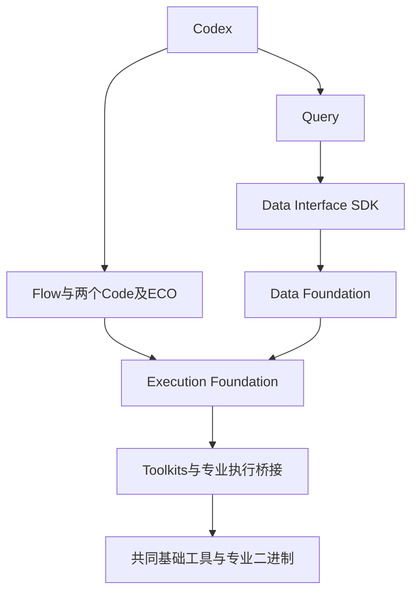
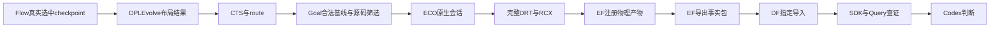
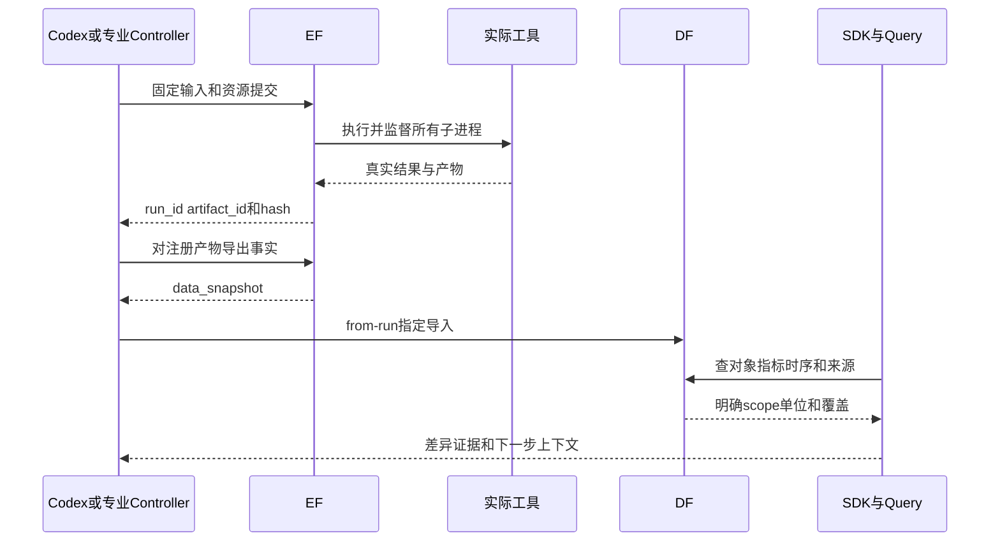

# 架构与源码边界

更新：2026-10-14。本页以本轮实际接口和 GCD 验收为准，历史状态保留在 Git 与各切片报告。最终工程回执见 `var/overnight/gcd-20261014/final-acceptance.json`；老板业务确认独立。

## 系统边界

O1 共同条件复测补充：相同工具版本或同名 PDK 文件不足以确定相同评价环境。实际库内容 hash、nominal 电压/温度、SDC 单位和完整约束、时钟传播及寄生来源一并记录。Flow 原生 TT/固定 CP0 的专业评分保持独立，最终共同 FF/310ps 收益由 Codex 根据统一测量判断；不能混算。新本机测量脚本读取共同基准已记录的实际 Liberty 并逐文件核对 hash，不新增评分/晋升底座。发现的旧 Flow FF 副本差异及优化结果见 `admin/GCD_OPTIMIZATION_REPORT_20261014.md`；历史实验不改写。

Codex 是入口、通用 harness、规划者与业务判断者。平台提供可复现执行、统一设计事实、Query 领域能力和四项专业能力，不新造通用 Agent harness 或评测底座。

根仓库以 Git 子模块固定九个独立项目，提交和上游来源见 `SOURCE_MANIFEST.json`。跨项目仅通过安装的公共 wheel / HTTP；Data Interface 是 SDK，无第三个后台服务或数据库。运行数据在 var，旧 ChipEvolve 在 discarded，不参与实际执行。

| 模块 | 职责与本轮实际接点 |
|---|---|
| Execution Foundation | 任务、排队、资源、进程树、取消、日志、输入身份和注册文件产物；所有平台 EDA / 构建 / 专业测量的入口 |
| Data Foundation | 设计 / 修订 / 运行 / 快照、对象 / 关系、指标、摘要、来源、持久导入回执 |
| Data Interface | 公共查询语义和 SDK；EF 提供运行目录，DF 提供设计事实，原文件仍由 EF 登记 |
| Query Agent | Codex 的垂直能力：领域工具、固定 scope、查证、比较、调查、证据与交接；不凭空推定因果 |
| Toolkits | 共同 OpenROAD / ORFS / A2 调用、实际测量和事实导出；不负责全局判断 |
| Flow Agent | A2-ORFO 的原候选、阶段继承、DRP / GWTW 与固定 CP0 评分；控制器只委派确定性阶段 |
| DPLEvolve | ReviewDSE 的同一工程实现；Teacher / Student、布局源码优化及原指标 / 筛选；集中 helper 委派 EF |
| GoalEvolve | Teacher / 四 Student / AST / EPD、功耗感知源码演化；集中 runner 委派 EF，SDK 输入上下文 |
| TimingECOAgent | ASU-VDA-Lab 的时序 ECO；保留原专业提示、操作、评分和回退；整个持续会话属于一个 EF 任务 |

## 模块依赖

DF 引用 EF 的产物与实际生产者。专业内部原生上下文和工作文件仍在原项目会话内；跨项目输入、设计事实和产物通过公共入口。没有将所有原内部查询重写成远程 RPC。

## 数据流

输入继承含 parent_run_id、snapshot_id、artifact_id、文件 hash、源 / 镜像 / 二进制身份及 PDK / SDC / SPEF。构建留证包与设计事实包区分。源码候选无合法晋升时保留原生合法基线，再继续专业接力；这不是源码收益。

## 核心场景

跨专业交接及调查时序、函数签名、HTTP 路径、数据结构和关键决定见 [admin/OVERNIGHT_GCD_INTERFACES_20261014.md](admin/OVERNIGHT_GCD_INTERFACES_20261014.md)。

## 已确认接口和决定

- EF 的 TaskSpec v3、KernelClient 提交 / 状态 / 资源 / 产物 / 取消接口沿用公共契约，不读取其内部数据库。
- DF 使用 `POST /snapshots/from-run` 指定 run_id / artifact_id 导入；SDK 根据 design、run、snapshot 和 stage 查询。
- 本机 HTTP 传控制和身份。大文件通过公开 locator 和磁盘复制，同步校验 hash；远程才走已有分块下载。历史17.6MB布局包本机取回约0.026秒的单次缓存测量保留，不作为稳定吞吐基准。
- 共同基础固定为 OpenROAD `27288f5c90` / ORFS `5105b0a77`、SIF digest `8e6ee7aac233da078364649fa8111dac5de33a3589f5445dcffd96f9d6d8dd39`。两个 Code 保留专业源码覆盖及私有二进制，不用 stock binary 替代专业命令。
- 专业循环保留，在确定性执行接点委派 EF。ECO 保留持续 OpenROAD 状态，避免拆散会话；新只读 probe 补齐上游提示已声明但缺失的命令。
- 两个 Code 和 ECO 的平台输入上下文由已安装 SDK 取得，绑定固定设计与指标快照。构建、解析、结构检查和版本查询也由 EF 执行；无平台 profile 的原生模式保留，平台失败不静默回落。
- Query 的明确快照对象 / 分析查询不被按 run 重新选择覆盖。按 run 比较从各类已索引快照读取指标 / 产物，核对所有权，保留歧义和不完整事实。
- OpenSTA JSON 时间是 SI 秒，原 ASAP7 Flow 为 ps，公共指标边界明确 ns / W / µm²。SDC 导出自带 `set_cmd_units -time ps`，最终310ps时钟经真实下游读取确认。
- 专业原生 ECO 一次 DRT 校准与完整 detailed_route / RCX 验收分开，完整验收记录实际 DRC、布局和 PPA。Flow TT / 固定 CP0、Goal GRT / ideal clocks、最终 FF / propagated clocks 的指标分开。
- EF 共享连接读锁修复与 Goal CSV 输出识别修复只针对实测故障；未改公共 API、资源规则或原算法。大构建64GiB / 2048进程 / 8核，物理阶段24GiB，专属服务32核 / 128GiB / 4workers，按任务配置而非固定小限额。

## 当前验证状态

O2 增量：固定 DF 时序/指标快照经 SDK 提供路径证据，由 Codex 选择 `u158` 的同尺寸 VT 动作；公开 EF 执行完整 DRT/RCX、测量、Yosys 等价及事实导出，结果经 DF 和 Query 查证。在共同 FF/310ps 下，新独立分支闭合 setup，功耗比原 ORFS 低0.1583%、单元面积低0.3846%，core/die 不变；独立重放逐值相同，与原 ORFS/ECO 的逻辑等价通过。这是本机 GCD 的新候选，待老板验收；专业算法、公共契约和旧完整链路状态未改。报告 `admin/GCD_TARGETED_REFINEMENT_REPORT_20261014.md`。

真实 Flow 两轮十二候选、DPL 三基线 / 已优化源码和后续 CTS-route、Goal 四份 C++ 候选 / 原生完整轮次 / 证据恢复、独立 ECO 和完整专业接力均已执行。最终 DRC / placement violations 为零，物理产物、对象、时序及指标均已回流；11个最终快照重启查询一致。公开目录记录335个运行及各自资源，全部终态，包含真实失败和取消。

Goal 原轮次因重复 CSV 输出误冻结而遮住指标；新桥接下八次重复解析成功，原恢复函数确认四候选结构检查和实际 metrics，原筛选仍因36–37个DRV拒绝，未晋升新源码。原轮次和 EPD 不覆盖。原 U4 AES 的已截止轮次仍未完成，这轮新的 GCD 收尾不改写其历史。

完整协同链路在共同条件下功耗降低约43.6%，但 TNS、单元面积和核心 / die footprint 退化，不晋升为全面 PPA 改善。独立 ECO 在原基准上闭合 setup 时序，功耗增加约1.1%。详细条件、全部指标和证据见 [admin/OVERNIGHT_GCD_REPORT_20261014.md](admin/OVERNIGHT_GCD_REPORT_20261014.md)。

## 已知技术债与后续边界

- 单项目候选收益不保证串联收益；后续优先提高电气约束可行率和跨阶段选优，不放宽原规则来晋升失败设计。
- 对象和采样时序索引不等于全部时序覆盖。29条证据的真实 Codex调查可给出差异与竞争解释，但尚未证明单一因果或完整signoff。
- 平台初次输入与跨项目交接统一；专业原生会话内部动态查询保留，没有逐条改写成 DF RPC。直接 Query→所有专业项目的一键通用接收器仍待后续契约 / 切片；这轮由 Codex 使用实际 SDK、公开产物和本机准备器调度。
- Root本机验收助手保留GCD、ASAP7和本机profile假设，源码 / 提示 / Tcl 身份有记录；更大设计、跨机器安装和公开产品化后续显式开展。
- 数据增强节省 token / 时间的公平因果对照、Tutorial、新用户安装与论文发布暂缓，不以调用总量声称节省比例。
- TimingECOAgent官方AES的LFS对象404，保留指针与来源；本轮用真实本机GCD，不冒称官方AES复现或第三方算法原创。
- 26份已有用户修改保持原状；运行数据、凭据、镜像、环境及未提交编辑不纳入源码发布。
