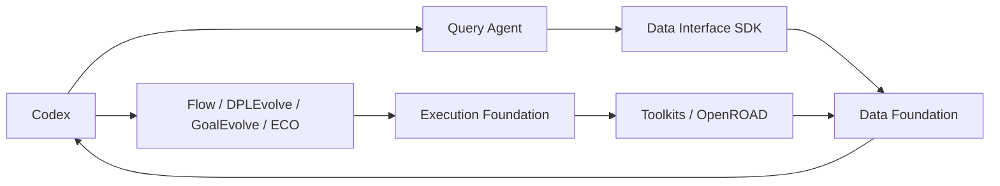

# ChipEvolve：Codex 驱动的 OpenROAD 垂直能力平台

ChipEvolve 为成熟 Agent（当前以 Codex 为入口）提供芯片物理设计的专业能力：可复现的实验执行、统一的设计事实与产物，以及基于证据的查询、理解和诊断。Codex 负责目标、规划和判断，平台负责运行实验、提供事实与专业优化能力。

当前优先在本机跑通实验和协同 PPA 优化。产品目标见 [PROJECT.md](PROJECT.md)，模块职责见 [ARCHITECTURE.md](ARCHITECTURE.md)，实际完成状态见 [TASKS.md](TASKS.md) 和 [admin/STATUS.md](admin/STATUS.md)。

2026-10-16 A19–A21：JPEG 来源复制取得第三设计前置资格，Query 取得原专业阶段/动作证据，GCD/AES 固定功耗方法及路由控制、完整证明/同值复测完成。结果和取舍见 [A19](admin/A19_THIRD_DESIGN_REPORT_20261016.md)、[A20](admin/A20_NATIVE_STAGE_EVIDENCE_REPORT_20261016.md)、[A21](admin/A21_FIXED_POWER_RELAY_REPORT_20261016.md)；三个物理阶段同时失联后恢复，稳定性根因仍待修。此前候选查证对照见 [A18](admin/A18_PREFLIGHT_REPORT_20261016.md)，[正式双核心实验协议](admin/FORMAL_EXPERIMENT_PROTOCOL_20261016.md)仍是待冻结草案。以下状态描述本机已验证能力，不代表新机器交付、全部稳定性或正式同预算团队优势已通过。

## 模块

各模块保持独立 Git 边界，由根仓库的 Git 子模块固定具体提交。跨项目依赖使用已安装 wheel 或 HTTP，不通过源码路径注入。

| 模块 | 目录 | 作用与当前状态 |
|---|---|---|
| Execution Foundation | `execution-foundation/` | 实验任务、资源、进程、工作空间、原始产物与溯源。 |
| Data Foundation | `data-foundation/` | 设计事实、快照、对象/关系、指标、来源与独立数据存储。 |
| Data Interface | `data-interface/` | 公开工具语义及 Python SDK；没有独立服务或数据库。 |
| Query Agent | `query-agent/` | 用统一事实、领域工具与调查技能增强 Codex；已实测查询/比较/来源、Goal阶段及真实动作归因，单动作贡献分摊与全面证据覆盖仍有边界。 |
| Toolkits | `toolkits/` | OpenROAD/ORFS 命令、原生输入、工具解析与数据导出。 |
| Flow Agent / A2-ORFO | `flow-agent/` | 参数优化；完整真实调参、统一执行/回流与中断恢复已有工程验收。 |
| DPLEvolve / ReviewDSE | `dplevolve/` | 同一个源码级布局优化项目；共同基础、统一 EF、新源码轮次及真实阶段交接已验证；局部 HPWL 与最终 PPA 分开判断。 |
| GoalEvolve | `goalevolve/` | 独立源码级时序/功耗优化；共同基础加原研究增量、统一 EF、GCD/AES 原生候选和物理交接已运行；原 U4 AES 历史轮次未正常收尾，不能改写为通过。 |
| TimingECOAgent | `timing-eco-agent/` | 第三方时序 ECO，保留来源；统一 EF 及本机 Codex 已接入，GCD 有效修复与 AES 无适用动作分别记录。 |

平台不重造通用 Agent harness 或独立评测底座。教程、新用户产品化及论文交付暂缓。版本发布和工程接力可运行不等于同预算协同 PPA 优势已完成。



上图为本机业务调用关系。专业保留原控制器和研究算法，平台通过统一执行与数据交付封装它们；全部内部原生调试数据自动进入 Query、跨设计资格和严格归因仍有边界，实际状态以 TASKS.md 为准。

## 取得源码与本机开发

```bash
git clone --single-branch --branch main --recurse-submodules --shallow-submodules https://github.com/CODA-Team/ChipEvolve.git
cd ChipEvolve
```

根仓库固定子模块 commit，`SOURCE_MANIFEST.json` 记录发布来源。六个自有模块的历史保存在本仓库 `modules/<目录名>` 分支；DPLEvolve、GoalEvolve 固定官方上游提交。上面的单分支/浅子模块获取方式避免把所有模块分支的完整历史重复下载；需要历史时在相应模块显式 fetch。各项目的 README、环境清单和许可证保留在模块内。

已有本机环境中继续使用项目自己的虚拟环境与 `dev.py`：

```bash
python3 dev.py query-agent python -m query_agent.interfaces.cli --help
python3 dev.py execution-foundation check
python3 dev.py data-foundation check
python3 dev.py data-interface check
python3 dev.py toolkits check
python3 dev.py flow-agent check
```

虚拟环境、安装 wheel、EDA 镜像、实验数据库、候选构建和运行产物属于本机配置/`var/`，不包含在本次源码发布中。此处不承诺新机器直接 clone 即可完成 EDA 实验；当前施工目标仍是本机完整运行。

共同工具链固定 10 月 ORFS 镜像，对应 ORFS `5105b0a77` / OpenROAD `27288f5c90`；两个 Code 保留研究增量及明确私有二进制，不跟随移动的 latest。来源见[审计报告](admin/COMMON_TOOLCHAIN_AUDIT_20261012.md)，后续实际资格与运行状态见 TASKS.md。

## 旧项目归档

原 ChipEvolve 项目的所有 466 个已跟踪文件完整移入 [`discarded/`](discarded/)，包括原 README、源码、测试、CI 配置与 LICENSE。它们是历史归档，不作为当前平台的模块、接口或验收依据。

归档前提交为 `5219cd94a92de649afd25367ebf4df5517acf69d`，保留历史 tag `archive/pre-platform-20261012`；`discarded/` 的 Git tree 与该提交原始根 tree 完全一致。发布结构及核查方法见 [admin/REPOSITORY_PUBLICATION_20261012.md](admin/REPOSITORY_PUBLICATION_20261012.md)。
