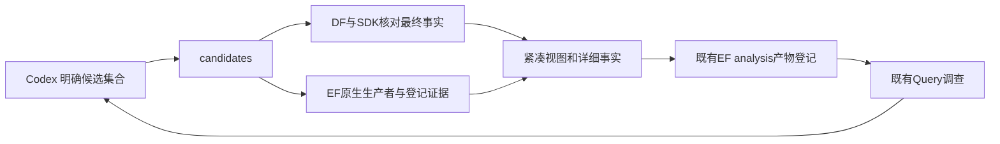

# A11/A12/A13：Flow 迁移资格、候选事实与真实恢复

状态：按老板批准的 `NEXT_OVERNIGHT_PLAN_20261015.md` 实施；**主目标 Flow 迁移资格未通过，独立的候选事实交付和交付恢复验证完成工程检查，待老板业务验收。** 没有将本轮写成整份夜间计划全部完成。

基线 `c78f674`，实施分支 `a11-flow-source-20261015`，运行证据在 `var/business/a11-flow-source-20261015/`。原实验及 26 份用户文件保留，EF/DF 服务、公共协议、专业算法与当前合法采用结果未改变。

## 从业务角度看结果

现在可以通过正式 `candidates` 入口，把指定设计的多个实验交给平台核对：它从 DF/SDK 验证最终指标和快照身份，从 EF 原生产者取得专业评分证据，将原生判定、最终 PPA 和硬约束并列。Query 先读紧凑事实及引用，Codex 继续决定采用或交接。该能力在 GCD、新物理控制、AES 四个 DPL 输出、Goal 及旧 Flow 六候选上实际验证。

Flow 还不能从现代 ORFS 内置综合起点开始一轮保持全部原旋钮含义的新搜索。原因已经用源码、实际命令和完整物理控制核实：原层次化旋钮在内置综合中不被消费，在原 Yosys 路线中却显著影响结果。这是专业能力兼容问题，不能用删除该旋钮或更换原生评分掩盖。

按已批准计划“无法等价实现时该项不通过，不能删除旋钮或静默忽略”的边界，停止依赖这项资格的新 Flow 搜索和新接力；继续完成独立的事实交付与恢复验证。没有反复打补丁、放宽约束或改动清单外的综合源码。

## 各切片状态

| 切片 | 实际结果 |
|---|---|
| N0 | 已保存基线、独立分支和 runtime；开始时 EF 无活跃/排队任务，26 文件校验一致 |
| S1 / A11.1 | 语义资格不通过：GCD 现代内置综合两组完整物理控制相同；原层次化旋钮未消费。尚未实施 `flow_recipe.py` 和正式 `source` 模式 |
| S2 / A11.2 | 完成 AES 同类控制及 Yosys 正对照，确认同一兼容缺口；不记作完整迁移资格通过 |
| S3 / A11.3 | 未启动新原生搜索；本轮展示的六个 Flow 候选是 A9 历史成果的重新查证 |
| S4 / A12.1 | 正式候选事实入口、原始引用、条件/约束核验、紧凑交付和两次真实 Query 核查完成；13 专项测试及 208 根回归通过 |
| S5 / A12.2 | 未启动：缺少通过本轮资格的新 Flow 输入，不以历史输入冒充新接力 |
| S6 / A13 | 真实终止业务驱动后，正式 resume 复用原 EDA 身份完成交付、DF/SDK 核查；零重复物理计算。无拟采用的新优化结果，未新增等价/独立优化重放或采用声明 |

## Flow 的兼容性证据

同一固定工具链：ORFS `5105b0a77`、OpenROAD `27288f5c90`、SIF SHA256 `8e6ee7aac233da078364649fa8111dac5de33a3589f5445dcffd96f9d6d8dd39`。实际物理运行、共同测量和事实导出均经 EF，结果经 DF/SDK 查询。

| 设计 / 综合路线 | SYNTH_HIERARCHICAL | 最终功耗 mW | cell μm² | setup 最差 slack ps |
|---|---:|---:|---:|---:|
| GCD / 内置综合 | 0 | 2.185011050 | 56.4829 | 22.7452 |
| GCD / 内置综合 | 1 | 2.185011050 | 56.4829 | 22.7452 |
| AES / 内置综合 | 0 | 35.107899457 | 1255.75 | 227.247 |
| AES / 内置综合 | 1 | 35.107899457 | 1255.75 | 227.247 |
| AES / Yosys 速度，A10 已有控制 | 默认 0 | 71.977406740 | 1510.27 | 211.617 |
| AES / Yosys 速度，本轮正对照 | 1 | 46.254694462 | 1477.44 | 352.667 |

内置综合的两组成对实验，七项共同 PPA 逐值相同，最终网表字节也分别相同。GCD 网表 SHA256 `ad72f09d7b3739c9e94fd9626d6022eed23fac73d84b80ca0c8a62186eea0a85`；AES 为 `2120d63c0a1c53f9187fa05a5d4d10291549186de4cb32854a93ef112d614447`。

原 Flow 的 `SYNTH_FLATTEN` 映射为反向 `SYNTH_HIERARCHICAL`。镜像中实际 `synth_syn.tcl` 未读取这两个变量，调用的 `synthesize` 公开参数只有命名相关选项；原 Yosys `synth.tcl` 则有明确层次分支。正对照日志真实出现 `Executing KEEP_HIERARCHY pass`，PPA 随之改变。正对照两组 ABC_AREA 有效值均为 0：旧组使用现代脚本默认值，新组显式声明 0，已由实际 variables.yaml 核对；实验 variant 和输出路径不同，均未进入 top/blackbox/combine 特例分支。

这些证据说明当前接点不能将该旋钮等价移到内置综合；不证明所有可能的底层实现都不可能做到。把 SYNTH_FLATTEN 映射成综合后端选择，也不能当作原旋钮的等价替换。Yosys 新正对照仍超过当前 ORFS 的功耗和面积上限，不采用，不作为新优化收益。

本轮新增五次完整物理控制（GCD 两次、AES 内置两次、AES Yosys 正对照一次）；另有一次独立 GCD 正式运行用于恢复验证，没有新的模型搜索。初次 AES 请求与 GCD 使用同名控制 key，被冻结输入检查在提交 EDA 前拒绝，随后以独立 key 执行；原失败日志保留。

权威证据：`compatibility-facts.json`、`compatibility-registration.json`，登记 analysis run `run-3fcd5802ffef42b69db349818e38c1bb`。镜像源码检查来自 EF run `run-1e1f0a9cc5214bd2ac2a082e6f7abb29`，实际命令帮助及 Yosys 日志均留存。

## 候选事实入口及数据流

新增命令：

```text
chip-evolve.py --config <local.json> candidates
  --reference <baseline-result.json>
  --result <candidate-result.json> [--result <candidate-result.json> ...]
  --key <new-facts-key>
```

内部接点保持审批签名：

```python
def build_candidate_facts(
    deployment: Deployment,
    reference_path: Path,
    result_paths: list[Path],
    experiment: Path,
) -> Path: ...
```



核对设计、目标、实际冻结 objective 和条件身份，最终七项 PPA 及 slew/cap/placement 约束指标均与 DF 比对。布局 DRC 来自已登记物理结果，原始结果 hash 保留；摘要中的 `final_feasible` 仅表示现有物理约束，不表示逻辑证明、独立重放或已采用。

原生 HPWL 只从明确生产者的登记 metrics.json 取得；原始单位未声明的 timing/power 值保持未知，不擅自标为 ns/W。Goal 保留原 parent/metrics。Flow 从实际物理 run 的 analysis 子运行读取原 `a2-evaluation.json`，保留 CP0、原库模式、原单位、寄生条件和引用；同一反馈的原始回执与导出副本合并展示，所有引用保留，不算两次独立测量。

超过 32 KiB 目标的全文提供候选目录、最终 PPA、违例与详细引用，完整条件/约束不删除。详细事实、SDK 核验和原生证据作为既有 analysis 产物登记；没有新增数据库、服务、综合分数、自动 winner 或 harness。

实测：

- AES 四个 DPL 输出及当前 Goal：紧凑视图 27,513 字节，analysis run `run-470e1f99d1e94341b6f84644c014bba7`。框架和 Student1/2/3 的原 HPWL 自动查回为 34071.3/33873.7/33785.0/34058.8 μm；最终面积分别超限 0.29/0.08/0.29/0.29 μm²。原框架历史选择与后来修正的 Student2 选择分别留存。
- A9 六个 Flow 完整候选：紧凑目录 12,921 字节，analysis run `run-6a7e7165f86a43039163398f22fb0245`，全文保留每个候选的真实原生 CP0 反馈。全部超过功耗及 cell/core/die 上限，不采用。
- 相同正式命令用于 GCD 两组物理控制，身份、事实和约束核验通过，不依赖设计名分支。

首版遗漏框架原生生产者时明确标为未知，保留其 r1；随后使用同一已保存交付检查点里的明确 producer 补齐并登记 r2，没有重新运行 DPL。两版原始事实及登记回执均保存。

## Query 实际核查

两次均使用已有 Query/Codex 后端和 524,288 字节读取预算，不扩张预算。

| 调查 | 结果 | 实际读取 / 步数 | 主要核查 |
|---|---|---|---|
| DPL / Goal | 11 事实、0 新假设，36 次工具调用 | 504,453 字节 / 11 步 | 原生 Student2 胜出、Student1 最终三指标更好但仍超面积、保留合法 Goal；历史与修正分开 |
| A9 Flow | 11 事实、0 新假设，20 次工具调用 | 206,556 字节 / 7 步 | TT/固定 CP0 与最终 FF/810ps 分开；六候选四项超限；源 ps 与已转换 ns 不重复换算 |

DPL 调查 `inv-de6dc0f1b18947f29c31f9298fb9006b`，专业上下文 ID `86809e81268ee9ea28e15b7530805ee1d7a39fd93404f040c4c780d6c9ad37f9`。Flow 调查 `inv-8b823af6fd0c40e0a19933f3e5a38ccb`，上下文 ID `75f936410e54fec184c7d967fd4b6a3cac8773a8161aade5d1ff6e5561f0f4cc`。

原始回答与证据分别位于 `query-aes/` 和 `query-flow/`；它们是独立的查询视图，使用实际历史 run_id，未伪造新 EDA 或修改 A9 的 Query 目录。该结果证明事实交付可被现有 Query 消费，不作为公平 token/时间收益测试。DPL 调查接近读取预算上限，不能宣称所有问题都已有充分预算余量。

## 真实交付中断恢复

从正式 CLI 新启动 GCD ORFS。在原始物理及共同测量完成、EF 已登记首个导出后，对本轮业务驱动发送 SIGTERM，真实返回 -15；没有取消 EF 工具任务或其他实验。随后执行：

```text
chip-evolve.py --config <本轮 runtime/local.json> resume
  --design gcd --key a13-gcd-delivery-interruption
```

恢复前后 ORFS `run-35c28a17fa4d4a9f91adb878b43a5601`、共同测量 `run-666feaedf9214a938a6c4664015c37b6` 完全相同；公共目录核对本实验共五个 EF run，两个为原物理/测量，三个为导出。新增物理计算 0，三类快照经 SDK 查询与原始指标一致。

权威回执 `a13-injection.json`、`a13-recovery-acceptance.json`，原业务日志及恢复日志保留。这验证已完成计算的确定性交付恢复，不扩大为原生模型搜索恢复。

## 改动、工程门禁与剩余决策

实现文件仅四份：

| 文件 | 职责 |
|---|---|
| `chip_evolve/candidate_facts.py` | SDK 核验、明确 producer 原生证据、紧凑/全文交付与既有 EF analysis 登记 |
| `chip_evolve/cli.py` | `candidates` 入口、显式候选列表及成功/失败状态 |
| `chip_evolve/diagnosis.py` | 向原 Query 优先提供紧凑事实引用，不改变调查循环 |
| `admin/test_candidate_facts.py` | 13 项条件、约束、原生来源/单位、反馈去重、目录引用和 CLI 状态测试 |

文档为本报告、批准计划状态、`ARCHITECTURE.md`、`TASKS.md`、`chip_evolve/README.md`。没有修改专业源码、EF/DF/DI/Toolkit、任何活跃运行副本或来源 manifest。

门禁：Ruff lint/format、三个实现文件 Pyright、13 专项测试、逐文件差异/架构边界检查、208 根回归通过；回归沿用根 `admin` 范围，排除已有用户开发中的 `admin/evaluation` 和历史 `admin/legacy-integration`。26 用户文件 hash 一致。运行数据不提交 Git。

下一项需要明确选择专业能力边界：

1. 保留原完整 Flow/Yosys 作为原生研究模式，从其明确的现代 Yosys 来源继续迁移；其起点 PPA 与默认内置综合不同，不能混称同一起点。
2. 单列现代内置综合的能力配置，明确声明层次旋钮尚不可用，再验证其余全部旋钮和真实默认起点；这是经过明确同意的能力配置变化，不能冒充原专业等价迁移。
3. 扩大到内置综合的专业实现以保留层次化能力，需要清单外源码和独立工程预算。

建议先冻结上述选择，再继续 Flow 实际 recipe 准备、原生完整搜索及新接力。当前结果没有新增可采用 PPA 改善；原 GCD/AES 合法 incumbent 保留，不宣称本夜完整协同已完成。
