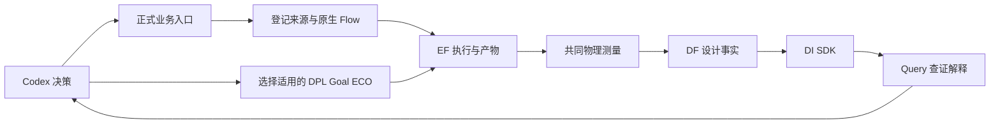
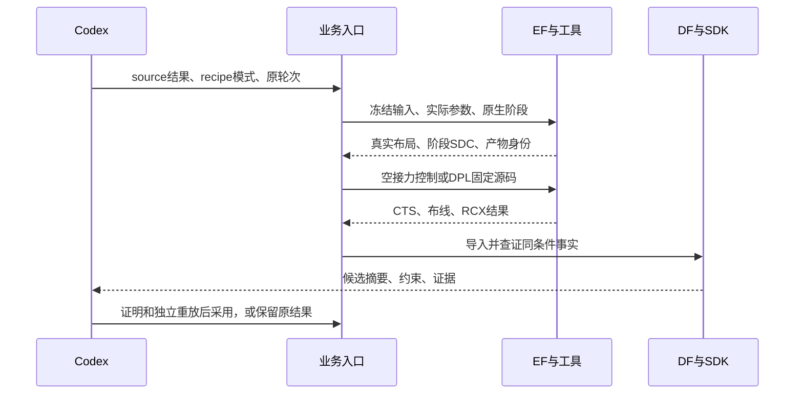

# A11–A13 夜间施工最终交付（2026-10-16）

本轮工程收尾完成，待老板业务验收。承接已批准的 `NEXT_OVERNIGHT_PLAN_20261015.md`，以及老板补充批准的“保留原完整能力，迁移现代 ORFS/Yosys 来源并跑完整搜索”。历史部分报告不再代表当前状态。

## 老板现在得到了什么

| 业务需求 | 本轮交付 | 实际效果与边界 |
|---|---|---|
| Flow 从指定设计的真实起点开始 | 显式 `--flow-recipe source`，冻结现代 ORFS/Yosys、实际输入、原参数及物理脚本 | GCD、AES 均通过来源复制和实际原生首行的七项 PPA 同值核查；没有为 GCD 写设计名分支 |
| 保留专业调参能力 | 保留层次化、阶段屏障、继承、GWTW、原搜索与 TT/CP0 评分；补现代报告兼容 | 两个设计各完成两轮、每轮三个候选，各 17 次成功模型请求；不是 smoke 或缩减算法演示 |
| 专业之间的效果能留下来 | 真实布局与其阶段 SDC、recipe 一起交接；固定 DPL 安装进入已有容器挂载目录 | 新 Flow 输入的空操作接力七项同值；GCD 接入既有优化源码有额外收益，非新一轮源码演化 |
| 能按设计核查候选和原因 | 正式 `candidates` 逐项登记紧凑事实、全文及原引用；Query 通过已有 SDK/EF 范围读回 | 能区分原生判断、最终 PPA、硬约束和未知项；Codex 据此保留或采用结果 |
| 完成计算后可恢复交付 | 复用已有 `resume`，保留实际 producer/run_id | GCD 真实中断零重复物理计算；AES 导入超时后保持六份原生任务、五份已完成共同测量及 17 次模型调用，只补剩余一份测量 |

现代默认内置综合不消费原层次旋钮，**完整 Flow 能力仍未通过**。本轮通过的是明确登记的现代 Yosys 来源，不代表已修好内置综合，也没有把不支持的参数从专业能力中删除。

## GCD：接力有额外收益，大幅差异主要来自来源变化

最终共同条件为固定 FF 库、原始 310 ps 业务约束，完整布线、RCX 后测量。正 setup 余量表示闭合，越大余量越多。功耗为当前固定测量条件下的估计。

| 结果 | 功耗 mW | 单元面积 µm² | core µm² | die µm² | setup 余量 ps |
|---|---:|---:|---:|---:|---:|
| 原 ORFS 基准 | 2.185011050 | 56.4829 | 58.7866 | 78.4819 | 22.7452 |
| 显式 Yosys 来源／新 Flow 合法首行 | 0.892263372 | 44.8918 | 57.9701 | 75.8293 | 11.6169 |
| 同输入 DPL 原框架 | 0.888895767 | 44.6148 | 57.9701 | 75.8293 | 13.9824 |
| 同输入 DPL 既有优化源码 | **0.886010006** | **44.5273** | **57.9701** | **75.8293** | **15.1532** |

- 来源切换及显式配置带来功耗约 −59.164%；这不是 Flow 搜索的调参收益，也不能全部归于某一个综合开关。
- 固定 DPL 方法相对 Flow 输入：功耗 **−0.700843%**，单元面积 **−0.811952%**，setup 余量增加 **3.5363 ps**。
- 固定优化源码相对同输入 DPL 原框架：功耗 **−0.324646%**，单元面积 **−0.196123%**，余量增加 **1.1708 ps**。这部分才能用来观察固定源码方法的增量。
- 最终相对原 ORFS 功耗 −59.450548%、单元面积 −21.166760%；setup 余量比原基准小，仍满足原硬约束，core/die 未增加。
- 六个 Flow 候选只有首行满足全部原约束；其余越过 core/die 上限，部分还有功耗或 setup 问题。不能因某个候选功耗最低就采用。

新结果已通过 **18/18 顶层输出的逻辑等价证明、0 未证明输出**；空目录独立 CTS/DRT/RCX 后七项 PPA 逐值相同，DF/SDK 身份及原约束通过，已登记在本轮 GCD 索引。

历史 A7 结果仍保留：其功耗 1.1775332 mW、单元面积 40.27 µm²。新分支功耗更低约 24.757%，面积较 A7 增加约 10.572%，属于原约束内的另一项取舍，不能宣称所有指标都优于历史结果。

证据（相对于本轮运行根 `var/business/a11-flow-source-20261015/`）：

- `runtime/experiments/gcd/gcd-yosys-native-2x3-r3/source-acceptance.json`
- `runtime/experiments/gcd/gcd-yosys-native-2x3-r3/s5-control-acceptance.json`：实际新输入产物一致，不冒用早期来源的控制实验。
- `runtime/experiments/gcd/s5-flow-dpl-framework-control/result.json`
- `runtime/experiments/gcd/s5-flow-dpl-fixed-replay-r2/result.json`：`run-139c4d40f3c84a66ae60095bdd76241a`。
- `runtime/experiments/gcd/s6-gcd-flow-dpl-yosys-validation/validation.json`：证明 `run-8c9c668fad1042e4befcf0338e56a5a2`，重放 `run-e7bf5ce2455d471c99aed898cf956502`。
- `gcd-ppa-contributions.json`、`gcd-adoption.json`。

## AES：通用流程跑通，但本轮没有可采用的新结果

同一套准备器、完整搜索和交付入口在 AES 上完成；共同条件为原 FF/810 ps。来源切换已经改变物理起点，不能把此后的整个差异都写成调参效果。

| 来源／候选 | 功耗 mW | 单元面积 µm² | core µm² | setup 余量 ps | 原业务约束 |
|---|---:|---:|---:|---:|---|
| 原 ORFS | 35.107899457 | 1255.75 | 1941.63 | 227.247 | 基准 |
| 显式 Yosys 来源／1-1 | 71.589611471 | 1498.69 | 2217.27 | 199.868 | 功耗及 cell/core/die 超限 |
| 1-2 | 45.653350651 | 1466.02 | 2020.93 | 349.330 | 同上 |
| 1-3 | 73.612660170 | 1495.16 | 2161.69 | 184.605 | 同上 |
| 2-1 | 45.618109405 | 1466.95 | 2020.93 | 353.204 | 同上 |
| 2-2 | 45.410703868 | 1467.01 | 2087.02 | 349.217 | 同上 |
| 2-3 | 47.104790807 | 1494.86 | 5727.61 | 328.715 | 同上 |
| 保留的 A9 Goal | **34.931797534** | **1254.13** | **1941.63** | **191.954** | **通过** |

搜索相对其自身 71.59 mW 起点确有改善，但没有达到原 ORFS 35.11 mW 和面积上限。六候选均不采用，也不强行接上后续专业来凑完整团队成绩。继续保留已验证的 A9 Goal `run-b6fccbd5cf944ca185f6f94374a3d913`；这份历史结果不是本轮新成果。本轮只另存保留决策，不改写其历史采用记录。

证据：

- `runtime/experiments/aes/aes-yosys-native-2x3-r3/source-acceptance.json`、`final-business-audit.json`。
- 同目录 `before-delivery-recovery.json`、`recovery-acceptance.json`：六个原生 ID、五个既有共同测量 ID 保持，新增仅 `iteration-2-3-common` 的 `run-eacad88f6af74d94b03b54a7ecf4e635`。
- `aes-retention-decision.json`；历史结果为 `var/business/a8-a9-workflow-20261015/runtime/experiments/aes/a9-goal/result.json`。

## 统一执行与数据有没有发挥作用

本轮的工具探针、来源准备命令、原生 EDA、DPL 重放、共同复测和证明均由 EF 执行并留任务、输入和产物身份。根业务入口只组合已批准的公共接点；设计事实通过 DF/SDK 查回，最终 12 个 Flow 候选的三类快照身份及七项指标已逐项核对。

EF 管实验进程、资源、任务、日志及原始产物；DF 管设计目录、快照、结构化事实和来源；DI 是 SDK；Query 给有引用的解释；Codex 做业务取舍。大文件继续使用本机已有材料化方式，HTTP 承担控制与身份查询。没有新建服务、模型循环、评分底座或改动公共契约。

`candidate_facts.py` 的修复解决了实际可发现性缺口：原来 capture 归档内有摘要，Query 却找不到单独登记的原文件；现在使用现有 `extra_paths` 逐项登记。GCD 和 AES 的正式紧凑视图均可从固定 scope 查回。

GCD 最后一次候选 Query 使用 4 步、16 次工具、301674 字节读取、168.68 秒；AES 使用 6 步、29 次工具、416637 字节、233.16 秒，均在原 512 KiB 读取预算内。这是实际成本，**没有公平 token 或速度收益结论**。两设计 Flow 模型账本分别记录 525381、596052 tokens，不含所有其他阶段成本，不能称整平台总成本。

AES Query 正确发现六候选超限，末尾曾把 ORFS reference 的运行编号误称为 Goal incumbent。该错误原文保留，未用于采用；Codex 以 SDK 身份和独立保留决策为准。一次限定范围的 Query 复核已用两份实际快照及原始指标纠正：`run-d9871b41ba024b399c798f44b7dc108d` 是 ORFS reference，`run-b6fccbd5cf944ca185f6f94374a3d913` 才是 A9 Goal。复核与原错误分别保存在 `aes-identity-correction-receipt.json`、`aes-candidate-query-audit.json`。可见有引用回答仍需核对引用是否支持结论，不能把模型输出本身当作事实。

DF 大快照导入仍曾超时、SDK 连接曾中断；既有确定性交付恢复完成了本轮工作，但根因没有在本片修复，不能宣称单机所有可靠性问题都已消失。最终 EF 核查本轮无仍在运行的实验，服务未重启。

## 架构、接口与关键决策





| 现有／新增接口 | 数据与职责 |
|---|---|
| `run --capability flow --flow-recipe source --source R --rounds 2 --candidates 3` | 仅显式新模式使用登记来源；默认 legacy 保持 |
| `prepare_flow_recipe(deployment, source_result, experiment) -> Path` | 准备固定物理树及 `recipe.json`，从 EF 展开真实 Make 参数 |
| `inherit_prepared_source(frame, experiment) -> Path` | 校验来源内容，重定位生成配置；不重置阶段物理条件 |
| `resume_layout(jobs, placement, frame, objective, producer) -> dict` | source 模式保留真实 `3_place.sdc`，共同测量仍用原业务 SDC |
| `materialize_dpl_replay(installation, state, experiment) -> Path` | 把既有验证安装复制到已挂载目录，记录二进制和原构建回执 hash |
| `candidates --reference R --result C... --key K` | DF/SDK 最终事实加明确原专业证据，登记紧凑摘要和全文，不决定 winner |
| `diagnose / resume / validate / select` | 复用既有命令和公共 EF/DF/SDK；未新增 HTTP 路由或公共数据契约 |

关键决策：

1. **显式登记 ps 来源**：现代 Yosys 从 SDC 直接取数字，ns 的 `-D 0.31` 与 ps 的 `-D 310` 会改变综合起点。拒绝静默单位转换；r2 只通过物理复制，正式 r3 同时核对实际原生首行。最终业务库角、SDC hash、上限保持。
2. **阶段 SDC 与测量 SDC 各司其职**：布局接力要保留调参实际物理条件；最终验收仍使用原业务约束。这避免下游把调参结果重置，也不放宽验收。
3. **复用现有专业安装**：同一 DPL 二进制只是进入容器可见目录，保留原构建回执；不因宿主路径不可见就重写或重编专业算法。
4. **事实与采用分开**：原生 TT/CP0、最终 FF、硬约束和 Codex 选择分别留证；不以最终结果反写原晋升，也不通过放宽上限换“成功”。

## 工程检查、改动清单和恢复入口

修改逻辑的 Ruff 静态检查、格式检查、Pyright 通过；根回归 **226 项**，实际生产 Flow 环境回归 **73 项**。原 CP0 兼容 7 项覆盖旧文本和现代 fmax、原单位及无效输入。新线长兼容保留旧键优先，仅为同含义的现代 `dpl` 作用域增加别名；12 份真实归档的三阶段线长重提取通过。

本轮完整搜索发生在线长别名补齐之前，中间线长曾缺失；本轮实际主评分是 TNS_EVAL，评分规则没有改。历史模型可见信息和搜索结果保持，不把事后重提取宣称成一次采用新提取器完成的搜索。后续新实验才会使用最终提交的全部修复。

曾用 EQY 匹配不同综合器自动命名的内部网络，导致首次证明失败；证据保留。改用项目已有的完整顶层输出 Yosys 后端，18 输出归纳证明通过，没有放宽证明规则。DF 连接异常后的验证恢复也保留。

| 文件 | 本轮职责 |
|---|---|
| `chip_evolve/flow_recipe.py` | 实际来源、参数、业务测量 SDC、继承路径及内容身份 |
| `chip_evolve/professional.py` | source 接力保留阶段 SDC/recipe；固定 DPL 安装材料化 |
| `chip_evolve/cli.py` | 本轮早期提交的显式 source 模式 |
| `chip_evolve/candidate_facts.py` | 本轮早期候选事实能力及收尾的逐文件登记 |
| `chip_evolve/diagnosis.py` | 本轮早期的紧凑事实优先交付，沿用原 Query |
| `admin/test_flow_recipe.py`、`admin/test_replay_environment.py`、`admin/test_candidate_facts.py` | 来源、真实阶段约束、路径、二进制身份和可发现性回归 |
| Flow `flow/run_sequential.sh` | 本轮早期的真实 Make 参数初始化 |
| Flow `flow/extract_metrics.py`、`flow/eval_tns.sh` | CP0 现代报告兼容、同含义线长键兼容 |
| Flow `flow/test/test_source_parameters.py`、`test_reference_ecp.py`、`test_wirelength_keys.py` | 对应行为验证 |
| `SOURCE_MANIFEST.json`、Flow gitlink | 固定已推送模块提交 |
| `ARCHITECTURE.md`、`TASKS.md`、`chip_evolve/README.md`、本轮报告 | 最新状态、接口、证据及已知限制 |

逐片差异审查及模块边界通过：未改公共 EF/DF/DI、未跨项目导入源码、未部署用户脏源码、未编辑运行副本；26 份原用户文件 hash 全部保持。独立环境执行测试，Flow 从其 `flow/` 目录运行；旧开发环境的测试导入问题没有扩大成工具链重构。

本轮代码提交：A12 `e5f1d57`；A11 `375dfc3`；Flow 模块 `77e2550`（已推至 `modules/flow-agent`）。文档收尾提交见根分支 Git 历史。运行产物留本机 `var`，没有推送凭据、环境或大数据。

正式命令示例（仓库根执行，`P` 是本轮已安装 client Python，`C` 是本轮部署文件的绝对路径）：

```bash
$P chip-evolve.py --config "$C" status --design aes
$P chip-evolve.py --config "$C" resume --design aes --key aes-yosys-native-2x3-r3
$P chip-evolve.py --config "$C" show --result /absolute/path/result.json
$P chip-evolve.py --config "$C" compare --result /absolute/path/candidate/result.json --against /absolute/path/reference/result.json
```

已成功恢复的实验无需再运行以证明恢复。完整 EDA/模型证据、初始失败、SDK 查回、Query 原文、保护核查及测试日志都在本轮运行根；`source-acceptance.json` 是完成后的旁侧验收，冻结的输入 recipe 不改写。

## 下一片应解决什么

优先解决 **AES 完整能力来源的业务起点不占优、原专业代理改善未转化为原约束内收益**：保持专业算法不变，另行批准一份有界来源／配置对照，确定完整 Yosys 能力能否获得更合理的 AES 起点，再决定是否值得扩大搜索预算。不能仅加轮次掩盖当前六候选全超限的事实。

另列独立切片：DF 大导入超时及连接恢复根因、Query 结果身份与引用一致性检查、路径比较语义元数据。两个 Code 的全新源码演化需独立足量预算。本轮没有新增 Goal 任意源码重放契约，没有重新跑两个 Code 的全部演化，也不包含 Tutorial、公开发布或公平 token/时间 benchmark。

本轮按批准范围完成工程收尾，后续新施工等待业务验收与新切片确认。
