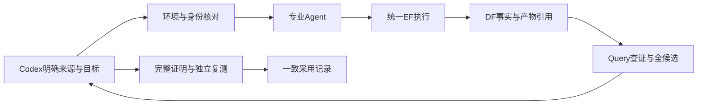
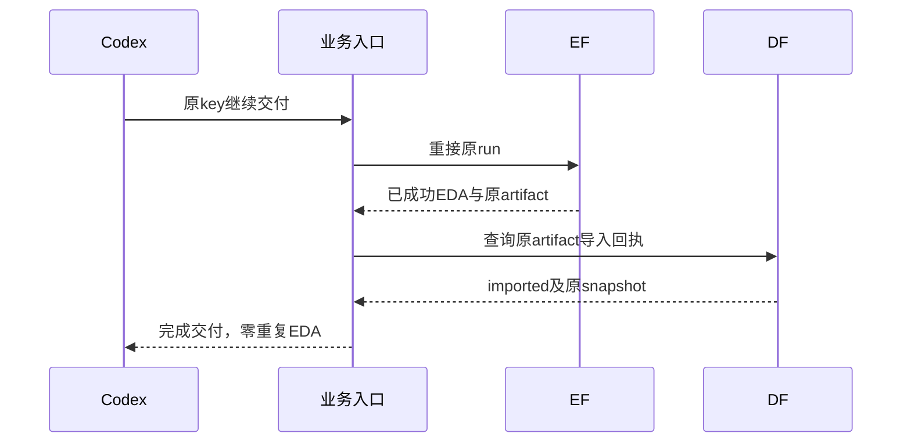

# A14–A17 工程交付报告

2026-10-16。老板批准的四个切片已完成实现与本轮工程验证，待老板业务验收。A18未启动。根基线`e81d082`，分支`a14-a17-preformal-fixes-20261016`。

## 老板现在得到什么

| 交付 | 业务效果 | 实测情况 |
|---|---|---|
| A14 采用一致性 | 只有与结果匹配的完整验证回执才能正式采用；并发晚到的差结果不能覆盖同范围好结果 | 并发/身份测试、真实GCD验证与SDK查证通过；历史采用记录不改写 |
| A15 候选与接力 | 全部候选交给Codex判断，TNS同分不再把第一项当winner；下游知道实际来源和有意进行的阶段转换 | AES六候选全量事实交付；Flow→DPL、DPL→Goal、Goal→ECO三条已有真实接点复核通过 |
| A16 环境资格 | 运行前核对实际工具、脚本、库、SDC和专业增量，防止版本字符串相同而语义不同 | GCD/AES冻结并通过；新设计picorv32完成物理和数据流程，但复制PPA不同，资格拒绝 |
| A17 稳定交付 | Codex能分清排队、无人消费、执行、交付等待与失败；超时后沿用原任务和原产物恢复 | 隔离EF真实恢复；大快照导入响应丢失后自动查回；重复EDA=0，导入次数=1，8路64次查询完成 |

这轮改善的是正式实验的可信度和平台封装。没有重新启动专业优化搜索，不能新增PPA改善、协同优于单项或token节约结论。原专业算法、原TT/CP0评分、原目标和晋升规则保留；Codex仍负责判断和选源。

## 已通过与未通过的环境

使用共同镜像`orfs-8e6ee7aac233da07.sif`，ORFS`5105b0a77`、OpenROAD`27288f5c90`。镜像及真实二进制hash、EF工具能力探针、原专业控制代码/构建回执和私有增量均记录在环境清单。不能用stock OpenROAD替掉Code的研究增量。

本轮部署`var/business/a14-a17-20261016/runtime/local.json`按设计自动绑定：

- `runtime/experiments/gcd/a16-environment-release/environment.json`
- `runtime/experiments/aes/a16-environment-release/environment.json`

路径均相对于`var/business/a14-a17-20261016/`。Flow新请求默认source，旧路径明确使用legacy；绑定正式source环境时不允许legacy冒用资格。后续Code/ECO允许同设计、同目标和条件下的新物理分支，不要求退回最早来源。

picorv32的ASAP7/单物理时钟声明、真实ORFS来源、完整place→CTS→route→RCX、三类快照和SDK查询均已运行。复制控制与来源七项PPA不全相同：

| 指标 | 原来源 | 复制控制 |
|---|---:|---:|
| 功耗 W | 0.062410965562 | 0.053478013724 |
| 单元面积 µm² | 2490.31 | 2493.54 |
| core面积 µm² | 3608.99 | 3573.40 |
| die面积 µm² | 4133.72 | 4093.70 |
| setup TNS ns | -46.8921 | -35.9290 |
| setup最差余量 ns | -0.179504 | -0.194150 |

该设计启用的重定时综合日志已出现不同的ABC结果序列；尚未用独立控制确定差异的精确根因。不能据此宣称平台带来14.3%功耗收益，也不能认为该设计已闭合时序。资格入口按实际差值拒绝，未生成可用环境清单，未采用。没有按设计名写补丁或删除重定时算法来凑同值。

证据：`a16-acceptance.json`、`a16-third-design-acceptance.json`、`runtime/experiments/picorv32/a16-source-qualification/comparison.json`及两份综合日志。picorv32第一次交付的60秒超时保留，随后的收尾重接原物理任务；数据超时不被用来解释实际PPA差异。

## A17的故障与修复

统一任务客户端保留原task、staged输入hash和submission；已有submission不重新提交，首次提交响应未知时保留原幂等key。新增生命周期文件解释`no_worker`、`awaiting_consumption`、`unsatisfiable_resources`、`resource_wait`、`worker_busy`与`running`。健康运行没有新增客户端死限额，不按日志静默杀任务；EF保留进程、租约、取消及原超时的所有权。

DF导入先查`GET /imports/<artifact_id>`；每次调用至多发一次`POST /snapshots/from-run`，响应未知后有限查同一回执并核对snapshot的design/subject身份，不在对账循环重发POST。明确恢复仍沿用同artifact的幂等接口。真实HTTP 4xx或失败回执仍保留为失败。无法确认时返回pending，不擅自重新执行EDA。

真实17,044,367字节压缩快照导入到约987MiB的独立数据库，客户端1秒等待故意早于导入完成，代理随后丢弃POST响应。最终修复版本约44.1秒查回成功，只有一次POST、回执attempts=1、没有新增EDA；重复请求仍指向原快照。导入完成后8路64次对象查询全部成功，本次最长约34.6毫秒。这是本机单次故障验证，不是吞吐SLA或公平性能对照。

隔离测试还复现了DF读连接的5秒锁等待错误：长导入期间回执请求断连。第一次只调整已建连接的等待预算不足，仍在首次创建新reader的初始化PRAGMA处复现。因此最终只修改`connections.py`：服务启动时初始化原有大小的只读池，再使其锁等待与既有写入一致。没有改数据库结构、引入新存储、增大池容量或修改用户的查询优化文件。真实锁测试覆盖已有reader和另一条尚未借用的reader；最终大导入日志不再出现`database is locked`。故障注入导致的预期BrokenPipe仍如实保留，不把所有服务日志宣称为零异常。

所有DF构建与测试使用干净检出的wheel，未从用户dirty DF/DI构建；26份原文件逐字节保护。生产EF `41151`、DF `53305`均未重启、替换或部署补丁。DF源码修复已发布到模块分支并在根版本清单固定；生产切换需要在后续维护窗口核查当前消费者。本轮新起的隔离服务均已关闭。

## 接口与数据流

| 入口/函数 | 语义 |
|---|---|
| `select(..., *, validation: Path)`；CLI `select --validation V` | 验证匹配后，在短采用锁内重读并原子记录Codex的决定 |
| `deliver_candidates(experiment, paths)` | `candidate-delivery.v1`包含全部候选引用/hash/事实，不隐式选源 |
| `freeze_environment(d, source, qualification, experiment)` / `check_environment(d, path, design, capability, source, flow_recipe)` | 冻结真实资格，启动前校验；变化需要新的资格，不能改旧清单 |
| `Jobs.submit(key, inputs, staged, ...)` | 公共EF幂等任务，保存原run，有限解释无法消费，健康计算不误杀 |
| `import_snapshot(jobs, producer, artifact, snapshot, subject)` | 通过既有DF回执对账，不调用EDA |
| `resume --design D --key K` | 恢复原确定性交付；不重启未完成的专业模型搜索 |
| `watch --design D --run-id R` | 当前EF运行、worker、资源和等待原因的只读视图 |

CLI退出0表示命令完成，验证完成但不通过返回2；返回3表示可恢复pending，与真实失败分开。pending JSON包含phase、reason、run/artifact及receipt路径。正常排队/健康运行没有额外的小时间限制；可选部署`lifecycle`参数见`chip_evolve/README.md`。

## 工程门禁与证据

| 检查 | 结果/记录（本轮证据根下） |
|---|---|
| 静态 | 根Ruff lint/format、Pyright通过；DF修改的连接池类型检查、F检查与新增测试lint/format通过 |
| 根回归 | 266通过，`a17-root-release.log` |
| EF相关回归 | 127通过，`a17-ef-regression.log`；已有lease/worker/取消/资源回归未重写 |
| DF干净wheel完整回归 | 376通过，`a17-df-regression-release.log` |
| 原生接点 | `a15-real-handoffs.json`；AES六候选SDK事实和原真实消费引用，未新跑优化搜索 |
| 真实生命周期 | `a17-real-acceptance.json`；`a17-isolated-r3/execution-acceptance.json`；`a17-df-fixed-r2/data-acceptance.json` |
| 差异/边界 | 只提交本轮文件；原始EF/DF接口、专业算法、用户dirty文件和历史回执保持边界 |

根测试：`var/business/a4-a5-20261014/runtime/envs/query/bin/python -m pytest admin --ignore=admin/evaluation --ignore=admin/legacy-integration -q`。DF测试在干净检出，以独立`df-check-env`消费已构建wheel；构建、安装、版本与服务日志均在证据根。真实故障驱动保存在`a17-real-check.py`和`a17-df-release-check.py`，仅测试用，不是新增产品harness。

## 后续边界

1. 这轮不进入A18，也没有进行公平总预算的团队/单项对照、原生Codex/平台token对照。
2. 正式预实验当前只能使用已核对的GCD/AES配置。picorv32须先定位重定时综合起点差异并重新取得资格；跨PDK/多物理时钟仍需另行资格。
3. DF服务的生产切换未做；本轮验证的是新wheel，不冒充现有后台进程已更新。客户端修复从当前根入口生效。
4. 未完成专业模型搜索的原生恢复、严格因果证明、全路径覆盖均不因这轮工程修复而自动交付。
5. 下一轮可用已验证设计做受控预实验，先核查完整接力的收益保留与平台操作简化，再冻结正式长轮次；不预先承诺联合PPA优势。

三句话维护说明：采用与来源行为分别在selection/candidates/handoff/diagnosis中，环境资格在environment中，执行等待与交付恢复在jobs/lifecycle/delivery中。数据从原专业进入EF、经共同测量进入DF/SDK/Query，再交给Codex判断与有验证的采用记录。改算法回专业项目，改客户端等待预算回本机部署的lifecycle，改接口语义先按协作协议确认。

## 本轮完整改动清单

| 文件 | 改动职责 |
|---|---|
| `chip_evolve/config.py` | 原子JSON写入和短采用锁 |
| `chip_evolve/selection.py` | 匹配验证、范围隔离与锁内采用 |
| `chip_evolve/validation.py` | 只接受明确单候选验证 |
| `chip_evolve/candidates.py` | 全候选集合与内容身份 |
| `chip_evolve/candidate_facts.py` | 展开集合并SDK核对全部事实 |
| `chip_evolve/handoff.py` | 原输入与有意阶段转换契约 |
| `chip_evolve/diagnosis.py` | Query的source/reference/retained结构化绑定 |
| `chip_evolve/professional.py` | 全候选交付、明确来源及环境引用 |
| `chip_evolve/environment.py` | 真实环境冻结与资格核查 |
| `chip_evolve/jobs.py` | 原任务重接、可配置HTTP等待与生命周期委派 |
| `chip_evolve/lifecycle.py` | 可解释等待、有限重连及WorkPending |
| `chip_evolve/delivery.py` | 原artifact导入对账与确定性交付恢复 |
| `chip_evolve/physical.py` | 候选输出路径、辅助脚本输入及可靠导入 |
| `chip_evolve/cli.py` | 验证必填、集合、环境、watch与pending返回 |
| `chip_evolve/README.md` | 命令、状态和恢复边界 |
| `admin/freeze_formal_environment.py` | 冻结现有真实资格与EF能力探针的工具 |
| `admin/test_adoption_consistency.py` | 身份、并发采用与历史不可变回归 |
| `admin/test_candidate_delivery.py` | 同分候选集合及身份回归 |
| `admin/test_professional_handoff_contract.py` | 三类专业输入转换契约回归 |
| `admin/test_environment_qualification.py` | 镜像/源码/部署变化、设计及来源模式资格回归 |
| `admin/test_delivery_lifecycle.py` | 等待、重连、真实HTTP丢响应与pending回归 |
| `admin/test_local_business.py` | 新验证/候选契约对应的业务测试 |
| `admin/test_local_workflow.py` | 已提交任务不再次提交，输入变化仍拒绝 |
| `ARCHITECTURE.md` | 模块接口、依赖和数据流更新 |
| `TASKS.md` | 四片真实状态与未通过项 |
| `SOURCE_MANIFEST.json`、`data-foundation` gitlink | 固定已发布的DF干净修复提交 |
| `admin/PREFORMAL_FIX_AND_EXPERIMENT_PLAN_20261016.md` | 明确A14–A17批准范围及A18边界 |
| 本报告 | 业务效果、实测、故障、限制与文件职责 |
| DF `src/openroad_app_data_foundation/connections.py` | 原有池启动前初始化及一致锁等待 |
| DF `tests/test_import_reader_wait.py` | 实际SQLite写锁超过默认5秒的并发回归 |

没有提交`admin/evaluation/`及原DF/DI的26份用户文件。DF发布检查点`259d777`与干净构建工作树`0ab93c0`的源码tree相同；逐字节保护和wheel hash见`protected-files-final.json`。根A14/A15/A16检查点分别为`175785b`、`376bfdf`、`d63bd27`；A17随本报告提交。
