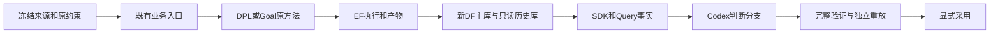

# A18：两设计有界预实验

老板在 A14–A17 后要求“推进下一项”，本片承接已审查计划中的 A18；基线 `81fef5c`，分支 `a18-preflight-20261016`。不启动正式统计实验或两个 Code 的新源码演化。原 26 份用户文件、旧服务和历史实验保留。

## 用户得到的结果与验收

1. 本轮新实验使用 A17 已验证的 DF 修复版本，EF 产物能经 DF/SDK 查回；旧事实通过显式只读 archive 访问。
2. GCD/AES 的同输入 DPL 控制、DPL 固定源码、Goal 固定方法、DPL→Goal 接力均留下最终物理结果和全部失败记录；能分辨专业局部收益、最终可行性和接力边际收益。
3. 拟保留结果必须完整逻辑证明、独立 CTS/DRT/RCX 重放和 SDK 核查，不把最后一棒默认当作最好结果。
4. 同一 Codex 做短候选查证对照，先核查答案与引用，再统计双方正确且用量完整的成本；错误答案、协议问题、准备成本单列。
5. 交付可继续运行的本机配置、预实验报告和正式双核心实验协议。正式长轮次以独立清单和批准为前置。

## 文件与影响面

| 文件 | 职责 |
|---|---|
| `admin/freeze_formal_campaign.py` | 冻结已完成来源、原目标、A16 环境及明确固定方法预算，不自动选优 |
| `admin/run_formal_preflight.py` | 调用既有业务 CLI；原 key 恢复，保留每次尝试及失败 |
| `admin/report_formal_campaign.py` | 全量列出终态、事实、匹配差值和所有尝试成本，不采用结果 |
| `admin/paired_preflight.py` | 启动原生 Codex 的只读成对查证任务；没有模型/工具循环 |
| `admin/test_formal_preflight.py`、`admin/test_paired_preflight.py` | 不可变来源、恢复不重复、失败与未知成本、正确性和证据边界测试 |
| `chip_evolve/professional.py` | 实测发现准备当前设计会被无关未资格设计阻断，只绑定当前 design；共享影响限于 Flow 准备和旧布局交付准备 |
| `admin/test_aes_migration.py`、`admin/test_flow_recipe.py` | 验证无关缺文件设计不干扰当前设计，以及显式来源/旧来源选择仍正确 |
| 本片报告、正式实验协议及根项目文档 | 区分本轮实测与正式实验草案，记录剩余问题 |

DF 使用 A17 已审查 wheel 的已安装环境，新起专属实例；本片不构建、不部署用户脏 DF/DI 源码，不改各专业算法、公共 EF/DF/SDK 契约或原运行副本。

## 数据流与运行顺序

按新 DF 启用与查证→来源可行性核查与冻结→两个设计固定方法对照→验证/保留→查证成对测试→门禁/报告执行；独立设计和只读查证可并行。发现不合法起点、目标冲突或检查器未证明时保留证据，不放宽约束。

## 已冻结的预实验预算

每设计四项：DPL 原 framework 控制 10,800 秒、固定优化源码 replay 10,800 秒、Goal 原 baseline/p0 replay 7,200 秒、相同 Goal 接 DPL 7,200 秒。各 1 次，不是新搜索或等预算团队评测。此前 Flow 六候选全部保留、读取但不重新搜索；ECO 仅在有适用违例时进入，不为凑流程强跑。

候选查证两设计×三次×两侧，每次相同 `gpt-6.1-sol`/medium、240 秒，成对交替先后顺序；原生 Codex 工具均可用。首轮若暴露协议歧义，原记录完整保留，修订协议下双方全量重跑，禁止只重试失败侧或修改 oracle。

工程验证使用实际 client 环境的 Pyright、Ruff、对应单测和根回归：`pytest admin --ignore=admin/evaluation --ignore=admin/legacy-integration -q`。最终核对 26 文件 hash、逐文件 diff 和跨模块安装边界，独立提交本片检查点。
