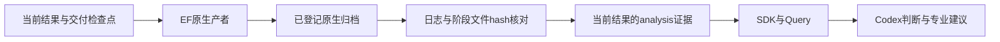

# A20：Query 取得原专业阶段证据

工程验证通过，老板业务验收独立。本片独立于仍在运行的 A19 第三设计资格和 A21 固定功耗源码实验；不将它们的未完成状态算作本片通过。

## 业务效果

现在 Query 可以沿“当前结果→真正的专业生产者→同一次评价日志→原生阶段测量”查证 Goal 的局部变化。原始记录原本已在 EF 的 `data_snapshot` 归档中，本片补足精确索引和固定 scope 交付，没有重新运行 EDA 或搭建新的数据服务/推理框架。

真实 GCD 查询区分了三类事实：

- `repair_design`、`repair_timing` 前后报告的指标相同，记录的网表 hash 也相同；这两步未产生可观察的网表或测量改善。
- 后续 placement/route 报告指标变化，但网表 hash 仍相同；不能把这种变化当作新的源码优化收益。
- 最终共同 DRT/RCX 测量与原生中间测量分开，DPL→Goal 的最终功耗增加约 0.238%，Query 建议保留 DPL，但没有声称已证明唯一物理原因。

Query 还通过现有 SDK 的对象差分查清了跨结果的实例数量变化：减少的是 filler/decap，匹配的 430 个实例 master 没有改变；不能仅按总实例数不同推断功能逻辑丢失。这说明同一 Codex 能利用新的阶段证据和已有对象事实做具体查证。

## 实现与数据流

| 文件 | 职责及影响 |
|---|---|
| `chip_evolve/stage_facts.py` | 从公开 EF 归档核对字节与 manifest；要求阶段 JSON 来自同一 cwd，且其输入日志 hash 等于所选 physical producer 的真实日志；输出原单位、阶段值、网表是否同值和原 Tcl 声明，不做原因推断 |
| `chip_evolve/diagnosis.py` | 按需准备阶段事实，将注册在当前 scope 的小型阶段视图优先交给 Query |
| `chip_evolve/candidate_facts.py` | 候选完整视图给出阶段事实引用，保留原生判定、最终 PPA 与原约束 |
| `admin/test_stage_facts.py` | 防止错尝试/错日志/错 hash 冒充阶段证据；区分“指标相同”“网表相同”和“缺少证据” |



数据不进入新的数据库，EF/DF/SDK 公共接口和九模块版本不变。新登记只调用确定性的 EF analysis 任务，不启动 EDA。结果、原生生产者、条件、目标、二进制/镜像/Tcl 指纹和原文件引用全部保留。后续读取复用同一已登记事实，不反复复制/登记。

本片新增阶段表覆盖 Goal 原生 checkpoint 协议；Flow/DPL 原有反馈和专业原始产物入口保留，未把其他专业的日志伪装成同一种阶段协议。声明在 Tcl 中的命令不是实际动作次数；相同指标也不单独证明未执行动作。

## 实测与验收

运行根 `var/business/a19-a21-purposeful-relay-20261016/`：

- 实际阶段事实 `runtime/experiments/gcd/stages-54e7ffb843bd-358577da/native-stages.json`；登记 analysis 为 `run-0a6156b6c3ee44679464a0a81fdac3a6`，原生产者 `run-abbc6e05b7a0415c8f12e8229f204950`，五个阶段，原三类 scope/七 PPA 查回通过。
- `a20-query.log` 给出真实调查 `inv-8546742858844eeb949aeb99f658b959` 及导出上下文路径；导出 11 条事实记录、去重后 6 条事实、19 个 evidence 项、0 假设。现有 Query 导出有重复事实记录，本片如实计数，不把重复算成独立新证据，也未跨模块顺手修改该行为。
- Query 引用实际阶段 artifact/哈希，区分原生 pW/ns 与最终 W/ns，source/reference 身份正确。调查启动时本轮尚未登记 incumbent，因此 authoritative retained 为 null；建议保留不冒充已经采用。随后实际采用记录由 A21 前置单独登记。
- Ruff/Pyright 通过；六项阶段专项及根 **292 项回归**通过（`a20-regression.log`）。后续 A21 的检查和测试独立计数。

业务验收可用本轮配置执行：

```bash
var/business/a7-quality-20261014/production-runtime/envs/client/bin/python chip-evolve.py \
  --config var/business/a19-a21-purposeful-relay-20261016/runtime/local.json diagnose \
  --result var/business/a18-preflight-20261016/runtime/experiments/gcd/a18r2-goal-relay/result.json \
  --against var/business/a18-preflight-20261016/runtime/experiments/gcd/a18r2-dpl-fixed/result.json \
  --question '引用 native-stages.json，区分各修复阶段、物理阶段及最终共同指标；说明有何证据、哪些原因仍未证明。' \
  --seconds 300 --steps 5
```

若要改阶段内容或证据核对，改 `stage_facts.py`；若要改 Query 如何发现/优先展开，改 `diagnosis.py`。因果消融由 A21 的独立实验提供，不能用本片的阶段相关性代替。
