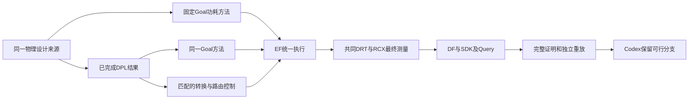

# A21：固定功耗方法与接力代价

本片工程收尾完成，老板业务验收独立。四组功耗方法、两组匹配控制、四个优化结果的完整验证和实际分支选择均已完成。它是既有专业源码及原配方的有界重放和匹配消融，不是新的 Teacher/Student 搜索，也不是等总预算团队优越性实验。实现检查点 `a998bfc` 已推送；本报告包含收尾暴露的失联故障及恢复，不能据此宣布单机稳定性问题已经全部解决。

## 四组真实最终结果

全部使用原设计目标、共同 FF/原 SDC、propagated clock 及完整 DRT/RCX；功耗为同一活动假设下工具估计。四组均交付三类设计事实，原最终硬约束通过。

| 设计/方法 | 功耗 mW | cell µm² | setup WS ps | 原约束 |
|---|---:|---:|---:|---|
| GCD 原保留 DPL | 0.886010006 | 44.5273 | 15.1532 | 通过 |
| GCD 固定 Goal 功耗方法单项 | **0.884755515** | 44.5419 | 1.6781 | 通过 |
| GCD DPL→相同 Goal 功耗方法 | 0.886934518 | **44.4398** | 15.5311 | 通过 |
| GCD 同输入转换/路由控制 | 0.888118520 | 44.5273 | 15.2534 | 通过 |
| AES 原保留 A9 Goal | **34.931797534** | 1254.13 | 191.954 | 通过 |
| AES 固定 Goal 功耗方法单项 | 34.993309528 | **1253.84** | 217.660 | 通过 |
| AES DPL→相同 Goal 功耗方法 | 34.947216511 | 1254.13 | 201.938 | 通过 |
| AES 同输入转换/路由控制 | 34.975331277 | 1256.04 | 203.537 | cell 超限 |

各组 setup/hold TNS 均为 0；GCD core/die 均为 57.9701/75.8293µm²，AES 为 1941.63/2321.51µm²。低功耗、低面积、较多时序余量对应不同分支，不把它们拼成不存在的一个结果。

GCD 接力相对原 DPL 功耗 **+0.104346%**、cell **−0.196509%**，setup 余量多 0.3779ps；相对本轮 Goal 单项功耗更高，不能写成“团队功耗优于最强单项”。新 Goal 单项相对原 DPL 功耗 **−0.141589%**，cell **+0.032789%**，setup 余量从 15.1532ps 降到 1.6781ps；收益很小且存在明确取舍。

AES 接力的功耗比本轮 Goal 单项低 **0.131720%**，但仍比原已验证 A9 Goal 高 **0.044140%**，cell 相同、setup 余量多 9.984ps。原 DPL 输入 cell 1256.04µm² 超过 1255.75µm² 上限，新功耗方法将它降至 1254.13µm²，完成了实际修复；不能把“修回可行”直接等同于“刷新最佳”。两组控制均真实交付，其中 AES 控制仍 cell 超限，不能写成六组全合法。

## GCD 验证与当前保留

两个新 GCD 分支均相对原 A4 ORFS 功能参考完成 **18/18 输出证明**、独立 DRT/RCX **七项 PPA 逐值一致**及 SDK 身份核对。沿用既有 Yosys 后端；不使用中间网表作为新 revision 来绕开已有采用范围。

Codex 已通过正式 `select --validation` 将本轮最低功耗的 Goal 单项登记为当前低功耗选择，明确记录上述面积/时序余量取舍。原 DPL、更低面积的新接力及其验证均保留；没有覆盖旧实验或宣称新分支全面支配旧分支。AES 当前继续保留原 A9 Goal。

AES 两个新结果各完成 **129/129 功能输出证明**；首次独立物理复测失联，随后复用完全相同候选/原 A9 ORFS 参考/Liberty 的已通过证明，仅重做失联物理阶段，最终均 **七 PPA 逐值一致、SDK 身份通过**。恢复验证在 `a21-aes-power-{single,relay}-validation-recovery/validation.json`；首次失败目录及对应 EF run 不改写。GCD 使用 canonical A4、AES 使用 canonical A9 参考，采用 scope 没有因中间参考而漂移。

`a21-final-facts.json` 通过 SDK 查回六组共 **18 个 scope** 及七项 PPA，四个优化结果均经 `checked_validation` 核对完整证明和同值重放；`a21-verified-choices.json`、`gcd-power-adoption.json` 保留实际选择和已验证备选。事实可查询、合法、完整验证、是否采用仍是四个不同状态。

## 匹配控制与 Query 解释

GCD 输入 DPL→只转换/placement/route，功耗增加 **2.10851431µW**；再比较同样输入/流程中的原 repair 调用，功耗减少 **1.18400203µW**、cell 减少 **0.0875µm²**。合起来仍比原 DPL 增加 **0.92451228µW**。专业动作有用，但没有完全抵消这次交接及物理重实现的功耗代价；这比笼统归咎于“Agent 不行”或“底座吞收益”更具体。

AES repair 方法相对匹配控制减少 **28.114766µW** 功耗、**1.91µm²** cell，修复了控制中保留的面积违例，同时 setup 余量减少 1.599ps。两个设计的本轮无 repair 控制与 A18 Goal p0 接力的七项最终 PPA 均逐值相同（`a21-routing-vs-a18-p0.json`）；原 p0 在这两个起点没有观测到新增最终收益，不能据此否定已有功耗源码的专业能力。

两个控制的原生输入各 46 项 hash、原/控制脚本及 binary 已核对，控制脚本恰好是删除指定 repair 行再重定位输出目录，未替换输入或算法。证据 `a21-control-identity-verification.json`，控制目录各自保留 `control-method.json`。这一外部核验与下述 Query 实际看到了什么分开报告。

真实 Query `inv-2fa1f502e5d243b9b00a5e351d111ba9`：

- 沿 `native-stages.json` 找到实际 repair 日志，再用 SDK 对象差分交叉核对：GCD 接力提交 **2 次 Vt 替换、1 次 buffer 移除**，不是仅凭 Tcl 出现三行命令来计数。
- 正确把 repair_design 的无持久网表变化、repair_power 的网表变化和后续物理阶段分开；排除原 AES parent 指标冒充本次 GCD 数据。
- 最终控制→方法功耗/面积降低，setup 最差 slack 增加 0.2777ps、hold 最差 slack 减少 0.0832ps；没有宣称每个动作独立贡献或优于最强单项。
- 导出 **11 条事实记录、6 条唯一事实、35 项 evidence、0 假设**。已有导出的重复记录如实计数，不跨片改 Query 模块。
- Query 未独立读取控制的全部初始输入/binary hash；它明确保留该覆盖限制。外部确定性核验已取得这些证据，但不能写成 Query 已完整自主核验。调查启动时 retained 绑定仍为原 DPL，后续采用新低功耗分支不回写调查历史。

上下文位于 `runtime/experiments/gcd/a21-gcd-power-relay/query/professional-context.json`；阶段证据索引 `a21-stage-facts.json`。控制分离的是整组 repair 调用及其后续物理实现影响，不能分摊成单个 Vt/buffer 的严格因果贡献，也不能从一次消融外推普遍收益。

## 修复了什么业务问题

A18 的 Goal p0 是原时序基线，不能代表演化所得的功耗优化方法。本片让 Codex 明确选择已有 Goal 搜索结果中的实际源码和原 evaluation_mode/recipe，再用于指定物理设计输入。原 CLI 只允许 DPL 的 `--code-source`，对 Goal 会报错；此前把它说成“静默忽略”不准确，已纠正。

```bash
python chip-evolve.py --config LOCAL_CONFIG run --design DESIGN \
  --capability goal --operation replay --source DESIGN_RESULT \
  --code-source ORIGINAL_GOAL_SEARCH_RESULT --context QUERY_CONTEXT \
  --key NEW_EXPERIMENT --seconds 7200
```

`--source` 选择本次设计状态，`--code-source` 选择专业算法及原配方。它不是设计 RTL 替换，也不把原搜索的历史 PPA 当成当前设计测量。DPL 的原目录形式参数保持原义。

本轮固定使用原 AES A9 Goal Student4 来源：source hash `f20120a3463c7d3dd4937000ad8dfb59558cc1b034d3d3c0b552db236fd2acee`，原 `power_only`、`legacy_setup` 和功耗回收参数保留。701 份专业源文件均与原成功生产者 `run-72c7ca14fa4641f8b0abfc705bf2aa2c` 的实际请求指纹相同。新接口自动核验这类身份；本轮四个运行副本在补充身份字段前启动，未修改运行副本，另存 `a21-code-source-identity.json` 核对其实际原来源。

## 实验边界与数据流

- GCD：同一所选 Flow 输入分别进入 Goal 功耗方法单项、DPL 后的同一 Goal 方法。
- AES：原可行 ORFS 输入分别进入 Goal 功耗方法单项、DPL 后的同一 Goal 方法。
- 每个接力另做同输入、同实际 Goal binary 的控制：保留转换、placement 和 route，只省略明确的原 repair 调用。原方法脚本不修改，控制不是“原 Goal”。
- 每项 native 7200 秒，保留原检查/评分；不启动新 Student，不放宽原目标，不修改原 power_only 为别的优化模式。



专业原 evaluator 在原项目独立进程内运行，保留私有源码副本和实际构建；确定性构建、EDA、解析与检查均通过 EF。根不直接导入相邻专业源码，不重造模型循环、评测底座或数据服务。

## 原生阶段与最终事实

新方法的 `post_repair_power` 确实出现了网表 hash 和原生测量变化，区别于 A18 p0 的 repair no-op。后续 placement/route 的变化与网表变化分开记录，命令声明不充当动作计数。

GCD 单项的原生 GRT 阶段 TNS 绝对值约 0.118626ns，但最终共同 FF、原 SDC、propagated clock、完整 DRT/RCX 的 setup TNS 为 0。不能把两个条件下的数值混用，也不能只凭原生 4/4 检查代替最终约束、完整输出证明和独立重放。

## 仍需解决的效率与正式实验边界

四次固定源码重放均保留独立构建，实际链接取得相同 binary。每个重链接约消耗 1009–1021 CPU 秒、峰值约 4.82GB，却沿用完整大构建的 64GiB 预约；前段轻量 build 操作也采用该类预约，造成真实资源排队。没有因此杀健康任务、缩减算法或修改活跃 profile。这是下一片可消除的重复成本，不能声称本轮已完成构建缓存或细化资源。

收尾另外出现实质稳定性故障：JPEG 复制 route 和 AES 两个独立复测，在 `06:34:07 UTC` 被同一 EF 标为 `lost/lease_expired`；原生优化、完整证明和两组控制不受此结果改写。一次 SDK `/scope` 审计读取同时发生 60 秒超时，EF/DF 留下 BrokenPipe；现有证据不能证明它与租约故障的唯一根因。保留原 run、日志和失败回执，不假称全部无失联，也不靠拉长 lease 掩盖。AES 的一次有界恢复已通过；JPEG 独立收尾见 A19 报告。后续六组 SDK 只读复核通过，但不能以恢复成功代替根因修复。

故障证据 `late-physical-failures.json`、`late-physical-timelines.json`、`late-physical-full-logs.json` 及恢复期间公开健康采样 `recovery-health.jsonl` 保留。服务/源码核对确认仍使用 A7 修复后的实际 EF wheel；没有重启 EF/DF、部署用户脏源码或修改专业运行副本。当前失联任务不能靠原 key 自动重做（原 max_attempts=1、lost 为终态）；此次新恢复明确记录新 run 与旧 checkpoint 的关系。通用异常恢复的封装与租约稳定性仍需下一片实测修正。

后续可依据完整源码、工具链、构建选项与产物 hash 复用已验证构建，并按实际 build/analysis/physical 阶段申请资源；新候选的私有源码、检查和真实算法运行仍要保留。当前不实现新的缓存系统或调度契约。

同预算团队是否优于最强单项仍未证明。GCD 新功耗单项胜过本轮接力；AES 接力胜过本轮单项但未刷新原保留最低功耗。下一轮应依据真实瓶颈分支调用和保留 Pareto 选择，再冻结正式双核心任务及总预算，不能用固定重放的结果代替新搜索、公平团队比较或完整端到端 token/时间收益。

## 改动文件与行为入口

| 文件 | 职责及影响 |
|---|---|
| `chip_evolve/cli.py` | Goal replay 可以显式接收既有搜索结果，保留 DPL 参数形式 |
| `chip_evolve/goal_replay.py` | 原源码、生产者指纹、原模式及配方绑定；生成调用原 evaluator 的确定性驱动 |
| `chip_evolve/native.py` | 在原 Goal 准备和 EF 接点中选择固定源码，其他原生 baseline/evolve 保持 |
| `admin/goal_route_control.py` | 独立可恢复消融控制，保留脚本/binary hash、删除命令与实际输入身份 |
| `admin/test_goal_replay.py` | 固定来源身份、配方、驱动及参数语义回归 |
| `admin/test_goal_route_control.py` | 控制只删除明确单行 repair，不静默改复杂 Tcl，不冒称完整专业方法 |

若修改如何选择/核验原源码和 recipe，改 `goal_replay.py`；若修改物理设计交接，改 `native.py` 并保留原输入契约；控制实验只在 `admin/goal_route_control.py`，不进入专业原算法。

Ruff lint/format、实际 client 环境 Pyright 通过，根 **304 项回归**通过。对应日志为 `a21-typecheck-final.log`、`a21-regression-final.log`；后续仅补运行证据与文档，没有再次改业务代码。逐文件差异与边界核查通过，**26 份用户文件 hash 不变**。本片未修改九个子模块、EF/DF/SDK 公共契约、原算法或目标；真实失联故障不因静态/单元检查通过而被抹去。
