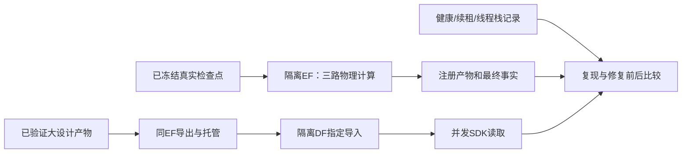

# A22：并发执行与数据交付的租约稳定性

老板在 A19–A21 收尾后要求“继续推进”，承接已说明的首要下一项。基线根 `285c0ee`、EF `15d9586`；根分支 `a22-lease-stability-20261016`。26 份用户文件按原 hash 保护；不动用户 DF/DI/evaluation 修改，不改专业算法、目标、公共契约或历史实验。

## 业务交付和验收

1. 对三任务同时失联、SDK 超时给出源码与受控复现证据，区分已证实机制和历史唯一根因；不把推测写成已修复。
2. 只修复可复现的执行底座阻塞点；原租约、任务超时、取消、真实失联隔离与资源规则保留。
3. 隔离 EF/DF 中实测三路真实物理计算与一路大事实交付、并发 SDK 读取；检查任务/产物/指标身份，保留所有失败和恢复成本。
4. 静态、针对性/既有测试、边界、差异审查通过。只有新 wheel 验证通过且生产服务无消费者，才考虑更新本轮专属服务；DF 用户源码不构建、不部署。

## 文件与影响面

- 本计划、后续报告及 `admin` 复现脚本：固定输入、公共 EF/SDK 调用、隔离服务和有限诊断；运行资产在 `var/business/a22-lease-stability-20261016/`。
- EF `core/runtime` 的实际缺陷文件及对应 `tests/core`：先取得复现证据，再说明最小改动；不预设重构/新调度层。
- 如需调整已有源码尺寸登记，按模块门禁记录实际变动，不豁免门禁；根 manifest/gitlink 仅在模块发布后同步。
- 根 `TASKS.md`、`ARCHITECTURE.md` 等：收尾登记真实通过和残留边界。

## 数据流与验证

先做有界受控复现，能复现的机制才写回归；再运行真实并发情景。诊断服务启用线程栈，生产只读核查。健康长任务不因日志静默而取消，不为避错缩减专业能力或放宽 PPA/验证标准。若历史现场不足以证明唯一根因，明确保留限制，并交付实测修复范围；不无限重试直到出现一次成功。

## 执行补充与权限边界

老板随后明确“没有sudo权限，不要干越格操作”。不再推进系统目录或SSD生产迁移；临时SSD仅做诊断并完整归档，最终验证和更新保留原项目目录/端口。实际修复限定于bundle托管锁、worker监控刷新与慢写后的间隔，以及有复现证据的根交付首次回执读故障分支；公共接口和专业算法保持。DF用户源码不动，WAL/FULL仅作为自有主库的离线运行配置验证，当前业务查询仍只经公共HTTP/SDK。

原目录进行一轮最终三AES/JPEG并发及监管验证后，不再叠加补丁；成功功能、健康短采样延迟及剩余风险分别记录。仅在自有应用空闲、完整备份后才原位更新EF wheel和DF主库配置，未涉及系统服务或其他用户进程。最终以本片报告和 `var/business/a22-lease-stability-20261016/progress.json` 为准；功能闭环通过不代表长尾或历史唯一根因已全部解决。
