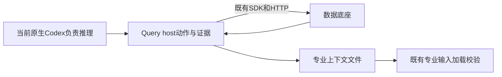

# A25准备：原生Codex与现有Query host入口

状态：入口资格检查已完成，正式预算、任务矩阵和协议尚未冻结，A26/A27未启动。JPEG完整证明仍在运行；本文不代替A24完整专业轮次或正式效率对照。

## 实际核查

本机`codex-cli 0.159.3`支持非交互执行、独立会话、结构化结果及JSONL事件。记录了JavaScript启动器、实际原生二进制与Node的SHA和版本，没有升级工具或读取、复制凭据。模型请求为`gpt-6.1-sol/medium`；服务端实际模型快照未由本次事件提供，保持未知。

| 检查 | 真实结果 | 证据位置 |
|---|---|---|
| 原生Codex读取本地文件和访问两个只读健康接口 | 两条原生命令执行成功，文件SHA正确，EF/DF均HTTP 200 | `var/business/a25-formal-preparation-20261017/native-codex-transport/` |
| Query host创建调查、读取真实JPEG事实、带引用回答、导出专业上下文 | 三个scope身份正确，七PPA与原测量一致；现有专业上下文加载器接受导出包 | `var/business/a25-formal-preparation-20261017/host-query-facts/receipt.json` |
| JPEG输入保持 | 原结果SHA不变；上述Query操作没有新增EF run或Query内部模型调用 | 同上及`professional-context.json` |

原生Codex读取检查的首个后处理脚本错用了`controller.stdout`文件名；复用的进程监督函数实际写`controller.log`。CLI已正常结束，首份脚本失败回执完整保留。随后只读原日志和答案进行补核，没有再次调用模型。唯一非JSON日志行来自CLI的stdin提示，后续正式驱动须分开保存stdout事件与stderr，并显式发送stdin及EOF。

该次原生调用记录52779输入、34560缓存输入、408输出token，脚本约23.32秒；Query host的四项确定性操作约2.19秒，未新增模型调用。两者任务不同，不能相减、相除或据此宣称节省。host检查由本线程Codex给出动作与事实结论，其推理成本不在该脚本计时内，总token不能填零。

## 已有接口如何增强同一个Codex

`query_agent investigate --model host`只创建既有调查、范围和上下文；当前Codex可通过`act`、`evidence`、`context`继续推理和取证，最后用`export-professional-context`交付。原生hosted Codex子任务仍是可选调用方式，相关模型成本须完整计入，不能把它强制用于每个简单事实读取。

本次实际检查止于上下文加载校验，未执行新的专业优化。没有新增通用Agent循环、模型API封装、后台或评测服务，没有修改Query-Agent及公共SDK代码。

## 正式入口的待冻结事项

- 两侧使用相同原生Codex版本、请求模型与推理设置、独立工作目录及会话，保留全部JSONL事件、命令和结果。直接侧可使用原项目、脚本与工具；平台侧可使用已有业务命令及host查询能力。
- `workspace-write`下的文件读取与loopback访问已验证，直接侧完整EDA启动权限及原专业运行尚须实际核查，不能由健康接口通过推出。两侧执行权限和基础工具条件须匹配。
- 原生事件已取得最终`turn.completed`用量；尚未核实跨原生专业调用的累计token硬限制。正式冻结必须区分实际可执行的预算限制与事后测量，不能把未实施的限制写成已经控制。缺失或中断用量保持未知，缓存输入不重复相加。
- 启动、监控、查询、实际接力、恢复及完整验证使用预先固定的任务、目标run集合和独立事实核查；不能把本次只读资格检查写成完整端到端验收。
- 继续保护用户的`generic_agent.py`及`ablation*`工作；本轮未借用、部署或提交这些文件。

官方依据：[Non-interactive mode](https://learn.chatgpt.com/docs/non-interactive-mode)、[Testing Agent Skills Systematically with Evals](https://developers.openai.com/blog/eval-skills)。文档用于确认原生执行及事件记录方式；本机能力和数据链路以上述实际记录为准。
