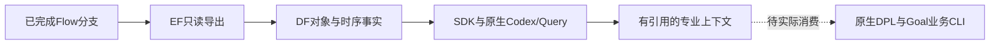

# A25：JPEG选定分支的Query比较与专业上下文

候选10的对象、时序与共同PPA已通过EF→DF→SDK交付，实际原生Codex/Query完成调查并导出专业上下文。独立核验通过四组事实、两组假设及43条证据引用。原JPEG完整搜索继续，原生Code尚未消费这份新上下文；没有新增优化、采用、完整功能证明或独立物理重放。

## 取得了什么业务证据

1. 功耗从178.33724618降至176.39359832mW，单元面积从6734.18降至6712.36µm²；setup余量从19.5042降至6.83587ps。原目标、条件ID、15份库和原SDC绑定保持。
2. 在每侧15条已存setup路径中，最差路径由DCT的`ddin[5]→block_1/unit_3`换成`ddin[7]→block_3/unit_1`。两边编号都叫`path:10`，起终点却不同；公共比较接口在experiment模式下仍明确拒绝把它们当同一条路径。
3. 一条真正匹配的`qnt_cnt[0]`输出路径余量反而提高约0.6ps。因此不能把整体最差余量下降解释成所有路径变差，更不能把12.66833ps直接叫作同路径回归。
4. 当前最差路径的已报告数据序列中，单元与连线增量分别约482.1ps、18.2ps；最大相邻单元弧为半加器B→SN，约54.6ps。Query查到了相关驱动和3/8个负载的网络。它们支持“单元/负载/缓冲拓扑值得检查”，不证明一个参数、一次移动或一个专业算法导致了变化。

上述路径是已存样本，不冒充全设计所有路径。原参考对应序列为466.5ps单元、14.0ps连线；由于两条最差路径的起终点不同，不能用这两个分解之差进行单因素归因。下一步针对同一端点的STA和受控专业动作才可进一步区分原因。

## 交接如何落地

实际接力输入已经固定为候选10的完整事实视图、同源Query上下文、原目标及各自哈希。后续Code调用仍由既有业务CLI提交，EDA统一走EF，按原生算法和已批准完整轮次/预算执行，接受结果前检查完整证明、独立重放和共同PPA。

Query提出先做孤立的详细布局C++实验，再从真正保留下来的物理结果做Goal优化C++/配方实验；目标是检查负载/时序响应，并避免后一步回到旧的设计输入。当前流程继承的是设计产物和目标/诊断，各专业源码独立构建，**没有自动把两研究项目的C++补丁合成一个二进制**；不能把模型一句“保留前一补丁”当成已完成源码合并或收益保留，后续必须核查实际动作和物理结果。

保持原硬约束。来源的6.83587ps是观测到的余量和取舍依据，不新增“后续不得低于该数值”的硬门槛；仍由Codex按原目标判断取舍。当前已闭合时序，没有强行发起ECO修复。

## 两个真实的接点问题及处理

**旧参考视图缺上下文。** 原参考旧时序视图的analysis/corner/unit为空，同一物理参考已经有经过验证的补充视图。本轮在模型启动前停止本轮独立准备器，保留退出130和原回执；使用已有补充视图构造显式参考视图，不改原结果或快照。全部20条已存setup/hold路径的原始数值和身份一致，新视图明确FF/post_route/秒。已经完成的对象EF导出与DF导入按同一run/artifact复用，没有重跑。

**通用交接草案不等于原生Code契约。** Query另外生成两个`role=code`的`contract_only`草案，默认300秒/6GiB且成功条件偏向setup。这些默认值不适用于DPL/Goal完整算法，也没有被原生Code执行。本轮采用独立的professional-context契约和原目标；不使用草案的预算或成功条件，更不把草案状态当作消费成功。原生DPL三Student、Goal四Student的后续12小时资格预算与原筛选规则保持。

原回答还把“保护来源余量”列在建议性扩展字段中。独立核查确认原十项硬约束数值完整一致，冻结目标没有新增余量阈值；专业上下文也不携带该嵌入回答字符串作为执行契约。上述接点限制在正式协议中须明确，不能偷偷限制专业能力或把建议升级成验收条件。

## 执行、成本和限制

- 新增对象与STA导出各一项EF任务，各一次attempt成功；两份DF导入也各一次。旧准备器与新准备器引用的对象导出是同一个run，只计一次，采样CPU合计102.09秒。
- 两侧共六种快照身份、原输入/原目标、四份固定设计输入哈希、关键路径与同路径比较均独立核对；现有专业上下文加载器接受实际导出。
- 对象导入期间，JPEG/GCD/AES历史SDK八项事实分别查回同值。这是一次有限并发查回，不能代替持续压力试验。
- 原生Query模型为gpt-6.1-sol/medium，宿主270.0547秒；输入1,328,609token，其中缓存1,182,592；输出12,871，包含推理输出2,798。总输入加输出1,341,480，不重复累加缓存或推理子集。一次宿主CLI不等于可观察全部后台推理请求数。
- 调查记录60项操作、445,380读取字节；包含一个字段选择HTTP400和两个未消费草案，错误成本保留。这一读取统计不含对象导出/导入、独立核查和其他主机I/O。与原JPEG共享机器，没有同工作量直接侧，不报告token或时间节约比。
- 独立核查最初误选不存在的`data_path`字段，已保留不可用的零值记录，改从相同缓存SDK的实际`source_path`重算并核对。该错误从未进入DF或Query事实，没有新增测量。

本次产品源码、服务、公共签名和专业算法没有改动；新增提交只有本报告和TASKS.md。沿用产品473项回归/静态检查，新增验证是实际公开数据及上下文独立验收；26份用户工作及既定专业队列输入保持。

## 证据与下一步

证据根目录为`var/business/a25-formal-preparation-20261017/`：

- `selected-jpeg-relay-query-r2/independent-acceptance.json`：专业上下文、六种scope、两项EF/DF执行、模型用量、限制。
- `selected-jpeg-relay-query-r2/qualified-native-handoff-input.json`：实际选定源、上下文、目标和哈希；原生消费仍待完成。
- `selected-jpeg-relay-query-r2/independent-sdk-oracle/`：独立路径样本、同路径/不同路径公共比较和已校正的增量分解。
- `selected-jpeg-relay-query-r2/reference-view-acceptance.json`：20条参考路径同值及原数据未改。
- `selected-jpeg-relay-query-r1/prequery-reference-correction-intervention.json`：只停止本轮独立准备器、模型未启动的实际身份与原因。
- `preparation-costs-r29.json`：旧成本哈希链、新Query成本、两项唯一导出及失败分列。

原JPEG真实收尾后仍须核验第二轮全部实际消费和最终数据回流，按既定r6队列完成健康Code及完整域GCD校准，再完成选定分支验证、真实专业接力、A25冻结及A26–A28公平实验。本报告证明比较与交接材料可用，不证明Code已经协同执行或团队PPA优势。
