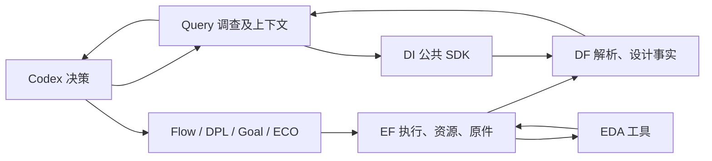
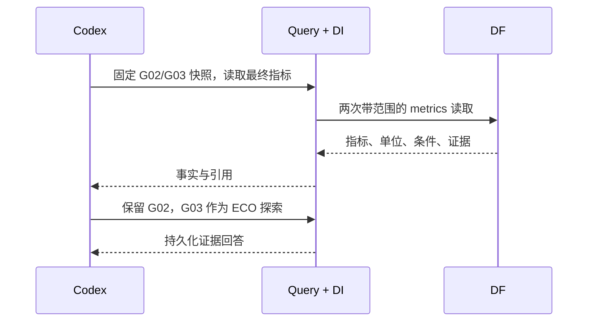
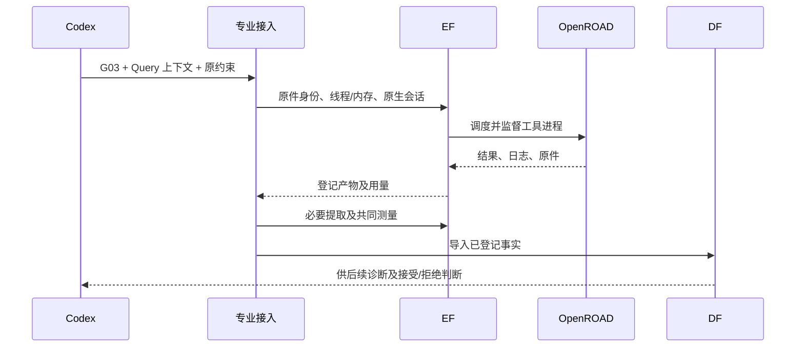

# A29 平台操作与接口实证

平台让当前 Codex 调用领域能力，统一提交实验、登记产物、取得设计事实；是否继续、接受哪条分支由 Codex 判断。下列记录来自本机实际调用，不是 token 节约率或四专业连续成功的声明。

## 已完成的操作

|操作|实际结果|原件（根目录下）|
|---|---|---|
|固定 GCD 已采用结果|复用 G02 的原验证，不重跑相同产物|`var/business/a29-paper-delivery-20261020/gcd-retained-package/manifest.json`|
|读取设计状态并诊断|G03 的 Query 完成4事实/4假设，定位共享反相器及12负载|`var/business/a29-paper-delivery-20261020/gcd-eco-source/query/professional-context.json`|
|当前 Codex 判断两候选|2次 DF 事实读取、引用各自证据、回答保留 G02；额外 Query 内部模型调用0|`var/business/a29-paper-delivery-20261020/same-codex-query-demo-r2/answer-state.json`|
|同一布线产物交付|组件/线路/引脚 DEF 段完全相同，七项 PPA 精确同值|`var/business/a29-paper-delivery-20261020/preserved-routing-acceptance-r3.json`|
|提交实际专业任务|DPL 两个候选完成首轮构建和评价并继续原生调整；ECO八轮及共同测量/事实交付完成，按setup/DRC拒绝|本轮 `runtime/experiments/gcd/` 的原生/EF回执|
|导入较大含宏设计|原 Ariane ASAP7 placed 基准经 EF 导入成功，210295组件及136 SRAM均核对|`var/business/a29-paper-delivery-20261020/runtime/experiments/ariane/a29-ariane-original-placed-import-r1/import-result.json`|

同一 Codex 展示的初始化和两次读取墙钟约1.346秒。父 Codex 的推理 token 没有单独计量，不能把“额外内部模型调用0”写成“总 token 为0”。旧64KiB调查预算失败的记录保留；完成案例使用512KiB预算，实际读取约50KiB。

## 接口与责任

接口取自现有实现，表中参数省略非核心可选项。DI 是安装的 SDK，没有另建服务。

|调用者→模块|现有签名或入口|返回/责任|
|---|---|---|
|Codex→业务入口|`chip-evolve.py --config CONFIG run --design DESIGN --capability dpl\|goal\|eco --source RESULT --context CONTEXT --rounds N --seconds N`|准备原生输入并提交；输出结果或具体失败|
|专业接入→EF|`KernelClient.submit(task, idempotent=True, idempotency_key=key)`；`POST /kernel/runs`|`run_id`、任务状态；工具进程由EF监督|
|Codex/接入→EF|`KernelClient.run(run_id)` / `logs(run_id, offset=0, max_bytes=...)` / `resources(run_id)`|状态、日志、预约和实际用量；资源等待与工具失败分开|
|接入→DF|`POST /snapshots/from-run`，请求含`run_id, artifact_id`|解析已登记的事实归档，保存导入回执|
|Codex/Query→DI→DF|`EdaAiClient.resolve_scope(snapshot_id=...)`；`GET /scope`|确定唯一设计/版本/实验/阶段快照|
|Codex/Query→DI→DF|`get_stage_summary(snapshot_id)`；`GET /snapshots/{id}/summary`|对象数量、覆盖范围和来源|
|Codex/Query→DI→DF|`get_metrics(snapshot_id=..., include_raw=True)`；`GET /snapshots/{id}/metrics`|指标、单位、条件及证据；分页|
|Codex/Query→DI→DF|`get_timing_paths(snapshot_id, check="setup", sort="slack", order="worst", limit=5)`|明确范围的最差路径样本，不冒充全量路径|
|当前 Codex→Query|`query_agent investigate ... --model host`，随后`act INV --decision FILE --model host`|复用已具备推理能力的宿主；Query保存调查和证据关系|

最小交接数据包含：`design_id`、`run_id`、`snapshot_ids`、`condition_id`、`objective_id`、原件身份及SHA、事实/假设、目标、允许动作、预算。实际字段以 `result.json` 和 `professional-context.json` 为准。这里没有增加另一份可写的“真相库”。

后一图的本轮ECO调用链已实际完成：共同PPA与公开SDK一致，原件及恢复证据登记完整；业务约束未通过，保留G02。执行成功和业务采用分别记录。

## 关键决策

- 原件与实验生命周期归 EF；解析后的设计事实、索引和查询归 DF；DI保持 SDK。Codex不用直接读服务内部数据库或管理工具进程。
- DPL 消费实际布局检查点，ECO 消费实际布线状态，避免统一成一个会丢失专业能力的假输入。
- 已布线 ECO 交付保留线路，只做提取与测量；未布线检查点仍需完成布线。独立checker的marker与原生DRT计数分别保存，目前不能声称它们等价或独立DRC为零。
- 专业局部排名和最终业务约束分开：允许有待下一棒修复的中间态；最终采用不能绕过原约束，也不默认采用最后一棒。
- 本机资源按实际设计配置。当前运行ECO仍使用已冻结的24GiB预约；新接入支持后续显式声明内存，不为启用新选项打断正在运行的实验。
- Ariane使用原研究提供的ASAP7 placed基准及SRAM模型，明确区别于ORFS RTL起点；目前只完成导入，不填写完整布线PPA。

## 2026-10-20 16:03 增补

DPL Student01已真实完成最终CTS/route并经DF/DI七项核验：原生HPWL降低没有转化为最终PPA改善，按原面积限制拒绝。Query实际形成4事实/3假设后，Codex从这个可修复中间态发起原Goal一轮四Student，原G02仍保留；EF登记原生candidate-brief并公开取回核对SHA，专业原排名未更改。这里同时展示“派发→执行→事实→调查→再派发”和拒绝无益分支的实际过程。

ECO八轮及随后独立完整布线已完成，后者原生DRT54→0，但setup仍失败；未来交付只有明确DRT0的已布线状态才保留线路，未收敛检查点正常补全。本轮不再有活动ECO会话。GCD的CTS/route内存声明4GiB已实测消费，其他设计按自己的配置申请。

老师审阅材料已生成本机ZIP快照，当前含15个完成节点；运行中的候选不计作成功。调用成本仍按原证据范围列出，不以缺测量的总token/时间节约率替代实证。

## 新增三专业合法接力：Flow→DPL→Query→Goal→DF/DI→Codex

已完成DPL01→Goal原一轮四Student和共同交付：DG1为0.81929122098mW/39.6139um²，setup WS+1.31586ps/TNS0，hold WS+34.0384ps/TNS0，原生DRT、电气/布局违反均0；较真实DPL父项功耗−12.6104%、cell面积−11.9286%。全部18输出PDR和独立完整DRT/RCX七指标精确同值通过；四份最终候选共48个raw值及快照身份通过公开DF/DI SDK。另3份setup拒绝，完整保留原生评分和源码引用。

Codex据此保持原G02低功耗结果，将DG1归档为经过验证的合法接力案例。本分支时序已经闭合，下一步不为串行展示额外派发ECO；此前G03→ECO八轮和独立布线补全仍是真实参与记录。实际读数、比较、验证与决定见本轮`gcd-dpl-goal-{all-final-sdk-facts,next-decision}.json`及`a29-gcd-dpl01-goal01-validated-r1/validation.json`。旧G02与新DG1策略/阶段不同，不把两者差异写成隔离的DPL贡献或最佳单Agent对照。

## 三设计业务状态与排队原因的实际查询

沿各实验实际使用的冻结入口，分别执行现有`status --design ariane/ibex/gcd`，并对ibex后续run执行`watch --design ibex --run-id ...`。三份状态回复分别684/2051/2182字节，watch回复2307字节；这是真实返回体大小，不是节约率或大模型token数量。

- Ariane：直接返回正在运行的完整ORFS实验及`run-c40e2257df494a38a1d941901dfc8952`。
- ibex：直接列出历史失败、已成功基线和原Goal进行中状态；watch将`run-c86add5b87444698b4c566157bce5b64`明确分类为`resource_wait`，说明需要12GiB、当前预算剩0，kernel仍新鲜并在执行其他任务。
- GCD：新增Goal接力及其验证均为succeeded；原DPL三Student轮次仍in_progress。

这些问题通过现有业务入口与公开EF查询完成，无需调用者直接查询内部数据库或检查物理目录。执行状态由EF负责；设计PPA和诊断事实仍走DF/DI/Query，二者职责不混用。父Codex负责解释回复；额外内部模型调用0，父推理token与同任务节约比例未计量。

不可变回复、原文件摘要及本轮解释保存在`var/business/a29-paper-delivery-20261020/business-status-demo-r1/answer-and-evidence.json`及同目录四份回复。这是一份带观察时点的操作快照，不把其中running或queued状态当作永久事实。

## JPEG源状态调查与后续决策准备

现有`diagnose --result Goal03 --against oldECO`完成真实调查并导出`jpeg-goal03-source/query/professional-context.json`。调用者明确source/reference的祖先关系，Query通过DF/DI查询七PPA、全组最差路径排序、对象与连接，返回4事实/3假设及局部WNS与全局TNS冲突证据。根Codex据此准备下一次原生ECO，保留原专业动作选择和评分，尚未派发；原停止Flow搜索没有恢复。

Query在有界读取中无法从gzip片段验证Liberty，且两份完整SDC尚未比较；根Codex随后使用公开DI一次取回登记原字节、核对SHA并解压/比较。SDC有效指令文本相同，HA声明已提取，结论保存独立补充记录，未篡改原调查结果。这个过程展示平台事实与通用Codex判断配合，也记录当前查询封装仍有改进余地；不把每个查询限制变成实验前置门禁。本次host确有模型调用，既有确定性status读取的“内部调用0”口径不能套用到这里。

## Ariane停止附带检查后的统一观察

`business-status-demo-r2/answer-and-evidence.json`冻结再次真实调用的Ariane status/watch及SHA。原任务business状态为failed，内层EF明确cancelled；新的已完成物理检查点续接为in_progress，watch显示resource_wait，需要16GiB、当时预算剩12GiB，kernel正在执行原GCD/ibex任务。用户可通过相同入口分辨“附带检查被主动停止”和“新测量在资源等待”，不用读取内部数据库。

这次一次性续接调用现有执行/测量/发布函数，尚未提供业务request的capability标签，因此status按既有缺省显示validation；其operation、原run与精确EF句柄已在收据说明，不能冒充一次新的专业优化或完整ORFS成功。原生LEC与最终事实交付耦合仍是后续可简化的接点；本轮先保存实际产物并接续，不扩建框架。确定性status/watch未额外调用模型，父Codex解释用量未知，未测节约比例。

## 2026-10-20 23:01 本轮最新核查（覆盖上文历史进行中口径）

- GCD原DPL一轮三Student与Teacher已完成，原生选中Student02；其共同CTS/布线交付仍排队。Student03合法化在原定时间内未结束（124），框架按原规则保留失败并完成轮次。已验证的DPL01→Goal DG1不改父项，保留功耗更低的G02。
- ibex原Goal一轮四Student与Teacher已完成，晋升Student01修复版。主分支最终为28.18046324mW /2339.71µm² /setup WS−28.3996ps /TNS−1.59699ns、slew32/cap1，不采用；12原始指标和三快照身份已通过DF/DI核对。其余候选共同交付排队。
- ibex主分支Query已完成，证据支持检查`_17624_`共享逻辑与`place4192`/`place4191`输出缓冲；故准备独立原生Goal timing-only修复。沿用已测网表/布局与900ps/库/SDC，原生prepare清除信号线和fillers、之后完成原详细布线；不把修复隐藏在测量里，不称Student01 C++源码已自动合并到新执行文件。当前只准备，尚未派发。
- ibex后续`run-58bdc4163b2940a796f3621ca48b1108`已通过EF原请求更正为**同源码last_gasp_deep匹配基线**，不是repair2。公开原件SHA核验显示该基线与Student03/04的ODB/V/DEF逐字节一致；不能声称这两个深策略已产生原生QoR收益。
- Ariane完整物理参考的RCX、共同测量及三类事实已经完成：642.41528511mW /43672.8µm² /setup WS−285.396ps /TNS−155.146ns /slew436，原生DRT0。1800秒事实导出成功，12值/3身份通过。原ORFS inline LEC被明确取消、功能尚未证明，不称完整原任务成功。
- Ariane Query已完成并指出深标准单元reg2out逻辑时序问题，已派发原Goal timing-only/StrictEvidence一轮四Student；32GiB原生基线当前等待资源。该设计保留原SRAM模型，不宣称所有宏均FF或完整签核。
- JPEG旧Flow搜索保持停止。以原Goal03为父的新定向ECO会话实际运行，最多八轮；尚无新的共同最终PPA。保留原负接力与Flow10证明超时。
- 新源码固定00199d3：仅按实测时间配置Ariane共同物理收尾7200秒；既有默认1800秒不变。事实导出配置1800秒的修复bc89146已通过针对检查；最近根570回归和静态/格式/类型检查通过。两修改均只用现有内部设计绑定，不增服务/API/数据库。

本轮实测等待为内存预约冲突：JPEG20GiB运行时，GCD与ibex的**冻结共同物理请求各24GiB**、Ariane32GiB不能进入余下12GiB。ibex原生评价12GiB不等于共同收尾24GiB，不改动冻结任务或把等待写成派发丢失。

论文表已有21个SHA核对完成节点（含Ariane参考、ibex主结果），新r7审阅包将持续导出；未完成四设计收口，不声称协同全面优于最强单项或token节约比例。

### 23:22更新：真实成本与完成状态

JPEG定向ECO原生八轮完成、10次模型调用（两次重试），原生DRT9592；完整布线/共同测量已另行派发。只读成本导出同时纳入`session/execution.json`，覆盖此前漏在该子范围之外的两次ECO执行回执：当前181个已保存EF回执，采样CPU106157.51秒，仍不是全场费用。ibex主分支Query另记录input1558174、cached1423104（输入子集）、output10127、445.14秒。专业DPL五次完成模型调用的缓存输入也作为输入子集，子调用时长之和不当作campaign墙钟。未知货币费用和宿主推理不置零，不报告未测量节约率。

最新审阅入口：`var/business/a29-paper-delivery-20261020/paper-assets/teacher-review-overview-r8.pdf`，九页含四设计独立接力图、21完成测量节点和原生阶段诊断；`teacher-review-snapshot-r8.zip`保留结果逐字节副本及来源SHA。四设计尚未全部完成。

## 2026-10-21：同一Codex实际查询与继续派发

新ibex最终状态已由当前Codex通过Query host读取：两份完整metric包、setup/hold样本、所有已存setup组与最差路径engineering，共六次成功读取109190字节；四次path参数格式错误也保留为失败。Query保存了新调查、原件引用与professional-context后，原生收尾脚本消费该新上下文，通过现有Jobs/KernelClient提交实际SPEF/传播时钟下的native EDA动作和后续DRT/RCX/事实发布。没有额外Query子模型调用；223.63秒调查墙钟包含宿主步骤等待，服务内0.410秒不能替代总用时，父模型token未知。

调查确认setup同时涉及reg2reg和reg2out；所选路径cell/wire原增量仅支持机制，不是完整归因。新收尾r1的“原生报告闭合、最终仍失败”按真实结果保留，随后只针对明确发现的Resizer增量寄生初始化问题与路由后slack余量启动r2；原生算法及正式验收约束不改。JPEG同候选保留线路的RCX作为诊断，native DRT计数unknown，禁止采用。全部是已存在EF/DF/DI/Query能力的消费，没有新服务、数据库或API，也不把试验性native原语封装说成新的专业研究Agent。

## 10月21日01:24：新完成的实际闭环

1. 当前Codex基于先前Query的ibex诊断，显式派发带增量RC初始化协议的原生收尾；EF完整DRT/RCX后将最终设计登记到DF，DI复核十二原始指标及三快照身份。Codex因setup/slew失败拒绝采用，保留IB0。这一闭环并非“工具成功所以优化成功”。
2. JPEG同候选保留线诊断也经EF执行新RCX/测量，并通过DF/DI的十二值/两身份核对。Codex比较同原始ODB与同condition/objective后识别布线交付差异，派发一份直接读取既有线/guide的原生DRT任务。旧Flow搜索始终停止；没有重跑模型搜索，也未把未知DRC当零。
3. 当前成本快照`cost-snapshot-20261020T172412Z.json`包含242个闭合EF任务及采样CPU134263.69秒；专业Goal20份用量回执、DPL5次模型和既有Query范围分别保留。未闭合任务不填完整成本；缓存输入是输入子集，没有同任务对照或父Codex独立token计量时不计算节约比例。

## 10月21日03:37：失败也通过统一入口留证

Ariane原生7200秒超时后，EF保存完整输出、部分检查点、源码/输入声明和失败回执，原框架接续其他候选；JPEG既有线DRT也已真实消费输入并保存DRT1231失败。两者都不是队列丢失或DF查错设计。Codex据具体JPEG错误和已登记Query上下文调整为VT/size原生序列，新任务继续通过EF，保持原条件/目标和最终验收。失败没有最终设计事实时不伪造DF完整PPA快照，EF原件与公开日志用于过程追踪。新增失败表保留真实墙钟/采样CPU/内存，当前246个闭合EF的成本范围仍与整场墙钟、父Codex token分开。

## 2026-10-21 04:24：四设计统一状态入口与真实取消结论

以各设计当前配置实际调用冻结业务CLI的status；回复逐字节留存并核SHA，调用者未查内部数据库，也未启动新EDA或模型。旧Ariane已确认前端退出、两个EF句柄终态cancelled后，写入其管理状态cancelled及缺陷/替代实验引用；原输入、源码、已完成结果均未改。

|设计|回复字节|命令墙钟秒|
|---|---:|---:|
|gcd|2179|1.235480|
|ibex|3380|1.068880|
|jpeg|3235|0.686184|
|ariane|2535|0.361117|

四份回复能够直接区分GCD/ibex没有活动计算、JPEG最终布线与Ariane新基线实际运行，Ariane旧轮明确cancelled；不会将因缺少管理终态文件而默认显示的in_progress当成永久事实。状态负责回答任务在哪，PPA/诊断仍以DF/DI/Query及结果原件为准。

额外内部模型调用0，父Codex推理token未单独计量，未报告节约率。真实请求、输出和耗时在var/business/a29-paper-delivery-20261020/business-status-demo-r3/answer-and-evidence.json；本次是固定时点的观察，不把running当作完成。

更新的成本快照cost-snapshot-20261020T202410Z.json纳入前端被停止后无法自行落终态的两份公开EF取消收据，按run去重。当前254终态EF（240成功、7失败、5取消、2超时），采样CPU161397.19秒；20份Goal调用、五份DPL调用等范围分别列示。未包括的历史、父推理和服务开销保持unknown，不作为完整成本或同预算效率对照。

## 2026-10-21 06:22：Query诊断驱动一次新策略

当前Codex通过既有DI重新查询IP2，显式按slack全局排序后取得16条已存setup路径；最差reg2out路径与−0.00130401ns聚合值一致。有限路径不是全部端点，原生修复仍处理全设计。SDK默认路径分页未按slack排序，必须明确指定`sort="slack"`；`truncated`是有数据的分页状态，不能误判为调用失败。

根据JPEG新VT/size物理可行结果和IP2的23项slew违反，本次只新增一个明确的VT/size、30ps内部余量及修复前后10% slew margin策略。原900ps、最终零TNS/零电气违反要求不变，不声称源码合成。EF已接受run-ae7fbe43e69a4395b07b8c189035a248，父run/目标/条件、四原始输入SHA、完整Query上下文及实际Tcl均已核对；当前排队，尚无新PPA。只有本次原生策略或最终事实通过，才继续后续交付；没有自动重复循环。额外Query内部模型调用0，父Codex token未知。证据见ibex-ip2-query-new-strategy-r3/、ibex-ip2-vt-size-slew-r3-source-dispatch-audit.json。

## 2026-10-21 06:31：大原件取回与真实下一棒

JPEG最终网表证明run-0c55ea8898be432e8dc75f743cac18c4已由公开EF确认为succeeded。完整extractor_log为6,168,724字节，通过KernelClient.materialize_artifact取回本机并与EF登记SHA完全一致（4c36f256ccaf98c23fa35278553858b73f4508c36d3c61ffd40de727d1eac5c3）；没有把4MiB上限的内联字节接口当作大原件下载接口，也未读取私有状态库。完整证明27输出/7082分区及所有网表/Liberty哈希独立核对。

Codex随后复用实际PASS证明，只派发一次已记录物理交付的独立重放run-786929353c204058a30a502368e57c78。原repair输入ODB、PDK和实际交付路径由既有replay_checkpoint恢复，EDA经EF、事实经DF/DI；七指标一致及既有功能/采用检查通过后才调用select。原生修复、功能证明、独立物理交付和采用是四种不同事实，分别记录。

## 2026-10-21 07:09：当前四设计统一状态实测

以相同冻结业务CLI和各设计实际配置并发执行四次status。GCD回复无活动EDA；ibex显示既有qualification排队；JPEG显示已复用完整证明后的独立交付重放排队；Ariane显示Student03原生物理评价、Student04链接正在运行及Student02完整链接排队。与公开EF真实句柄对应，未启动EDA或模型、未查私有库。

|设计|回复字节|单条命令墙钟秒|
|---|---:|---:|
|gcd|2179|1.395322|
|ibex|4163|1.157748|
|jpeg|4911|1.361031|
|ariane|2844|0.599333|

四次为并发调用，不能将单条墙钟求和作为全场墙钟或与先前串行值计算节约率。额外内部模型调用0，宿主推理token未知；任务管理状态与PPA/采用结论分开。完整命令、回复原字节与SHA见`business-status-demo-20261020T230937Z/answer-and-evidence.json`。

## 2026-10-21 07:27：依据实测峰值修正单项预约

ibex此前三次成功完整物理任务的公开资源回执峰值为3,761,676,288 / 3,781,582,848 / 3,781,480,448字节，约3.50–3.53GiB；原生专业profile已为12GiB，但共用交付配置的`designs.ibex.orfs_execution.memory_gib`仍为24。现仅为本次已完成原生状态的新交付配置改为12GiB，8线程、1800秒原限制、工具/库、900ps、原目标和完整冷GRT/DRT/RCX均不变，保留约三倍峰值余量。没有改EF总预算、服务、cgroup或其他计算。

旧run-eeead2dc91ad49e8b30cac45c5fff74c在公开EF中明确为启动前取消、started_at=null、零attempt；原等待前端自然退出，原日志保留。已完成native run-ae7fbe43e69a4395b07b8c189035a248的实际输出ODB，与公开EF归档及本机输入逐字节SHA相同后直接复用；没有重跑优化或模型。新交付run-62c097c1b2e14b9b922f2a759500e24b实际预约12GiB；新旧真实route.tcl仅输出目录不同，父run/目标/条件标签、线程、超时及其他资源相同。只是一次未执行预约的替代，不作为第二次优化策略或算法失败计算。

证据：`ibex-ip3-delivery-memory12-actual-dispatch-audit.json`、`ibex-ip3-native-state-public-capture-verified.json`及`ibex-ip3-never-started-delivery-resource-cancellation.json`。下一步仍等待同一IP3状态的最终PPA，未产生新采用结论。

## 2026-10-21 07:47–08:03：真实采用与跨设计验证

JPEG的完整证明结果复用后，原交付独立GRT/DRT/RCX、共同测量和三类事实均已完成。Codex从DF/DI再次核对候选与重放共24个原始指标、6个snapshot/run/design范围，七个比较量逐值完全一致，原约束通过；既有checked_validation/select实际成功。当前JPEG incumbent/result SHA/validation SHA与原件一致，新增jpeg-final-adopted-business-verification.json保存独立回查。没有为了采用重复模型、优化或完整证明。

新ibex状态也经过同样EF→DF/DI闭环达到物理可行。Codex据真实模型解析结果（1936公共触发器状态、106输出）将现有全输出PDR配置为20GiB/4worker/14400秒，与Ariane原生12GiB并行。既有两个parse job原ID保持，首个宿主启动目录错误没有提交证明任务；修正只接续已有目录，不改变公共API或证明义务。实际证明run-b916a1f70b984d4fadba2b6d37bd05ae仍在计算，不将物理可行代替采用。

## 10月21日：实际资源调度、归档交接与完整成本范围

公开`KernelClient.resources(run_id)`实测有效内存预算32GiB；部署记录`services.command`中的128GiB参数不能替代实时资源状态。旧Ibex证明20GiB与Ariane原生12GiB占满预算时，两个原生约束修复构建各16GiB明确返回resource wait。原生结束后2GiB资格任务正常调度；在两个尺寸/VT寄存器额外状态已真实资格后，Codex明确保留旧586个已证分区、原件和成本，停止旧配置，新配置完整106输出证明只准备，先让两份原生修复链接继续。没有修改服务、cgroup或预算；资源等待、专业计算失败与功能反例分开记录。

Ariane初次Student01/02/04均原生成功，Student03原7200秒超时。三份成功任务均通过公共`materialize_artifact`取回约145MB的`data_snapshot`归档，核对post_route ODB及网表的成员SHA；成功任务打包归档，失败任务的保全产物可以是独立原件，不能按一种形态猜测所有任务。专业约束修复会更新原工作目录，但公开EF归档仍固定初次字节，后续交接可按producer与SHA追溯。这是实际传输/归档能力，不是新增EDA重放或4MiB内嵌读取。

本轮成本导出补入原先26份初始Goal回执之外的12份回执（8份反思、4份电气约束修复），按campaign/operation/attempt核对38个唯一调用尝试，旧26份原件SHA不变。当前已知Goal输入26139849、输出413321 token；DPL另列5份回执及cached-input子集。326个已闭合EF任务的已知采样CPU237276.65秒，仍不含正在计算的链接和未单列的父Codex推理/服务开销，不报告货币总成本或节约率。4份缺本地execution.json的记录已沿公开EF复核：2份历史取消已在终态成本记录中、2份仍链接，不能把4份都说成活动任务。

原件为本轮`ef-actual-capacity-and-original-reinforcement-queue-20261021.json`、三份`ariane-corrected-student0{1,2,4}-native-completed-verification.json`、`unclosed-operation-journals-public-status-20261021.json`及`cost-snapshot-20261021T022828Z.json`。这些是带时点的操作/成本证据；最终采用仍等待Ibex完整证明/重放与Ariane原轮次/共同PPA，未把原生成功作为最终PPA通过。
## 2026-10-21 11:45：保留原证明后按业务顺序调度

Ibex 同模型完整证明已完成 594 个分区，但其 20 GiB 预约阻塞原 Ariane 后续 16 GiB 构建；公开 EF 实时总预算是 32 GiB。先通过 EF 验证原生 EQY `-c`：保留分区的状态字节和 mtime 不变，缺失分区重新完成，错误时钟样例仍 FAIL 并产生反例。首次资格脚本误把四个实际分区断言为两个，修正仅针对运行脚本，原始失败与成本保留。

验证通过后，已保存原输入/配置/分区、594 个 PASS、日志和运行成本，公开 EF 取消 `run-ba39aa9497494e2ea045fa5b385b1649` 让渡资源；原 Ariane 排队构建 `run-4459c0ffe7b64377856a810056311d89` 随即实际启动。不是静默超时重启、功能反例或修改专业算法。一次性接续脚本等待同一 Ariane 前端和任务完成，再用原生 `-c` 继续相同 106 输出/2046 义务、相同模型和配置；保留原总 14400 秒扣除已执行约 4156 秒后的剩余预算。只有完整 PASS 后才执行已有 r3 独立交付重放/SDK/采用。

Ariane 原修正轮的 Student01、04 首次 constraint repair 均原生成功，实际分别约 2102.39 和 978.56 秒。两份不可变 EF ZIP 中的 post_route ODB/网表成员已核 SHA；原生成功仍不是共同最终 PPA 结论。Student04 下一项原生修复继续，Teacher、完整 DRT/RCX、DF/DI 和最终判断尚待完成。GCD/JPEG 已验收结果不重跑，旧 JPEG 搜索继续保持停止。

证据：本轮 `ibex-native-continuation-scheduling-decision.json`、`eqy-native-continue-qualification-result-r2.json`、`ibex-native-continue-after-ariane-launch.json`、`ariane-student0{1,4}-constraint-repair01-native-verification.json`。没有修改服务、资源总额、公共接口或数据库。

## 2026-10-21 12:02：论文全表公开事实复核

通过现有 EF 和 DI 公共客户端只读核对33个已完成测量节点：全部生产任务为 succeeded，394个已有原始数值与当前 DF/DI 返回相同，86项实际快照归属与设计/run/snapshot 身份相同，耗时7.15秒。GCD B0、JPEG JB0历史缺失fanout保持缺失；部分兄弟候选原本只交付两个事实范围，本次按实际范围核对，不写成全部三范围已齐。没有新EDA或模型调用，也不把这一读取耗时当成相对原生Codex的节约率。

原件：`var/business/a29-paper-delivery-20261020/paper-public-facts-audit-20261021T040207Z/summary.json`及同目录逐节点收据。该检查证明当前论文数字能通过统一入口取得，不替代功能证明、最终可行性、独立签核或协同因果判断；Ibex/Ariane仍按实际未完成状态推进。

## 2026-10-21 12:29：Ariane 原生轮次完成，进入共同物理交付

Student04 telemetry 修复后的原生物理任务 `run-f625f87b613b406b8581eeb6a6654606` 成功，实际原生命令约893.16秒，公开EF归档中的ODB/网表成员SHA核验通过。与前次constraint repair相比，保存的ODB/网表逐字节相同，评估Tcl和固定设计输入相同，变化仅为SizeUpGenerator.cc及相应工具/构建收据；两次原生内存时序估计有差别，不能为其指定唯一原因或增计一次物理优化收益。

原1轮4 Student及Teacher已完成：01 refuted、02 validated、03 timeout/invalid、04 verified_qor_unattributed。原确定性晋升控制器选择Student04，机制未证激活的标记保留，未由平台改写原选择。该候选准确归档ODB已进入 `run-963b87a6b37e465596e84f0b50d387ee`，实际32GiB/8线程/7200秒进行共同完整DRT/RCX；最终指标、兄弟交付、DF事实和Codex业务采用仍待完成。Ibex已保存的同模型证明继续等待资源，不重复派发。

证据：本轮 `ariane-student04-telemetry-repair-native-verification.json`、`ariane-student04-telemetry-same-physical-state-comparison.json`、`ariane-corrected-native-candidates-before-teacher.json`、`ariane-native-selected04-actual-full-qualification-dispatch.json`，及原 `teacher_review.json`。所有记录均为真实原生过程或共同交付的阶段证据，不作为新增最终PPA行。

## 2026-10-21 13:50–14:00：Ariane主候选最终事实、拒绝与实际查询

原主候选AG4的完整DRT/RCX及测量已成功，最终651.96436644mW/43970.9µm²，setup WS−391.727ps/TNS−310.3ns，hold WS−72.8162ps/TNS−24.7916ns，slew913、cap/fanout/布局0、原生DRT0。相对AB0功耗+1.4864%、实例面积+0.6826%，原功耗/面积/setup/hold/slew五项约束失败，Codex拒绝。12个值与3个事实范围经公开DI核验；主结果准确字节冻存，后续兄弟元数据扩展不计新实验。DF公开导入提交前404是收据尚未可见，实际约10分钟后完成，不据此重跑。

随后Codex通过已有DI读取AB0/AG4各setup、hold最差三条已存路径，共4次、25444字节、串行读取约0.812秒。setup最差起点由miss_handler状态寄存器变为amo_fifo数据寄存器；同一reset→RESETN路径hold要求时间增加约83ps而到达时间仅变化约−2ps。该观察可定位后续调查方向，不能证明唯一原因；每类仅10条已存路径，不冒充全设计路径枚举。原r1宿主辅助脚本误将正常分页truncated判断为失败，原回复保留，r2按原契约读取成功；没有新EDA/模型。父Codex推理token未知，不报告节约率。

34个论文节点重新经过公开EF/DI核验：34/34生产任务成功、406个已有数值和89项实际快照归属相同，用时5.186秒。最新范围成本349闭合EF、采样CPU290700.55秒，44份Goal调用输入29580582/输出470208；未闭合与父Codex/服务开销未计入。所有原始失败、取消和费用范围保留。

Ibex一次性续算驱动已升级为r2，仅在整个Ariane case实际终态、原前端退出且无Ariane EF任务后才放行，防止观察窗口结束时提前预约证明内存。旧空闲等待者在没有派发证明时退出；未取消任何Ariane计算、未改变证明模型或剩余预算。实际前端PID184765与新等待者PID2936091身份已核对，Student01完整交付仍在运行。

证据：本轮ariane-goal04-main-early-final-sdk-facts.json、ariane-selected-final-public-query-r2/、paper-public-facts-audit-20261021T055715Z/summary.json、ibex-native-continuation-case-terminal-guard-verification.json和cost-snapshot-20261021T055649Z.json。四设计整体未完成。

## 2026-10-21 14:18：同一最终路径的实际Query诊断

补充路径上下文与完整点读取，DI默认分页明确标truncated，按已有get_timing_points(path_id,limit=100)取回两侧各44个完整已存点，未将最初10点当全路径。对应reset→RESETN捕获时钟沿途引脚/单元类型相同，时钟到达+82.6ps（连线+62.375ps、单元+20.225ps），数据到达−2ps、margin+0.51ps，解释该路径保持余量的大部分变化；不能推广成全设计的唯一原因。

实际native/qualification/common Tcl与SDC逐字节身份保存。native显式请求ideal-network处理及placement/GRT估计，最终采用完整DRT/RCX及显式传播时钟；setRC已令两侧实际路由层均M2-M7。两SDC有效命令只差native保存的传播时钟行，共同测量本身也显式设置传播时钟。未重跑任何EDA/模型、未改专业策略或目标。原Student01继续详细布线第1轮，Ibex续算仍等待整个Ariane case终态。

原件在本轮ariane-selected-final-public-query-r2/，分别保留默认分页、完整44点、路径延迟分解与脚本边界，后续包包含准确源文件及SHA。该记录说明通过统一数据接口可以开展具体诊断，不计算查询节约率，也不以调查替代原case收尾。

## 2026-10-21 14:47–14:50：AG1真实最终交付与同轮自动接续

Student01完整DRT/RCX任务run-dc4b649f886b4b3d9ed56f2a088c8748成功，common生产任务run-e0f54ba558f34d2ca6b480382c060e95也成功，ORFS/OpenSTA事实经原EF/DF入口发布。AG1最终645.26546001mW/43675.6µm²/setupTNS−537.744ns/holdTNS−16.0177ns/slew824/原生DRT0，原五项约束拒绝。十二数值与实际两个范围通过公开DI核验，负分支不补昂贵功能证明或未交付对象快照。检查点SHA与原native candidate、producer/measurement身份一致。

原前端自动派发Student02完整qualification run-fda868da258b4392ac46b7bc3b6d2c05，不是新campaign。主AG4及AG1分别保留实际负结果，Ibex仍等待整个Ariane case终态才续算。原live inventory截面冻结在ariane-completed-sibling-inventory-cut-r1.json，后续变更不影响已核查记录。

当前35节点的publicEF/DI复核全部通过，418已有数值/91真实范围相同，用时2.574秒。所列成本382闭合EF/319336.26采样CPU秒，44份Goal调用输入29580582/输出470208保持；新增四份是实际Student01交付任务，之前扩展的29份兄弟回执另有范围说明。没有新模型/重复优化或节约率主张。
