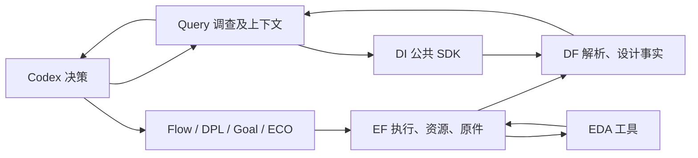
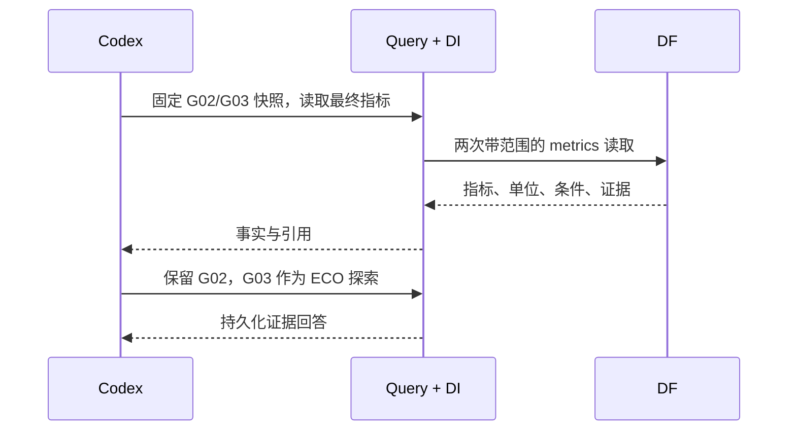
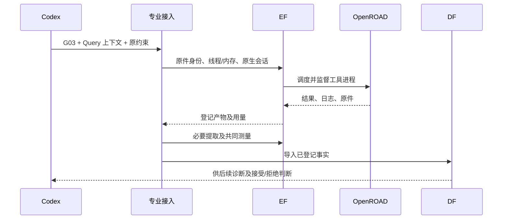

# A29 平台操作与接口实证

平台让当前 Codex 调用领域能力，统一提交实验、登记产物、取得设计事实；是否继续、接受哪条分支由 Codex 判断。下列记录来自本机实际调用，不是 token 节约率或四专业连续成功的声明。

## 已完成的操作

|操作|实际结果|原件（根目录下）|
|---|---|---|
|固定 GCD 已采用结果|复用 G02 的原验证，不重跑相同产物|`var/business/a29-paper-delivery-20261020/gcd-retained-package/manifest.json`|
|读取设计状态并诊断|G03 的 Query 完成4事实/4假设，定位共享反相器及12负载|`var/business/a29-paper-delivery-20261020/gcd-eco-source/query/professional-context.json`|
|当前 Codex 判断两候选|2次 DF 事实读取、引用各自证据、回答保留 G02；额外 Query 内部模型调用0|`var/business/a29-paper-delivery-20261020/same-codex-query-demo-r2/answer-state.json`|
|同一布线产物交付|组件/线路/引脚 DEF 段完全相同，七项 PPA 精确同值|`var/business/a29-paper-delivery-20261020/preserved-routing-acceptance-r3.json`|
|提交实际专业任务|DPL 两个候选构建成功；ECO 实际读取 G03 并执行原生动作，整体会话尚未收尾|本轮 `runtime/experiments/gcd/` 的原生/EF回执|
|导入较大含宏设计|原 Ariane ASAP7 placed 基准经 EF 导入成功，210295组件及136 SRAM均核对|`var/business/a29-paper-delivery-20261020/runtime/experiments/ariane/a29-ariane-original-placed-import-r1/import-result.json`|

同一 Codex 展示的初始化和两次读取墙钟约1.346秒。父 Codex 的推理 token 没有单独计量，不能把“额外内部模型调用0”写成“总 token 为0”。旧64KiB调查预算失败的记录保留；完成案例使用512KiB预算，实际读取约50KiB。

## 接口与责任

接口取自现有实现，表中参数省略非核心可选项。DI 是安装的 SDK，没有另建服务。

|调用者→模块|现有签名或入口|返回/责任|
|---|---|---|
|Codex→业务入口|`chip-evolve.py --config CONFIG run --design DESIGN --capability dpl\|goal\|eco --source RESULT --context CONTEXT --rounds N --seconds N`|准备原生输入并提交；输出结果或具体失败|
|专业接入→EF|`KernelClient.submit(task, idempotent=True, idempotency_key=key)`；`POST /kernel/runs`|`run_id`、任务状态；工具进程由EF监督|
|Codex/接入→EF|`KernelClient.run(run_id)` / `logs(run_id, offset=0, max_bytes=...)` / `resources(run_id)`|状态、日志、预约和实际用量；资源等待与工具失败分开|
|接入→DF|`POST /snapshots/from-run`，请求含`run_id, artifact_id`|解析已登记的事实归档，保存导入回执|
|Codex/Query→DI→DF|`EdaAiClient.resolve_scope(snapshot_id=...)`；`GET /scope`|确定唯一设计/版本/实验/阶段快照|
|Codex/Query→DI→DF|`get_stage_summary(snapshot_id)`；`GET /snapshots/{id}/summary`|对象数量、覆盖范围和来源|
|Codex/Query→DI→DF|`get_metrics(snapshot_id=..., include_raw=True)`；`GET /snapshots/{id}/metrics`|指标、单位、条件及证据；分页|
|Codex/Query→DI→DF|`get_timing_paths(snapshot_id, check="setup", sort="slack", order="worst", limit=5)`|明确范围的最差路径样本，不冒充全量路径|
|当前 Codex→Query|`query_agent investigate ... --model host`，随后`act INV --decision FILE --model host`|复用已具备推理能力的宿主；Query保存调查和证据关系|

最小交接数据包含：`design_id`、`run_id`、`snapshot_ids`、`condition_id`、`objective_id`、原件身份及SHA、事实/假设、目标、允许动作、预算。实际字段以 `result.json` 和 `professional-context.json` 为准。这里没有增加另一份可写的“真相库”。

后一图表达现有调用路径；本轮新 ECO 正在其中运行，不能把图当作其最终验收已通过。

## 关键决策

- 原件与实验生命周期归 EF；解析后的设计事实、索引和查询归 DF；DI保持 SDK。Codex不用直接读服务内部数据库或管理工具进程。
- DPL 消费实际布局检查点，ECO 消费实际布线状态，避免统一成一个会丢失专业能力的假输入。
- 已布线 ECO 交付保留线路，只做提取与测量；未布线检查点仍需完成布线。独立checker的marker与原生DRT计数分别保存，目前不能声称它们等价或独立DRC为零。
- 专业局部排名和最终业务约束分开：允许有待下一棒修复的中间态；最终采用不能绕过原约束，也不默认采用最后一棒。
- 本机资源按实际设计配置。当前运行ECO仍使用已冻结的24GiB预约；新接入支持后续显式声明内存，不为启用新选项打断正在运行的实验。
- Ariane使用原研究提供的ASAP7 placed基准及SRAM模型，明确区别于ORFS RTL起点；目前只完成导入，不填写完整布线PPA。
