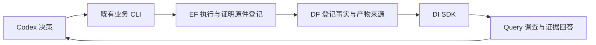

# A31 本轮平台修复交付：让已有结果真正成为可用成果

本轮从 2026-10-24 19:47（本机时间）开始，按已批准的三小时窗口推进三个切片：完成证明的结果恢复、当前业务状态纠正、Query 失败原因透传。没有启动新的优化搜索或调度消融，没有重启服务、搬迁数据库或修改用户在途的 DF/DI 与评测代码。

## 老板现在得到什么

| 交付 | 实际效果 | 状态 |
|---|---|---|
| Ibex/ASAP7 完成结果恢复 | 先前原生已证明成功、却被收尾脚本误报失败的结果，现已完成独立物理重放、数据核验及本轮采用登记。 | 实测通过 |
| 可信业务状态 | 旧交付成功记录不再遮住新失败；没有提交的实验也不会继续显示为等计算完成。 | 实现与回归通过 |
| 可处理的 Query 失败 | 控制 Agent 可以看到模型容量不足、退出码、追踪位置，知道该恢复模型调用还是继续调查设计。 | 回归及安装包事件重放通过 |
| 数据到调查的真实链路 | GCD/JPEG 三类快照与七项 PPA 逐值一致；GCD 正式 Query 调查完成证据回答。 | 实测通过；简单 ask 仍有缺口 |

三个切片的工程检查与下述业务操作已由工程师完成，仍可由老板独立复核；不把本轮结果恢复写成八组正式实验全部通过。

## Ibex 的业务结果与时序

以下来自同 condition/objective 的原始 baseline 和 candidate；本轮恢复其有效性，未产生新的优化收益。

| 指标 | 原 baseline | 恢复采用的 candidate | 解释 |
|---|---:|---:|---|
| 功耗 | 29.243746772 mW | 28.254939243 mW | 降低约 3.38% |
| 单元面积 | 2403.75 µm² | 2342.58 µm² | 降低约 2.54% |
| setup worst slack | +25.478 ps | +10.1494 ps | 时序余量减少，但保持闭合 |
| setup TNS | 0 ns | 0 ns | 均闭合 |
| hold TNS | 0 ns | 0 ns | 均闭合 |

正 slack 是 worst slack，不应标成正 WNS。candidate 的 WNS 为 0；最终电气与路由约束无违反。本结果说明功耗/面积收益在闭合约束内兑现，不能写成同时提升时序。

原 EQY 在 10 月 22 日已完成：18737 分区 PASS，覆盖 106 输出、1938 原始状态义务及 16691 额外实际切点。原收尾错误来自特殊脚本读取不存在的 `status` 文件，未识别原生 `PASS`。原 EF 的 extractor_error 历史保留；本轮用新成功 EF 任务登记证明原件，随后走正常物理重放和 DF/DI 校验，没有重跑 PDR。

关键记录：

- 原失败任务：`run-fbf3d8495f524f7fa45a794120e340df`。
- 本轮证明原件登记：`run-7503946b99804c59a898e269dbaff26d`。
- 采用候选：`run-82db4fc077bd445ca6ad73e6f931af26`。
- 独立重放：`run-3e3c9993332448aea2d68554d343ea5f`；七项最终值全部相同。
- 本轮工作区：`var/business/a31-result-recovery-20261024`。
- 采用收据：`ibex-recovered-adoption.json`，adopted=true，无失败条件。
- 完整验证：`runtime/experiments/ibex/a31-ibex-asap7-recovered-proof-validation-r1/validation.json`。

采用登记在本轮独立工作区完成，没有覆盖冻结历史试次，也没有把独立重放算作第二次完整协同优化实验。

## 状态管理纠正

`progress.experiment_status` 保留当前真实 failed/running/pending/succeeded，旧恢复记录单独显示为 delivery_recovered；恢复引用还必须有对应本地结果。原 CLI 名称和已有字段保持。

只读基线收集进程 PID 1465870 已循环数天。核对 Ariane/ASAP7 第一项为真实 orfs_error、第二项未提交后，保存原索引并只结束该观察进程；未取消或重启 EDA。可变索引明确记为 blocked，并保留七组已有基线对。收据：`baseline-observer-close-receipt.json`。

## 平台的数据流与边界

已完成证明可复用，但必须绑定同一结果对、冻结网表/模型、完整输出义务及成功证据生产者。恢复执行、事实核验、最终采用分别留下收据。原研究算法、任务资源上限和业务约束没有改。

Query 保留原始错误和 trace；暂停可以恢复，但本轮没有新增后台重试器。安装包及专用环境已验证，旧服务/Query 环境未热切。详见 [Query 切片报告](A31_QUERY_FAILURE_TRANSPARENCY_20261024.md)。

## 检查、文件与发布

主业务 636 项、Query 170 项回归通过；用户现有 evaluation 24 项在适用环境通过。Ruff、格式、两侧类型检查以及 Query 三条依赖约束通过。差异逐文件限定于下面三个切片与文档，17 个受保护文件哈希保持，DF/DI 的 HEAD 和工作树状态与开工基线一致。

| 切片 | 文件与职责 |
|---|---|
| A31.1 | `chip_evolve/validation.py` 复用完成证明；`admin/test_validation_completed_proof.py` 验证绑定与恢复；`admin/A31_COMPLETED_PROOF_RECOVERY_20261024.md` 记录证据。 |
| A31.2 | `chip_evolve/progress.py` 定义真实状态；`chip_evolve/cli.py` 展示状态；`admin/test_business_status_recovery.py` 验证失败不被遮盖；对应切片报告。 |
| A31.3 | Query 的 `codex_host.py`、`investigation.py` 传递原因；`test_host_failure_receipt.py` 覆盖生命周期；根 `diagnosis.py` 与 `test_query_objective_handoff.py` 贯通业务报错；对应切片报告。 |
| 收口 | 本报告、`TASKS.md`、`ARCHITECTURE.md`、`SOURCE_MANIFEST.json` 与 Query gitlink 记录范围和源码身份。 |

Query 模块提交为 `568b1ac`。远端常规 `modules/query-agent` 已有 `4ee0af0` 的“候选待启用”比较提示增量，本轮没有擅自合入或覆盖它。为保留这项在途边界，A31 源码检查点发布到同一 ChipEvolve 仓库的 `modules/query-agent-a31-result-recovery-20261024`，manifest 明确记录实际分支；根仓库使用 `a31-result-recovery-20261024`。这两条均为可审阅检查点，不是对生产服务或主分支的热切换。

## 正式论文实验还缺什么

| 缺口 | 本轮核查结论 | 后续最短动作 |
|---|---|---|
| Ibex/Nangate45 证明 | 原证明真实超时，没有可恢复 PASS。 | 分析困难义务后单独续证，不冒充恢复成功。 |
| Ariane/ASAP7 | 当前周期 ECO 为负结果；另缺完整同条件基线对。 | 选明确策略与可用来源，先补一组有效交付。 |
| Ariane/Nangate45 | constant-buffer EST-0104 尚未解决。 | 核对具体原生脚本/输入后做定向兼容修复。 |
| GCD/Nangate45 | 业务已批准 500 ps 新条件，但本轮未实施。 | 同条件重跑 baseline 与协作，250 ps 负结果保持。 |
| 八组双次平均 | 本轮恢复一份 Ibex 有效结果，不等于补齐全部双次链。 | 逐组核对现有两次完整链，缺哪组补哪组。 |
| Query 简单查询与效率 | simple ask 仍有证据选择/匹配缺口；真实 host 约 73 秒、239567 input token（200960 cached）、1707 output token。 | 定向修查询并压缩调查上下文，再做同任务简短对照。 |
| DF 存储与查询 | 主库约 224.3 GB，开工 health 约 3.66 秒；未迁移/清库。 | 在独立范围内做查询/存储优化，保留用户在途修改。 |
| 自主决策优于固定顺序 | 没有受控固定顺序对照，本轮未增设该实验。 | 当前只主张异构能力可组合、结果可追踪、可按约束选结果；更强主张需要单独对照。 |

本轮最有价值的变化是：已完成成果不会再轻易因收尾错误丢失，当前失败不会被历史成功盖住，模型侧失败也能与 EDA/数据失败分开处理。下一步应逐组补齐有效论文链，避免回到大范围平台改造。
