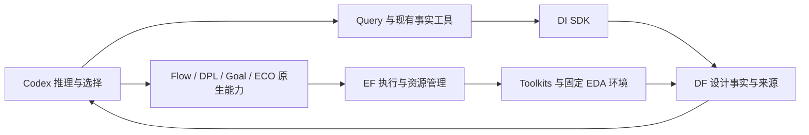

# 实验前全面核查：架构、功能与实际环境

日期：2026-10-24。源码基线：根仓库 `9216454`。本轮没有向生产 EF 提交新的 EDA 实验、优化搜索或模型调用，也没有重启服务、调整服务容量、清库或移动历史实验。测试使用各模块的临时数据和模拟工具。

## 给老板的结论

平台的模块职责可以保留，当前不需要重构整个平台。已有功能确实能工作，但部署记录、测试入口、依赖安装和不同数据视图的使用还不够一致。**“开发检查通过”不能直接宣布“下一轮八组实验可以启动”。** 本轮已修复能明确定位的检查入口与验证环境问题；下一轮的配置、资源和已知 PDK 阻断仍须按实际任务收口，暂不启动新长实验。

| 老板关心的问题 | 核查结论 | 实际处理 |
|---|---|---|
| 架构是否臃肿 | 主链路只有执行与数据服务；DI 没有服务/数据库。业务接入层已约 7955 行、31 个 Python 文件，最大的 `professional.py` 为 1083 行，维护负担需要控制。 | 保留专业原生控制器；本轮没有添加框架、服务、公共 API 或数据库。长文件拆分不作为跑实验前置。 |
| 功能是否正确 | 基础模块、四专业接入与业务回归能通过；真实查询有可用路径，也有尚未修复的边界。 | 修复 Flow 检查入口，重新核验专业接入；对查询失败区分选错视图与真实证据匹配问题。 |
| 环境是否干净 | 当前服务没有 PYTHONPATH/PYTHONHOME 注入；镜像和八组库文件哈希通过。但开发/运行/发布三套身份并不完全一致。 | 按固定 wheel 对齐部分开发与本轮隔离环境，保留用户在途修改，未热切生产。 |
| 能否立即开始八组长实验 | 不能直接宣布就绪。 | 先固定下一轮实际配置与资源，解决对应设计的已知失败，做针对性短验证后再搜索。 |

## 一、架构核查

- 业务层 AST 导入审计未发现直接导入 EF runtime、DF 存储实现、Query 实现或 SQLite。跨模块仍通过公共客户端/SDK；EF 的 17 组 guardrails 随全量检查通过。
- 专业控制器有本地 subprocess 不代表 EDA 绕过 EF：DPL/Goal 的平台 profile 委派构建和物理操作，ECO 的持久 OpenROAD 及子进程归属单个 EF 会话。平台模式失败不应退回宿主 EDA；对应委派与失败测试已覆盖。
- DPL 消费布局检查点并继续 CTS/route；Goal 会显式移除 fillers/信号线后执行原算法与路由；ECO 消费已布线状态。交接记录说明这些转换，不能声称每棒都无损继承所有物理状态。
- 原生局部评分与最终 PPA 分开，最终采用由 Codex 经已有 validation/selection 决定。本轮未增加评测底座。
- `professional.py` 的来源准备、专业派发、候选收集和布局续接集中较多；后续可按原有职责拆文件，但不要先添加总线、插件层、状态框架或抽象接口。
- Query 已提供同一 Codex host 的动作接口；简单事实应直接走现有工具。业务诊断默认另开 hosted 会话有实际上下文成本，不能拿其约 73 秒的调查成本作为所有查询的必需开销。

## 二、实际修复与回归

### Flow 检查入口

原 `python3 dev.py flow-agent check` 从仓库根运行 `pytest flow/test`，测试导入原生 `common` 失败。修复为在 `flow-agent/flow` 运行 `pytest test`；不添加 PYTHONPATH、不改变 Flow 算法或测试逻辑。`dev.py` 同时整理格式、明确 subprocess 返回码处理，并使已有 shebang 与执行权限一致。

新增 `admin/test_dev_flow_entrypoint.py` 检查 Flow 的工作目录、测试路径和无 PYTHONPATH 注入，同时确认 Query 的目录保持原样。两个针对性测试通过，随后 Flow 97 项和根业务 638 项通过。

### 专业验证环境

DPL 开发环境和 ECO 开发环境缺少源码需要的 `eda_toolkits.context`；ECO 还没有 pytest。初始失败日志保留。实际业务使用的 DPL/ECO/Goal/Flow 环境均具备上下文与目标组件，不能把开发环境问题误报成全部专业 Agent 已不能运行。

从干净 Toolkits 提交 `86673fa` 构建 wheel，SHA256：`3e2d1a51be1bec5c8f0f450edbf5bcb861f48fabded62a598a46ce5f0d35b3d9`。安装到 DPL/ECO 开发环境与 A31 本轮专用 Query 环境，ECO 补齐 pytest；三个环境的 `pip check` 通过。没有修改专业算法、个人凭据或生产服务。

Goal 直接裸环境测试遇到 localhost 经代理返回 502；按业务入口已有的 NO_PROXY 配置运行后通过。这是测试调用未遵守环境约定，未用源码补丁掩盖。Goal 客户端依赖运行在单独 client Python 是既有设计，不能因其 agent Python 不含 EF SDK 就宣称委派失效；另在客户端测试环境覆盖了平台边界测试。

| 检查范围 | 结果 | 说明 |
|---|---:|---|
| EF 完整检查 | 396 passed / 1 skipped | pip、类型检查、guardrails、运行/HTTP 测试；跳过项为不适用的宿主能力负例。 |
| DF 完整检查 | 378 passed | 包含用户在途源码；不代表这些源码已经发布或启用。 |
| DI 完整检查 | 13 passed | SDK 及用户在途修改的现有测试。 |
| Toolkits 完整检查 | 78 passed | 原生适配、输入、资源、解析与失败产物。 |
| Flow 完整检查 | 97 passed | 经修正后的统一入口。 |
| DPL validation | 47 passed | 对齐依赖后通过。 |
| Goal unit | 441 passed / 3 skipped / 29 subtests passed | 3 项 SDK 相关测试在独立 client 环境补查。 |
| Goal 平台客户端边界 | 53 passed | 与 unit 有重叠，不累加为独立实验。 |
| ECO 接入检查 | 20 passed | 对齐依赖后通过。 |
| 根业务回归 | 638 passed | 含新入口回归。 |
| Query | 复用 A31 的 170 项通过记录 | 源码未改变；本轮另做安装包的真实只读查询。 |

Ruff、修改文件格式与 Pyright 通过。各失败原件和修复后日志均保留，不删失败测试、不把跳过改成通过。

## 三、实际环境与八组输入

镜像 `/home/wjyuan/projects/eda-toolchain/orfs-8e6ee7aac233da07.sif` 已重新计算完整 SHA256，与登记的 `8e6ee7aa…d8dd39` 相同；共同 OpenROAD 基础提交为 `27288f5c90265ae5296b2f5a9fa6e8714fa191ad`。Code 私有研究增量仍单独保留，不能要求其二进制与通用 OpenROAD 同字节。

49 份 A30 local 配置中，按修改时间为八组各选一份代表做静态审计，**这不是自动替老板选定下一次实验配置**。八组声明的库文件哈希与测量时钟常量/单位均匹配。部分 SDC 使用 ns 或 Tcl 变量，不能直接通过 Flow 的“字面量 ps 输入”解析；这不等于它们的原生物理测量时钟错误。需要 Flow 接力时应使用其明确资格来源，不能硬套 GCD 的序列化规则。

| 项目 | 当前实际情况 | 风险与动作 |
|---|---|---|
| EF 容量 | 实际进程 PID 3936549，32 GiB / 32 CPU / 4 workers；旧配置保存的是其他 PID 与 128 GiB。 | 固定下一轮实际资源，不以旧元数据排程。当前 DPL/Goal 模板 build 为 32 GiB、private variant 为 8/16 GiB；不能笼统声称所有任务都因容量无法启动。未来若需 64 GiB 构建，必须先解决实际预约能力。未改容量。 |
| EF 当前任务 | queued/preparing/running/retry_wait/cancel_requested 都为 0。 | 没有本轮卡死待消费的生产任务；历史 stale worker 与可选 evaluator 缺失不能冒充当前阻断。 |
| DF 主服务 | 43789，主库约 225.08 GB，健康查询本次约 0.246 秒；历史库作为只读 archive。 | 不是两套互相覆盖的写入真相；本次短采样不能证明持续负载性能。 |
| 旧 DF 服务 | 53305 仍在运行；旧配置中 data pid 也指向它。 | 新任务应明确使用 43789。未核清其他消费者前不停止旧服务。 |
| DF 代码身份 | 服务安装文件 fingerprint 与公开启动 fingerprint 相同；服务版本 0.2.2.dev1。 | 当前工作树/manifest/实际包仍需分别记录，不将源码测试通过当上线。 |
| 发布清单 | 9 模块中 8 项 HEAD 与 manifest 一致；DF 当前 HEAD 259d777 与 manifest 7f6e7a5 不同，且 DF/DI 有用户在途修改。 | 不重置、不擅自提交用户工作；下一轮应固定实际消费的包与来源。 |
| GCD/Nangate45 | 最近代表配置仍是 250 ps。 | 老板批准的 500 ps 新条件尚未落成下一轮配置/基线，原 250 ps 负结果保留。 |

检查期间保留了 26 个用户在途文件的哈希；生产服务无 PYTHONPATH/PYTHONHOME 注入。独立环境数量多本身不是污染，**无法说明某次任务究竟消费哪个包/源码才是问题**。

## 四、Query 功能与封装是否在帮忙

本轮直接核对了 GCD/JPEG ORFS 与 OpenSTA 两种快照：ORFS 有功耗、面积、WNS/TNS；这两份 OpenSTA 快照有路径数据而无汇总 metrics。向后者索要 WNS 返回不足，不应解释成 DF 丢失所有时序数据。

安装包真实只读调用，新增模型和 EDA 调用均为零：

| 设计 | 调用方式 | 返回 WNS | 墙钟 |
|---|---|---:|---:|
| GCD | typed timing + ORFS snapshot | 0 ns | 0.483 s |
| GCD | 按 run 查询 WNS | 0 ns | 0.732 s |
| JPEG | typed timing + ORFS snapshot | −0.0156584 ns | 0.267 s |
| JPEG | 按 run 查询 WNS | −0.0156584 ns | 0.471 s |

这些是用于核查的实际历史节点，JPEG 该节点时序不闭合，不能拿来冒充最终合格结果。

仍有真实缺口：普通 metric 查询同时要求精确 snapshot 时，实验级 MetricObservation 转为 Evidence 后缺少 snapshot 身份，匹配会拒绝已有指标；多指标自然语言也不是完整的批量指标接口。本轮没有通过放宽 scope 或伪造证据修它。下一步应在原有 provider→observation→evidence 链保留已验证身份，覆盖跨 snapshot 负例；不添加另一套查询框架。

对简单事实使用现有确定性入口，对理解/归因让当前 Codex 组合证据与现有 host 动作。不得强制所有请求都再开一次模型会话，也不得把一次小查询成功宣传为完整因果分析能力。

## 五、恢复实验前的最短收口顺序

1. **固定一份下一轮实际运行清单。** 明确设计/PDK/时钟、工具镜像与专业增量、解释器/wheel、EF/DF 地址、资源与父产物；复用现有 local/profile/收据，不建新服务或评测库。
2. **修原有接口的具体问题。** 补普通 Query snapshot 证据身份，固定指标所在视图；随后验证返回值、引用和上下文交付一致。对已正确的调用不另包一层。
3. **逐设计处理真实阻断。** GCD/Nangate45 落实已批准的 500 ps；Ariane/Nangate45 定位 EST-0104 输入/脚本；Ibex/Nangate45 区分真实证明超时与收尾错误。`freeze_environment` 当前仍明确限制 ASAP7，不能把这份旧资格收据当作双 PDK 全能力证明。
4. **做针对性短验证，再开长搜索。** 核对本次会用的工具加载、阶段交接、EF 收到并完成任务、DF 取回同一指标与产物，以及中断后不重复计算。已由相同哈希产物证明过的部分复用；失败先查具体原因，不能拿长搜索当环境调试器。

本轮没有为了“全面”而强加所有设计都跑四专业、再做调度消融、清完所有技术债或完成公开发布。验收围绕已批准的协同案例、正确 PPA 和统一封装。

## 文件与证据

本切片源码仅 `dev.py` 和 `admin/test_dev_flow_entrypoint.py`；文档为本报告、`AGENTS.md`、`TASKS.md` 与 `admin/STATUS.md`。专业源码、公共协议、用户在途评测/DF/DI 文件未修改。

证据位于 `var/business/a32-pre-experiment-audit-20261024/`：`runtime-and-architecture.json`、`image-identity.json`、`eight-design-input-audit.json`、`data-service-installed-identity.json`、`EF-active-queue.json`、`development-toolkit-alignment.json`、`query-supported-cases.json` 及逐模块检查日志。环境对齐记录含 wheel SHA、安装目标与失败/成功输出；实际运行数据不提交 Git。
