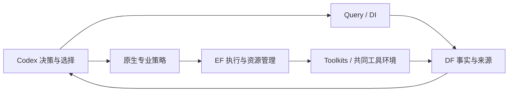

# A54：当前功能阻断图与待用策略纠正

2026-10-26 A92：Ariane实际cap驱动经原ECO BUF_X2隔离三负载，动作/合法化/增量GRT正确；混合RC cap60→59，但同条件GRT控制与动作后均slew1/cap17，仍拒绝，不能把跨RC的60→17说成收益。新网22guides、非零60.8fF负载及完整STA路径验证通过；默认模型该信号活动率0，微小功耗差未冒称动态优化。11DF原值/两Query原件核验、三私有脚本静态通过，产品/原算法/26用户文件保持，同源回归复用，无模型/最终RCX/采用。见 [A92](A92_ECO_ELECTRICAL_LOAD_ISOLATION_20261026.md)。

2026-10-26 A91：真实Ariane复现ECO指定负载显示名不匹配，以及Nangate45 BUF_X2输出Z被硬编码Y遗漏、过程却返回成功的断连。仅修插入/删除buffer的原生master引脚及实例身份接点，原签名/动作/评分/回溯保持。双PDK实际插入删除及拓扑恢复、3EF包/6capture与DF身份/冻结核验通过；旧3失败→新七项通过、ECO63/2子项与根48接点、静态通过，根754同源复用。模块17b0407供新会话，产品根/26用户文件/服务保持，无模型/布线/新PPA或采用。见 [A91](A91_ECO_BUFFER_TECHNOLOGY_IDENTITY_20261026.md)。

2026-10-26 A90：GCD/Nangate45 500ps原Goal联合配方→Query→显式ORFS物理接续最终资格通过并登记采用。power1.922859345mW（−13.8547%）、cell594.51µm²（−12.0079%），setup/hold WS +11.0525/+110.445ps、TNS0、电气/DRC0；18输出PDR、独立19字段同值/网表同SHA、25EF包/96capture及四Query原件核验通过。setup余量较基线减少29.0387ps，仍闭合。产品/服务/26用户文件保持，七私有脚本静态通过、根754/Goal479及71子项同源复用，无长搜索；独立重放不算第二次优化。见 [A90](A90_GCD_NANGATE45_JOINT_RELAY_20261026.md)。

2026-10-26 A89：八组A73待用配置SHA/政策保持，701份Goal源码/原二进制、97份Query安装源码及实际Goal/ECO冻结入口匹配，八次历史精确scope的setup WS通过。修复Goal平台将无Git副本的上层平台HEAD误记为源码提交；原文件SHA/构建验签及算法不变。14针对/479模块/71子项/39根接点与静态通过，模块0ca32cc供新会话，未恢复长搜索或新增PPA。见 [A89](A89_PREPARED_BINDINGS_AND_SOURCE_IDENTITY_20261026.md)。

2026-10-26 A88：生产DF同机实际优先本地复制，已流式/部分索引/256MiB缓存。A84真实行隔离60万事实两库均WAL/FULL且全部内容SHA相同；50.76/45.37秒，物理写入均约1.764GB、库878.4MB。确认解析/索引持久化为具体成本，未凭单次10.61%差异改生产缓存；全量交付延迟仍未关闭。源码/服务/用户文件保持，下一项核对八组待用配置消费修复情况，见 [A88](A88_DF_ACTUAL_FACT_WRITE_PROFILE_20261026.md)。

2026-10-26 A87：ECO三个上下文导出仍有首次clock format失败，真实首rank文件0字节已复现；三处注释改epoch后全成功，原正文/四时序保持，原消费者读到91邻居/13高扇出/5目标负载。6针对/56模块/2子项/57根接点及10份EF原件通过，模块de19cc4供新会话。无新PPA/采用；下一项定位实际DF解析/索引写入成本，见 [A87](A87_ECO_CONTEXT_REPORT_FIRST_CALL_20261026.md)。

2026-10-26 A86：已实际复现并修复公共ECO将STA报告显示名误当OpenDB原始名的问题；原五负载/slack排序同值，实际克隆输入/输出连接及对象增量通过。50模块/2子项、57根接点、静态及差异检查通过；模块ff8d13c供新会话使用。原专业动作/评分/回溯和公共接口保持，无新PPA或采用。Ariane剩余电气与其他实验缺口仍在，见 [A86](A86_ECO_NATIVE_INSTANCE_IDENTITY_20261026.md)。

2026-10-26 A85：Ariane/Nangate45最终负载定点修复完成短核查。私有对象寻址已修；保存guides的增量R4/R5零违反伴69缺路由警告，无效；修改前建立完整工作GRT的R6警告0但slew1/cap16，仍拒绝。五DF/DI/Query及32份EF输出核验，8私有脚本静态通过；没有新最终RC/PPA/采用，停止同清单路由试探。A84实际最终slew1/cap60保持。下一项先实际核查公共ECO对象身份，不猜测补层。见 [A85](A85_FINAL_SPEF_REPAIR_AND_ROUTE_STATE_20261026.md)。

2026-10-26 A84：Ariane/Nangate45 A83保存状态完成实际DRT/RCX、共同测量及三DF scope/12事实/四Query原件核验。最终power159.345523mW已低于原上限5.394µW、cell739092µm²、setup/hold WS +288.494/+47.782ps、TNS0、DRC0；但slew1/cap60仍拒绝。18EF原件、当前60驱动DF/DI身份及唯一OAI22_X4→X1回归核对通过；最终V与GRT同SHA。公共源码与26用户文件保持，754同源根回归复用；无新模型/长搜索/采用。下一项据最终SPEF做定点电气修复，见 [A84](A84_ARIANE_FINAL_RCX_AND_ELECTRICAL_DIAGNOSIS_20261026.md)。

2026-10-26 A83：Ariane/Nangate45原Goal严格回收300个size-down后保留检查点，修正私有物理接续顺序、两处有害缩尺寸、显式原路由层范围及最后一处CLKBUF升级的增量路由交接。最终GRT setup/hold WS +294.374/+25.735ps、TNS均0、电气0/0/0、cell739091.888µm²；不同RC阶段功耗不混算，最终DRT/RCX/功耗资格及采用仍待。全部EDA经EF，阶段DF/DI/Query和原件核验通过；公共源码保持，复用754同源根回归及静态code-check，26用户文件保持。无新模型/长搜索，见 [A83](A83_ARIANE_STRICT_POWER_ELECTRICAL_HANDOFF_20261026.md)。

本表已接续至 A92。A54 初始基线根 `a0e9bea`、Query `54a08be`；该初始轮没有 EDA/专业搜索或模型调用。后续按“具体诊断 → 定点修复 → 短验证 → code-check”推进，真实短验证见下列更新。A32/A34 是历史审计，保留原始失败及尚未通过的资格。

2026-10-26 A82：Ibex/Nangate45既有分支完成独立DRT/RCX、七PPA及19原始字段同值、网表与已证明候选同SHA、三DF scope/两Query原件核验，并经现有策略登记采用。setup −9.952→+8.634ps/TNS0、power21.887543mW（−0.954257%）、cell29465.4µm²，电气/DRC0，原约束保持。修复验证入口先读旧请求capability而未先用保存检查点的问题；12新增旧失败→通过、53针对/754根回归及静态通过，26用户文件保持。无新优化/PDR；独立重放不计第二次优化。见 [A82](A82_IBEX_NANGATE45_QUALIFIED_ADOPTION_20261026.md)。

2026-10-26 A81：Ibex/Nangate45原完整证明已补齐，19384分区/106输出全部PASS；复用5333、新原生PDR补14051，12CPU/16GiB有界EF成功，原超时保持。原模型/库/时钟/配置及完整列表不变，全部状态/新日志/输入SHA和现有proof_receipt核验通过，completed_proof业务收据可消费；候选三DF scope/指标/原约束通过。742同源回归复用、静态code-check及26用户文件保持；无新优化或PPA，待独立物理重放及采用。见 [A81](A81_IBEX_COMPLETE_PROOF_RESUMPTION_20261026.md)。

2026-10-26 A80：真实Ariane有限行profile定位到提交/checkpoint成本，并修复import_snapshot在已提交事实可读时仍同步等POST响应的问题。保留WAL/FULL、既有HTTP/身份/恢复；实际安装DF+真实EF包+DI SDK在扣住响应时已正确交付、attempt1/重入不重导。742根/25针对、两旧失败→通过及静态增量code-check通过；测试6项既存类型诊断新增0，26用户文件/DF安装源码保持。未宣称消除实际大库写入或生产20分钟耗时，无EDA/模型/新采用。见 [A80](A80_COMMITTED_FACT_DELIVERY_WAIT_20261026.md)。

2026-10-26 A79：修复ECO持久会话寄生更新后沿用旧功耗缓存，并将实际会阻断报告的格式化时间戳改为epoch秒。原helper真实控制/修复配对表明GRT功耗0.158→0.160W缓存纠正，非优化收益；四STA和面积保持。46模块/2子项、54根接点、静态检查及8EF原件/DF/DI/Query原件核验通过，740同源回归复用。原动作/评分/回溯及26用户文件保持；模块0105684已发布，无长搜索或新采用。见 [A79](A79_ECO_QOR_POWER_CACHE_FIX_20261026.md)。

2026-10-26 A78：查清Goal mid仅纯VT，Nangate45单VT上0候选为预期；early真实300动作减少面积却引入setup/电气债，拒绝。独立只读配对确证A77私有脚本漏刷功耗缓存，原阶段功耗收益撤回；A74新进程最终测量不受影响。两DF/DI/Query快照和原件、14份策略EF输出及静态code-check通过，26用户文件/产品源码保持，740同源回归复用。下一项查ECO持久会话功耗；无新采用或长搜索。见 [A78](A78_GOAL_POLICY_AND_POWER_CACHE_20261026.md)。

2026-10-26 A77：同源原生cap20/recover20配方完成。仅恢复guides的r1触发RSZ树缺1负载；试验副本重建working GRT后r2完整成功。电气阶段cap64→13，通用回收397实例使hold/电气恶化（A78已撤回未刷新缓存的原功耗收益）；末GRT hold TNS−0.372938ns、slew102/cap305、面积/阶段功耗超限，拒绝且不跑DRT。四节点/四EF原件、DF/DI及两Query核验通过，产品/26用户文件保持，740同源回归复用。下一项审原Goal专业功耗机制，不重复通用回收。见 [A77](A77_NATIVE_REPAIR_POWER_CONFLICT_20261026.md)。

2026-10-26 A74/A76最终收口：DRT/RCX、共同测量、三事实scope/12数值/4 Query及原件核验通过；64驱动均经DF/DI按native ID/master/ODB SHA核对，原session82815 exit0、导入1次。setup/hold闭合、DRC0，但cap64和power超限0.0261084%仍拒绝、未采用。数据交付实际约20分钟，登记为大设计性能瓶颈。下一项审原生电气修复/功耗回收与具体导入耗时；见 [A74](A74_ARIANE_NANGATE45_FINAL_QUALIFICATION_20261026.md)、[A76](A76_POSTROUTE_CAP_DIAGNOSIS_20261026.md)。

2026-10-26 A76/A74：真实DRT/RCX与共同测量完成，setup/hold WS +261.794/+42.930ps、TNS均0、DRC0；较同条件参考setup余量+54.841ps、cell−671µm²，slew16→0/cap252→64。但power159.392521mW超原159.350917mW上限0.0261084%、cap64，仍不合格。64驱动只读定位成功，非已知常量且均无dont-touch，cap超限1.21–18.45%；无产品改动，740同源回归复用、静态/原件核验通过。当前DF大对象导入仍由原session82815等待，不重发。见 [A76](A76_POSTROUTE_CAP_DIAGNOSIS_20261026.md)、[A74](A74_ARIANE_NANGATE45_FINAL_QUALIFICATION_20261026.md)。

2026-10-26 A75：修复独立验证按方法标签把有效保存检查点误分流到ORFS baseline；检查点优先，历史无检查点baseline保持。7个新场景修复前失败→通过，52针对/740根回归与静态边界检查通过；26用户文件保持。A74同一EF详细布线继续，无新EDA/模型/PPA结论。见 [A75](A75_VALIDATION_CHECKPOINT_PRIORITY_20261026.md)。

2026-10-26 A74：Ariane/Nangate45最终收尾前置核查及19项物理接力回归通过；原6ns/输入/镜像/目标保持，8CPU与8工具线程一致、16GiB资源核实。公共resume已实际启动EF `run-376fac03616245beb2e94e60b82c442e`，当前详细布线运行；没有新专业搜索、最终PPA或采用结论。沿同一run观察，不能因观察超时重跑。见 [A74](A74_ARIANE_NANGATE45_FINAL_QUALIFICATION_20261026.md)。

2026-10-26 A73：Ariane/Nangate45保存GRT经公共resume准入短验证，176184实例/189839网络/1667022 guides和原层范围、setup/hold WS/TNS逐值保持；重复恢复同run/attempt且不新增EDA。修复Query不识别setup WS，228模块/24针对/9根接点、独立wheel97源码/四真实查询及静态code-check通过。没有完成DRT/RCX/PPA/采用，长搜索仍暂停，26用户文件保持。见 [A73](A73_SAVED_GRT_INTAKE_AND_SETUP_WS_20261026.md)。

2026-10-26 A72：cut行片段投影已修复并经新私有二进制实测；真实11738行/36单元的原函数投影29移动→0，四个同映射候选局部HPWL下降88.00–91.88%、时序恶化减轻，仍不及原设计、原规则全部拒绝。210746实例/191607网络含供电回滚、两事实/四Query、七EF构建与归档/AST身份通过；477模块项合计及71子项核对、原函数19子项和静态code-check通过，26用户文件保持。八份新source_seed绑定保留原策略和500ps政策，未恢复长搜索或新增采用。转查其余接点，见 [A72](A72_RMP_ROW_FRAGMENT_FIX_20261026.md)。

2026-10-26 A71：SLVT映射库202cell单区域短验证实际生效，但四STA仍恶化、拒绝并完整回滚；两placement事实/四Query通过。进一步从原ODB核查11738行片段：原36合法单元按现有仅y选行规则有29个被移走、累计4342788DBU，横纵距离选片段则0位移。已定位cut行投影的具体几何缺陷，下一项修复并编译原函数回归/原生短验证；尚未宣称修复已落地或新增PPA。产品/26用户文件保持，静态code-check通过，无长搜索/模型。见 [A71](A71_RMP_FAST_LIBRARY_AND_ROW_FRAGMENT_DIAGNOSIS_20261026.md)。

2026-10-26 A70：同一Ariane检查点单区域原生配对诊断完成；实际36个SLVT输入被四种ABC全部映为80–106个RVT。原输入SLVT归一化开关在此无效，边界放置使局部HPWL下降12.78–18.67%，仍时序恶化、八次STA全部拒绝；两组完整210746实例/191607网络含供电回滚同值。EF映射原件、四placement事实/八Query及静态code-check通过，产品源码/26用户文件不变。下一项核对多VT映射与延迟目标语义，不重复默认长搜索。见 [A70](A70_RMP_MAPPING_AND_PLACEMENT_DIAGNOSIS_20261026.md)。

2026-10-26 A69：修复Goal准备阶段预运行glob漏登记node/nets CSV，真实EF七产物与两CSV公开取回/profile哈希一致；原Ariane RMP单阶段4逻辑云/16次STA全部时序变差拒绝，210746实例/191607网络含供电的拓扑和位置完整回滚。三placement快照/六setup与hold Query及原件通过；733根回归与静态code-check通过，26用户文件保持。无新采用/模型/长搜索；下一项核查原RMP映射及边界放置策略，不重复默认配置。见 [A69](A69_ARIANE_RMP_DIAGNOSIS_AND_GOAL_ARTIFACTS_20261026.md)。

2026-10-26 A68：确证RMP把共用VDD/VSS误当触发器信号邻接；737实例的原邻居735→真实信号邻居167。私有源码仅加供电排除，保留全部信号/时钟/STA/回滚规则；原生新构建与160文件/1989符号AST完成。同一GCD输入恢复4逻辑云/16次真实STA，均因时序变差拒绝；737实例/761网络含供电的拓扑与位置回滚同值，DF/DI/Query两阶段原件通过。475模块/52子项、23根接点及静态通过，root同源731复用；八份待用配置只更新源码绑定并保留500ps等原政策，未放行长搜索或新增采用。 见 [A68](A68_RMP_SUPPLY_ADMISSION_FIX_20261026.md)。

2026-10-26 A67：修复Goal timing_only漏执行4种原生RMP策略；54组合中仅4种改变，其余50种命令逐字相同。Ariane最差reg→output路径Q后42个单元弧全SLVT，单元/连线延迟636.44/45.41ps，setup WS−280.68ps；不改约束。一次EF原生GCD短验证确认RMP实际检查200条路径，但可重构实例0、无收益，负分支不采用；两阶段DF/DI/Query与原件通过。6新增/11子项、473模块/40子项及49根接点通过，root同源731复用；静态增量检查通过，原生成器11项既存严格lint诊断保持。正式长搜索未恢复、八组双次未完成。 见 [A67](A67_GOAL_TIMING_ONLY_RESTRUCTURE_20261026.md)。

2026-10-25 A55更正：此前漏查已完成的 `run-9efb…` 修正PDN分支，原ORFS最终VDD/VSS PSM实际通过，随后因SRAM GDS缺失失败。旧来源/事后改网格负结果保持；当前剩余问题及原件见 [A55](A55_ARIANE_CORRECTED_PDN_SOURCE_RECOVERY_20261025.md)。下表与下一步已同步这一范围。

2026-10-25 A62：Goal 时钟指令控制否定本设计上的理想时钟猜测；不实施猜测性补丁。实际原生 DEF/V→crit_vt_deep→合法化→GRT 完成，3388 次 VT 调整；同协议起点/后继 GRT TNS −509.059→−451.843ns，欠账减少11.24%，仍不闭合。实例物理状态/网表在 placement→GRT 保持，新增1604090 guides；六快照及 Query 实际比较通过。未做最终 DRT/RCX/证明/采用，下一项查专业 GRT 与共同最终 RC 相关性。见 [A62](A62_GOAL_NATIVE_BOUNDARY_DIAGNOSIS_20261025.md)。

2026-10-25 A63：真实Hold TNS错答setup已修复，Query隔离检查点 `f31773d`；15新增/211Query/712根及14真实查询通过。四组同状态RC事实已登记，原生估算表不同而RCX规则相同，未切专业RC；专业后继hold欠账需明确交现有ORFS物理收尾，不能默认setup专业自动处理。最新八组待用配置在A63/configs，保留PDN/FakeRAM及500ps策略。见 [A63](A63_QUERY_HOLD_AND_RC_BOUNDARY_20261025.md)。

2026-10-26 A64：确证Goal placement ODB丢失原生routing bounds与layer adjustment，原平台initializer恢复后实例/网表不变；显式ORFS GRT全阶段成功，hold TNS0、电气0/0/0，但setup WS−280.684ps/TNS−92.960533ns仍未闭合。31针对/八驱动静态、五包64文件及DF/DI/Query核验通过；私有接点验证尚未收口到公共业务入口，未做最终DRT/RCX/证明或采用。见 [A64](A64_NATIVE_PHYSICAL_HANDOFF_20261025.md)。

2026-10-26 A65：已复现并修复简单hold路径查询实际返回setup的问题。内部check贯通现有DI服务端筛选和证据标记；8新增/219Query/712根、三依赖约束及独立包8真实查询/两报告原件通过，新的八组绑定保留原策略。A64独立物理接点仍待显式接回业务及恢复/候选证据链，不默认改qualify。见 [A65](A65_QUERY_TIMING_PATH_CHECK_20261026.md)。

2026-10-26 A66：显式原生物理接点已用既有orfs/replay/source接回业务、候选溯源/恢复及独立验证，双PDK实际数据回流通过；19新增/62针对/731根及静态检查通过。ASAP7 GCD完整18输出/独立七PPA同值通过，源结果保持；原生中间阶段可在无最终PPA时经DF/EF核查接入。成功回执漂移和历史baseline误分支已修复；Nangate旧250ps仍负，500ps正式策略不改，八组双次未齐。见 [A66](A66_EXPLICIT_NATIVE_PHYSICAL_RELAY_20261026.md)。

## 老板可以据此作出的判断

EF 执行、DF 事实、DI SDK、Query 与专业接入均有真实可用记录，当前无需重构架构。最近修复已经消除了多项跨 PDK、源码消费、路由交付与证据匹配问题；剩余主要工作是特定设计的物理/功能资格、策略选择和重复实验。八组历史事实可查，不等于八组优化已经合格。

本轮另修正一项待用配置：GCD/Nangate45 已有 500 ps 闭合基线，但未来 Goal 模板仍沿用 Ibex 的 timing-only 权重。功耗权重为零时，闭合 TNS 的候选评分距离可为零，功耗改善不计入目标。新私有配置显式选择已有 GCD 的功耗/时序联合策略；不改平台代码、公共接口或历史实验。

实际包依赖检查还查出 Goal 环境的 Toolkits 缺少声明依赖的 EF client/contracts。只补装与现有生产客户端一致、SHA 已核对的两个本机 0.2.0 wheel；既有包未卸载或升级，服务未变。原有独立 client Python 委派方式保留，不把这项环境完整性问题说成旧 EDA 委派全部失效。

## 功能与任务块

| 功能块 | 当前已核实的能力 | 剩余限制或下一步 |
|---|---|---|
| EF 提交、消费、资源与监控 | 公共接口正常；32 CPU / 32 GiB / 4 workers，五种活动状态计数均零；A32 完整检查及后续真实任务有效 | 当前没有“任务排队但无法消费”的实例；A66修复的是业务Jobs成功回执因新客户端等待而漂移，EF服务本轮不改。历史 stale worker 与未配置的可选 protected evaluator 不作为本轮阻断；未来大构建仍按实际申请和峰值核对 |
| EF 日志、失败与产物 | A38/A45/A48/A52 实际成功/失败原件均可追踪；大产物沿既有 materialize 路径 | 外层命令成功不代表内部检查通过。A52 EF succeeded 而供电检查失败，必须读原生结果 |
| DF/DI 事实与来源 | 既有精确scope、原指标及来源核验保持；A88确认生产包指纹、local-first和流式/部分索引；隔离60万事实两库内容完全一致 | 实际主库约241.66GB/2449快照，A84全量对象交付仍慢；样本50.76/45.37秒且写入量不减，不凭此增大生产缓存。用户DF/DI WIP和实际wheel身份分开保留，不热切。见[A88](A88_DF_ACTUAL_FACT_WRITE_PROFILE_20261026.md) |
| Query 精确查询、比较与交接 | A33/A49–A53 修复 scope/来源/比较；A63修hold标量，A65再修简单路径类型及分页，独立安装包/实际原件核验通过 | 多指标及复杂归因继续由Codex通过既有SDK/hosted工具组合；不新造harness，不把不同测量run当独立优化两次 |
| 显式原生物理接力 | A66已接入现有业务入口，按实际Make/脚本恢复路由环境，保留guides做DRT/RCX，记录源和后继；ASAP7完整证明/独立同值、双PDK/恢复与DF/DI/Query通过 | GCD增加时序余量同时增加功耗/面积，不自动采用；Nangate250ps仍setup/功耗/面积拒绝，正式500ps不变。Ariane原生阶段来源核查通过，最终长路径/物理资格仍缺；见[A66](A66_EXPLICIT_NATIVE_PHYSICAL_RELAY_20261026.md) |
| Toolkits / 共同工具环境 | A32 镜像与库身份核验；后续原生任务由 EF 在该环境实际执行 | Code 研究增量二进制另有源码/构建身份，不能要求与通用 OpenROAD 同字节 |
| Flow 来源与完整参数能力 | A42 完成反馈幂等恢复；A45 完整 500 ps 来源通过；A46 保留原变量 SDC、20% I/O 与 17 参数的准备检查通过 | 新条件完整搜索及协作尚未运行；准备成功不算完整搜索通过，旧默认综合也不冒充现代完整能力来源 |
| DPL 阶段与双 PDK | A36 实际三条原生布局链成功，八组设计注册正确；A37 新产物经 DF/DI/Query 可读 | 输入必须是适用的布局检查点；局部 HPWL 改善需继续检查最终 PPA，不能自动采用 |
| Goal 原算法、源码与续作 | A38 修复实际 measured-path 崩溃，A39 保留源码 seed/构建 donor，A40/A44 去除续作/重放的 PDK 硬编码 | A67/A68/A72补齐RMP模式、供电准入及宏行片段；新二进制/AST/原生短验证通过，八份未来源码绑定已准备。实际单区域四候选仍拒绝，Ariane setup未闭合，后续按问题选策略，不把兼容修复当最终收益 |
| Goal GCD/Nangate45 策略 | A90原联合固定配方经Query/ORFS物理接续、最终18输出PDR/独立重放与数据核验，原约束下采用；power−13.8547%/cell−12.0079%、时序闭合 | 固定配方本分支最终资格已关闭；未运行新四Student或完整Flow搜索，独立重放不计第二次优化，setup余量有减少；见[A90](A90_GCD_NANGATE45_JOINT_RELAY_20261026.md) |
| ECO 双 PDK 与已布线交付 | A35/A47/A56保留库/会话/线路；A57/A61补齐探针与设计TNS；A79功耗、A86/A87身份/报告修复，A91再修buffer A/Y→实际master引脚及指定负载显示名 | 模块17b0407供新会话，真实双PDK插入/删除拓扑恢复及63模块/48根接点通过；原算法/旧负结果保持，电气最终资格与新八轮仍未完成，不将动作修复计PPA收益。见[A91](A91_ECO_BUFFER_TECHNOLOGY_IDENTITY_20261026.md) |
| Ariane/Nangate45 原生 GRT 修复 | A59/A83完成原生GRT修复及严格功耗回收，A74/A84实际最终DRT/RCX/共同测量与DF/DI/Query完成 | 当前实际最终A84 power159.345523mW已低于原上限、setup/hold闭合、DRC0，但slew1/cap60拒绝。A85私有负载修复排除缺路由零违反误判，完整工作GRT对照仍slew1/cap16，无新最终资格/采用，停止同清单路由试探；见[A84](A84_ARIANE_FINAL_RCX_AND_ELECTRICAL_DIAGNOSIS_20261026.md)、[A85](A85_FINAL_SPEF_REPAIR_AND_ROUTE_STATE_20261026.md) |
| 最终验证与采用 | A31 Ibex/ASAP7完整验证及采用；A81–A82 Ibex/Nangate45原19384分区/106输出PASS、独立DRT/RCX/七PPA及19字段同值、网表同SHA、DF/Query和采用全部完成；既有GCD/JPEG保留 | Ibex/Nangate45本分支最终资格阻断已关闭，不能把独立重放计第二次优化。其他设计资格与八组双次仍未齐；见[A82](A82_IBEX_NANGATE45_QUALIFIED_ADOPTION_20261026.md) |
| Ariane/ASAP7 最终供电与交付 | A52旧来源/事后改网格失败保持；A55核实另一前置修正来源的原ORFS最终VDD/VSS PSM实际通过、DRC0，之后因缺SRAM GDS失败 | A60核实原包为FakeRAM2.0抽象模型，显式声明宏后末端导出控制/136实例核验通过，完整宏几何仍为抽象；不再重复PDN或把真实SRAM制造版图作为当前PPA前置。原最终SPEF的setup TNS−127.168ns/slew444保持历史事实；A64新原生GRT后继hold0、电气0/0/0、setup TNS−92.960533ns仍失败，最终DRT/RCX/完整资格缺失；见[A60](A60_ASAP7_FAKERAM_STREAMOUT_20261025.md) |
| 论文路径与两次平均 | 既有专业参与、真实接力及失败分支保留；GCD、JPEG、Ibex 有有效成果 | 八组各两次完整合格优化未齐；没有受控证据证明自主调度优于固定顺序。两项都是实验缺口，不是靠新框架能补出的功能 |

## 本轮策略修正的精确范围

新配置位于 `var/business/a54-current-blocker-map-20261025/configs/`，沿用 A53 最新 Query 安装包和原专业绑定。八份配置仅移到本轮独立 state_root；其中 `gcd-nangate45` 再指向新私有 campaign。旧 A53 配置的全部 SHA 已核对保持。

新 campaign 从原 Nangate45 模板保留其余全部字段，仅复制已有 `gcd-asap7` campaign 的三项原生策略设置：

| 设置 | 原待用模板 | 新待用模板 |
|---|---|---|
| metric_weights | dynamic=0、leakage=0、TNS=1 | 三项均为 1 |
| promotion | strict_evidence | power_first_promotion |
| power_stage_protected_rounds | 10 | 0 |

这是一次**明确的新任务策略选择**，不是声称策略与旧任务相同。原目标值、四 Student、Teacher、AST、EPD、原生 recipe、动作上限、源码 seed、构建 donor 和资源保持。没有加入自造的功耗缩放目标；最终闭合/电气/面积等业务约束也不变。原生 baseline 仍须在真实输入上测量，不能把模板中的旧 baseline 字段当成本设计事实。

Goal 自己的解析器加载八份 campaign。纯决策检查采用明确标注的合成单元夹具（正功耗、TNS=0），旧模板距离为 0，新模板距离大于 0；原生策略选择 `adaptive_tradeoff / power_then_timing`。夹具数值不进入 PPA、DF 或论文。真实闭合证据仍来自 A45：500 ps、setup WS +40.0912 ps、TNS 0；本轮没有产生新 PPA。

## 运行环境与架构

本轮读取实际监听进程：EF `41151` PID3936549，DF `43789` PID3537663；旧 DF `53305` 未动。服务无 PYTHONPATH/PYTHONHOME 注入。EF health 约 0.017 秒、DF health 约 0.222 秒；八组 SDK 指标读取加 Query 调用约 0.45–0.66 秒/组，仅为本轮只读短采样。

九模块中八个 HEAD 与 manifest 一致，DF HEAD/WIP 差异原样保留。业务接入层 31 个 Python 文件、8063 行，最大 `professional.py` 1086 行；AST 检查未发现直接导入 EF runtime、DF 存储、Query 实现或 SQLite。维护负担仍在，当前没有证据要求为本轮实验新增服务、总线或重构层。

五个实际任务解释器（client、Query、Goal、Flow、ECO）最终依赖检查全部通过。Goal 新增 client wheel SHA `a32ed9de…82e652`、contracts wheel SHA `07e82398…65d42`；安装后各 Python 文件与 wheel 逐字节匹配，并从 Goal 环境通过公共 EF client 读取原已完成任务。完整 SHA、安装前后包清单与差异见 `goal-dependency-wheels.json`、`goal-environment-alignment.json`，仅新增这两个包。

## 验证、code-check 与改动清单

实际证据目录：`var/business/a54-current-blocker-map-20261025/`。包括运行身份、八组查询、库/SDC/配置 SHA、策略字段差异、原生解析与分支验证、包依赖、EF 公开状态和 26 个保护文件哈希。八组查询读取的是明确列出的历史节点，包含负结果和旧 250 ps 节点；绝不将其当新 500 ps 或最终采用结果。

- 本轮没有产品 Python 源码、模块 gitlink、公共协议或服务修改；不用重复全场 EDA 验证未变源码。
- 补齐环境后 Goal 全部单元回归 **444 passed / 29 subtests passed**，根业务接点 **24 passed**，原生策略检查通过。A53 的 196 Query / 712 根业务全回归为同产品源码检查点，可复用，不冒充本轮重跑。
- 两份新增验证脚本 Ruff、格式、Pyright 最终通过。首次 Ruff 导入排序及显式 subprocess 返回码检查失败已纠正；首次从根目录做 Goal 静态检查选错源码根，改在 Goal 自有项目目录运行后通过。未改产品或注入跨项目 PYTHONPATH 来消除诊断。
- 部分专用环境有意没有 pip；首次用目标解释器直接 `-m pip` 的检查失败保留，后续用已有 pip 的 `--python` 检查目标环境，不往运行环境安装管理工具。此后确实发现 Goal 两项声明依赖缺失，补装两个既有 wheel 后五个环境全部通过；不将初次失败记成通过。
- 26 个用户保护文件、旧配置和历史成果保持；实际差异逐文件核对。

提交文件仅本报告、`AGENTS.md` 当前审计入口、`TASKS.md` 切片状态、`ARCHITECTURE.md` 当前边界记录、`admin/STATUS.md` 续接索引。运行配置与验证脚本属于 var，不发布；源码与 manifest 不发生变化。修改下一任务策略，应改其显式 campaign 绑定，不能在平台派发函数里悄悄改权重或晋升。

## 下一步按实际阻断推进

1. Ariane/ASAP7：复用A55找回的前置修正来源及最终PSM证据；A61已修ECO全设计上下文，A62原生crit_vt_deep及同协议GRT控制已跑完，确认有11.24%局部TNS收益但仍不闭合。A63已核实估算表不同但RCX规则相同；A64恢复Goal布局丢失的原平台路由上下文后，显式原生ORFS GRT收尾成功，hold0/电气0/0/0，setup仍−92.960533ns。A65已补齐简单hold路径语义，A66已收口显式接点并保存专业producer/物理后继、阶段事实及恢复；A67进一步证实最差输出路径Q后42单元弧全SLVT，并修复timing_only漏执行原RMP；短GCD检查无可重构候选。A68已修供电误筛并验证4逻辑云/16 STA、全部拒绝及完整回滚；A69/A70已完成原生重构/边界放置诊断，A71快速库仍无可接受候选，并确证仅y选行在实际宏行片段上移动29/36原合法单元。A72修复并完成新二进制/同映射验证，HPWL恶化显著消退但四候选仍不及原设计；当前单区域策略不再重复，转查其余接点。后续ASAP7优化须重新检查可闭合来源或原专业更大逻辑范围策略，不能把换表或改约束当修复。A60已验证FakeRAM声明与末端导出，不重做已过的供电或导出阶段。
2. Ibex/Nangate45：A81–A82已完成19384义务/106输出完整证明、独立物理同值/网表同SHA、DF/Query核验与本轮采用；本分支无待重跑任务，第二次独立优化和八组统计仍单独处理。
3. Ariane/Nangate45：A84实际最终功耗159.345523mW、setup/hold及DRC通过，slew1/cap60仍拒绝；A85最终SPEF负载修复及同网表路由对照已收口，缺路由零违反不能签收、R6仍不合格，不重复同清单调参。A86/A87已关闭公共ECO对象名和上下文导出阻断；下一项先定位生产DF实际解析/索引写入成本及用户WIP边界，不为当前不合格分支做昂贵证明或重复大EDA。
4. GCD/Nangate45：A90已完成500ps原生联合固定配方、Query/ORFS物理接续、完整证明/独立重放及采用，power−13.8547%/cell−12.0079%，原约束保持。该分支无需重跑；未来完整专业搜索与第二次独立优化仍单独处理，长搜索继续暂停。

其余组保留已有有效结果，按各自事实选专业接力。当前总目标仍在进行，长搜索继续暂停，不能把本轮配置/查询检查写成八组实验验收完成。
