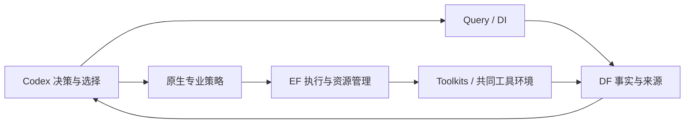

# A54：当前功能阻断图与待用策略纠正

接续根 `a0e9bea`，Query `54a08be`。本轮按“具体诊断 → 定点修复 → 短验证 → code-check”推进，没有启动 EDA、专业搜索或模型调用。A32/A34 是历史审计，下表是截至本轮的当前入口；保留原始失败及尚未通过的资格。

## 老板可以据此作出的判断

EF 执行、DF 事实、DI SDK、Query 与专业接入均有真实可用记录，当前无需重构架构。最近修复已经消除了多项跨 PDK、源码消费、路由交付与证据匹配问题；剩余主要工作是特定设计的物理/功能资格、策略选择和重复实验。八组历史事实可查，不等于八组优化已经合格。

本轮另修正一项待用配置：GCD/Nangate45 已有 500 ps 闭合基线，但未来 Goal 模板仍沿用 Ibex 的 timing-only 权重。功耗权重为零时，闭合 TNS 的候选评分距离可为零，功耗改善不计入目标。新私有配置显式选择已有 GCD 的功耗/时序联合策略；不改平台代码、公共接口或历史实验。

实际包依赖检查还查出 Goal 环境的 Toolkits 缺少声明依赖的 EF client/contracts。只补装与现有生产客户端一致、SHA 已核对的两个本机 0.2.0 wheel；既有包未卸载或升级，服务未变。原有独立 client Python 委派方式保留，不把这项环境完整性问题说成旧 EDA 委派全部失效。

## 功能与任务块

| 功能块 | 当前已核实的能力 | 剩余限制或下一步 |
|---|---|---|
| EF 提交、消费、资源与监控 | 公共接口正常；32 CPU / 32 GiB / 4 workers，五种活动状态计数均零；A32 完整检查及后续真实任务有效 | 当前没有“任务排队但无法消费”的实例。历史 stale worker 与未配置的可选 protected evaluator 不作为本轮阻断；未来大构建仍按实际申请和峰值核对 |
| EF 日志、失败与产物 | A38/A45/A48/A52 实际成功/失败原件均可追踪；大产物沿既有 materialize 路径 | 外层命令成功不代表内部检查通过。A52 EF succeeded 而供电检查失败，必须读原生结果 |
| DF/DI 事实与来源 | 本轮八组各六项原始指标与 result 逐值一致，run/snapshot/revision 精确 scope 一致 | 主库约 225.21 GB；本轮短读取正常不证明持续负载性能。用户 DF/DI WIP、manifest 与服务安装身份仍需分别保留，不热切换 |
| Query 精确查询、比较与交接 | A33/A49–A53 修复 snapshot、来源引用、缺失原因、stage 推断和不同 run 计数；本轮最新安装包八组查询 8/8 通过 | 多指标及复杂诊断继续用现有 SDK/host 工具由 Codex 组合；不新造 harness，也不能把不同测量 run 当独立优化两次 |
| Toolkits / 共同工具环境 | A32 镜像与库身份核验；后续原生任务由 EF 在该环境实际执行 | Code 研究增量二进制另有源码/构建身份，不能要求与通用 OpenROAD 同字节 |
| Flow 来源与完整参数能力 | A42 完成反馈幂等恢复；A45 完整 500 ps 来源通过；A46 保留原变量 SDC、20% I/O 与 17 参数的准备检查通过 | 新条件完整搜索及协作尚未运行；准备成功不算完整搜索通过，旧默认综合也不冒充现代完整能力来源 |
| DPL 阶段与双 PDK | A36 实际三条原生布局链成功，八组设计注册正确；A37 新产物经 DF/DI/Query 可读 | 输入必须是适用的布局检查点；局部 HPWL 改善需继续检查最终 PPA，不能自动采用 |
| Goal 原算法、源码与续作 | A38 修复实际 measured-path 崩溃，A39 保留源码 seed/构建 donor，A40/A44 去除续作/重放的 PDK 硬编码 | 崩溃复测通过不等于 measured 策略最终收益通过。每次专业任务必须依据当前设计事实选原有策略 |
| Goal GCD/Nangate45 策略 | 本轮新配置由 timing-only 改为已有 GCD 联合策略；八份原生配置解析及决策分支检查通过 | 尚未运行新 native baseline/四 Student，不能记成新增功耗优化收益 |
| ECO 双 PDK 与已布线交付 | A35 库、corner、单位及模型参考与物理会话一致；已有路由保留；A47 独立重放保留阶段/原生 DRC 身份 | Nangate45 加载通过不代表完整模型 ECO 会话已经获得合格收益；ECO 负分支继续保留 |
| Ariane/Nangate45 原生 GRT 修复 | A48 完整原 14 动作、repair_design/repair_timing、合法化及 incremental GRT 实际跑完 | GRT 估计仍有 4 slew / 8 cap；需解决剩余问题并完成最终 DRT/RCX/证明。不同 RC 模型不能直接宣称最终改善 |
| 最终验证与采用 | A31 Ibex/ASAP7 恢复完整证明、独立重放与采用；既有 GCD/JPEG 合格分支保留 | Ibex/Nangate45 原证明确为超时，不存在可直接恢复的整体 PASS；新预算已准备，尚未运行 |
| Ariane/ASAP7 最终供电 | A52 已查明原最终 VDD 失败；事后修改已布线 PDN 的捷径也失败，失败事实已入 DF | 既有 PDN 相位修正必须在信号布线前生效，之后仍需完整物理资格。前置 floorplanning 检查不能替代最终完整实例检查 |
| 论文路径与两次平均 | 既有专业参与、真实接力及失败分支保留；GCD、JPEG、Ibex 有有效成果 | 八组各两次完整合格优化未齐；没有受控证据证明自主调度优于固定顺序。两项都是实验缺口，不是靠新框架能补出的功能 |

## 本轮策略修正的精确范围

新配置位于 `var/business/a54-current-blocker-map-20261025/configs/`，沿用 A53 最新 Query 安装包和原专业绑定。八份配置仅移到本轮独立 state_root；其中 `gcd-nangate45` 再指向新私有 campaign。旧 A53 配置的全部 SHA 已核对保持。

新 campaign 从原 Nangate45 模板保留其余全部字段，仅复制已有 `gcd-asap7` campaign 的三项原生策略设置：

| 设置 | 原待用模板 | 新待用模板 |
|---|---|---|
| metric_weights | dynamic=0、leakage=0、TNS=1 | 三项均为 1 |
| promotion | strict_evidence | power_first_promotion |
| power_stage_protected_rounds | 10 | 0 |

这是一次**明确的新任务策略选择**，不是声称策略与旧任务相同。原目标值、四 Student、Teacher、AST、EPD、原生 recipe、动作上限、源码 seed、构建 donor 和资源保持。没有加入自造的功耗缩放目标；最终闭合/电气/面积等业务约束也不变。原生 baseline 仍须在真实输入上测量，不能把模板中的旧 baseline 字段当成本设计事实。

Goal 自己的解析器加载八份 campaign。纯决策检查采用明确标注的合成单元夹具（正功耗、TNS=0），旧模板距离为 0，新模板距离大于 0；原生策略选择 `adaptive_tradeoff / power_then_timing`。夹具数值不进入 PPA、DF 或论文。真实闭合证据仍来自 A45：500 ps、setup WS +40.0912 ps、TNS 0；本轮没有产生新 PPA。

## 运行环境与架构

本轮读取实际监听进程：EF `41151` PID3936549，DF `43789` PID3537663；旧 DF `53305` 未动。服务无 PYTHONPATH/PYTHONHOME 注入。EF health 约 0.017 秒、DF health 约 0.222 秒；八组 SDK 指标读取加 Query 调用约 0.45–0.66 秒/组，仅为本轮只读短采样。

九模块中八个 HEAD 与 manifest 一致，DF HEAD/WIP 差异原样保留。业务接入层 31 个 Python 文件、8063 行，最大 `professional.py` 1086 行；AST 检查未发现直接导入 EF runtime、DF 存储、Query 实现或 SQLite。维护负担仍在，当前没有证据要求为本轮实验新增服务、总线或重构层。

五个实际任务解释器（client、Query、Goal、Flow、ECO）最终依赖检查全部通过。Goal 新增 client wheel SHA `a32ed9de…82e652`、contracts wheel SHA `07e82398…65d42`；安装后各 Python 文件与 wheel 逐字节匹配，并从 Goal 环境通过公共 EF client 读取原已完成任务。完整 SHA、安装前后包清单与差异见 `goal-dependency-wheels.json`、`goal-environment-alignment.json`，仅新增这两个包。

## 验证、code-check 与改动清单

实际证据目录：`var/business/a54-current-blocker-map-20261025/`。包括运行身份、八组查询、库/SDC/配置 SHA、策略字段差异、原生解析与分支验证、包依赖、EF 公开状态和 26 个保护文件哈希。八组查询读取的是明确列出的历史节点，包含负结果和旧 250 ps 节点；绝不将其当新 500 ps 或最终采用结果。

- 本轮没有产品 Python 源码、模块 gitlink、公共协议或服务修改；不用重复全场 EDA 验证未变源码。
- 补齐环境后 Goal 全部单元回归 **444 passed / 29 subtests passed**，根业务接点 **24 passed**，原生策略检查通过。A53 的 196 Query / 712 根业务全回归为同产品源码检查点，可复用，不冒充本轮重跑。
- 两份新增验证脚本 Ruff、格式、Pyright 最终通过。首次 Ruff 导入排序及显式 subprocess 返回码检查失败已纠正；首次从根目录做 Goal 静态检查选错源码根，改在 Goal 自有项目目录运行后通过。未改产品或注入跨项目 PYTHONPATH 来消除诊断。
- 部分专用环境有意没有 pip；首次用目标解释器直接 `-m pip` 的检查失败保留，后续用已有 pip 的 `--python` 检查目标环境，不往运行环境安装管理工具。此后确实发现 Goal 两项声明依赖缺失，补装两个既有 wheel 后五个环境全部通过；不将初次失败记成通过。
- 26 个用户保护文件、旧配置和历史成果保持；实际差异逐文件核对。

提交文件仅本报告、`AGENTS.md` 当前审计入口、`TASKS.md` 切片状态、`ARCHITECTURE.md` 当前边界记录、`admin/STATUS.md` 续接索引。运行配置与验证脚本属于 var，不发布；源码与 manifest 不发生变化。修改下一任务策略，应改其显式 campaign 绑定，不能在平台派发函数里悄悄改权重或晋升。

## 下一步按实际阻断推进

1. Ariane/ASAP7：围绕信号布线前的既有 PDN 修正安排有界资格检查；不再在旧最终布线上反复平移供电网。
2. Ibex/Nangate45：先复核原困难证明义务与准备好的 14400 秒预算；不得把部分 PASS 当整体完成。
3. Ariane/Nangate45：针对剩余电气问题选择已有原生修复策略，再做最终资格；不把 GRT 指标当最终 RCX 收益。
4. GCD/Nangate45：500 ps 来源与本轮策略配置已准备，正式恢复搜索时再测真实 native baseline、检查实际 recipe，随后完成协作及两次独立优化。

其余组保留已有有效结果，按各自事实选专业接力。当前总目标仍在进行，长搜索继续暂停，不能把本轮配置/查询检查写成八组实验验收完成。
