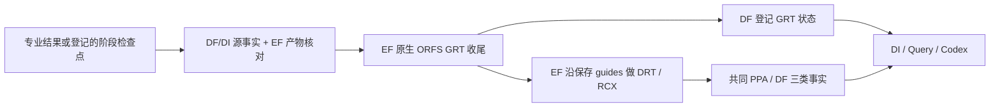

# A66：接通显式原生物理接力，修复恢复回执漂移

基线根 `65aa941`。本轮从 A64 的独立物理接点收口到正式业务代码，完成工程验证；老板业务验收独立。新增的原生 ORFS 收尾属于确定性工具能力，不新增专业 Agent、模型 harness、HTTP 服务或评测数据库。专业算法和原晋升不变，没有新 Student/Teacher 或模型搜索。

## 老板现在能做什么

Codex 选择一个已有专业检查点，用现有 `run --capability orfs --operation replay --source ...` 发起原生物理修复。平台核对源事实和 EF 产物，恢复实际路由设置，完成原生 GRT、电气/setup/hold 收尾、DRT/RCX、共同 PPA 与 DF 交付；Codex 查看结果后决定是否继续或采用。普通 baseline、Goal/DPL/ECO 的原交付保持；不会把修复暗加到所有 `qualify` 调用中。

不完整请求会在创建实验前报出具体错误，解决原来 `orfs --source` 被静默忽略的问题。合法输入既可以是专业结果，也可以是既有 `delivery-checkpoint.json`，后者需要 EF 实际字节及 DF/DI 精确阶段事实，不要求先取得最终 PPA。

A62 的真实 Ariane 原生 GRT 检查点已实际通过后者的来源核查：`run-d2429561bfb443b0ae4925b9c3af91fa`、post-route 快照和 ODB SHA 相互匹配，不新跑 EDA、不冒充完成 Ariane 最终资格。该证据在 `raw-stage-admission.json`。

## 修好了哪些实际阻断

1. **交接入口**：ORFS 基线和显式专业后继分开；阶段任务、最终测量及原专业生产者各自记录。原候选证据和源码引用留在原结果，新后继通过源路径/SHA/run/snapshot 与其关联。
2. **环境恢复**：读取实际 Make 环境和 FASTROUTE 脚本直接引用的环境变量，保存其原字节；应用后显式设置配置声明的信号/时钟层。避免自定义脚本只恢复信号层、时钟层仍继承旧值，或层容量变量丢失后使用默认值。
3. **交付保留 GRT**：新后继标记 global_route，资格验证直接消费保存 guides 做 DRT/RCX，保留原层范围；不再重新 global_route 或改成默认 M2–M7。旧详细布线保留路径不变。
4. **独立验证与恢复**：新后继验证不再按 ORFS baseline 从头跑综合；先保存的修复结果可复用。旧 baseline 的 replay 标签依据实际产物/已有原任务继续原行为，历史实验不被改成新的优化策略。
5. **回执稳定**：真实恢复没有新增 EDA，但原来三项 exports 的 `wait_seconds` 被新查询等待时间覆盖，使结果 SHA 改变。Jobs 仍查询 live EF 状态；同 run 再次成功时复用原成功回执。实时查询通过生命周期记录/EF 提供，不把新客户端等待当作新实验。

原生专业方法没有改成替代玩具；本接点调用共同镜像的原 `make do-grt`，保留原 helper/循环/筛选，仅显式使用已批准的 Diamond 兼容参数。8 工具线程与 EF 8 CPU 一致；本轮 GCD 声明4GiB，原生算法没有被限小。原目标、SDC/库/PDK和提取规则保留。

## 实际验证结果与业务取舍

最终主证据为 r2。r1 实际结果/失败检查均保留，不能与 r2 当作两次正式独立优化求均值。

| GCD / ASAP7，同 FF / 310ps / 原业务目标 | Goal G02 原结果 | 显式物理后继 r2 |
|---|---:|---:|
| 总功耗 / mW | 0.71564863902 | 0.73442235589 |
| cell area / µm² | 39.1181 | 40.0221 |
| core / die area / µm² | 57.9701 / 75.8293 | 57.9701 / 75.8293 |
| setup WS / ps | +0.0834055 | +13.8234 |
| setup / hold TNS / ns | 0 / 0 | 0 / 0 |
| slew / cap / fanout / DRC | 0 / 0 / 0 / 0 | 0 / 0 / 0 / 0 |

该后继增加约13.740ps的最差 setup 裕量，代价是功耗+2.6233%、单元面积+2.3110%。两个结果都满足原硬约束，但本轮没有理由用更高功耗分支替换原 G02；未调用 select，原采用不动。这里正值是原始 **WS**，按定义截断的 WNS 仍为0，不报告夸大的时序百分比。

r2 主测量 `run-1b4b1b83f3244da7907f7f2925e00c8c`；全18输出/1整体分区PDR通过、未证明0；独立 DRT/RCX 重放七PPA逐值相同、当前SDK通过，原生修复没有重做。完整回执为 `runtime/experiments/gcd/a66-independent-replay-and-proof-r2/validation.json`。

| 双 PDK 接入检查 | ASAP7 r2 | Nangate45 r2 |
|---|---|---|
| 实际信号层 / 时钟层 | M2–M7 / M4–M7 | metal2–metal10 / metal4–metal10 |
| 实际脚本的 PIN / ABOVE 调整 | 0.25 / 0.25 | 0.25 / 0.25 |
| source→原生GRT→保存guides的DRT/RCX→DF | 成功 | 成功 |
| 最终业务资格 | 原硬约束通过，未采用 | 旧250ps条件下 setup TNS −7.72364ns，且功耗/面积超限，拒绝 |

Nangate45 用已有250ps负分支验证接入，最终6.5987124108mW / 976.22µm² / setup WS−176.178ps，hold TNS0、电气0、DRC0；这不是新的500ps正式结果。已批准的500ps方案和未来八组配置不改，不把“流程成功”说成“PPA合格”。

首次接点只采集通用6个变量，实际自定义脚本依赖的 FLOORPLAN/PIN/ABOVE 变量未传递、ASAP7时钟下限仍为M2。该问题经代码和日志确证后修复，r2 才是完整配置验证；没有原样重复坏配置或改小算法以通过。记录 `routing-context-before-regression.log` 和两次实际设置/日志。

## 溯源、数据及恢复证据

- 两个PDK各8项EF任务，实际终态成功；专业原生产者、source run/snapshots、GRT生产者和共同测量生产者分开。输入与额外源引用在现有 checkpoint 的 input_hashes 中冻结，恢复不会更换它们。
- 两套 native GRT JSON独立换算原显示单位，与hook给出的ns标量按原JSON精度核对；不是拿同一解析器互相验证。GRT估算与最终提取RC分别登记，不混作同条件因果收益。
- 8项实际Query读取覆盖两PDK、GRT/最终、setup/hold TNS；值/单位/scope及引用metadata的完整字节/SHA通过。最终三类数据和七指标通过当前DI读取。
- 最终 r2真实测试先保留再移走前端result，恢复生成同SHA结果；再次resume不改其mtime，前后同8个EF run，新增EDA0。首次等待字段漂移保留在 `recovery-wait-drift/`；r1的最初真实回执从已保留的初始结果恢复，未修改物理事实或EF任务，不将过程失败写成成功。

## 文件职责与 code-check

| 改动文件 | 职责 / 影响 |
|---|---|
| `chip_evolve/native_physical.py` | 新增内部阶段适配器；源核查、实际Make路由环境、显式原生修复、阶段事实、现有确定性交付。没有新服务或专业算法。 |
| `chip_evolve/cli.py` | 既有orfs/replay/source组合显式分派；普通baseline保持。 |
| `chip_evolve/delivery.py` | 冻结额外源输入、保留GRT交付与恢复；默认额外输入为空，旧调用保持。 |
| `chip_evolve/physical.py` | 可选消费已有GRT guides；原补路由和详细布线保留路径保持。 |
| `chip_evolve/validation.py` | 依据实际方法区分baseline与修复后继；独立重放不重新优化。 |
| `chip_evolve/jobs.py` | live状态确认后保留相同run的首次成功回执，避免客户端等待字段漂移。 |
| `admin/test_native_physical_relay.py` | 19项交接/配置/原生事实/恢复/历史兼容回归。 |
| `chip_evolve/README.md` | 命令、source阶段边界、原专业源码追踪和恢复说明。 |
| 本报告、A54、TASKS、ARCHITECTURE、STATUS | 本轮证据、当前业务状态及后续工作。 |

静态lint/format/Pyright通过，新增19项/针对62项/根全回归731项通过；逐文件差异与AST模块边界检查通过。无EF runtime、DF存储、SQLite或Query实现跨目录导入。26个用户保护文件、旧源/目标/专业模块及原generic_agent、DF/DI修改保持。没有模块wheel/服务容量/公开HTTP端点变更。

证据目录 `var/business/a66-explicit-physical-relay-20261026/`；关键为 `code-check.json`、`business-verification.json`、`recovery-verification-final.json`、`raw-stage-admission.json`、两次主/兼容控制及验证回执。运行数据不纳入发布。

## 仍未完成

A64 物理接点已接入业务结构并通过本轮工程验证；不再要求每次手工拼接该段。但 Ariane/ASAP7 的残留setup长路径、Ariane/Nangate45最终资格、Ibex/Nangate45完整证明、GCD/Nangate45的500ps协作及八组两次合格优化仍未完成。下一步用已有事实定位具体物理/策略阻断，不再重建接口；正式长搜索暂不放行，也不把本轮兼容试跑当论文正式重复实验或自主调度优势证据。
