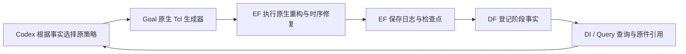

# A67：修复“只修时序”漏执行原生重构，并定位 Ariane 深逻辑瓶颈

本切片按“具体诊断 → 定点修复 → 短验证 → code-check”完成工程验证，待老板业务验收。没有恢复正式长搜索，没有新增可采用的 PPA 结果。总目标及八组双次实验仍在进行。

## 老板能看到的实际变化

此前 Goal 选择 RMP 时序重构策略，但任务模式为 `timing_only` 时，实际生成的 Tcl **完全没有调用重构**，只运行普通 `repair_timing`。专业策略的名字与实际执行不一致。现在该模式会执行所选原生重构，并保留其重构在前或在后、修复次数、四候选云/一个接受云、时序筛选与回滚规则；不会偷偷增加功耗回收。

业务收益是恢复一个原本被模式分支屏蔽的专业能力，不能将其写成 Ariane 已收敛，也不能将后面的负结果写成成功优化。既有专业 C++、Teacher/Student/晋升规则、SDC、库和业务约束均未改。

## Ariane：已找到真实瓶颈，不再笼统说“时序不好”

复用 A64 已完成的原生 ORFS GRT 报告，没有重新测时序。原报告与 EF `run-687a0c58c4ed452d80673f005a598b57` 原件逐字节/SHA 对应，报告 SHA 为 `b5d2bf65be33a75d737344ae8b5fa00ec55bdb4b0ddc04a2fa9356e43d06639a`。

| 最差 setup 路径 | 已核实事实 |
|---|---|
| 起点 | miss handler 的 `state_q[0]` 寄存器 |
| 终点 | 输出端口 `axi_req_o[143]`，是 reg→output 路径 |
| 原时钟 / 输出延迟 | 900 ps / 180 ps；要求到达时间 720 ps |
| 发射时钟到达 / Q 到达 | 281.83 ps / 318.84 ps |
| 输出到达 / setup WS | 1000.68 ps / −280.68 ps |
| Q 后单元弧 | 42 个，全部 SLVT |
| Q 后单元延迟 / 连线延迟 | 636.44 ps / 45.41 ps，来自原报告的舍入值求和 |

这条路径主要受深组合逻辑和实际发射时钟插入延迟影响；单元延迟约占 Q 后延迟的93.3%。不能继续假设 VT 调整或布线收尾会消除这条路径的全部欠账。下一项应检查原生逻辑重构的候选准入、实际动作与约束，兼顾其他寄存器路径。这里没有改变时钟、I/O 约束，也没有把“去掉时钟插入”当作优化方案。已有 A62 的局部 VT 收益仍保留，不因本诊断否定其真实贡献。

## 复现、修复及影响面

- 原新增回归先出现4个配方子项失败和1项参数检查失败，证实策略缺失；失败日志保留为 `before-regression.log`。
- `goalevolve/evaluation/contest2026.py`：扩大既有 RMP 分支的模式匹配，功耗步骤仅在原组合模式出现。公共函数签名、配置字段和 recipe 定义不变。
- `tests/unit/test_timing_only_restructure.py`：新增6项测试/11个子项，覆盖4种原生 RMP 策略、前后顺序、候选限额、时序硬筛选、无功耗回收及其他原模式。
- 全18种原策略 × 3种模式，共54份生成命令做前后比较：只有4种 RMP 的 `timing_only` 改变，其余50种逐字相同。不能顺带把 `reroute_mid_power` 的功耗步骤加入纯时序任务。

没有新增服务、公共 HTTP API、数据库或通用框架。数据仍经现有 EF→DF→DI/Query，控制与采用决定由 Codex 完成。

## 一次实际短验证及负结果

使用已有 **GCD/Nangate45 250 ps 负分支**的冻结原生 DEF/V/SDC/PDK输入和 A38 已验证二进制，仅验证此次模式修复；不是已批准500 ps正式实验，不替代它，也不算独立优化重复。

- EF 原生任务：`run-187b574f0b394045a933f6db771a8ef9`，4工具线程/4 CPU、8GiB、300秒任务预算；实际 OpenROAD 墙钟约1.35秒。
- 实际日志出现 RMP `path_query`，检查200条路径、选择4个端点，但可重构实例为0；重构前后网表及 ODB 均相同。**确已执行原生分析，但没有有效重构动作。** 不能将空候选判成整个PDK不支持；候选为何全部被过滤还需要具体准入核查。
- 后续原生时序修复/GRT完整结束，但指标变差，保留为负证据，不采用；本轮不为它追加昂贵功能证明或最终DRT。

| 原生阶段，仅作诊断 | setup TNS / ns | setup WS / ps | 原生报告总功耗 / mW |
|---|---:|---:|---:|
| 修复设计后 / RMP后，placement估算 | −6.91184817833 | −155.026690317 | 6.29086839035 |
| 时序修复后，placement估算 | −7.49363259322 | −169.421009794 | 6.86175189912 |
| 最后GRT，global routing估算 | −8.05189804289 | −182.555947748 | 7.08364602178 |

跨阶段RC口径不同，表格不表示每段的严格因果贡献；不是最终提取PPA。原生早期checkpoint的功耗是该日志报告值，不替代最终功耗核验。已有合格结果及采用状态完全不动。

EF完整产物包中的25个文件与本机原件/SHA匹配。RMP后及GRT后两份阶段事实分别通过既有ORFS解析入口登记DF，经当前DI查询及A65安装版Query实际回答；值、单位、scope和引用metadata完整字节/SHA通过。无额外模型调用。

## code-check 与提交范围

证据目录：`var/business/a67-goal-timing-recipe-20261026/`；关键为 `code-check.json`、`matrix-comparison.json`、`fact-verification.json`、`ariane-path-diagnosis.json` 和实际EF/DF/Query回执。

- 新增6项/11子项通过；Goal全回归 **473 passed / 40 subtests passed**，根相关接点 **49 passed**。根业务Python逐文件哈希未变，复用A66同源码731项全回归。
- 产品类型检查0错误，核心lint通过；新增测试和私有验证脚本lint/格式/类型通过。现有生成器在仓库较严格规则下的11项既存lint诊断，逐项与原提交一致，未擅自大规模整理旧文件，也不宣称它们已修好。
- 最终源码重新在独立输出目录生成同一真实输入的完整Tcl，与已执行脚本只作输出目录规范化后逐字相同。未改写已执行脚本、输入或历史日志。
- 逐文件差异、模块依赖检查通过；26份用户保护文件保持，generic_agent和DF/DI在途工作不动。EF五类活动状态均0。

发布仅Goal上述两份源码/测试、根gitlink和来源manifest，以及本报告和当前状态文档。运行数据留在var；历史控制器和服务不热切。

如需改策略步骤，改原recipe/本原生命令生成器；如需改任务选择，改显式业务计划。不得把策略选择、参数扫描或中间修复藏入最终测量。

## 下一步

先查RMP候选准入为何在这份输入上为0，再为Ariane的深组合路径选择有实际动作的原生策略，短验证通过才继续其物理接力。Ariane/ASAP7仍有setup欠账；Ariane/Nangate45最终DRT/RCX/PPA/证明、Ibex/Nangate45完整证明、GCD/Nangate45的500 ps协作和八组双次合格实验仍未完成。正式长搜索继续暂停。
