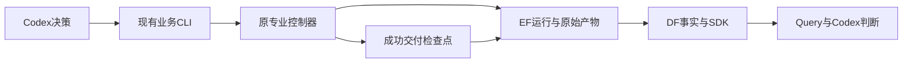
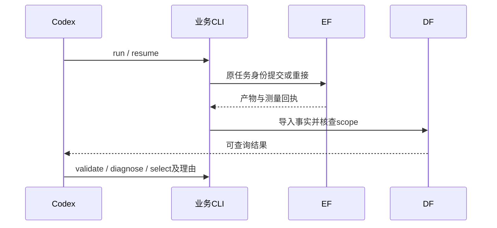

# A8/A9：本机流程收口与 AES 迁移验证

老板于 2026-10-15 确认上一轮规划，要求完成第一项，并由第二项 AES 验证迁移。基线 3c05323，分支 a8-a9-local-workflow-aes-20261015；26 份用户文件 hash 保存在 var/business/a8-a9-workflow-20261015/baseline.json。不扩大到专业算法升级、公开发布或公平 benchmark。

## 用户效果与切片

用户可从正式 CLI 调用原专业、恢复已完成专业的交付、继续原 Goal 父方法、验证并独立重放结果、通过 Query 查证后决定采用。Codex 保留选择和业务判断。

| 切片 | 验收 | 模块/前置 |
|---|---|---|
| A8 | 正式入口覆盖运行/诊断/继续/交付恢复/比较/逻辑证明/空目录重放/采用；GCD 真实恢复不重跑已成功计算，原始失败保留，SDK 身份和重放一致 | 根业务组合；A6/A7 |
| A9 | 同一入口用于 AES：冻结条件、适用专业搜索和阶段交接、完整 route/RCX、DF/SDK/Query、结果验证；不以 GCD 实例名改通用代码，不放宽约束换改善 | A8；现有专业公共入口 |

## 实施文件与边界

- cli.py：增加 resume/continue-goal/validate/compare 正式命令，现有命令兼容。
- delivery.py：原专业成功后保存确定性交付检查点，恢复无需重跑模型或专业搜索。
- validation.py / logic.py：已有 EF 工具下的独立重放、固定 Liberty 输出证明和 SDK 身份查询；不新增评分或服务。
- continuation.py：从原 admin 迁入已验收 Goal 续作；admin 保留兼容转发。
- physical.py / professional.py / native.py / jobs.py：保存交付检查点、恢复已提交任务并复用确定性阶段；影响四专业收尾，不改专业算法或公共 HTTP/SDK 契约。
- admin/test_local_workflow.py：中断、内容身份、恢复和证明边界回归。
- PROJECT.md / ARCHITECTURE.md / TASKS.md / chip_evolve/README.md：记录真实接口、状态和限制。

恢复仅重接原任务或补完已完成专业的确定性交付。尚未产生专业完成检查点时明确报告 native 尚未完成，不凭空实现通用模型会话恢复。失败 EDA 不使用旧成功标识强行重试。新 Goal 续作独立 key，保留原目标、筛选、四 Student 和旧证据。

## 数据流与验证

检查顺序：lint/format/type → 新逻辑单测 → 差异审查 → 模块边界 → 原根回归；随后 GCD 真实验证、A8 检查点提交，再进入 A9。AES 记录真实成功/失败、资源与成本，是否改善独立于迁移是否有效。运行数据留在 var，不提交凭据、环境和镜像。老板业务验收独立。
