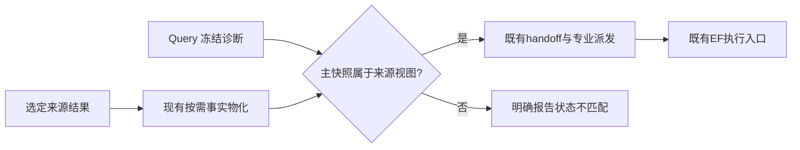

# A95：专业任务绑定精确设计快照

日期：2026-10-27。根基线 `63b3fa8`。本轮按“具体诊断→实际复现→定点修复→短验证→code-check”完成工程检查，老板业务验收独立。长专业搜索继续暂停。

## 发现的问题与业务影响

四专业共用的 `chip_evolve.professional.execute` 已核对 Query 诊断的设计编号、实验编号和结构化 source run，却未核对其 `scope.snapshot_id`。同一 producer 可产出多个物理状态，仅核对 run 无法识别把功耗优化后的诊断交给时序修复后状态的错误。

新增回归使用明确的合成测试夹具，不作实验数据：同一run、不同快照、合法冻结哈希的上下文，在旧入口的 Flow/DPL/Goal/ECO 四条路径都进入了下游，四项预期拒绝测试全部失败；十二项合法视图路径通过。未发现或声称历史PPA已经被此缺口污染；本轮关闭的是入口确实可复现的错配路径。

## 最小修复与数据流

产品仅在 `professional.py` 增加两行：在原 `design_facts.ensure` 完成后，检查诊断快照属于当前来源的 `snapshot_ids`，失败时在写handoff/输入回执及派发专业前明确拒绝。

检查必须放在按需物化之后，否则合法的新OpenDB快照会被旧的薄来源误拒绝。ORFS、OpenSTA、OpenDB任一已声明来源视图仍可使用；比较包的参考证据不因此被禁止，受检查的是专业包的主scope。模块公共接口、专业算法、优化目标、输入转换和资源规则不变。

## 针对性短验证

- 新增16项：四专业错误检查点拒绝4项、三种合法视图×四专业12项。两份既有测试夹具补齐真实契约已有的snapshot_id，不改取消或物化行为。
- 58项针对性回归通过；当前根业务全回归 **770 passed**。产品及三份测试的Ruff、格式、Pyright通过；私有只读脚本同样通过。完整门禁见证据目录。
- 首次全回归误收集 `admin/legacy-integration` 归档用例，因缺旧环境产生12项收集错误；保留原日志。随后使用当前根业务入口 `pytest -q admin/test_*.py` 全部通过，未为归档测试改产品或安装旧依赖。
- 对A90同一真实producer的三份历史快照，重新通过公共DI读取WS/TNS，再用已安装Query CLI查询TNS，并获取DF原件核SHA。功耗优化后 setup WS **−195.025723313 ps** / TNS **−4.62123907776 ns**；时序修复后 **+7.87586684828 ps** / **0 ns**；布线后 **−2.31159542495 ps** / **−0.00679889497279 ns**。三个状态共享run但事实不同，不能混用。它们是原生估计阶段，不能当最终RCX指标或新优化收益。
- 本轮无EDA/模型调用、无新PPA、无采用变更，EF五种活动状态为空。26份保护文件及generic_agent.py保持原SHA，DF/DI用户WIP原样保留。

## 差异审查与交付范围

1. `chip_evolve/professional.py`：两行共享派发检查；以后调整来源状态绑定改这里。
2. `admin/test_professional_snapshot_binding.py`：冻结哈希有效、同run错快照及全部合法专业路径回归。
3. `admin/test_design_fact_materialization.py`：补齐延迟对象快照夹具，证明检查不会提前误拒绝。
4. `admin/test_professional_campaign_settings.py`：补齐取消测试的快照身份，保留原超时/取消验证。
5. 本报告、`admin/STATUS.md`、A54功能地图、`TASKS.md`、`ARCHITECTURE.md`：分别记录问题证据、续接入口、当前功能状态、切片范围和跨模块绑定边界。

运行证据仅在 `var/business/a95-professional-snapshot-binding-20261027/`，不提交运行数据。修改仍经既有EF/DF/DI/Query边界，没有直接访问服务内部存储、增加服务/API/数据库或跨项目源码注入。

本切片关闭交接身份缺口，不等于整体正式实验放行。Ariane/Nangate45最终slew/cap、Ariane/ASAP7 setup、大规模DF导入延迟及八组双次独立合格优化仍未解决；无受控证据证明自主调度优于固定顺序。下一项沿真实入口继续核查具体阻断，不重复已通过的ECO报告通道或重跑已合格GCD。
