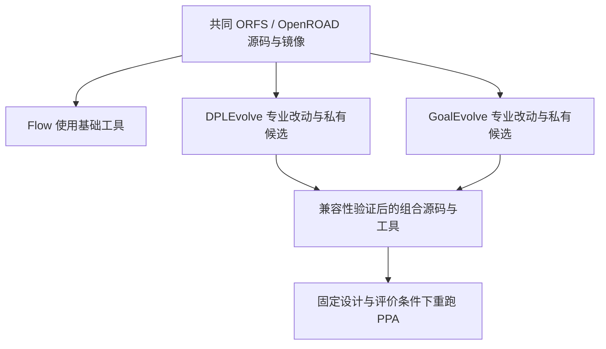

# 共同 EDA 工具链来源与迁移审计

日期：2026-10-12。老板已确认采用本机 10 月镜像；本报告完成来源取证及迁移范围核查，没有切换生产环境、修改专业算法或完成三项目接力。

## 老板现在得到的结论

共同基础版本已经可以精确冻结，不再依赖含义不明的 `latest` 链接。Flow、DPLEvolve、GoalEvolve 应采用这套共同基础版本；两个 Code 项目的定制功能及候选源码仍须独立编译。统一的是基础源码、工具环境和交接条件，候选二进制按真实修改另行标识。

目前 Flow 的完整调参实验已通过工程验收，DPLEvolve 已完成原生真实候选与独立重放，GoalEvolve 已完成环境及真实已发布候选/p0 重放，但尚未完成新的 AE-3 演化。两个 Code 项目仍未收口到 EF/DF。本次审计没有改变这些完成状态。

## 选定版本及证据

| 项目 | 固定身份 |
|---|---|
| 本机镜像 | `/home/wjyuan/projects/eda-toolchain/orfs-8e6ee7aac233da07.sif` |
| SIF SHA256 | `8e6ee7aac233da078364649fa8111dac5de33a3589f5445dcffd96f9d6d8dd39` |
| 官方 OCI digest | `212127afc6538596e9c819ecea4830ec7edb76e2fca51f8dcd741c772558d4e0` |
| 官方 ORFS commit | `5105b0a77fe8b3ae107bed67112eb5f83caca5d5` |
| 官方 OpenROAD commit | `27288f5c90265ae5296b2f5a9fa6e8714fa191ad` |
| OpenSTA 子模块 pin | `e983e15b2cb346badf8f23725fd3914d25312c44` |
| 镜像 OpenROAD binary SHA256 | `4df33066532b6232175771cda06067b935d9fe2769ac02d81a738f3c84e6c95c` |
| 基础工具 | Yosys 0.68+post、KLayout 0.30.12、GCC 11.4.0、CMake 3.31.9、SWIG 4.3.0 |

SIF 记录的生成时间是 **2026-10-02 20:55:54 CST**；10 月 9 日为本机文件日期。镜像 OpenROAD 自报 `unknown`，因此上述源码身份来自官方构建取证，而非这个版本字符串。

来源链已核实：

1. SIF 的 label 固定 OCI digest `212127…`。
2. [官方 Jenkins master/1642 构建日志](https://jenkins.openroad.tools/job/OpenROAD-flow-scripts-Public/job/master/1642/consoleText) 第 305 行 checkout ORFS `5105b0…`；第 437 行固定 OpenROAD `27288f…`；第 905 行构建参数 `openroadVersion=26Q4-6-g27288f5c90`。
3. 同一日志第 37590/37714 行发布 `26Q4-11-g5105b0a77`，digest 与 SIF 的 OCI 来源完全相同。镜像发布发生于 12:00 UTC，早于 SIF 生成；完整 CI 回归稍后结束不构成矛盾。
4. 与该 ORFS commit 的 2,545 个普通文件/链接逐项比较：镜像保留的 **2,407 个全部匹配，零内容差异**；138 个未保留的文件明确列出，没有把它们计为匹配。
5. 通过 GitHub 取得迁移相关 13 个源码文件，内容与目标 commit 的 Git blob 全部匹配。完整 OpenROAD 文件清单也已取得；完整源码 checkout、子模块获取及本机源码构建属于 U1，尚未完成。

9 月 30 日镜像的 SIF SHA256 为 `c96d9a56efaf7b0157194e6892c490add62c5a50b37926434048315c553982bf`，OpenROAD binary 为 `62dd60d4…`。两镜像的上述基础工具版本一致，Yosys binary 完全相同；OpenROAD binary 不同。9 月镜像有 GCD/ASAP7/ibex 完整流程记录；10 月镜像已有本平台 clean-room 的 GCD→EF→DF 和补 STA 成功记录，因而选择依据是现有平台验证及来源可追溯性。

## 兼容性实证及边界

10 月镜像成功读取 Flow 的 AES/Nangate45 CTS ODB、DPLEvolve 的 GCD/Nangate45 floorplan ODB、GoalEvolve 的 AES/ASAP7 post-route ODB。三个样本的退出码、设计名称、实例数量、ODB hash 与完整命令已留证。

这证明三个指定历史样本可以被共同镜像单向读取。完整实验、候选构建、写出后交给下一项目、时序/功耗语义及最终 PPA 仍要逐切片实测。两个 Code 项目需要的 `detailed_placement_evolve` 和 `repair_power` 均不在镜像原厂 binary 中，不能通过替换路径获得它们。

## 各项目最小迁移范围

| 项目 | 已核实的接点 | 保留内容 | 必须验证 |
|---|---|---|---|
| Flow / A2-ORFO | `config/env.sh`、原生 `flow/Makefile`/scripts、`flow/platform_campaign.py`、Toolkits `openroad/a2_stage.py`、`a2_evaluation.py`、冻结 profile | 原生候选生成、DRP、阶段屏障/继承、固定 CP0、功耗约束及同实验恢复 | 共同镜像下原生 Tcl/合成插件/路径可用；真实两轮调参；EF/DF 来源与恢复仍一致 |
| DPLEvolve | `metadata/anchors.json`、`scripts/workspace/prepare_workspace.sh`、四组 prepare patch、共享 core configure/build、私有 variant relink | Teacher/Student、完整布局评价、合法性、真实 pin HPWL、原生晋升/拒绝 | 改为显式选择共同 anchor；移植接入 hunk；重新构建 core/私有候选；原生三基线与真实候选可运行 |
| GoalEvolve | p0 内容快照、`goalevolve/config.py` 的 source/build seed、`src/rsz` 定制、`src/rmp` 依赖、原生 evaluator 的构建入口 | AST、EPD、Teacher/四 Student、受保护 evaluator/checker、目标/晋升逻辑 | 把定制能力移到共同源码；明确 STA/库依赖；共同源码下本机基线与真实候选；历史发布容差仅用于原生重放 |

**DPLEvolve 的具体承重文件。** 基础 patch 修改六个共享文件：`include/ord/Design.h`、`include/ord/OpenRoad.hh`、`src/CMakeLists.txt`、`src/Design.cc`、`src/Main.cc`、`src/OpenRoad.cc`。真正独立的只读 `git apply --check` 表明前三个需适配的文件是 `src/CMakeLists.txt`、`src/Main.cc`、`src/OpenRoad.cc`；另外三个共享文件可按现有 patch 文本通过检查。通过文本检查不等于可编译。

ORFS overlay 也不能原样应用。新版 `run` 已使用 `RUN_CMD --log --tee`，应只补实际需要的 `RUN_OPENROAD_ARGS`/`RUN_SCRIPT_ARGS` 传递，不退回旧日志/启动方式。framework/negotiation seed 依赖先准备的 `dpl_evolve`，没有把“在未准备源码上失败”当成迁移结论。

**GoalEvolve 的具体差异。** p0 按内容 SHA256 `357addea…` 标识，不按其非干净工作树来源 commit 代替实际内容。与共同源码的对应文件比较，排除测试后，rsz 有 81 个源码/接口/构建文件不同，另外 12 个 p0 源码文件在目标树中没有对应路径，包括 `RepairPowerPolicy`、`PowerRecoveryPlusPolicy`、`SizeDownCandidate/Generator` 等。rmp 的三个源码/接口文件不同。这个比较包含源码分叉及上游演进，**不是已提取好的最小研究补丁**。

因此不能把旧 `rsz` 整目录覆盖新版。必须逐个追踪 `repair_power → Resizer::repairPower → Optimizer/RepairPowerPolicy → move/STA` 的实际依赖，保留新版已有 policy 接口；必要的额外共享改动在对应切片计划中列明。最终共同组合也须验证两项目补丁的相互作用。

## 确定的工程选择

- 固定本次验证通过的 digest/commit，不自动跟随移动的 `latest`。
- 共同源码与构建环境；专业 overlay、候选源码、构建配置及 binary hash 分别留证。重新编译的 hash 无须等于原厂 binary，但必须绑定实际来源。
- 源码优化交接包含候选修改及其输入/输出阶段；不能只交一个不明版本的 ODB 或工具路径。共同变体构建时包含经验证的专业改动组合。
- 大文件继续走 EF 公共定位及本机文件读写/hash 路径；HTTP 承载管理信息。不新增网络文件传输平台。
- 原生旧环境留作历史复现，新的共同环境使用新 campaign。换工具后不得继续标成原实验恢复，也不得混用旧数值作新基线。
- 三项目协同必须使用同一设计、同一工艺/库/SDC 与评价条件；Flow 的 AES/Nangate45 和 GoalEvolve 的 AES/ASAP7 不能直接接力或比较。共同演示设计由两 Code 实际支持的输入/阶段审计后确定，不在此预先指定。

## 未完成事项与续接

共同源码构建、三项目运行切换、专业补丁移植和完整接力均未完成。L3 的模型入口选择、真实 AE-3 和九项上游历史资产相关测试失败仍按原报告保留；本次来源审计不将其记作解决，也不重置过期的六小时演化预算。

Docker Registry 和 Git smart-HTTP 取源失败已保存。官方日志、GitHub API 文件树及原始源码提供了可核查的替代取证；后续源码准备仍须逐项核对内容。初次 patch check 因父 Git 仓库导致全部 patch 被跳过，结果已作废并保留 `dpl-patch-applicability-skipped-invalid.json`；正式结论来自独立审计目录的有效检查。

本轮证据目录：`var/audit/common-toolchain-20261012/`。主要回执为 `audit-receipt.json`、`selected-image.json`、`image-tracked-tree-comparison.json`、`raw-source-integrity.json`、`dpl-patch-applicability.json`、`goal-p0-target-tree-comparison.json`、`odb-read-probes.json`。各项目历史效果见 L1/L2/L3 报告；下一步可执行计划见 [COMMON_TOOLCHAIN_PLAN_20261012.md](COMMON_TOOLCHAIN_PLAN_20261012.md)。
