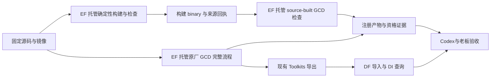
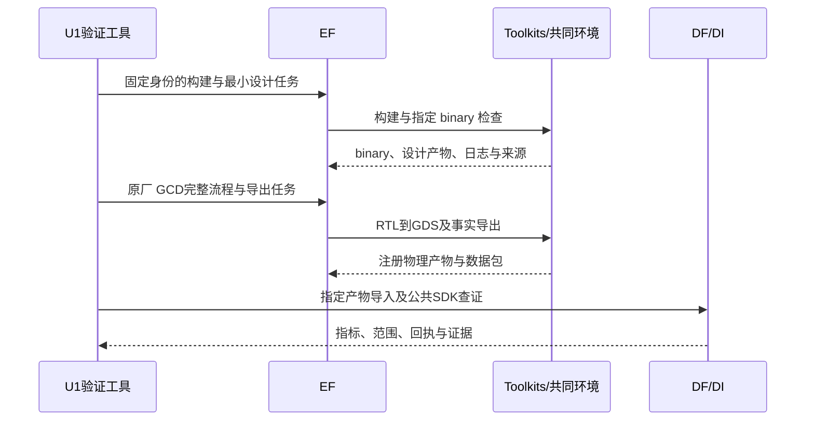

# 共同工具链迁移切片计划

日期：2026-10-12。10 月共同镜像选择已获老板确认；本文件把源码审计结果转为具体施工计划。U1 / U2 已完成工程验收，业务确认待老板；U2 具体文件、接口及验收计划已获老板“同意执行”确认，完整真实结果见 `U2_FLOW_COMMON_TOOLCHAIN_REPORT_20261012.md`。U3–U5 进入前仍按协作协议确认实际文件与接口。

## 最终业务效果

1. 本机三项目采用明确、可重放的共同 EDA 基础版本，不再靠含义不明的 `latest` 或散落的工具路径。
2. Flow 调参和两个 Code 源码优化各自保留研究能力，可交接可追溯的输入、专业改动与结果。
3. 三项目在同设计/工艺/目标下完成最终 PPA 优化；Codex 通过统一事实与 Query 证据判断结果。
4. 失败或中断能找到现场和已完成任务；工具/源码升级属于新实验，不能混成旧实验续跑。

这组切片解决共同版本与兼容性，和既有 L4 统一执行、L5 设计数据、L6 统一数据入口共同构成 L7 的前提。版本统一不能替代执行/数据接入验收。ECO、教学、公开发布与论文对照继续暂缓。

## 纵向切片及验收

| 切片 | 老板得到什么 | 验收标准 | 模块 | 前置/状态 |
|---|---|---|---|---|
| U1：共同基线资格验证 | 有准确源码、能构建、能经平台跑真实设计的共同基础工具 | 完整 source/submodule/镜像身份冻结；未改算法的 OpenROAD 构建成功；明确使用该 source-built binary 完成 GCD 最小处理；镜像 GCD RTL→GDS 经 EF 执行、DF 导入、DI 查证；所有回执一致 | 现有 EF/Toolkits/DF/DI 公共接口、admin 验证工具 | 本次来源审计已完成；工程验收通过，业务确认待老板；不依赖模型登录 |
| U2：Flow 迁移 | 共同环境下可继续使用完整调参产品 | AES 两轮×三候选，原生算法/继承/评价条件保留；全部物理阶段及反馈回流；四类真实恢复窗口通过；冻结新基线，不混入旧环境的收益 | Flow、Toolkits、现有 EF/DF/DI | U1；具体方案已确认，完整真实工程验收通过，业务确认待老板，见 U2 报告 |
| U3：DPLEvolve 迁移 | 共同基础源码上仍能优化详细布局 | 显式共同 anchor；共享 core 与私有候选构建；原生 smoke、三条合法基线、真实源码候选及固定来源重放；完整原生评价/晋升语义保留 | DPLEvolve、私有工具工作区 | U1；L2 原生工程验收已有；未开始 |
| U4：GoalEvolve 迁移 | 共同基础源码上仍能优化时序/功耗 | 定制 repair_power/必要 rmp/STA 依赖可编译运行；原生 smoke、本机真实基线、新源码候选及 checker；AST/EPD/四 Student/晋升保留 | GoalEvolve、私有工具工作区 | U1；L3 原生 AE-3/门禁与模型入口问题须先处理或由老板显式调整验收；未开始 |
| U5：共同组合交接 | Flow 和两个 Code 在同一设计下完成可查证接力 | 确认共同设计/PDK/约束/阶段；经验证的专业改动组合编译；跨阶段输入输出、源码和工具身份可核对；实际最终 PPA；所有 EDA/评价经 EF，查询/分析经 DF/DI/Query | 三专业项目、底座与 Query | U2–U4，以及 L4–L6 完成；未开始 |

U2/U3/U4 的文件清单由 U1 构建和本次源码差异逐切片收敛。不会在 U1 顺手移植专业补丁、改 Agent harness 或新增公共数据契约。

## U1 验收标准（已授权；工程通过、业务确认待老板）

1. 固定 SIF `8e6ee7…`、ORFS `5105b0…`、OpenROAD `27288f…` 及递归依赖；源码内容、编译参数和实际 binary 可查。
2. 在该镜像的构建环境内编译未改算法的 OpenROAD；通过 EF 调用明确的 source-built binary 处理真实 GCD 输入并成功写出有效 ODB，不误用系统/原厂工具。
3. 使用选定原厂镜像，经现有 EF 接口完成 GCD/Nangate45 的 RTL→GDS；注册产物、导出、DF 导入及 DI 指标/来源查询全部通过。
4. 新增脚本静态/类型/格式、对应测试、差异/架构审查及相关回归通过；保存失败现场和复验命令；老板复核后才记业务完成。

这里分别验证源码构建产物与原厂镜像流程，不要求它们的 binary hash 或运行时间相等。不把 GCD 的基础运行当成两个 Code 项目已经移植成功。

## U1 文件清单与职责

| 文件/目录 | 职责 |
|---|---|
| 新增 `admin/qualify_common_toolchain.py` | 准备独立冻结源码/子模块和构建目录；通过已安装公共 EF client/Toolkits 调用构建、source-built GCD 检查及原厂完整 GCD 流程；记录资源、命令和失败。只用于本机资格验证，不新增通用 Agent harness。 |
| 新增 `admin/accept_common_toolchain.py` | 核对源码/submodule、SIF、实际构建 binary、成功阶段及公共产物/DF/DI 来源；生成资格回执，拒绝把缺少构建或物理结果记作通过。 |
| 新增 `admin/finish_common_toolchain_data.py` | 从本次已成功 EF run 补齐原 ORFS 指标/单位导入和 SDK 查证；显式收尾回执保护旧证据，不重复物理任务。 |
| 新增 `admin/test_common_toolchain_qualification.py` | 验证工具来源不匹配、误用系统 binary、步骤失败及未完成任务不会得到成功回执；验证独立运行目录/已有回执保护。 |
| 新增 `admin/test_common_toolchain_acceptance.py` | 验证缺 source-built 设计结果、缺注册产物、错设计/工艺及错误快照来源不能通过。 |
| `var/toolchains/common-u1-<本次身份>/` | 完整源码/依赖、编译输出、生成的本机启动入口、工具 manifest、新 EF/DF 状态及 GCD 输入/产物/日志。首次创建后保留，不覆盖旧实验。 |
| `TASKS.md`、`admin/STATUS.md` | 记录 U1 工程检查和老板业务确认的实际状态。 |
| `AGENTS.md` | 记录老板新增的按任务规模分配资源的协作原则，不改变底座接口。 |
| 本计划及新增 U1 报告 | 记录实际命令、回执、失败、结果和后续接点。 |

根基线：`41635049fb1039a5c711972a414904c68c3d48de`（已发布 ChipEvolve），U1 独立分支 `u1-common-toolchain-20261012`。开始前的用户修改及八个子模块身份/hash 已保存在 `var/toolchains/common-u1-20261012/preparation/baseline.json`。根下已有 `admin/evaluation` 修改继续保留，不纳入 U1。本次只读检查还发现 DF/DI 独立仓库存在未提交修改；本轮未编辑这些文件。U1 开始时须重新记录这些工作树及已安装 wheel 身份，不擅自提交、覆盖或把未验收修改混入资格基线。

U1 没有计划修改 EF、DF、DI、Query、Toolkits 或三个 Agent 的业务代码。若真实构建/现有 adapter 不能满足验收，先给出失败证据和具体影响面，在当前切片内确认修复范围，不临时绕过统一执行。

## U1 数据流及接口



复用现有公开接口，不新增后台服务、数据库或 API：

- `KernelClient.submit(task, ...)`：现有 schema v3 TaskSpec，HTTP `POST /kernel/runs`；构建/检查使用已有 `adapter=command`、`extractor_command` 与显式输出证据，原厂流程使用现有 `orfs_flow`。
- `KernelClient.run(run_id)`、`artifacts(run_id)`、`materialize_artifact(...)`：状态、注册产物及本机取回。失败和取消仍由 EF 管理。
- `OrfsToolkit.submit_flow(design='gcd', platform='nangate45', revision=...)` 与 `export_flow(run_id, snapshot_id)`：原厂完整流程和结构化导出。
- DF `POST /snapshots/from-run` 指定注册的设计数据产物；DI 的 `EdaAiClient` 查询实际指标、范围和来源。源码构建资格证据不冒充芯片设计快照导入。受内存限额终止的已编译组件可以作为显式 hash/源码/镜像/编译参数绑定的检查点交付下一 EF 任务，保留原失败 run，不覆盖或修改旧现场。

生成的本机启动入口放在 var，显式绑定镜像和 source-built binary/依赖，只处理本次验证任务。所有 EDA 设计处理由 EF 发动；跨项目用 wheel/HTTP，不使用源码路径注入。U1 的工具身份 manifest 是验证资产，不先扩展其他模块的公共契约。



后续 U2 若要扩展 Flow profile/fingerprint，必须纳入真实 SIF/source/binary 身份，不能仅 hash 启动脚本。profile 的具体字段和签名在 U2 计划中确认后实现。两个 Code 的 professional overlay/私有候选同样独立留证。

## U1 实施顺序与验证命令

1. 明确 Git 检查点、用户修改边界和独立分支；新建 var 运行根，不连接旧服务/数据库。
2. 取得完整固定源码及递归依赖，核对源码清单/子模块；在选定镜像内检查编译依赖，并经 EF 构建。取源失败保留现场，可使用原始归档并核对内容；不能换成移动的 HEAD。
3. 通过 EF 管理 source-built binary 的 GCD 最小处理；核对输入、实际 binary hash、有效设计输出和构建来源。
4. 新建本实验 EF/DF 实例，经公开 Toolkit 完成选定镜像 GCD RTL→GDS、导出、指定产物导入及 SDK 查证。
5. 按顺序通过静态检查、对应测试、逐文件差异审查、架构约束和相关回归；报告结果及老板可运行的复验入口，提交 `[切片U1] ...（待业务验收）`。

计划的命令入口（本轮新增脚本；实际运行结果以回执为准）：

```text
execution-foundation/.venv/bin/ruff check <U1五个新增Python文件>
execution-foundation/.venv/bin/ruff format --check <U1五个新增Python文件>
execution-foundation/.venv/bin/mypy --follow-imports=silent --ignore-missing-imports <U1五个新增Python文件>
admin/.venv/bin/python -m pytest admin/test_common_toolchain_qualification.py admin/test_common_toolchain_acceptance.py
admin/.venv/bin/python admin/qualify_common_toolchain.py prepare --run-root <新var目录> --image <已确认SIF> --threads 8
admin/.venv/bin/python admin/qualify_common_toolchain.py run --run-root <同一目录>
admin/.venv/bin/python admin/accept_common_toolchain.py audit --run-root <同一目录>
git diff --check
git diff --name-only
```

`admin/.venv` 有 pytest，但没有公共 EF/Toolkits/DI 包。资格验证主控使用标准库，四个项目的 committed HEAD 生成 wheel 并安装到本切片独立虚拟环境，分别执行 EF/Toolkits 任务与 DI SDK 查证；不注入其他项目源码，不将尚未提交的 DF/DI 修改混入运行基线。静态工具复用现有 EF 环境的 ruff/mypy。相关回归涵盖既有公共 EF 进程/资源、Toolkits ORFS 和数据来源检查；有新失败时再扩大检查，不反复重跑无关长实验。

预算建议：单设计 GCD/Nangate45、物理并发 1、单任务 8 编译线程、单 LTO worker；总监督上限三小时（重试使用剩余预算），构建上限 90 分钟、完整 ORFS 上限 60 分钟；原计划 EF 预留 24 GiB；本轮实测 LTO 的进程树 RSS 峰值约 37–40 GiB，老板于 2026-10-12 明确要求放宽单个大任务限额，当前单构建改为 64 GiB / 2048 进程。小任务按实际需求分配，不照搬大构建配置。没有模型调用；不复用或重置 L3 已过期的演化预算。

## 关键决策及尚待选择

- 先验证未改算法的共同工具，随后逐项目迁移，避免同时改变基础版本与两个研究算法而无法定位失败。
- 候选依然私有编译；最终组合使用经验证的专业改动组合和同一基础版本。强制三个项目使用同一个原厂 binary 会使 Code 源码优化失效。
- 历史运行作为复现证据，新版本重新冻结基线；不同工艺及评价条件分开。平台 PPA 与 token/时间收益仍属于后续 L8。
- GoalEvolve 的本机 Codex 登录适配尚未确认；现有 API-only 入口、AE-3 和九项上游测试失败保持 L3 未完成状态。U1 可独立推进，进入新的模型运行前仍需解决这一具体入口及验收问题。
- 若共同设计需要 GoalEvolve 支持 Nangate45 或 Flow 支持竞赛 ASAP7 输入，作为 U5 的具体适配范围确认；不能仅因设计名都叫 AES 就交接。
