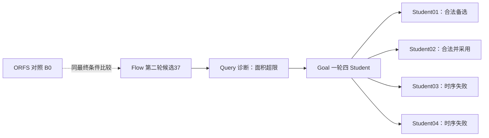

# GCD 既有结果追踪：只读核对，不是新一轮实验

本轮从原 `result.json` 读取数值，核对共同 condition/objective 与已登记 SHA；Student02 的采用及验证文件 SHA、18 输出证明记录也已核对。没有重跑模型、EDA、证明或发布事实。本表复用历史验收记录，不声称本轮再次执行了证明或 SDK 查询。

## 实际关系

ORFS 是对照，不能把图中的虚线当作其产物直接传给这份 Flow 的证据。Flow 的现代综合来源、搜索阶段父项与原 ORFS 有差异；此表只展开实际 Flow2-37→Goal 的交接。四个 Student 都以 F37 为共同起点，是候选分支，不是四次连续优化。Query 不生成新的物理 PPA。

DPL 和 ECO **未在这条最好分支中实际执行**。其他历史分支不拼接到此图；下一步按适用阶段确定真实承接位置，才能补齐它们的作用。

## 论文主表所需的既有指标

| 节点 | 功耗 mW | cell µm² | core µm² | die µm² | setup WS ps | setup TNS ns | hold WS ps | hold TNS ns | 决策 |
|---|---:|---:|---:|---:|---:|---:|---:|---:|---|
| B0 | 1.37355377 | 42.6757 | 58.7866 | 78.4819 | 9.34292 | 0 | 32.6035 | 0 | reference |
| F37 | 0.890911557 | 44.8918 | 57.9701 | 75.8293 | 12.289 | 0 | 35.2101 | 0 | handoff; area exceeds limit |
| G01 | 0.755599816 | 39.2348 | 57.9701 | 75.8293 | 5.31003 | 0 | 34.8005 | 0 | retained alternative |
| G02 | 0.715648639 | 39.1181 | 57.9701 | 75.8293 | 0.0834055 | 0 | 36.7482 | 0 | adopted |
| G03 | 0.768538506 | 38.7974 | 57.9701 | 75.8293 | -70.4802 | -0.856145 | 34.7756 | 0 | rejected: setup timing |
| G04 | 0.766251818 | 38.9869 | 57.9701 | 75.8293 | -92.9781 | -1.01305 | 35.0684 | 0 | rejected: setup timing |

六节点的 `route_drc`、design violations、max slew/max cap 均为 0；五份非对照结果的显式 max fanout 违反为 0。原对照 `result.json` 没有 fanout 字段，CSV 标 unknown，不补成 0。单独的 placement legality 字段未包含在这些结果中，不能用空字段冒充签核；最终完整物理流程与既有验证证据另列。

Student02 相对实际 F37：功耗下降 **19.6723%**，cell 面积下降 **12.8614%**，同时从源面积超限转为满足原约束。相对 ORFS 的功耗下降 **47.8980%** 包含来源差异，不全部归因协同。setup 余量仅 **0.0834055 ps**；Student01 的 **5.31003 ps** 余量更大，保留为备选。

## 身份、证据与未完成项

- 共同条件 ID：`243763f6d71604907412b2083cb354070ef159649a9403dc7b65d7c26ef00e90`。
- 共同目标 ID：`bb3bdcf5b0013f597cd619f97ad48bdff3431e680c52099a40bd80cca8dbae48`。
- 实际工具条件从每份结果读取：FF、0.31 ns、传播时钟、候选完整布线 SPEF；OpenROAD 基础 `27288f5c90`、ORFS `5105b0a77`，Code 私有二进制/源码需另按原记录绑定。
- Student01/02 的全部 18 输出 PDR、独立完整 DRT/RCX 七项 PPA 同值及公共 SDK 历史验收：见 `A25_GCD_FLOW_QUERY_GOAL_QUALIFICATION_REPORT_20261019.md`。
- Teacher 原生晋升 Student01；Codex 最终采用 Student02，保留原生与业务决定，不改写。
- Student02 原采用记录：`/home/wjyuan/projects/eda-development/var/business/a25-goal-epd-trace-export-20261019/student02-adoption.json`。
- 对应验证：`/home/wjyuan/projects/eda-development/var/business/a25-integrated-qualification-20261019/gcd-runtime/experiments/gcd/a25-gcd-flow237-goal-student02-validated-r1/validation.json`，SHA `4c1558859859812b28bb0fe5414e875de2cce8f89a3bc2ddbd273329fe030448`。
- 新实验开始前仍需收口已验证 Goal 归档器修复的默认来源；不能因此否认已清洁重建同值的这份 Student02。
- 这不是四专业完整连续成功、同预算团队优势或多设计普遍改进的证据。ibex/ariane 的当前可运行性未由此表验证。

## 原结果位置与当前 SHA

- B0：`/home/wjyuan/projects/eda-development/var/business/a25-formal-preparation-20261017/canonical-gcd-unit-control-runtime/experiments/gcd/a25-canonical-ps-native-control-r1/result.json`；SHA `948ebd2a77fd1d7ddcaced27adc5acf6d1245d734343a318fba747b999c31f9a`。
- F37：`/home/wjyuan/projects/eda-development/var/business/a25-gcd-canonical-source-20261017/runtime/experiments/gcd/a25-gcd-full-native-domain-r2/iteration-2-37/materialized-result.json`；SHA `a1059362282960ac0dde09eb569536f92795ee148e85f853fe58ea2aa1a00657`。
- G01：`/home/wjyuan/projects/eda-development/var/business/a25-integrated-qualification-20261019/gcd-runtime/experiments/gcd/a25-gcd-flow237-goal-private16-r1/result.json`；SHA `be8000af4ce732622f6a08fcc6c04f862e9717bf7096a254fd11b374dbae3fab`。
- G02：`/home/wjyuan/projects/eda-development/var/business/a25-integrated-qualification-20261019/gcd-runtime/experiments/gcd/a25-gcd-flow237-goal-private16-r1/native-candidates/candidates/a25-gcd-flow237-goal-private16-r1--round_001-student_2/result.json`；SHA `f26b9cae79d48ecb98afa3cae0ec67b21706a79b073af040a95096a4379c3636`。
- G03：`/home/wjyuan/projects/eda-development/var/business/a25-integrated-qualification-20261019/gcd-runtime/experiments/gcd/a25-gcd-flow237-goal-private16-r1/native-candidates/candidates/a25-gcd-flow237-goal-private16-r1--round_001-student_3/result.json`；SHA `9f7f6e7b59aded5af9cc44c97c0caad7615b043fb999c9ac39818541c4551ee1`。
- G04：`/home/wjyuan/projects/eda-development/var/business/a25-integrated-qualification-20261019/gcd-runtime/experiments/gcd/a25-gcd-flow237-goal-private16-r1/native-candidates/candidates/a25-gcd-flow237-goal-private16-r1--round_001-student_4/result.json`；SHA `c7f1808c6ccb72d42a9b8388449076c8d7d03a05ce6ea62b302cf095ca6d4781`。

机器可读表：[GCD_EXISTING_TRACE_20261020.csv](GCD_EXISTING_TRACE_20261020.csv)。包含 run/physical run、快照 ID、完整电气指标与来源 SHA。

口径更正：表中允许正值的时序余量为原始 worst slack（WS）；规范 WNS=min(0, WS)。这是列名更正，原始结果及数值不变。
