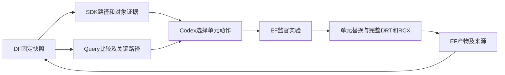

# O2：用路径证据完成 GCD 定点修复

工程验证通过，本机 GCD 的本轮业务指标全部满足，老板确认待给出。Git 基线 `c30d4e0`，分支 `optimize-gcd-o2-20261014`。上一轮 O1、夜间完整链路和失败证据均保留。

## 老板得到的效果

在相同评价条件下，新候选同时做到时序闭合、功耗和单元面积低于原 ORFS，芯片占地不扩大。它解决了上一轮“时序闭合需要增加功耗”的剩余问题。

| 指标 | 原 ORFS 共同复测 | O1 闭合方案 | O2 新候选 |
|---|---:|---:|---:|
| setup TNS（ns） | −0.119970 | 0 | 0 |
| 最差 setup slack（ns） | −0.0415901 | +0.00546838 | +0.00295625 |
| 总功耗（W） | 0.0013730376959 | 0.0013787084026 | 0.0013708643382 |
| 单元面积（µm²） | 45.4750 | 45.4167 | 45.3001 |
| core 面积（µm²） | 61.3089 | 61.3089 | 61.3089 |
| die 面积（µm²） | 79.0143 | 79.0143 | 79.0143 |
| hold TNS / slew / cap / 布局违例 | 0 / 0 / 0 / 0 | 0 / 0 / 0 / 0 | 0 / 0 / 0 / 0 |
| 完整详细布线 DRC | 0 | 0 | 0 |

相对原 ORFS，功耗下降 **0.1583%**，单元面积下降 **0.3846%**；最差 setup 裕量 **+2.956ps**。收益适用于本机 GCD、固定 FF/310ps 及本轮功耗测量条件，不扩展为更大设计或所有工艺角的收益。

## Query 如何帮助 Codex 决策

O1 的低功耗方案有约 9.147ps 缺口。通过 SDK 查询它的固定时序快照，10 条 setup 采样路径中，5 条负裕量路径都经过 `u158`；最差路径还经过 `u238`。相比 O1 闭合方案，它多改变的五个单元为 `u158`、`u238`、`u45`、`place151`、`output92`。另外几项节能改动没有出现在这五条负裕量采样路径上，先保留。

Codex 根据这些事实选了四个 `u158` 单元方案进行单项干预，而没有增加学生源码搜索或另造因果推理框架。

| `u158` 选择 | TNS（ns） | 最差 slack（ps） | 功耗（W） | 单元面积（µm²） |
|---|---:|---:|---:|---:|
| 不改，重新完整路由的控制组 | −0.0967135 | −10.1739 | 0.0013708026381 | 45.3001 |
| RVT，1.5 倍驱动 | 0 | +3.38457 | 0.0013711963547 | 45.3292 |
| RVT，2 倍驱动 | 0 | +3.29842 | 0.0013716419926 | 45.3584 |
| LVT，1 倍驱动 | −0.00191977 | −1.91977 | 0.0013707919279 | 45.3001 |
| **SLVT，1 倍驱动** | **0** | **+2.95625** | **0.0013708643382** | **45.3001** |

新候选只把 O1 低功耗 checkpoint 的 `u158` 从 `NOR2x1_ASAP7_75t_R` 换成 `NOR2x1_ASAP7_75t_SL`，保留尺寸与连接。相同处理的不改动控制组仍失败，单项干预后闭合，为这个输入上的修复提供了实验支持。各组都重新完整路由，控制组与 O1 原路由有小幅数值差异；表内使用本轮控制组，不把重布线波动假装成单元改动收益。

这是 Query 提供事实、Codex 决策、已有物理工具执行的真实闭环。不是新训练的模型、GoalEvolve 新源码收益，或之前 Flow→两 Code→ECO 大占地链路的最终收益。该旧链路的限制仍按夜间报告保留。

## 数据与执行过程

输入由固定 DF 快照取得上下文，再经 EF 的公开产物身份取回 ODB/SDC/SPEF；执行、路由、测量、等价检查和事实导出全部走 EF。使用同一镜像、15 份参考库 hash、同一冻结 SDC，保持 FF、310ps、传播时钟和相同 I/O 约束。工具及 SDK 使用已有安装环境，无 sibling 源码注入或私有数据库读取。

六组记录（四个动作、控制组、独立重放）均入 DF，包含对象/关系、指标、原始产物引用；新候选、控制组和重放另有各 20 条采样时序路径。它不是全路径索引。Query 实测返回 TNS 改善、总功耗差 −2.1733577µW 和最差路径 +2.956e−12s，均有 artifact 引用。

## 复现、正确性与工程门禁

- 新候选从同一公开输入在空目录独立重放，单元动作、完整 DRT、RCX、共同复测全部重做，**11 项物理指标逐值相同**。
- 四个单项动作、控制组和重放，均检查 428 个实例的具名 pin→net 连接不变；单元动作前核对实际输入 master，错误输入不会被静默替换。
- 使用固定镜像内 Yosys 及参考 Liberty 逻辑模型，分别证明新候选与原 ORFS、原 ECO 的网表逻辑等价。两次 `equiv_status -assert` 均通过，各 **1628 个等价点已证明、0 个未证明**。这与物理时序/电气检查分别留证。
- 新 Python 的 Ruff lint/format、mypy 通过；本机 admin 回归 **133 项通过**（Toolkit 环境 129，Query 环境的 SDK 相关测试 4）。
- 所有实验资源、终态和实际产物经公共 EF 核对；DF stage summary 的原始指标与测量逐值一致；参考库和 SDC hash 与原 ORFS 完全相同。
- 本切片 35 个 EF 任务全部成功终止，六组指标均核对通过；对象/指标共 12 个快照，另有 3 个采样时序快照。无遗留计算任务。
- 26 份原用户修改 hash 不变。九个业务模块和公共契约没有改动，原专业算法、筛选、来源/版权保留。未修改活动副本。

## 文件职责和复查入口

| 文件 | 职责 |
|---|---|
| `admin/gcd_targeted_refine.py` | SDK 固定输入、具名单元动作、EF 路由/测量、连接完整性记录；不做自动搜索或晋升 |
| `admin/test_gcd_targeted_refine.py` | 验证换尺寸/VT 后连接稳定、重连/删除可发现、实际 Tcl 在错误 master 下终止 |
| 本报告 | 业务结果、控制组、条件与证据 |
| `TASKS.md` | O2 通过状态、O1 历史与接续点 |
| `ARCHITECTURE.md` | 记录这次事实→决策→执行→验证闭环的实际边界 |

证据根：`var/overnight/gcd-20261014/optimization-r2/`，主要文件：

- `baseline.json` / `plan.txt`：基线、范围和验收条件。
- `input-paths-sdk.json` / `input-points-sdk.json`：选择 `u158` 的真实路径证据。
- `inputs/opt2-power-100-common/`：SDK 上下文、公开物理输入及 artifact/hash 身份。
- `opt4-nor-sl1/result.json`：候选结果；其他同级目录保留控制及动作结果。
- `replay-acceptance.json`：独立重放。
- `formal/{execution,orfs-execution}.json`：两次等价任务；脚本和输入留证包在相应 EF task 目录。
- `query-{comparison,power-comparison,final-paths}.json`：真实 Query 回答。
- `acceptance.json`：全任务、数据、指标条件、重放、等价和用户文件核查。

新候选的完整物理 producer：`run-3853ff457fac4423b244fcbbfb7f4845`；共同测量：`run-dd080f0a93ca4f1c8a8f5704f907f569`。

固定快照：`gcd-20261014-opt4-nor-sl1-common-{opendb,orfs,timing}`。物理文件在夜间 state 根的 `handoffs/opt4-nor-sl1-qualified/`，共同测量、显式单位 SDC 及输入身份在 `handoffs/opt4-nor-sl1-common/`。运行数据不提交为源码。

## 下一阶段的业务重点

本轮已经有一个相同条件下优于原 ORFS 的可复现 GCD 候选，保留为后续实验输入，默认原基准不覆盖，等待老板验收。后续重点应是把已明确的面积和共同条件反馈给 Flow 下一轮搜索，并从 Goal 现有电气失败复盘中选定专业机制的改进范围，继续提高专业优化的可行率。不能把这次小设计的单项修复代替大设计、各专业源码演化或论文公平对照。
