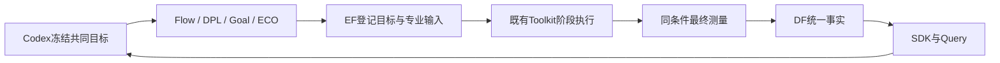

# A2/A3：真实交接与共同目标修复

两项修复已完成工程验证，待老板业务验收。DPLEvolve 的修改现在能真实进入 CTS 和完整布线；四个专业模型入口、执行记录和最终测量能够使用同一份全局目标。修复没有给这份 DPL 候选带来最终收益：真实对照显示它退化，因此 Codex 保留已有合法最好结果。

本轮基线为 `41af744`，施工分支 `fix-handoff-objectives-20261014`。未扩大到通用 Query→专业 receiver、新 benchmark、Tutorial 或新一轮 Goal 四 Student 演化。

## 老板获得的功能

1. 专业 Agent 交出的布局能够被下游继续使用，流程不会悄悄覆盖它。
2. 一个团队目标明确说明时钟、真实库内容、功耗及单元/core/die面积边界，实际模型也能看到。
3. 同条件的最终事实可以查回并比较；条件不一致时不能混算。Codex 判断采用、拒绝或保留，不增加评测服务。

原专业算法、内部评分、Teacher/Student 和晋升规则保留。阶段性探索允许退化，最终采用必须另行满足共同目标。

## 修复一：保住 DPL→CTS 的交接

旧适配器在新 WORK_HOME 下执行 `make finish`，触发重新综合和前置布局，覆盖 DPL 候选。新实现复用 Toolkits 已有 `a2_stage`：注入真实注册候选的 checkpoint，先 CTS，再 route_finish，用现有 Make `-o` 机制冻结前置目标。

验收同时检查前置 ODB 的 SHA-256、实际 `read_db` 消费路径，以及没有重新综合或重跑 `3_5_place_dp`。CTS 添加时钟单元后的合法布局继续允许。候选 SHA 为 `5b0a85e71d538b10697c2ce01d4ce10a113d95e050804afc09f5f9351798d3b9`。

| 实验 | CTS run | 完整 route run |
|---|---|---|
| A2 保留 DPL，原生阶段条件 | `run-e6b2244d15084caf8a1ba92c3b10f08d` | `run-eb47c0367a5c4cd683743801781f2ae3` |
| A3 保留 DPL，共同库/SDC | `run-af7ce9eb0e3d4dedb6f2724dd9852fc2` | `run-ac68125b8e134e01acbcec7a6f64c6f0` |

另有同一 Flow checkpoint、配置及阶段条件的无 DPL 控制组。四条路线均完成完整布线，最终 DRC=0；DPL 前置文件保留，消费路径有日志证据。

## 修复二：共同目标确实送到模型和数据查询

`chip-evolve.objective.v1` 是轻量 JSON，不是新服务。包含设计、基准运行、实际 Liberty/SDC 的 hash、共同工具身份、FF/310ps、传播时钟、完整路由 SPEF、单位和独立面积边界。当前目标：setup/hold TNS=0，电气/布局/DRC违例=0；功耗≤0.0013730376959 W；单元面积≤45.475 µm²；core≤61.3089 µm²；die≤79.0143 µm²。

四个专业项目通过安装的 Toolkits wheel 读取同一文件，在实际模型请求处附加目标；真实模型调用均准确返回了相同 objective_id、310ps、功耗及 core/die 限制。这是目标传递验证，没有把它冒充新的专业搜索轮次。

Flow 的请求缓存包含目标内容，改目标不能误用旧决策；Goal 的持续会话身份包含目标，变化后不能继续旧目标会话。执行请求登记目标文件、objective_id 和 final_condition_id。最终测量核验实际 SDC、库和工具条件；同名不同内容的库、不同 SDC、不同设计或模型/执行目标不一致均有拒绝测试。

发现 Flow 的一份同名 FF SIMPLE_RVT 库与共同参考内容不同，实际 nominal 条件也不同。只在新私有 Flow 副本中替换为共同参考内容，历史副本不动；共同阶段使用 ASAP7 的 BC（对应 FF）及显式310ps checkpoint SDC。专业内部 TT/固定CP0等原评分单独保留。

确认没有running/queued任务后，为既有执行桥接的client/Goal Python环境安装同一公共wheel；已有Toolkit工具实现逐文件内容一致，仅增加目标helper，服务与专业算法没有更换。最终数据经 EF 导出、DF 指定导入、SDK 查回。共同身份保存在现有 `evaluation_conditions` 字段，查询可直接看到 objective_id、condition_id、实际库 hash、工具身份和时钟；无需改 DF/SDK 公共接口。

## 实际效果：交接正确，候选仍需拒绝

以下最终复测均为同一 FF/310ps、传播时钟、完整路由 SPEF。A2 两条路线使用原生阶段条件完成物理流程，A3 两条使用共同库/SDC完成物理流程；只在各自匹配控制组内评价 DPL 的增量作用。

| 路线 | TNS（ns） | 最差 slack（ns） | 功耗（W） | 单元面积（µm²） | core/die（µm²） |
|---|---:|---:|---:|---:|---:|
| A2 无 DPL 控制 | −6.13621 | −0.204628 | 0.00070586026413 | 45.7083 | 156.939 / 188.184 |
| A2 保留 DPL | −6.32346 | −0.208815 | 0.00073101732414 | 46.5977 | 156.939 / 188.184 |
| A3 无 DPL 控制 | −6.28250 | −0.205345 | 0.00071560725337 | 46.4519 | 156.939 / 188.184 |
| A3 保留 DPL | −6.40310 | −0.208610 | 0.00073997740401 | 47.3121 | 156.939 / 188.184 |
| 已有合法最好结果，重新核验 | **0** | **+0.00295625** | **0.0013708643382** | **45.3001** | **61.3089 / 79.0143** |

A3 中加 DPL 后，TNS绝对值增加约1.92%、功耗增加约3.41%、单元面积增加约1.85%。所有新匹配分支都没有满足整体目标；Flow 选中配置的22%利用率造成的较大 footprint 并未由交接修复消除。Codex 的本轮决定是拒绝替换已有合法最好结果。

已有最好结果的时序闭合、功耗较原ORFS低0.1583%、单元面积低0.3846%属于前轮 O2 分支，本轮只复核和保留，不能说成修复后的四 Agent 联合收益。局部 HPWL 改善不保证最终 PPA 改善；这次消除了“改动被吞掉”的工程问题，剩下的是候选效果与跨阶段取舍。

## 接口、数据流和关键决定

| 接点 | 签名或字段 | 所属/决定 |
|---|---|---|
| 布局继续执行 | `resume(state, key, *, design, profile, config, sdc, flow_archive, placement, parent_run, objective=None) -> dict` | 本机适配器；输入驱动，不在算法里加 GCD 特例 |
| checkpoint验收 | `verify_stage_archive(path, expected_sha256, phase) -> list[str]` | 检查保留与实际消费，不把 EF 成功状态当成语义成功 |
| 共同目标 | `load_objective(path)`、`append_objective(prompt)`、`objective_messages(payload)` | 公共 Toolkit wheel；不导入兄弟源码 |
| 任务交接 | `bind_task_objective(spec, path=None)` | 复用 TaskSpec v3 的 inputs/staged_inputs/labels，无新HTTP路径 |
| 条件核对 | `verify_conditions(goal, sdc=...)`、`condition_id(goal)`、`require_same_conditions(left, right)` | 提供可比较事实，不做评分与晋升 |
| 最终复测 | `measure(state, key, odb, spef, sdc, parent, objective=None)` | 原测量助手增加显式条件绑定，EDA仍由EF执行 |
| 数据回流 | EF注册产物→`POST /snapshots/from-run`→SDK `get_metrics` | 保留已有数据契约与两个底座边界 |

选择已有阶段 seam，是因为它已解决前置依赖冻结；选择小 JSON + wheel，是因为共同目标只需携带确定事实，不需要新后台或评价引擎。历史实验、失败证据和第三方算法/版权保留。

## 工程门禁和改动清单

- 新公共目标模块 strict mypy、四份新/改测量助手 mypy、相关 Ruff/格式/编译检查通过；专业原仓库既有 E402 自身路径初始化、E731等原风格例外保持，新增代码未引入这些问题。
- Toolkits 全套与交接/测量针对测试73项通过；Flow58项、DPL validation19项、Goal392项及24个subtests、ECO5项通过。Root admin136项、SDK专项4项回归通过。Goal一次 localhost 测试被代理502影响，设 NO_PROXY 后全套通过，没有修改产品代码处理测试代理。
- 差异与模块边界审查通过：没有改专业 C++ 算法、数据库结构、公共HTTP签名、资源规则或引入兄弟源码路径。原26份用户文件 hash保留。
- 临时验证的 ORFS 根目录设置错误、ECO原生输出封装解析、相对路径留证失败及一次补充测量的 parent 文本误填均保留/明确排除；最终验收使用正确输入身份的独立记录，没有覆盖旧证据。

| 改动文件 | 职责 |
|---|---|
| `admin/resume_placement.py`、`admin/overnight_dpl.py` | 保留候选并继续CTS/route，记录真实消费与来源 |
| `admin/test_resume_placement.py` | 旧后继清理、指定SDC、覆盖/重跑/错误消费者回归 |
| `admin/gcd_common_remeasure.py`、`admin/overnight_runtime.py` | 共同条件绑定、EF留证与数据上下文 |
| `admin/test_gcd_common_remeasure.py` | 异库/SDC、相对路径留证和条件信息回流回归 |
| `admin/handoff_objectives.py` | 本机冻结目标、私有共同环境、匹配实验及事实投影助手 |
| `admin/verify_professional_objectives.py` | 四个真实模型入口的目标送达检查 |
| `toolkits/src/eda_toolkits/objectives.py`、`toolkits/tests/test_objectives.py` | 小型公共目标/条件接口及身份回归 |
| `flow-agent/flow/platform_model.py`、`flow/platform_execution.py`、`flow/test/test_platform_resume.py` | 实际请求、任务和重放身份携带目标 |
| `dplevolve/scripts/codex_exec/runner.py`、`scripts/platform/execution.py`、`validation/test_shared_objective.py` | 实际Teacher/Student请求和执行留证携带目标 |
| `goalevolve/goalevolve/agents/codex_runtime.py`、`goalevolve/platform/execution.py`、`tests/unit/test_platform_codex.py` | 实际请求、会话身份和执行请求携带目标 |
| `timing-eco-agent/src/platform_codex.py`、`src/platform_execution.py`、`src/test_platform_codex.py` | EF会话向原生ECO模型传目标 |
| 五模块`README.md`、根`PROJECT.md`/`ARCHITECTURE.md`/`TASKS.md`/`SOURCE_MANIFEST.json`及本报告 | 使用契约、边界、状态、版本和可接续检查点 |

如果要改变最终业务限制，创建新的冻结目标文件；如果要改变布局交接行为，修改 `resume_placement.py`；如果要改变专业算法，进入其独立切片。本轮不自动推进第三项通用入口。

运行证据：`var/overnight/gcd-20261014/fix-a2-a3/acceptance.json`；四模型送达回执在同目录`model-checks`，真实物理交接在`handoffs/a2-*`及`handoffs/a3-*`。这些运行数据不提交为源码。
