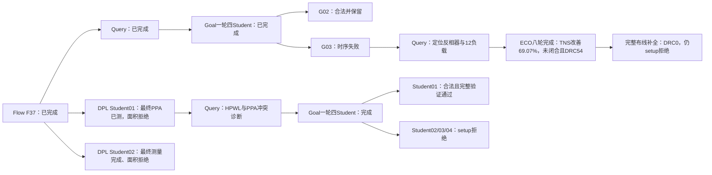
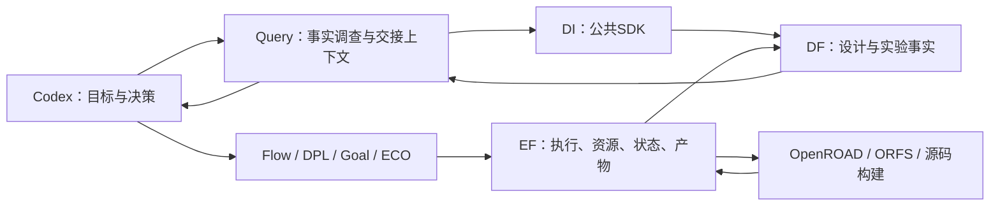

# 邀请论文实验素材：当前实测版（2026-10-20）

这是持续更新的实验素材，不是声称四设计已经全部完成。当前31行数据从原结果逐SHA核对后导出；新GCD DPL原生一轮三Student/Teacher已完成、选中Student02，选中Student02共同最终测量已完成、原面积约束拒绝，原轮兄弟交付已收齐；Student01→Goal原1轮4Student已完成最终测量，新增合法分支通过18输出PDR和独立重放；未完成候选不填结果。CSV包含完整PPA、电气/布局违反、DRC方法、run/条件/目标及来源SHA。

## 当前可用结论

GCD已有真实 Flow→Query→Goal 合法增量：相对实际Flow父项，功耗下降19.6723%、单元面积下降12.8614%，并修复父项面积超限。Student02有18输出PDR和独立完整DRT/RCX七值同值；Student01保留更大时序余量。

JPEG保留可行Flow候选及真实负接力。DPL Student03仅原cell面积上限失败；不事后改写约束。原Goal03→ECO的时序与功耗退步如实展示，该旧ECO交付包含平台重布线，不能拿它代表修复后的交付效果。

新增真实 Flow F37→DPL01→Query→Goal DG1 合法分支：0.81929122098mW /39.6139um²，setup WS+1.31586ps/TNS0，DRT及电气/布局违反0。较实际DPL父项功耗−12.6104%、单元面积−11.9286%；全部18输出PDR、独立完整DRT/RCX七值同值及DF/DI通过。G02功耗仍更低，保持保留。两条Goal分支的阶段/策略不同，不把分支差异当作DPL的独立因果效果。

## 已有测量

|设计|节点|专业|功耗mW|cell µm²|setup WS ps|setup TNS ns|状态|
|---|---|---|---:|---:|---:|---:|---|
|gcd|B0|ORFS|1.373553765000|42.6757|9.34292000|0|reference|
|gcd|F37|Flow|0.89091155678000|44.8918|12.289000|0|handoff; area exceeds limit|
|gcd|G01|Goal|0.75559981633000|39.2348|5.31003000|0|retained alternative|
|gcd|G02|Goal|0.71564863902000|39.1181|0.0834055000|0|adopted|
|gcd|G03|Goal|0.76853850624000|38.7974|-70.4802000|-0.856145|rejected: setup timing|
|gcd|G04|Goal|0.76625181828000|38.9869|-92.9781000|-1.01305|rejected: setup timing|
|gcd|GE8|ECO|0.77087164391000|38.9432|-32.4331000|-0.264783|rejected: setup timing and native route DRC 54|
|gcd|GEC|route completion|0.77061523916000|38.9432|-32.4934000|-0.266838|rejected: setup timing; complete route DRC0|
|ibex|IB0|ORFS|29.243746772000|2403.75|25.478000|0|reference: complete flow; explicit multi-VT libraries|
|gcd|D01|DPL|0.93751552049000|44.9793|10.4943000|0|area rejected; validated Goal repair branch; native round completed, Teacher selected Student02|
|gcd|D02|DPL|0.89124625083000|44.6148|14.3074000|0|native Teacher selected; final area rejected; G02/DG1 retained|
|gcd|DG1|Goal|0.81929122098000|39.6139|1.31586000|0|validated feasible alternative; G02 retained|
|gcd|DG2|Goal|0.8015136118000|39.1473|-85.4511000|-0.867528|rejected: setup timing|
|gcd|DG3|Goal|0.80402684398000|39.1473|-93.1683000|-0.98939|rejected: setup timing|
|gcd|DG4|Goal|0.80402684398000|39.1473|-93.1683000|-0.98939|rejected: setup timing|
|jpeg|JB0|ORFS|178.33724618000|6734.18|19.5042000|0|reference|
|jpeg|JD3|DPL|178.1052202000|6735.09|19.8262000|0|rejected: original area limit|
|jpeg|JF10|Flow|176.39359832000|6712.36|6.83587000|0|measured feasible; proof timed out; not adopted|
|jpeg|JG3|Goal|150.8680135000|6243.33|-12.5853000|-0.0701142|rejected: setup timing|
|jpeg|JEold|ECO|151.72357857000|6243.36|-12.9088000|-0.170005|rejected: setup timing; legacy platform reroute|
|jpeg|JEnew|ECO+route finish|151.72843635000|6243.39|-15.6584000|-0.238709|rejected: setup/fanout; native8rounds,10modelcalls; fullrouteDRC0|
|ibex|IG1|Goal|28.18046324000|2339.71|-28.3996000|-1.59699|rejected: setup/slew/cap; native promotedStudent01; ORFS retained|
|ibex|IG2|Goal|27.968287468000|2335.44|-36.3866000|-4.41515|rejected: setup/slew/cap; originalStudent02; ORFS retained; OpenDB deferred|
|ibex|IG3|Goal|27.995452285000|2335.22|-37.8584000|-4.26612|rejected: setup/slew/cap; originalStudent3; OpenDB deferred|
|ibex|IG4|Goal|27.995452285000|2335.22|-37.8584000|-4.26612|rejected: setup/slew/cap; originalStudent4; OpenDB deferred|
|ibex|IT1|Goal native timing|28.110442683000|2340.26|-26.2704000|-1.74221|rejected: finalsetup/slew; originaltiming-only, no newCPP|
|ibex|IP1|native finishing|28.248446062000|2340.73|-10.3335000|-0.148885|rejected: setup/slew; actualfinalTNSdebt-91.45%; separateRCprotocolr2alsocompletedandrejected|
|jpeg|JP1|native finishing|151.75381303000|6243.33|-26.2502000|-0.306245|rejected: finalsetup; nativeVTrepair then fullreroute; no newCPP|
|ibex|IP2|native finishing r2|28.235161677000|2341.42|-1.30401000|-0.00130401|rejected: max_slew_violations,setup_tns_ns_min|
|jpeg|JPD|preserved-wire diagnostic|150.82803369000|6243.33|0.26612000|0|diagnostic only: existing wires RCX; native DRC unknown; not adopted|
|ariane|AB0|ORFS checkpoint|642.41528511000|43672.8|-285.396000|-155.146|reference: setup/slew fail; original inline LEC retired; not adopted|

完整字段：[机器可读指标表](INVITED_PAPER_METRICS_20261020.csv)。GCD条件为ASAP7 FF/310ps，JPEG为ASAP7 FF/545ps，ibex为ASAP7 FF/900ps；Ariane为900ps、标准单元FF及原提供SRAM模型（宏角点未统一核实）。跨设计不直接计算改善率。ORFS对照与现代Flow综合/方法来源分列；相对ORFS的全部降幅不归为某段源码或协同的唯一贡献。

## GCD实际接力与本轮动作

实线表示已完成的真实步骤；虚线标明当前计算或后续步骤。DPL原生整轮已完成，Student02共同最终PPA已测、面积拒绝；Student01经Query→Goal已形成新的合法验证分支；ECO是真实完成的拒绝侧枝，不画成成功采用的四棒主线。

## 平台做什么

本轮G03 Query已查询实际DF快照并导出专业上下文：4事实/4假设，定位reg2reg关键路径、共享小SLVT反相器及12负载，建议增强驱动/分裂负载；没有把建议冒充已执行或因果证明。ECO由平台派发，原专业评分与回滚保留。实际八轮最终功耗0.77087164391mW、cell面积38.9432um²、setup WS−32.4331ps、TNS−0.264783ns；相对G03绝对TNS减少69.0726%，但仍未闭合且原生DRT54，所以原生分支拒绝，合法G02不变。随后单独完成原方法仅一轮DRT所留下的布线违反，DRC54→0、功耗0.77061523916mW、setup WS−32.4934ps/TNS−0.266838ns，仍时序拒绝；不重跑模型，补全前后分列。

## 当前四设计交付状态

|设计|当前交付|下一步|
|---|---|---|
|GCD|合法既有成果已固定；DPL原生轮已结束、选中Student02完成共同最终测量，面积拒绝；Student01→Query→Goal新增合法分支0.819291mW/39.6139um²，18输出PDR/独立重放通过；ECO侧枝仍setup拒绝，G02保持|原轮兄弟交付已收齐；Student02原面积拒绝，保留已完整验证的G02和DG1|
|ibex|原Goal一轮四Student及Teacher评审已结束，晋升Student01修复版；共同主分支28.180463mW/2339.71um²/TNS−1.59699ns/slew32/cap1，DF/DI十二值核对通过，暂不采用|原四Student及全部最终交付完成，四候选均setup/电气拒绝；独立timing-only最终仍拒绝；当前Codex通过Query六次有效事实读取完成新诊断；r2最终28.235162mW/2341.42um²/TNS−.00130401ns/slew23/DRT0，仍拒绝，ORFS可行基线保留|
|jpeg|旧实测可行Flow候选及真实负接力保留；余下搜索已停止；24GiB证明分区超时，未采用Flow10|旧Flow搜索保持停止；以Goal03为父的新定向ECO原生八轮已完成（10次模型含重试），原生DRT9592→完整布线DRC0，最终151.728436mW/6243.39um²/TNS−0.238709ns，setup/fanout拒绝；Goal03独立postroute收尾r1最终setup仍失败；同候选保留线路RCX诊断已完成：TNS0/WS+0.26612ps，但原生DRC未知不可采用；冷重布线TNS−.306245ns说明交付布线选择影响收益。r2原工具RSZ0074路由树失败已保留；既有线DRT也失败（DRT1231引脚缺访问点）；新VT/size原生序列保留30ps内部目标并重新完整布线验证，已通过EF排队，原约束不变|
|ariane|原映射网表/136 SRAM来源的完整物理参考已交付：642.415285mW/43672.8um²/setup WS−285.396ps/TNS−155.146ns/slew436，原生DRT0；12指标与3快照经DF/DI核对|Query已完成并发现深逻辑reg2out时序问题，原Goal timing-only一轮四Student已派发、原生基线已完成，原生STA确认5093违例端点；四Student真实C++变体完整链接均已成功；Student02首评价7200秒限额超时，Student01物理评价继续；原LEC取消未证明|

## 指标与证据口径

表中WS是原始worst slack，可为正；CSV另列规范WNS=min(0, WS)。原始结果不改写。最终采用按原setup/hold、功耗、面积、布局/电气及原布线流程DRC条件判断；缺失值写unknown。工具估计PPA不等于硅测或全工艺签核。JPEG Flow10原8GiB功能证明因内存不足中止；24GiB新case于19:19在分区阶段达到一小时限额，峰值11126919168字节、采样CPU3744.19秒，无完整证明或功能反例，未采用。本轮不重复相同证明，不重开旧搜索。

DPL Student01原生HPWL530.9um（较Diamond536.9下降1.1175%，较framework531.9下降约0.188%），但最终功耗0.93751552049mW、cell44.9793um²，较实际F37父项功耗/面积更大且面积超原上限。Query已以真实四事实/三假设导出交接上下文，新Goal一轮四Student从该布局分支出发，Student01最终0.81929122098mW/39.6139um²，setup WS+1.31586ps/TNS0，DRT及电气/布局违反0；较DPL父项功耗−12.6104%、cell面积−11.9286%，通过全部18输出PDR、独立完整DRT/RCX七值同值和SDK核验。其他3候选setup拒绝；旧G02仍更低功耗，继续保留。新旧Goal分支的阶段/策略不同，不能把分支差异全部归因于DPL。

新增保留布线实测已确认相同线路/单元/引脚及七PPA不变。独立`drt::check_drc`返回5377 marker，而原DRT流程计数为0，两者方法不同，独立检查值另列，不偷偷替换原指标或宣称它们等价。新ECO会在原生best选择时保存当次DRT计数，并与实际交付ODB哈希绑定；完整本轮验收见A29施工记录。独立marker的物理含义尚待专项核实，本文不宣称独立检查为零。新ECO独立checker为5924，另列；原生54从最佳选择的原始控制台记录恢复并随EF归档登记。原输出目录建立过晚的缺陷已在未来版本修复，当前实验没有重跑模型或篡改其原生动作。

平台效率先报告实际操作链、成功交接及已知成本；没有同任务对照的数据，不填写token/时间节约比例。研究算法按上游归属引用，平台贡献是统一集成与协同环境。

## 本机论文图件与方法说明

新增PPA图：`var/business/a29-paper-delivery-20261020/paper-assets/gcd-ppa-observations-r2.pdf`（另有SVG）。从CSV选择7个已完成GCD节点，逐原件SHA核对，标明原面积上限、合法采用与拒绝状态；横向排列不是连续接力。完整节点仍以CSV为准。

更新后的GCD实际接力图：`var/business/a29-paper-delivery-20261020/paper-assets/gcd-measured-relay-r4.pdf`（另有SVG）；DPL01→Goal新合法分支已由虚线待做改为实线完成，既有ECO拒绝侧枝保留。

[方法与英文图注](INVITED_PAPER_METHOD_NOTES_20261020.md)说明平台分工、阶段交接、专业能力、采用规则和比较范围。

JPEG独立追踪图：`var/business/a29-paper-delivery-20261020/paper-assets/jpeg-measured-relay-r6.pdf`（另有SVG）。五个历史实测节点及三个真实父子交接已由input-receipt的source原件SHA核对；Goal03→ECO负接力保留，旧ECO交付重布线标明，Flow10单独列示，不推断其父边。

可编辑[GCD英文案例正文及七节点表](INVITED_PAPER_GCD_CASE_TEXT_20261020.md)已提供。另有[ibex原生阶段诊断](A29_IBEX_NATIVE_STAGE_DIAGNOSIS_20261020.md)及ibex-native-stage-diagnosis-r2.pdf，明确为原生GRT估计，尚不是最终共同PPA。

新增ibex与Ariane独立接力图：`var/business/a29-paper-delivery-20261020/paper-assets/ibex-measured-relay-r3.pdf`、`ariane-measured-relay-r5.pdf`。它们只把已完成节点画为实线，prepared/queued/最终待测步骤单独标明，不作为新收益。

已完成但未产出最终PPA的三项尝试另见 [失败过程表](INVITED_PAPER_FAILED_ATTEMPTS_20261021.csv)：Ariane Student02首次原生超时、JPEG RSZ0074与DRT1231；不把失败阶段估计填为最终PPA。Goal线程适配已由真实EF工具确认8线程/8核。旧Ariane因已验证DRV基线事实丢失而停止、完整留证；独立修复轮实际EF原生8线程/12GiB，完整DRT仍32GiB，原目标及算法不变。

基线观测完整性：GCD B0及JPEG JB0原记录缺少fanout数值，CSV明确unknown，不补零、不报告其fanout改善比例。独立DRC marker与原生DRT计数分列。四设计实际status调用、字节与墙钟见business-status-demo-r3，额外模型调用0；父Codex推理未单列计量，不报告节约率。
