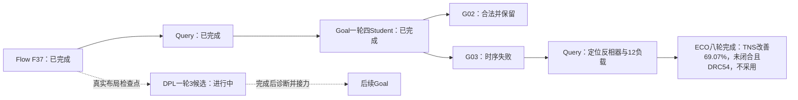
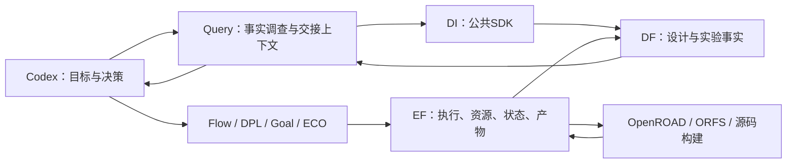

# 邀请论文实验素材：当前实测版（2026-10-20）

这是持续更新的实验素材，不是声称四设计已经全部完成。当前12行数据从原结果逐SHA核对后导出；新GCD DPL尚在执行，不提前填入结果。CSV包含完整PPA、电气/布局违反、DRC方法、run/条件/目标及来源SHA。

## 当前可用结论

GCD已有真实 Flow→Query→Goal 合法增量：相对实际Flow父项，功耗下降19.6723%、单元面积下降12.8614%，并修复父项面积超限。Student02有18输出PDR和独立完整DRT/RCX七值同值；Student01保留更大时序余量。

JPEG保留可行Flow候选及真实负接力。DPL Student03仅原cell面积上限失败；不事后改写约束。原Goal03→ECO的时序与功耗退步如实展示，该旧ECO交付包含平台重布线，不能拿它代表修复后的交付效果。

## 已有测量

|设计|节点|专业|功耗mW|cell µm²|setup WS ps|setup TNS ns|状态|
|---|---|---|---:|---:|---:|---:|---|
|gcd|B0|ORFS|1.373553765000|42.6757|9.34292000|0|reference|
|gcd|F37|Flow|0.89091155678000|44.8918|12.289000|0|handoff; area exceeds limit|
|gcd|G01|Goal|0.75559981633000|39.2348|5.31003000|0|retained alternative|
|gcd|G02|Goal|0.71564863902000|39.1181|0.0834055000|0|adopted|
|gcd|G03|Goal|0.76853850624000|38.7974|-70.4802000|-0.856145|rejected: setup timing|
|gcd|G04|Goal|0.76625181828000|38.9869|-92.9781000|-1.01305|rejected: setup timing|
|gcd|GE8|ECO|0.77087164391000|38.9432|-32.4331000|-0.264783|rejected: setup timing and native route DRC 54|
|jpeg|JB0|ORFS|178.33724618000|6734.18|19.5042000|0|reference|
|jpeg|JD3|DPL|178.1052202000|6735.09|19.8262000|0|rejected: original area limit|
|jpeg|JF10|Flow|176.39359832000|6712.36|6.83587000|0|measured feasible; old partial search|
|jpeg|JG3|Goal|150.8680135000|6243.33|-12.5853000|-0.0701142|rejected: setup timing|
|jpeg|JEold|ECO|151.72357857000|6243.36|-12.9088000|-0.170005|rejected: setup timing; legacy platform reroute|

完整字段：[机器可读指标表](INVITED_PAPER_METRICS_20261020.csv)。GCD条件为ASAP7 FF/310ps，JPEG为ASAP7 FF/545ps；跨设计不直接计算改善率。ORFS对照与现代Flow综合/方法来源分列；相对ORFS的全部降幅不归为某段源码或协同的唯一贡献。

## GCD实际接力与本轮动作

实线表示已完成的真实步骤；虚线标明当前计算或后续步骤。DPL仍在执行；ECO是真实完成的拒绝侧枝，不画成成功采用的四棒主线。

## 平台做什么

本轮G03 Query已查询实际DF快照并导出专业上下文：4事实/4假设，定位reg2reg关键路径、共享小SLVT反相器及12负载，建议增强驱动/分裂负载；没有把建议冒充已执行或因果证明。ECO由平台派发，原专业评分与回滚保留。实际八轮最终功耗0.77087164391mW、cell面积38.9432um²、setup WS−32.4331ps、TNS−0.264783ns；相对G03绝对TNS减少69.0726%，但仍未闭合且原生DRT54，所以拒绝，合法G02不变。

## 当前四设计交付状态

|设计|当前交付|下一步|
|---|---|---|
|GCD|合法既有成果已固定；DPL继续；G03→ECO完成并按setup/DRC拒绝，G02保持|收取DPL结果、诊断并继续适用接力|
|ibex|官方镜像Slang综合实际通过；发现多VT库/LEF配置不一致并已修正|为优先GCD，基准计算已暂缓；ECO已结束，已自动继续相同配置|
|jpeg|旧可行候选与真实负接力可复用；老板已停止低收敛第二轮余下搜索|按已有结果诊断选择有效起点，不重跑整个搜索作为前置|
|ariane|已找到原Goal ASAP7 placed基准：210295组件、136 SRAM实例、21 Liberty/11 LEF，宏模型存在|原布局已由EF成功导入并核对210295组件/136 SRAM；完整物理基准待做，不称原样ORFS RTL基准|

## 指标与证据口径

表中WS是原始worst slack，可为正；CSV另列规范WNS=min(0, WS)。原始结果不改写。最终采用按原setup/hold、功耗、面积、布局/电气及原布线流程DRC条件判断；缺失值写unknown。工具估计PPA不等于硅测或全工艺签核。

新增保留布线实测已确认相同线路/单元/引脚及七PPA不变。独立`drt::check_drc`返回5377 marker，而原DRT流程计数为0，两者方法不同，独立检查值另列，不偷偷替换原指标或宣称它们等价。新ECO会在原生best选择时保存当次DRT计数，并与实际交付ODB哈希绑定；完整本轮验收见A29施工记录。独立marker的物理含义尚待专项核实，本文不宣称独立检查为零。新ECO独立checker为5924，另列；原生54从最佳选择的原始控制台记录恢复并随EF归档登记。原输出目录建立过晚的缺陷已在未来版本修复，当前实验没有重跑模型或篡改其原生动作。

平台效率先报告实际操作链、成功交接及已知成本；没有同任务对照的数据，不填写token/时间节约比例。研究算法按上游归属引用，平台贡献是统一集成与协同环境。
