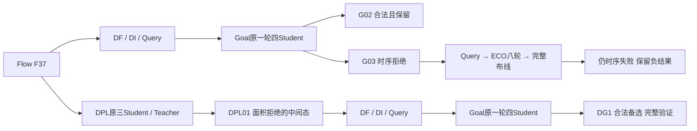
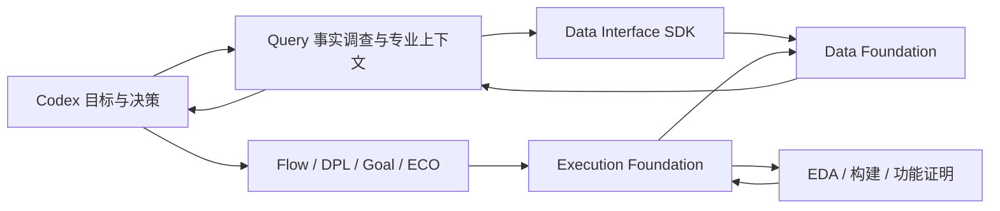

# 邀请论文实验素材：当前实测版

更新于2026-10-21 15:58。当前36个完成测量节点逐原件SHA核对。进行中任务不填收益，失败中间态不充当最终采用结果。

## 老板可直接使用的结论

- GCD四专业均真实参与；Flow→Goal和Flow→DPL→Goal形成两条完整验证的合法接力。最低功耗G02保留：0.71564863902 mW / 39.1181 µm²，setup WS +0.0834055 ps / TNS 0；较实际F37父项功耗−19.6723%、面积−12.8614%。
- 第二条GCD分支DG1为0.81929122098 mW / 39.6139 µm²，setup WS +1.31586 ps / TNS 0；较实际DPL01父项功耗−12.6104%、面积−11.9286%。两条均有18输出PDR和独立完整DRT/RCX七指标同值。
- JPEG JP3为152.64929831 mW / 6244.16 µm²，setup WS +10.2303 ps / TNS 0，hold TNS、电气、布局和原生DRT违反均为0；相对原ORFS参考功耗−14.4041%、面积−7.2766%。完整27输出PDR、独立交付重放七指标同值和DF/DI核对通过，已保留。
- JP3是Goal03物理状态经过Codex显式VT/size原生修复及完整布线的结果；不能表述成新ECO成功或多个源码变体合并。ECO的真实负接力完整保留。
- ibex原Goal一轮四Student及失败收尾完整保留；新Query驱动的一次VT/size策略IP3已完整测量：28.254939243 mW / 2342.58 µm²，setup WS +10.1494 ps / TNS 0、hold TNS 0、电气/布局/原生DRT 0。较ORFS参考功耗−3.3813%、面积−2.5448%；派生时钟及尺寸/VT状态匹配已通过真实资格，完整106输出证明与重放尚未完成；尚未采用，IB0保留。
- Ariane原1×4及Teacher与全部eligible最终交付已完成：AG1、AG2、AG4均违反原功耗/面积/setup/hold/slew五项约束，全部拒绝；Student03原生超时保留。本轮没有合法采用结果，AB0也只是原不合格物理参考。原生晋升04与平台最终采用分别记录。
四设计整体尚未全部收口。

## 完成测量节点

|设计|节点|实际父项|专业/动作|功耗 mW|cell µm²|setup WS ps|setup TNS ns|决策|
|---|---|---|---|---:|---:|---:|---:|---|
|gcd|B0||ORFS|1.373553765000|42.6757|9.34292000|0|reference|
|gcd|F37||Flow|0.89091155678000|44.8918|12.289000|0|handoff; area exceeds limit|
|gcd|G01|F37|Goal|0.75559981633000|39.2348|5.31003000|0|retained alternative|
|gcd|G02|F37|Goal|0.71564863902000|39.1181|0.0834055000|0|adopted|
|gcd|G03|F37|Goal|0.76853850624000|38.7974|-70.4802000|-0.856145|rejected: setup timing|
|gcd|G04|F37|Goal|0.76625181828000|38.9869|-92.9781000|-1.01305|rejected: setup timing|
|gcd|GE8|G03|ECO|0.77087164391000|38.9432|-32.4331000|-0.264783|rejected: setup timing and native route DRC 54|
|gcd|GEC|GE8|route completion|0.77061523916000|38.9432|-32.4934000|-0.266838|rejected: setup timing; complete route DRC0|
|ibex|IB0||ORFS|29.243746772000|2403.75|25.478000|0|reference: complete flow; explicit multi-VT libraries|
|gcd|D01|F37|DPL|0.93751552049000|44.9793|10.4943000|0|area rejected; validated Goal repair branch; native round completed, Teacher selected Student02|
|gcd|D02|F37|DPL|0.89124625083000|44.6148|14.3074000|0|native Teacher selected; final area rejected; G02/DG1 retained|
|gcd|DG1|D01|Goal|0.81929122098000|39.6139|1.31586000|0|validated feasible alternative; G02 retained|
|gcd|DG2|D01|Goal|0.8015136118000|39.1473|-85.4511000|-0.867528|rejected: setup timing|
|gcd|DG3|D01|Goal|0.80402684398000|39.1473|-93.1683000|-0.98939|rejected: setup timing|
|gcd|DG4|D01|Goal|0.80402684398000|39.1473|-93.1683000|-0.98939|rejected: setup timing|
|jpeg|JB0||ORFS|178.33724618000|6734.18|19.5042000|0|reference|
|jpeg|JD3|JB0|DPL|178.1052202000|6735.09|19.8262000|0|rejected: original area limit|
|jpeg|JF10||Flow|176.39359832000|6712.36|6.83587000|0|measured feasible; proof timed out; not adopted|
|jpeg|JG3|JB0|Goal|150.8680135000|6243.33|-12.5853000|-0.0701142|rejected: setup timing|
|jpeg|JEold|JG3|ECO|151.72357857000|6243.36|-12.9088000|-0.170005|rejected: setup timing; legacy platform reroute|
|jpeg|JEnew|JG3|ECO+route finish|151.72843635000|6243.39|-15.6584000|-0.238709|rejected: setup/fanout; native8rounds,10modelcalls; fullrouteDRC0|
|ibex|IG1|IB0|Goal|28.18046324000|2339.71|-28.3996000|-1.59699|rejected: setup/slew/cap; native promotedStudent01; ORFS retained|
|ibex|IG2|IB0|Goal|27.968287468000|2335.44|-36.3866000|-4.41515|rejected: setup/slew/cap; originalStudent02; ORFS retained; OpenDB deferred|
|ibex|IG3|IB0|Goal|27.995452285000|2335.22|-37.8584000|-4.26612|rejected: setup/slew/cap; originalStudent3; OpenDB deferred|
|ibex|IG4|IB0|Goal|27.995452285000|2335.22|-37.8584000|-4.26612|rejected: setup/slew/cap; originalStudent4; OpenDB deferred|
|ibex|IT1|IG1|Goal native timing|28.110442683000|2340.26|-26.2704000|-1.74221|rejected: finalsetup/slew; originaltiming-only, no newCPP|
|ibex|IP1|IT1|native finishing|28.248446062000|2340.73|-10.3335000|-0.148885|rejected: setup/slew; actualfinalTNSdebt-91.45%; separateRCprotocolr2alsocompletedandrejected|
|jpeg|JP1|JG3|native finishing|151.75381303000|6243.33|-26.2502000|-0.306245|rejected: finalsetup; nativeVTrepair then fullreroute; no newCPP|
|ibex|IP2|IT1|native finishing r2|28.235161677000|2341.42|-1.30401000|-0.00130401|rejected: max_slew_violations,setup_tns_ns_min|
|ibex|IP3|IP2|native VT/size r3|28.254939243000|2342.58|10.1494000|0|physically feasible; final functional proof pending; not yet adopted|
|jpeg|JP3|JG3|native VT/size r3|152.64929831000|6244.16|10.2303000|0|validated feasible; exact27outputPDR and independent7metric delivery replay; retained|
|jpeg|JPD|JG3|preserved-wire diagnostic|150.82803369000|6243.33|0.26612000|0|diagnostic only: existing wires RCX; native DRC unknown; not adopted|
|ariane|AB0||ORFS checkpoint|642.41528511000|43672.8|-285.396000|-155.146|reference: setup/slew fail; original inline LEC retired; not adopted|
|ariane|AG1|AB0|Goal + common final delivery|645.26546001000|43675.6|-366.492000|-537.744|rejected: max_slew_violations,power_total_w_max,cell_area_um2_max,setup_tns_ns_min,hold_tns_ns_min|
|ariane|AG2|AB0|Goal + common final delivery|645.35105228000|43675.6|-351.000|-498.558|rejected: max_slew_violations,power_total_w_max,cell_area_um2_max,setup_tns_ns_min,hold_tns_ns_min|
|ariane|AG4|AB0|Goal + common final delivery|651.96436644000|43970.9|-391.727000|-310.3|rejected: max_slew_violations,power_total_w_max,cell_area_um2_max,setup_tns_ns_min,hold_tns_ns_min; original native controller selected; native gain unattributed|

完整指标、core/die面积、setup/hold、电气/布局、DRC方法、run/condition/objective及原件SHA见[指标CSV](INVITED_PAPER_METRICS_20261020.csv)。无最终PPA的已终止尝试见[失败过程表](INVITED_PAPER_FAILED_ATTEMPTS_20261021.csv)。

## GCD真实接力

允许后续专业修复不合格中间态；最终采用结果才必须满足约束。四专业真实参与不等于四专业连续成功串联，两条Goal分支的阶段/策略不同，不能把分支差异当成DPL的独立因果增益，也没有证明优于最强单Agent。

## 平台统一封装

EF管理任务、资源、状态和产物；DF管理可查询事实及原件引用；DI提供公共契约；Query把事实转为证据、假设和专业交接上下文；Codex决定下一步和是否采用。不新增通用harness、服务、评测数据库。实际操作及用量范围见[平台操作记录](A29_PLATFORM_OPERATION_TRACE_20261020.md)。

## 比较和论文口径

- GCD / JPEG / ibex分别为ASAP7 FF的310 / 545 / 900 ps条件；Ariane为900 ps、标准单元FF及原SRAM模型，不声称全宏统一FF签核。跨设计不计算改善率。
- 最终PPA使用实际DRT/RCX、固定SDC/Liberty和同测量方法；功耗为OpenSTA估计，没有设计SAIF或硅测功耗主张。ORFS对照与现代Flow综合来源分列。
- WS保留实际正负值，WNS=min(0, WS)。不四舍五入抹掉违反，不事后放宽JPEG面积约束。
- 原生DRT计数和独立DRC marker是不同方法，分列且不互换；未知值保持unknown。
- 既有相同产物证明直接复用；失败候选不反复补昂贵证明。没有同任务效率对照时，只报告实际操作、墙钟与已知用量，不计算token/时间节约率。
- [方法及英文图注](INVITED_PAPER_METHOD_NOTES_20261020.md)、[GCD英文案例正文](INVITED_PAPER_GCD_CASE_TEXT_20261020.md)供论文直接使用。

## 当前资源交接（2026-10-21 11:45）

Ibex同模型完整证明已保存594个PASS/2046个义务，公开EF取消仅为释放20GiB预约，让原Ariane16GiB构建和后续32GiB完整交付先完成。原生EQY-c已由正例与错误时钟反例验证；后续保持原输入、配置、分区和106输出，按原14400秒扣除已用时间续算；不是功能反例或重新优化。
Ariane原生轮次及主/兄弟候选最终交付均已完成，三份最终候选全部拒绝。新的r2续算驱动要求整个原case实际终态，防止仅前端观察退出就提前占用证明资源。

[四设计英文实验段落与总表](INVITED_PAPER_FOUR_DESIGN_CASES_20261021.md)可直接编辑；其中Ibex/Ariane保留实际待验证状态，最终终态后再更新。

## Ariane 原生轮次已完成（2026-10-21 12:29）

原一轮四Student及Teacher已完成，确定性控制器选择Student04；其原生收益仍被标记为尚未归因，机制未证明激活。源ODB已按公开EF归档SHA核对；主候选完成32GiB/8线程的共同DRT/RCX，结果见AG4行。AG1/AG2与主AG4的最终交付均已完成，全部拒绝。补观测后的ODB/网表与前次修复逐字节相同，不计作新的物理收益。

## Ariane已完成，Ibex同模型续算实际运行

事实读取短暂超时后，原冻结r9 CLI resume复用原四份Student02 EF任务与已发布数据完成整轮交付，没有重跑专业搜索、EDA或模型。原宿主首次相对路径启动错误在提交任务前退出，日志保留。Ibex已通过EF run-05fea209b52e4860b4ec41495f5bbcd4接续相同106输出/2046义务，复用594PASS、原剩余10243秒；完整验证及重放尚未完成，IB0仍保留。
