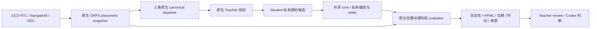

# L2：DPLEvolve 本机原生复现

老板在 L1 汇报后授权继续既定 L2–L8 路线。本切片只实现 L2，统一执行、数据接入分别属于 L4、L6；不改公共接口，不把原生运行记作平台接入完成。

## 用户验收效果

1. 项目原生控制仓库和独立工具链能在当前服务器运行。
2. 项目自带 Nangate45/GCD 真实设计产生 `3_4_place_resized.odb`，三条 canonical baseline 完成且合法。
3. 原生 prompt/workspace smoke 通过；一次有界 Teacher/Student 运行产生至少一个真正修改过的源码候选。
4. 新源码候选构建、原生完整详细布局评价、源码/二进制/metrics 来源核对通过。优化效果如实报告，不以是否胜出替代运行验收。
5. 命令、日志、失败、输入、工具身份和候选版本留在独立 var 目录，能够继续查证。

## 文件和影响面

| 文件/目录 | 职责 |
|---|---|
| `dplevolve/` | 独立正式 Git 项目，固定上游 `96d8c613d62bf3431083bb5e52c7df8853d5a622`。原生算法、Teacher/Student 与 evaluator 保留。 |
| `.gitignore` | 登记独立子仓库，避免工作区仓库重复提交其源码。无业务行为变化。 |
| `admin/run_dplevolve_native.py` | 有界运行原生命令，保存配置、进程、输出、失败与控制源码 hash；开发验收工具，不是业务 Agent harness。 |
| `admin/test_dplevolve_native_runner.py` | 验证失败留证、禁止重复步骤、源码变动识别、timeout 子进程清理。 |
| `admin/accept_dplevolve_native.py` 和对应测试 | 实验完成后核对原生基线、真实候选、新源码与构建/评价一致性。实际格式以源码和真实输出决定。 |
| `var/code-agent/l2-dplevolve-20261011/` | 冻结控制源码、独立 ORFS/OpenROAD、运行配置、共享 core、原生状态与证据。 |
| `admin/L2_DPLEVOLVE_REPORT_20261011.md` | 本切片工程结论、实际效果、失败和恢复入口。 |
| `ARCHITECTURE.md`、`TASKS.md`、`admin/STATUS.md` | 同步真实能力、原生接点、接入边界和验收状态，不改变其他模块职责。 |

根工作区基线 `f02840a`，分支 `l2-dplevolve-native-20261011`。已有 evaluation 修改/未跟踪文件保留，不纳入本切片。正式 DPLEvolve 为 `l2-native-20261011` 分支。运行控制副本为独立冻结 clone；不修改正在运行的源码。

## 数据流和关键选择

使用原项目 anchor：ORFS `dcded6834fa6aa5b20f45d66eb3fb0dd7c0c6483`，OpenROAD `d14d526a6f8ce5388e2a8dc30da88a0189df2f46`。从本机现有 Git 对象复制源码，独立 checkout 后运行官方 prepare，不修改旧仓库。使用服务器已有编译依赖和 Yosys；OpenROAD 必须由本切片锚定源码重新构建。

共享 core 只构建一次，Student 使用私有 `dpl_evolve` 源码和明确二进制，不能把系统 OpenROAD 当作候选工具。GCD 是项目自带真实设计，用于最小复现；其 HPWL 指标不等于最终芯片 PPA，后续完整流程和公平对照单独验收。

原生 Teacher/Student 使用已经配置的 Codex CLI。至少一轮、一名 Student、串行评价、每次构建/物理执行八线程。先通过环境、构建和基线再启动真实源码演化，不跳过原生 preflight。运行预算与每个原生命令记录在 step receipt；发生确定性失败后保留现场，正式修复再冻结新副本。

## 验证与继续

- 本切片新增脚本：ruff lint/format、mypy、compile、对应 pytest、git diff 和架构边界检查。
- 原项目静态 gate：`scripts/repo/check_release_readiness.sh --skip-teacher-dry-run`；工具链准备后执行原生 prompt/workspace smoke。
- 原生顺序：prepare → configure/build shared core → placement snapshot → 三基线 → dry-run prompt audit → Teacher/Student launch → 真实结果来源审计。
- `admin/run_dplevolve_native.py --run-root <目录> --step <新步骤名> --timeout-seconds <预算> -- <原生命令>` 保存每步回执。旧步骤拒绝重启；失败保留，新尝试使用明确的新步骤/新冻结副本。
- 原生结果由 evaluator 的 `metrics.json:hpwl`、合法性与 source/binary 身份确认，不使用 `hpwl_proxy` 排名。
- 工程通过与老板业务验收分开；统一平台执行/数据仍未完成。
