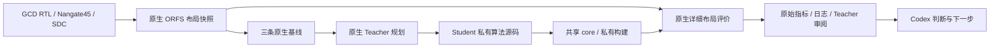

# L2：DPLEvolve 本机原生复现

更新：2026-10-11。L2 原生复现工程验收通过，37 项总核查与六项独立重放对照通过；业务确认待老板。统一执行、统一数据接入仍属于 L4、L6，本切片不宣称平台已接入 DPLEvolve。完整回执为 `var/code-agent/l2-dplevolve-20261011/l2-acceptance.json`。

## 老板得到的功能

- DPLEvolve / ReviewDSE 的独立工程和工具链能在本机运行，保留原项目 Teacher/Student、算法起点和受保护 evaluator。
- 项目自带 GCD / Nangate45 的真实 RTL 经过综合和布局，生成用于源码优化的 ODB/SDC；三条原生基线完成且布局合法。
- 原生 prompt/workspace smoke 通过；一轮 Teacher/Student 能真正修改算法源码、构建私有 OpenROAD 并评价，失败和拒绝的优化路线也保留。
- 原生命令、输入、源码版本、二进制、原始日志和评价数据归档在独立运行目录，后续统一接入有真实依据。

## 环境与身份

运行目录：`var/code-agent/l2-dplevolve-20261011`。正式项目 `dplevolve/` 和运行控制副本 `source/` 均固定上游 `96d8c613d62bf3431083bb5e52c7df8853d5a622`，工作树干净；专用虚拟环境安装 PyYAML 6.0.3。没有修改上游控制或评价源码。

原项目 ORFS anchor 为 `dcded6834fa6aa5b20f45d66eb3fb0dd7c0c6483`，OpenROAD anchor 为 `d14d526a6f8ce5388e2a8dc30da88a0189df2f46`。在独立复制的源码目录运行官方 prepare 后，本机 commit 分别为 `6b0ac1adaed97a2e8fdaa9e48ec354026328b894` 和 `55cb44ce84283d07225b18e5d4b5424fefd34ed0`；共享 core 来自该源码真实构建，耗时约 642.57 秒，没有使用系统 OpenROAD 冒充候选工具。

使用服务器 GCC toolset 13、已有编译依赖和 Yosys；Release、GUI OFF、八线程。Teacher/Student 使用现有 Codex CLI 默认配置，没有模型覆盖。一次原生轮次、一名 Student，构建和物理评价限制八线程、物理评价串行。

GCD placement snapshot 由真实 RTL 生成，约 8.25 秒；设计有 618 个实例、570 个可移动实例。输入为 `orfs/flow/results/nangate45/gcd/l2_gcd_20261011/3_4_place_resized.odb` 和同目录 `2_floorplan.sdc`。控制源码、输入、core/Yosys 和三条基线的 hash 已冻结。

## 实际结果

HPWL 是原生 OpenROAD/DPL pin-based 线长，越小越好；不使用 cell-bbox proxy 排名，也不把详细布局线长等同于最终布线 PPA。

| 原生基线 | HPWL（µm） | 原生运行时间（s） | 布局违规 |
|---|---:|---:|---:|
| OpenROAD 默认详细布局 | 2969.1 | 0.627 | 0 |
| OpenROAD negotiation | 2993.6 | 0.724 | 0 |
| DPLEvolve 自带框架 | 2941.1 | 0.638 | 0 |

Teacher 在原生工作区选择 prepared diamond 起点。第一版真实新源码的 HPWL 为 2969.9 µm、时间 0.585 s，合法但略差于 OpenROAD 默认；原始 metrics、日志及 diff 保留在 Student 的 `artifacts/first_evaluation/`。

Student 完成一次同路线强化后，HPWL 为 2941.7 µm、时间 0.677 s、平均/最大位移为 1.0411/15.3770 µm。它相对 OpenROAD 默认线长减少约 0.92%，但略差于项目自带框架 2941.1 µm，且最大位移高于默认 8.9889 µm。原生 Student 已拒绝该路线并保存源码试验证据；工程复现与优化晋升是两个不同结论。

候选源码固定为 `8a7a417072e6b4ee2f018d144f48c0d70108696b`，准确 diamond 起点为 `e6d61587ead88651bcedeb21fee26e03b0956a01`；相对该起点真正修改九个算法文件，442 行新增、13 行删除。稳定 candidate 和 rejected refs 都保留，固定 ref 不代表晋升。

从该 candidate ref 独立 clone、使用官方私有 variant helper 全新构建，约 36.25 秒；用明确的私有二进制和新 run tag 重放。最终 HPWL 仍为 2941.7 µm，阶段 HPWL、位移和合法性全部一致，原生运行时间为 0.660 s，低于原项目 1.254 s 的两倍默认预算。原实验及重放原始文件均保留；对照见 `replay-comparison.json`。重放期间不改变 Student 工作区或覆盖其评价记录。

原生轮次于北京时间 15:37:02 启动、15:54:02 正常结束，约 17 分钟。Teacher 规划、Student 实现和 Teacher review 三项真实模型操作均退出零；最终 prompt audit 无 warning。Teacher 确认候选工程有效，保留为有证据的机制工作区，不替代更好的 2941.1 µm 基线；指出局部接受/评分可能限制更大范围优化，并给出有界联合移动的后续研究建议。本切片到此结束，没有启动新轮次。

原生三个模型操作的累计账本：输入 4,234,420 token，其中缓存输入 3,947,520；输出 39,522，输入与输出合计 4,273,942。它是多个工具回合累计量，不是一次上下文大小；不含主 Codex 对话、前期失败和编译成本，也不当作数据底座节省 token 的对照结论。原项目的模型上下文开销较大，后续按统一数据接入及 L8 条件测量。

本次仅一个小设计和一轮，不能证明通用优化质量；完整 Flow/Code 协同 PPA 和平台收益留到后续切片。

## 数据流与接入依据



源码变化涉及精确 TopK 候选、累计 hot node/segment 状态和局部 reorder。选中起点的 `source_base_commit.txt` 会随 diamond 切换更新；源码新颖性需相对该准确起点确认，不能把换预制起点当作新算法。

后续 L4 的确定性接点已有源码依据：共享 core configure/build、私有 variant configure/relink，以及 `baseline/run_baseline.sh --openroad-binary` 的原生 EDA 评价。Teacher/Student 的策略、trial keep/reject 和稳定 candidate ref 继续由原项目管理。L6 再将这些原始结果与来源交给统一数据入口，不绕过公共接口读平台私有数据库。

## 文件职责与工程门禁

| 本切片文件 | 职责与原因 |
|---|---|
| `.gitignore` | 登记独立 DPLEvolve 子仓库。 |
| `admin/run_dplevolve_native.py` | 记录有界原生命令、配置、来源、日志、失败和进程清理；仅是开发验证工具。 |
| `admin/test_dplevolve_native_runner.py` | 验证失败留证、来源变化、步骤不覆盖及 timeout 子进程清理。 |
| `admin/accept_dplevolve_native.py` | 核对真实基线、新源码、明确私有构建/评价、输入与产物来源。 |
| `admin/test_dplevolve_native_acceptance.py` | 拒绝 proxy-only、违规、缺合法性、错误日志/身份和产物替换。 |
| `admin/L2_DPLEVOLVE_PLAN_20261011.md` | 本切片已授权范围、数据流和验收步骤。 |
| `admin/L2_DPLEVOLVE_REPORT_20261011.md` | 实际效果、证据、限制及验证交接。 |
| `ARCHITECTURE.md` / `TASKS.md` / `admin/STATUS.md` | 同步原生能力、接入边界及真实工程和业务验收状态。 |

本轮脚本 lint、格式、类型、编译检查通过；16 项新增验证测试与九项已有恢复/资源/进程测试，共 25 项通过。既有四项数据来源检查通过；Flow 没有新增代码或接口变化，沿用 `a90bd07` 的 48 项已通过记录。最终静态检查和脚本 hash 见 `engineering-checks-final/receipt.json`。

新算法的私有 prepared 模块没有独立单元测试 target；不宣称其单元测试通过。Student 逐文件 diff/clang-format 检查、源码编译、两次真实 GCD 评价和本次固定源码独立重放构成对应验证；日志中真实精确探测/回滚、零 replay failure 及原生 scratch/incremental objective 一致性也保留。

架构检查见 `architecture-review.json`：没有修改平台业务模块或公共契约，没有新增跨项目源码 import/软链接，没有修改旧服务或旧数据库。根目录已有 `admin/evaluation` 用户修改未纳入切片。所有运行数据留在 var，正式独立 DPLEvolve 源码保持干净。

## 失败与验证交接

初次 static/prepare 使用未安装 yaml 的 Python，失败现场保留；建立独立 venv 后通过原生检查与 prepare。原生合法设计不一定生成 `check_placement_report.json`，初次审计错误要求该文件的结果保留为 `baseline-audit-initial.json`；修正后使用原生 post-metrics 检查命令及原始 `detailedplace__design__violations=0` 确认合法性，没有降低 evaluator 标准或重跑基线。

曾误用缺运行 SDK 的环境启动根回归，collection 失败；改用既有正确环境后通过，没有改旧测试迁就错误环境。实际模型、源码试验与失败完整保存。

| 证据（相对于运行目录） | 证明什么 |
|---|---|
| `l2-acceptance.json` / `native-evidence.json` | 37 项来源、真实运行及候选构建/评价核查通过；业务确认待老板。 |
| `source-manifest.json` / `baseline-freeze.json` | 控制源码、工具、输入及三条基线未被演化改写。 |
| `steps/` | 各步原生命令、环境配置、日志、预算、退出状态和失败现场。 |
| `state/l2_gcd_source_20261011/teacher_rounds/` | 原生 manifest、prompt audit、Student 试验源码/ref、失败/拒绝证据和 Teacher review。 |
| `state/l2_gcd_source_20261011/checkpoints/operations/` | 三项真实模型操作的 session、日志、用量和最后回复。 |
| `replay/variant/` / `replay-comparison.json` | 固定候选的干净独立源码、全新私有二进制及与原实验一致的真实重放。 |
| `engineering-checks-final/receipt.json` / `architecture-review.json` | 静态门禁、最终源码 hash、回归及模块边界。 |

老板无需重跑完整优化，可先查看上述总回执与三个 baseline/candidate 指标，再读 Student/Teacher 的原因分析。只读重核查命令为：

```bash
cd /home/wjyuan/projects/eda-development/admin
.venv/bin/python - <<'PY'
from pathlib import Path
from accept_dplevolve_native import audit

result = audit(Path('../var/code-agent/l2-dplevolve-20261011').resolve())
print('工程通过:', result['engineering_accepted'])
print('核查数量:', len(result['checks']))
print('失败项:', [k for k, v in result['checks'].items() if not v])
PY
```

命令不重跑 EDA、不再次调用模型、不覆盖原回执。下一切片是 L3 / GoalEvolve 原生复现，之后在 L4 统一两个 Code 项目的确定性执行入口。

## 三句话交接

1. 本切片新增原生运行记录、真实来源验收及对应测试，并更新计划、报告和状态；没有改 DPLEvolve 上游业务源码。
2. 原生 ORFS 提供输入，Teacher/Student 修改私有算法源码，官方 helper 构建和评价，原始结果供 Codex 判断；统一平台入口尚未接入。
3. 查运行与来源看 admin 验证脚本，改专业算法看 DPLEvolve 私有 candidate 源码；统一执行和数据接入按 L4、L6 单独施工。
