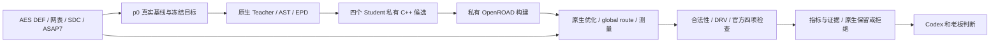

# L3：GoalEvolve 本机原生复现施工计划

状态：老板于 2026-10-11 确认通过，正在按本计划实施；源码和只读环境审计已完成。本计划对应已确认路线的 L3；统一执行和数据接入分别属于 L4、L6。

## 老板最终得到什么

1. GoalEvolve 的原生专业能力能在本机运行，独立于已经复现的 DPLEvolve。
2. 在原项目的真实 AES / ASAP7 设计上跑通源码优化，得到实际时序、动态功耗和漏电功耗。
3. 查到每个新源码候选的修改、构建、物理结果、有效性及保留/拒绝原因。
4. 输入、工具、源码、模型和结果有冻结身份，能核查、重放并为后续统一接入提供接点。

本轮是原生工程验收；优化是否达标如实报告。AES / ASAP7 与 Flow 的 AES / Nangate45 不是相同工艺条件，本轮不将两者数值混为平台协同收益。

## 已核实的施工依据

- 官方上游与 P0 审计一致，固定 `1cc20aa611e687c2745ff7da6a006a5d25f49f85`。只读审计副本位于 `var/audit/goalevolve-l3-20261011/source`，工作树干净。
- 原生 `doctor.sh` 已通过，p0 内容摘要校验成功。当前服务器有 Python 3.12.13、GCC 13.3.1、CMake 3.31.9，与项目记录的主机版本一致；这不代表 GoalEvolve 专用环境或真实编译已经通过。
- p0 的实际输入由内容摘要 `357addea0e53ed786d7b37c8d763b711e4531789b0d93c87878c8d1d4cd91f69` 标识。其来源 commit 是 `d231bd8f98d2a0adb8369002b2c1e7aa8e7877ed`，原始工作树曾有修改；不能只根据 README 引用的上游 revision 或 Git commit 判断源码身份。
- `goalevolve.cli smoke` 使用模拟 evaluator，只检查控制流程，不能替代真实实验。
- 原生 AE-2 从已发布的冻结源码独立构建并重放。AE-3 才产生新源码；两者分别记录。
- AES 有已审阅目标策略：TNS 绝对值 12 ns、动态功耗 350,000,000,000 pW、漏电功耗 35,000,000 pW。基线必须在本机重新测量并冻结，不能使用输入 CSV 的历史数值冒充实际基线。
- AES 普通 evolve profile 引用历史 R54 父代，源码树没有 README 示例中的 AES baseline.json。采用官方 `p0 init → p0 baseline → p0 run`，由原项目清除历史父代字段，避免照抄失效入口。
- 原生默认是 Teacher 加四个 Student，允许编辑 `src/rsz` / `src/rmp`，使用 AST 证据、EPD、原生晋升策略与受保护 evaluator。保留这些方法，不缩成单个模拟 Agent。
- 原生评价会串行执行物理流程，但允许候选构建并行。配置构建资源时必须分别考虑这两项。
- 官方 `lec` 槽位实际是四项竞赛结构有效性检查：固定 physical cell、macro、I/O 位置和触发器完整性。它不是通用布尔逻辑等价证明；布局合法性、零 DRV 与构建/flow 成功也需分别确认。
- 原生模型策略写在 `config/codex.json`，项目凭据用于生成隔离的 Codex 工作目录。实施时核对模型/provider 可用性，复用本机已验证的接入配置，记录任何运行配置差异；不输出或提交凭据。

源码接点：`goalevolve/cli.py`、`p0_campaign.py`、`execution/engine.py`、`evaluation/contest2026.py`、`artifact_evaluation/ae1/run_ae1.py`、`ae2/run_ae2.py`。本轮优先通过现有 CLI 和 profile 完成，不修改这些业务接口。

## 验收标准

1. AE-1 原生环境、冻结输入和正式源码构建通过，原生 smoke 单独记录为控制流程检查。
2. AES 已发布源码的最小 AE-2 重放完成，官方结构有效性检查通过；逐项核对发布指标及既有容差，偏差和失败保留。
3. 本机 p0 真实基线冻结后，完成一轮有界 AE-3；至少一个真正修改 C++ 的新候选能成功构建、运行真实物理流程并生成实际指标。
4. 该候选的源码内容、输入、构建二进制、flow/checker 日志与指标来源一致；原生保留/拒绝状态和原因可查。新候选不能仅为重放已发布补丁。
5. 静态、对应测试、差异审查、架构与回归检查通过；汇报时序/功耗、有效性、耗时、模型用量和限制，工程与老板业务验收分开。

## 文件清单与影响面

| 文件/目录 | 职责 |
|---|---|
| `goalevolve/` | 新建正式独立上游仓库；保留原生控制、算法和评价实现。 |
| `.gitignore` | 登记独立子仓库，避免根仓库重复收录源码。 |
| `admin/run_goalevolve_native.py` | 有界调用原生 setup/check/smoke/baseline/evolution/replay，保存本轮命令、配置、来源、日志、进程与失败。仅为开发验证工具。 |
| `admin/test_goalevolve_native_runner.py` | 检查预算清理、失败留证、不可覆盖及冻结来源；必要工具函数复用既有 admin 实现，不改 L2 行为。 |
| `admin/accept_goalevolve_native.py` | 核查真实 AE-1/AE-2/AE-3、C++ 修改、官方检查、测量及源码/二进制/输入身份。 |
| `admin/test_goalevolve_native_acceptance.py` | 拒绝模拟结果冒充真实实验、缺少有效性、指标错误、未改 C++ 或来源不匹配。 |
| `var/code-agent/l3-goalevolve-20261011/` | 冻结运行副本、原生环境、私有构建、campaign、模型账本和回执；原生 outputs 全部留在 var 内的副本下。 |
| `admin/L3_GOALEVOLVE_REPORT_20261011.md` | 业务效果、实际测量、原生限制、失败及只读验收入口。 |
| `TASKS.md` / `admin/STATUS.md` | 记录切片阶段及实际工程/业务验收状态。 |

根仓库基线为 `0508d5abdc3200805364cad4290b90d40a2b91f3`；已有 evaluation 用户修改单独保留。正式上游保持清晰，专用运行副本完成必要的本机 profile/model 配置后冻结，演化期间不编辑控制源码。候选沿用 GoalEvolve 原生内容 hash/patch 身份，不强迫其采用 DPLEvolve 的 Git-ref 格式。

影响已有模块：新增独立项目与开发验证文件；不修改 EF、DF、DI、Query、Toolkits、Flow 或 DPLEvolve 的业务实现，不改变公共契约。旧服务、数据库和已有实验继续保留。

## 数据如何流动



AE-2 独立验证已发布源码，不向 AE-3 冒充新候选。每个 AE-3 候选从相同 benchmark 输入执行完整原生流程，不把父代 post-route ODB 再优化一遍作为可比基线。固定目标、基线和评价口径保持原生语义。

本轮只有原生 CLI/profile 与本机文件交接，不新增 HTTP API。EF 统一执行及 DF/DI/Query 统一数据接口在原生接点验证后单独实施。

## 实施和验证顺序

1. 新分支与独立正式仓库，冻结上游、p0、已发布 AES 源码、输入/库及受保护 checker；保存当前版本和已有用户修改边界。
2. 在 var 运行副本使用原生环境 setup；核对已有编译依赖兼容性，用真实 p0 源码准备工具。原生 AE-1/check 和已有 Python 测试通过后，再进入 EDA。
3. 原生 CLI smoke 通过，标注模拟；AE-2 对 `aes_cipher_top_student_code` 做 preflight 和真实源码重放，保留发布容差比较及官方检查。
4. 用 p0 AST 路线初始化独立 AES campaign，配置本机工具路径并测量、冻结同流程基线；保留原生已审阅绝对目标。
5. 一轮 AE-3，四个原生 Student，记录 Teacher 规划、实际任务、C++ patch、候选构建/评价、模型调用和最终选择。真实有效候选产生后，检查固定源码的独立重放或等效来源证据。
6. 依次完成静态检查、对应测试、逐文件 diff/模块边界审查和必要回归；写报告与状态，提交 `[切片L3] ...（待业务验收）` 检查点。

原生入口示意，实际绝对路径和命令保存在每步回执：

```text
make setup / make check
python -m goalevolve.cli smoke --state-root <独立 smoke 目录> --rounds 1
python artifact_evaluation/ae2/run_ae2.py preflight --artifact aes_cipher_top_student_code --openroad <本轮 p0 binary>
python artifact_evaluation/ae2/run_ae2.py replay --artifact aes_cipher_top_student_code --rebuild --jobs 8
python -m goalevolve.cli p0 init --design aes_cipher_top --run-id l3_aes_20261011 --output-root <本轮目录> --planning-mode ast_graph --max-rounds 1
python -m goalevolve.cli p0 baseline --campaign <campaign 目录>
python -m goalevolve.cli p0 run --campaign <campaign 目录> --rounds 1
python -m goalevolve.cli p0 status --campaign <campaign 目录>
```

使用项目独立环境/自身安装，不添加跨项目源码 PYTHONPATH 或 sys.path。AE 脚本需要本项目可导入时，仅沿用原项目内的运行方式。

预算：单设计、一轮、四个 Student；p0/AE-2 单次构建八线程，四个候选每个构建两线程；物理测量沿用原生串行锁，记录实际并发与线程。总监督预算六小时，保留原生每项命令/模型预算及重试记录；预算结束保留现场，不降低评价门槛，也不自行扩大到更多设计或轮次。

## 尚待真实运行验证

已有依赖是否能成功编译 p0 和发布源码、模型名称/provider 是否可用、AE-2 数值容差是否匹配，以及一次 AE-3 是否产生可构建的真实新候选，都要通过本轮实测确认。没有做到的验收项不能记完成；新源码未改善但工程有效时照实报告，构建/物理或有效性失败则不算新候选验收通过。

本轮完成后才进入 L4，基于实际 compile / OpenROAD / parser / checker 入口收口统一执行；随后统一数据、协同流程和本机收益测量。ECO、教学、新用户安装与论文对照暂缓。
