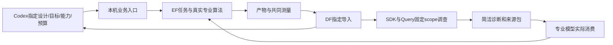

# 第三、第四项施工：单机业务入口与专业对照

已获老板“继续推进第三项和第四项”授权。基线 `cfb8d49`，分支 `local-business-comparisons-20261014`。用户26份未提交文件保留；历史运行副本和失败证据不改写。

## 业务交付

| 切片 | 老板得到什么 | 验收 | 依赖 |
|---|---|---|---|
| A4 单机入口 | 指定设计、目标、能力、预算即可运行；自动执行、归档/入库、Query上下文传给专业模型 | GCD及真实AES，无源码中的设计特例；四专业入口真实消费诊断；结果/失败可按设计查回 | A2交接、A3共同目标、现有EF/DF/SDK/Query |
| A5 单项/组合 | 原生方法与平台包装的匹配复测，各单项与有关组合及Codex选择记录 | 相同输入/方法的包装不改变结果；同条件最终PPA与预算/成本明列；保留最好合法结果；是否超越单项由实测判断 | A4；固定共同库/SDC及方法身份 |

不新建API后台、通用Agent harness或评测底座；不展开Tutorial/公开评测。专业原策略、评分、晋升、Teacher/Student和版权保留。TimingECOAgent目前的ASAP7能力边界明确，不声称支持所有PDK。

## 实现计划与文件职责

- 根 `chip-evolve.py`、`chip_evolve/`：本机业务CLI、设计/部署绑定、公共EF任务与自动数据回流、专业适配。运行目录及输入由配置决定；Codex选择动作/采用结果，命令完成确定性物理工作。
- 根 `admin/prepare_local_business.py`：把已资格验证的本机工具/专业源码与环境登记为部署配置；真实设计配置和SDC属于输入资产，不是算法特例。
- 根 `admin/run_local_comparisons.py`、对应测试：固定本机对照输入、原方法重放、单项/组合事实与预算记录，不自动制造研究结论。
- Query `domain/professional.py`、`application/professional.py`、`interfaces/investigation_cli.py`及测试：从现有固定scope的调查导出专业可消费事实/诊断包，保留证据、假设与未知；沿用host/Codex调查机制，不重建推理框架。原有限buffer ECO契约不放宽。
- Toolkit `context.py`及测试：小型公共上下文传递/身份助手，供已安装wheel消费，不负责诊断或决定下一Agent。
- Flow `platform_model.py`/`platform_execution.py`、DPL `scripts/codex_exec/runner.py`/`scripts/platform/execution.py`、Goal `agents/codex_runtime.py`/`platform/execution.py`、ECO `platform_codex.py`/`platform_execution.py`及对应测试：把同一上下文送进实际推理和执行身份；Goal公开design_id与原生top名分离，ECO去掉固定gcd标签。
- 根及模块文档、manifest：记录接口、真实完成状态、改动清单和可接续检查点。

专业模型/集中执行桥接与Query CLI是本轮涉及的共享接点：影响平台模式的提示、任务身份和数据交接，不修改专业C++算法、底座数据库或公共HTTP签名。跨项目用已安装wheel、CLI和HTTP；不导入兄弟源码。

## 数据流

配置绑定只保存本机环境与设计资产。业务请求不需要手写stage路径、库列表、导出或入库命令；这些细节仍可在原始回执查证。专业会话内部现场查询保留。

## 验证

先做静态、类型、针对单元测试、逐文件差异与模块边界检查，再做GCD和AES真实端到端实验；保存每条路线的输入/hash、实际命令、模型提示、资源、原筛选结果、完整路由与共同最终测量。Query回流核查design/snapshot/producer及证据一致。原生匹配方法也包在EF任务内，避免出现不受管理的EDA实验。

每个切片单独提交。包装等价、搜索新收益、工程可运行三者分别报告；源优化拒绝或组合无增益仍是合法实验结论。A4工程通过后自动进入已授权A5。
