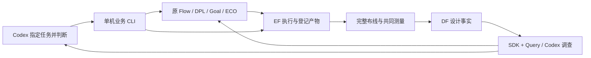
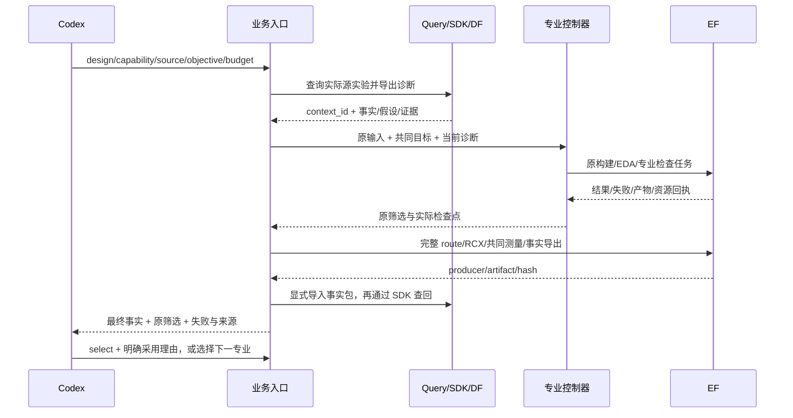

# A4：单机业务入口工程报告

工程验证通过，老板业务验收待确认。授权为“继续推进第三项和第四项”；基线 `cfb8d491`，分支 `local-business-comparisons-20261014`。A5 的收益结论单独记录，不用接口可运行代替优化有效。

后续A5最终审查发现三个源码构建发生EF心跳租约过期，长构建稳定性尚未通过；A4的入口/数据交付及门禁通过不能覆盖这一新增真实缺口。完整证据和下一优先修复项见[A5报告](LOCAL_PROFESSIONAL_COMPARISON_REPORT_20261014.md)。

## 老板现在可以使用的功能

Codex 指定设计、能力、目标、预算和上一份结果，平台完成专业输入准备、统一执行、完整布线复测、产物登记、事实入库及诊断交付。Codex 根据结果选择下一能力并决定采用哪份结果。

- `run`：原 ORFS 基线、Flow 调参、DPLEvolve 布局源码优化、GoalEvolve 优化源码演化、TimingECOAgent 时序 ECO。
- `status`：按设计查看实验、失败原因、结果及当前排队/运行中的 EDA 任务。
- `diagnose`：已有 Query/Codex 调查查询 DF/SDK，引用当前设计证据，可与固定参考实验比较；导出原专业模型实际消费的事实、诊断、假设及限制。
- `select`：记录 Codex 采用理由；不允许时序/电气/面积/功耗/DRC 越界结果或全面退化结果覆盖已保留的合法结果。
- `collect-flow`：恢复已成功原生 Flow 的数据交付，不重跑原计算。DPL 可显式重建并重放已保存 Student 源码。

入口是根目录 `chip-evolve.py`；使用说明在 `chip_evolve/README.md`。本机部署配置为 `var/business/a4-a5-20261014/runtime/local.json`，资源/路径属于部署配置，不需要专业模型重复组装。

## 实际验证与通用边界

| 验证 | 实际证据 |
|---|---|
| GCD 四专业调用 | `experiments/gcd/{flow-single-r8,dpl-single-r5,goal-single-r3,eco-single-r2}` 原控制器、真实模型提示、EF 回执、结果和三个 DF 快照 |
| 第二个真实设计 AES | `experiments/aes/reference-r3` 原 RTL→ORFS；`goal-native-reference-r3` 原 Goal 基线和四项检查、完整布线、共同测量及入库 |
| 设计身份 | AES 公开 design_id=`aes`，原生 top=`aes_cipher_top`；不再将 EF 所有实验标成 GCD |
| 真实 RTL | `experiments/toolchain/rtl-identity/rtl.json`：GCD 和 AES 的全部 RTL 与固定镜像逐文件 hash 相同，探测任务由 EF 执行 |
| Query 到模型 | 四能力 `input-receipt.json` 记录源 run/context_id；实际发送的专业提示含同一 `platform_design_diagnosis` 包，执行任务也保留该身份 |
| 数据回流 | A4 截止核查：37 份结果（含全部24个 Flow 分支）有 OpenDB/指标/OpenSTA 三类公共快照；GCD 与 AES 都可通过 SDK 查回事实 |
| 原专业行为 | Flow 两轮×12候选，DPL 原 Teacher/三个 Student/review，Goal 原四 Student/Teacher/AST/EPD/晋升，ECO 原操作/评分/回退/路由校准保留 |

上述运行根为 `var/business/a4-a5-20261014/runtime/`。公共核查回执为上级 `public-audit.json`、`public-runs.json`、`public-facts.json`。所有失败保留；原计算成功而入库失败的实验以单独恢复记录说明，不改写首次失败。

新设计通过登记 RTL/原设计配置、SDC、top、库、原专业 case 及路由层接入；源码没有按 GCD 名称挑选优化机制或写入固定实例补丁。本轮跨设计实测覆盖 ASAP7 标准单元 GCD/AES；AES 验证 ORFS→Goal 原生基线和数据交付，**没有验证 AES 四专业完整搜索**。其他 PDK、宏、不同周期多时钟仍需真实资格验证。

## 模块和数据流

EF 管实验启动、队列、资源、进程树、输入与原文件；DF 管设计/修订/运行/快照索引、对象/关系/指标/来源。SDK 汇聚公共查询。专业项目内部现场查询和工作区保留，跨项目设计事实和诊断经统一数据入口；不把其每条内部查询重写成远程 RPC。

同机大文件使用 EF 公共 materialize 接口完成本机复制；HTTP 主要传任务和查询记录。未新建后台服务、通用 Agent harness、数据库或综合评分。

## 接口与数据结构

| 接点 | 真实接口 |
|---|---|
| 业务调用 | `run --design ID --capability orfs/flow/dpl/goal/eco --key KEY [--source RESULT] [--objective JSON] [--seconds N] [--rounds N]` |
| 专业诊断 | `diagnose --result RESULT [--against REFERENCE] [--question TEXT]` → `diagnosis.json` 与专业上下文 |
| Query 导出 | `query-agent export-professional-context INVESTIGATION_ID --snapshot ID --objective TEXT --package-output JSON` |
| 诊断类型 | `ProfessionalContext{schema_version,context_id,investigation_id,scope,fixed_inputs,summary,confirmed_facts,hypotheses,evidence,limitations}` |
| 提示/任务绑定 | Toolkit `append_context(prompt: str) -> str`、`context_messages(payload: dict) -> dict`、`bind_task_context(spec: dict, path=None) -> dict`；显式 `EDA_PLATFORM_CONTEXT` |
| EF | 已有 `KernelClient.submit(task, idempotent=True, idempotency_key=...)`、`run`、`runs(design_id=...)`、`artifacts`、`resources`、`materialize_artifact` |
| EF HTTP | 已有 `POST /kernel/runs`、`GET /kernel/runs/{id}`、`GET /kernel/runs/{id}/artifacts`、`GET /kernel/runs/{id}/resources`、`GET /kernel/designs/{id}/tree` |
| 数据入库 | 已有 `POST /snapshots/from-run {run_id: export_producer, artifact_id: data_snapshot}` |
| SDK/DF | 已有 `get_run_summary(run_id)`、`get_stage_summary(snapshot_id)`、`get_metrics(snapshot_id=...)`、对象/关系/采样路径/证据查询 |
| 最终结果 | `result.json{design_id,run_id,physical_run_id,objective,objective_id,condition_id,metrics,files,snapshot_ids,exports,native_method}` |
| Codex 采用 | `select --result RESULT --reason TEXT` → `adoption.json`；合法结果登记 `designs/ID/incumbent.json` |

复用原协议，不改变 EF/DF/DI 公共 HTTP 签名。Query 通用事实包不扩展原 buffer-edit 权限；原生专业算法的既有编辑能力保持。Goal 固定四 Student；可配置候选数量只作用于 Flow/DPL。

## 本轮必要适配与决策

1. 保留原专业控制器，用薄业务入口组合确定性工作。专业算法、评分及晋升属于原项目；Codex 负责全局判断。专业分数与最终共同硬约束不等价，两个结论分别记录。
2. 每份诊断绑定实际源 run，不复用另一个候选的解释；改变 context 会使 Flow 决策重放身份失效。Query 请求注明专业边界：Goal 改 OpenROAD 源码，不能把 RTL 改写建议误交给它。首次错误建议及修正调查都保留。
3. DPL 使用真实 placement 检查点接续 CTS/route，避免后续重跑覆盖优化；Flow 保存每个分支的原配置，下一轮覆盖同名 config 时从原 checkpoint 恢复。
4. Goal 的 DEF 使用原数据库精度，解决100 DBU序列化将行距0.054µm舍入为0.05µm导致的合法化失败；同时分开公开设计身份与原生top。
5. DPL 构建同时挂载当前 ORFS 源码前缀和已有 CMake 的原绝对前缀，解决 SWIG 头文件缺失，未删专业算法。原失败和已保存 Student 源码重放均留证。
6. Flow 数据导出的排队等待使用剩余实验预算，实际导出仍保留短执行预算；大构建占资源时不误取消合法排队任务。Goal 并发二进制回执使用独立临时文件，避免同名写入竞争。
7. 两套独立本轮 EF/DF 服务沿用已发布 wheel；旧服务和历史实验不切换。实际库/SDC 内容、镜像/源码、最终单位和条件身份冻结，不能仅凭同名库或移动 latest 混算收益。

## 改动清单和职责

| 项目/文件 | 原因 |
|---|---|
| 根 `chip-evolve.py`；`chip_evolve/{__init__,cli,config,jobs}.py` | 本机入口、部署/设计绑定、任务及产物公共操作；不新增规划循环 |
| 根 `chip_evolve/{clock,physical,professional,native,diagnosis,selection}.py`、`README.md` | 约束单位、完整测量和入库、原专业输入与检查点、诊断交付、Codex采用及说明 |
| 根 `admin/prepare_local_business.py`、`admin/test_local_business.py` | 本轮独立部署准备和业务边界/恢复测试 |
| 根 `admin/resume_placement.py` | 原管理依赖延迟至执行函数，使纯checkpoint工具可正常导入；没有源码路径注入 |
| Query `src/query_agent/interfaces/{cli,investigation_cli}.py` | 专业包导出及显式可配置调查调用/读取预算；原默认预算不变 |
| Query `src/query_agent/{domain,application}/professional.py`、`tests/unit/test_professional_context.py` | 固定scope/证据/身份模型，复用原handoff输入冻结，不扩张编辑权限 |
| Toolkit `src/eda_toolkits/context.py`、`tests/test_context.py` | 专业提示与EF任务的公共诊断身份传递 |
| Toolkit `src/eda_toolkits/openroad/flow.py`、`tests/test_flow_bindings.py` | 原ORFS接受显式暂存配置/SDC/库；保留默认调用 |
| Flow `flow/{platform_execution,platform_feedback,platform_leaf,platform_model}.py`、`flow/test/{test_platform_feedback,test_platform_resume}.py` | 实际诊断消费/重放、执行身份、排队等待与回归 |
| DPL `scripts/codex_exec/runner.py`、`scripts/platform/{execution,selection}.py`、`validation/{test_platform_execution,test_shared_objective}.py` | 原提示/执行/筛选接点、CMake前缀适配和测试 |
| Goal `goalevolve/agents/codex_runtime.py`、`goalevolve/platform/execution.py`、`tests/unit/{test_platform_codex,test_platform_build_receipts}.py` | 实际提示和会话身份、通用设计身份、并发原子回执与测试 |
| ECO `src/{main_orch,platform_codex,platform_execution,test_platform_codex}.py` | 显式迭代预算、实际提示和EF身份、跨设计输入；原默认48轮不变 |
| 根计划/本报告/PROJECT/ARCHITECTURE/TASKS/manifest | 保存实际接口、模块职责、证据、限制和可接续检查点 |

A5 的 `chip_evolve/comparisons.py`、`admin/run_local_comparisons.py`、`admin/test_local_comparisons.py`及对照报告单独提交。没有修改 EF/DF/DI 的业务源码；26份原用户修改 hash 全部保持。

## 工程门禁

Query：ruff、格式、pyright零错误、三项import边界及161项测试通过。Toolkit：63项；Flow：60项；DPL：20项；Goal：396项及24个subtest；ECO：5项通过。根业务与已有回归及A5对应检查以最终工程回执为准。根/新增Toolkit类型检查零错误；原生文件遵循原格式、Python语法及差异空白检查通过，逐文件差异与跨模块边界已核查。

一次 Goal 回归的本机HTTP测试受宿主代理影响得到502，加入明确 localhost NO_PROXY 后全套通过；一次 Flow 开发环境用旧Toolkit wheel未找到context，改用本轮独立已安装wheel环境后60项通过。没有为这些验证环境问题改测试断言或算法。

业务验收可按 `chip_evolve/README.md` 使用当前部署查看 GCD/AES、查询结果并指定下一专业任务。实际优化效果、原生包装对照、组合是否胜过单项见 A5 报告，不能由本报告推定。
