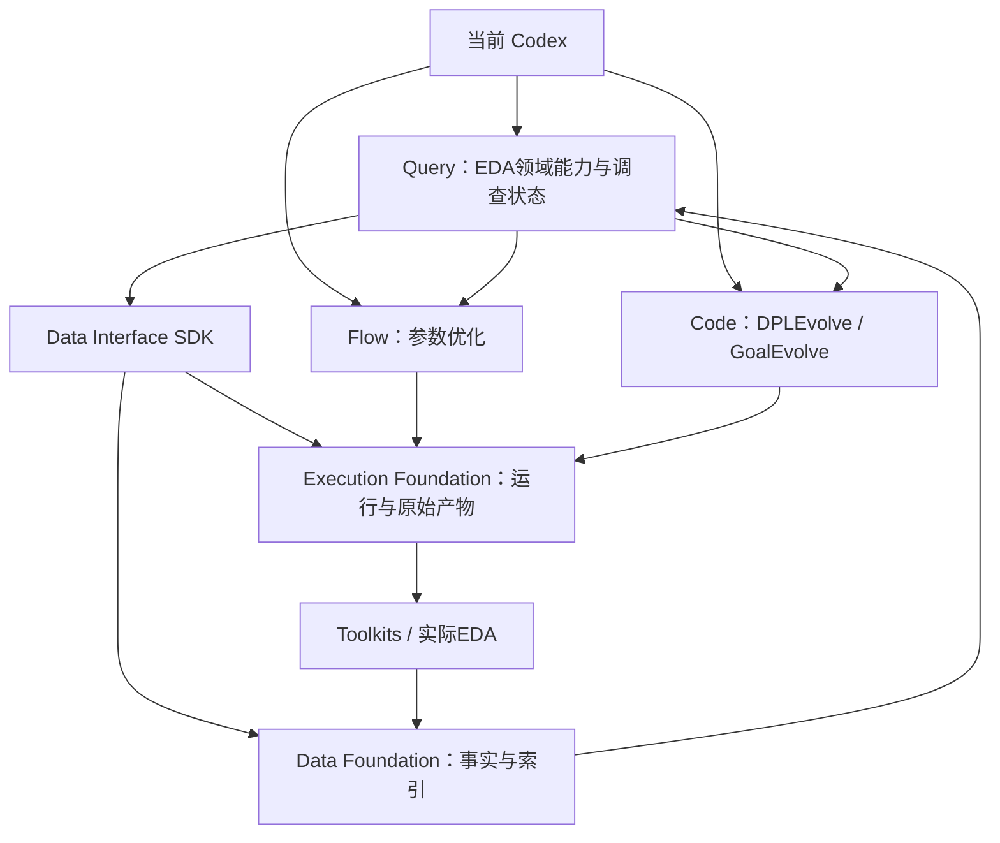
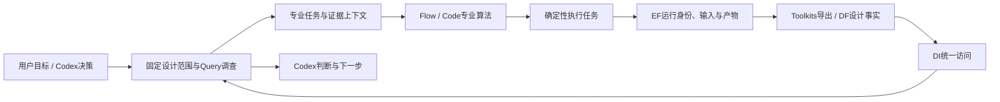
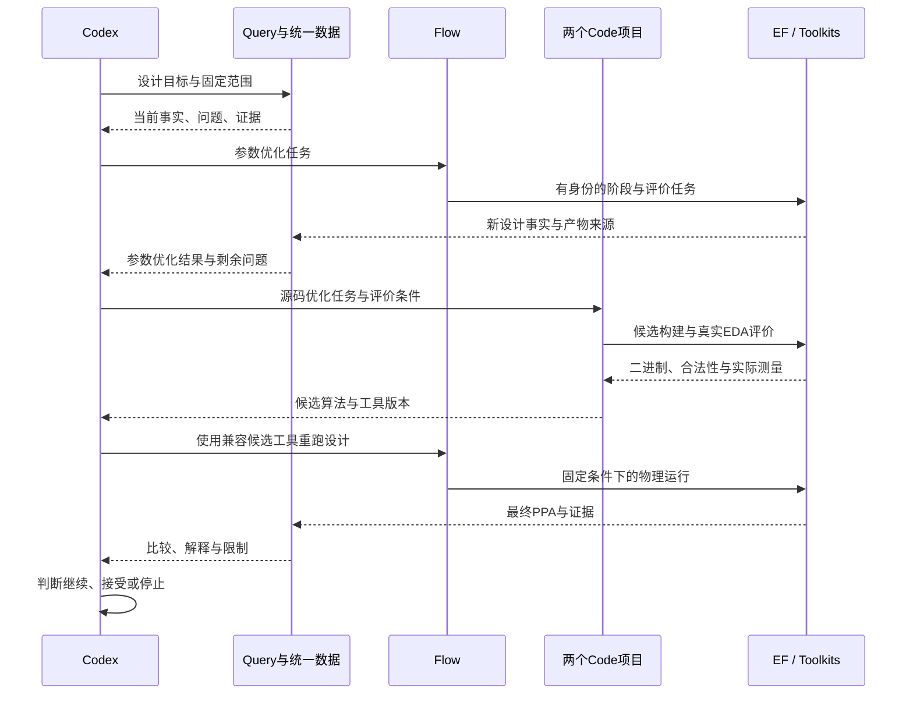
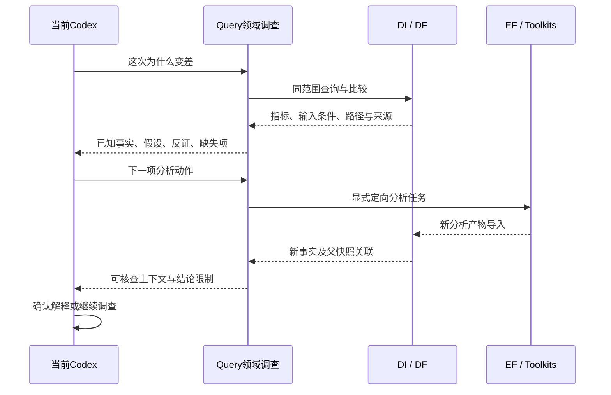

# 本机协同优化施工计划

更新：2026-10-11。依据老板本轮“同意执行”及八项工作要求，恢复当前 P3 验证。教学、新用户安装、公开发布和论文交付暂缓；本机 PPA、token 和耗时测量保留。现有未提交用户修改、历史服务、数据库与失败记录保留。

## 产品共识

Query-Agent 是 Codex 的 EDA 垂直形态：Codex 的通用推理能力 + 领域 harness（固定设计范围、调查状态、证据与任务交接）+ 数据/工具 + 专家技能。复用成熟 Codex 的模型、工具循环、上下文和环境；衡量加入领域能力后同一 Codex 的任务效果和成本。

最终用户在本机能够：

1. 给出一个设计和 PPA 目标，自动完成调参和源码优化并取得实际结果。
2. 在同一设计视图中查看每次实验的输入、参数、工具/源码版本、状态、产物与来源。
3. 使用 Codex 驱动的 Query 查询、比较、理解问题，必要时补充真实分析并交给专业 Agent。
4. 中断后继续同一实验，复用已完成的确定性工作与保存的模型决策。
5. 查看相对 ORFS 的 PPA 改善，以及数据能力带来的 token 和时间变化。

## 扩展边界

- 执行边界：专业 Agent 交付任务；EF 调度并管理实际 EDA 进程；Toolkits 负责工具命令、输入加载、解析与导出。每次实际 EDA/评价有 run、输入 hash、工具身份、日志和原始产物。
- 数据边界：EF 管原产物；DF 管设计事实与索引；DI 为公共 SDK；Query 将这些事实、专业技能与 Codex 推理结合形成调查与交接上下文。
- 专业边界：A2 负责参数搜索，DPLEvolve 负责详细布局源码演化，GoalEvolve 负责其目标驱动源码演化。保留各自原生算法、Teacher/Student、受保护 evaluator 与恢复语义。
- 原生算法的确定性评分保留，输入与测量通过统一边界登记。设计理解/诊断由 Query 能力提供；专业 Agent 不再各自维护另一套设计事实数据库。
- 原始 ODB/SDC 等作为执行输入，通过注册产物引用取回；Agent 读取设计事实通过 DF/DI，复杂原因分析使用 Query。数据解析和工具测量仍归 Toolkits，事实索引归 DF。
- Code 候选源码与二进制属于版本化工具产物；最终设计 PPA 需要用相应工具重新运行相关阶段与下游评价。
- 保留独立项目与公共 wheel/HTTP 接口，以后可增加客户端和教学入口。目前部署验收使用当前 Linux 本机。
- 新模块契约由老板确认；当前已授权 P3 验证与本切片必要修复不重复请求许可。后续切片先给文件职责、数据流、验证和影响面，不跨切片施工。

## 八个纵向切片

| 切片 | 完成后的业务效果 | 验收标准 | 涉及模块 | 前置 |
|---|---|---|---|---|
| L1 / P3 | 完整、可续跑的真实 Flow 调参实验 | AES 两轮×三候选；真实模型/物理参数消费；四个真实中断窗口；已完成 run/hash/call_id 不重复；实际评价回流；完整产物和正常结束 | Flow、EF、Toolkits、DF、DI | P2 已通过；本轮开始 |
| L2 | DPLEvolve 在本机可真实运行 | 原生环境、placement snapshot、canonical baselines 先通过；smoke 与一个最小真实设计；至少一个新源码候选构建/评价，保留合法性与来源 | DPLEvolve、独立原生工具链 | L1；关键源码审计已有 |
| L3 | GoalEvolve 在本机可真实运行 | AE-1 环境和最小重放；一次有界 AE-3 新源码演化；真实 build/评价及候选状态 | GoalEvolve、独立原生工具链 | L1；与 L2 分别验收 |
| L4 | 三个专业项目实验统一管理 | 两个 Code 的所有实际 EDA/评价入口接 EF；保留算法；取消/失败/恢复/产物可查；实际任务清单无绕过执行入口 | 三专业项目、EF、Toolkits | L1–L3；确定实际接点 |
| L5 | 按设计查看实验、产物与原因 | design/revision/campaign/candidate/run/snapshot 显式关联；成功/失败/未导入 run 可查；代表设计的时序/对象覆盖明确；Codex Query 能提供比较、支持/反证和来源 | EF、DF、DI、Query | L4；复用已有事实能力 |
| L6 | 专业 Agent 使用统一数据和诊断入口 | 三项目的决策上下文绑定统一 scope/事实/证据；原生评分与真实测量对应；Query 的真实 Flow/Code 接收与反馈可执行；不靠人工复制或纠正 ID | Query、三专业项目、DF、DI、Toolkits | L5；接收契约确认 |
| L7 | Flow 与两个 Code 协同完成 PPA 优化 | 同一份设计输入；源码/二进制兼容性经过构建与运行验证；Flow 结果→Code 改算法→重跑相关流程→Query 复核→Codex 判断；阶段变化和最终 PPA 可追溯 | 所有在做模块 | L4–L6 |
| L8 | 本机量化平台收益 | 固定输入/工艺/约束/功耗条件和预算；ORFS 基线与最终结果；阶段增量；同一 Codex 的原始工具/强脚本与统一数据入口对照；记录总 token、调用、准备成本、查询与端到端耗时及全部失败 | 现有测量脚本、执行与数据记录 | L7；基线从 L1 起冻结 |

L4–L6 是整合切片：L2/L3 原生验证完成后，以实际调用边界设计最小适配器。新能力做成可运行的接入案例，避免先全面重构所有项目。

## 当前切片 L1 / P3 的执行计划

基线：Flow `ec66a316da210c91976ab6497950dad57f34905e`，工作树干净；workspace `c25f50c76a070016eb5961a971b218262880e033`，已有 evaluation 用户修改保留。

文件与职责：

- 复用 `admin/run_platform_campaign.py`：冻结运行副本、启动本实验独立 EF/DF、实际中断并恢复 Controller。
- 新运行目录 `var/flow-agent/p3-platform-campaign-20261011`：源码 manifest、平台请求/状态、模型使用、实验日志、产物和中断前后证据。
- 首次运行在任务受理时失败：独立 8 核容量又乘默认 60%，不够接受 8 线程任务。原失败目录保留；`admin/run_platform_campaign.py` 修正本实验 `--platform-fraction 1.0`，仍限制总容量为 8 核/12 GiB；`admin/test_platform_campaign_budget.py` 用真实 API-only gateway 验证 8 核受理、9 核拒绝，不运行 EDA。
- 重跑目录 `var/flow-agent/p3-platform-campaign-20261011-retry1`，每个尝试独立保存证据。
- retry1 在第一个真实中断窗口后恢复失败：GNU timeout 子进程组仍持有 Controller 锁，验收脚本只停止原组。已按专有运行目录核实并清理该次残留 publisher；EF 的真实 placement 正常完成。修正验收脚本为停止专有 Controller 会话内全部 publisher 进程组，保留 EF 的独立运行进程；不改 Flow 算法、阶段超时或公共接口。`admin/test_platform_campaign_control.py` 用真实 timeout、继承锁与独立 worker 验证边界。新重跑目录为 `var/flow-agent/p3-platform-campaign-20261011-retry2`。
- `PROJECT.md`、`TASKS.md`、`ARCHITECTURE.md`、`admin/STATUS.md`：记录老板修正的业务范围与已启动切片；不改变 API。
- 若真实运行暴露缺陷，先报告具体失败与影响面，仅修 P3 所属源码/验收脚本；保留失败副本，重新冻结后再运行。

数据流：原生 A2 的候选/阶段 → EF TaskSpec → Toolkits/OpenROAD → 原始产物与实际 CP0 测量 → 指定 metadata 导出 → DF 显式导入 → DI 查询事实与来源。

验证：先 `python3 dev.py flow-agent check`；再复用验收入口 `prepare`、`supervise`。已有新增模块静态检查记录保留；代码若变动则补对应检查及回归。最终核对两轮产物、四次中断、原 run/hash/call_id、模型账本、实际评价与数据来源，工程结果与老板最终业务确认分别记录。

预算：两轮×三候选；物理并发 1、每任务 8 线程；EF 本实验总内存容量 12 GiB；总时间 3 小时，阶段上限 90 分钟；真实 Codex 后端。只管理本实验创建的进程，不修改旧服务或旧数据库。

## 核心依赖与数据流

上图是本轮目标关系，当前已实现/待接入状态见切片表；Query→Flow/Code 的真实接收器尚待完成。

## 本机评测的两种问题

**PPA：产品优化了多少。** 冻结同一 RTL/网表、库/PDK、输入约束、功耗活动条件与评价口径。主对照为 ORFS 原始流程；同时记录 Flow、Flow+DPLEvolve、完整组合的阶段增量。报告功耗、面积、WNS/TNS、合法性/DRC、运行时间和可行结果；按真实指标分别报告改善，不预先承诺三项一起降低。Code 工具版本变化须可追溯，先验证兼容性和固定评价环境。

**数据：增强后的 Codex 省了多少工作。** 使用同一 Codex、同一设计问题、相同可获得证据与预算；对比原始报告/可复用强脚本与平台数据/Query 能力。记录输入、输出、缓存 token、模型调用次数、重复读取、补分析次数、正确完成情况与时间。包括主 Codex 和专业项目内部调用；未知用量保留。将索引准备/导入成本、首次查询、复用查询、实际 EDA 耗时分别展示，再给端到端总量。

这属于老板要求的本机效果验证，不启动论文写作、公开 benchmark 产品、新用户安装或 Tutorial 工程。

## PDAgent-Bench v2 的借鉴边界

已读取老板指定的 https://arxiv.org/html/2606.17253v2 ，重点参考任务理解/报告/诊断/脚本/完整流程的分层、真实阶段指标、技能增强、跨阶段反馈与 token 记账（附录 A.4 报告 input/output/total/calls）。本机先选真实设计的代表问题，不搬入全部题库，也不复制其通用 BaseAgent/模型框架。

该版本大量实验使用商业工具，其论文指标不当作本平台成绩。已核对作者项目页 https://chenrongqian.com/publication/pdagent-bench/ ：页面指向 arXiv；本次未找到可验证的正式代码发布链接，因此尚未完成项目源码审计，后续获得官方仓库再检查可复用内容。

## 当前执行与后续交接

2026-10-11 首次 P3 运行因验收配置的 CPU 预算失败，未启动物理实验、模型调用为零。retry1 确实完成任务受理并进入真实中断窗口，但验收脚本遗漏 GNU timeout 的子进程组，导致恢复被占用锁拒绝；独立 EF 的 placement 成功，整个 campaign 未验收。两次失败完整保留。修正后的静态检查、资源受理与真实进程锁回归通过，Flow 原有 47 项检查通过，记录见 `var/flow-agent/p3-local-checks-20261011-control/receipt.json`。下一次在独立 retry2 运行目录重试；启动不等于验收通过。

每个切片按工程门禁、真实业务证据和 Git 检查点收尾；两到三个切片后同步架构/任务清单。已批准业务路线不会替代新模块契约确认，后续实现计划以复现结果决定。
