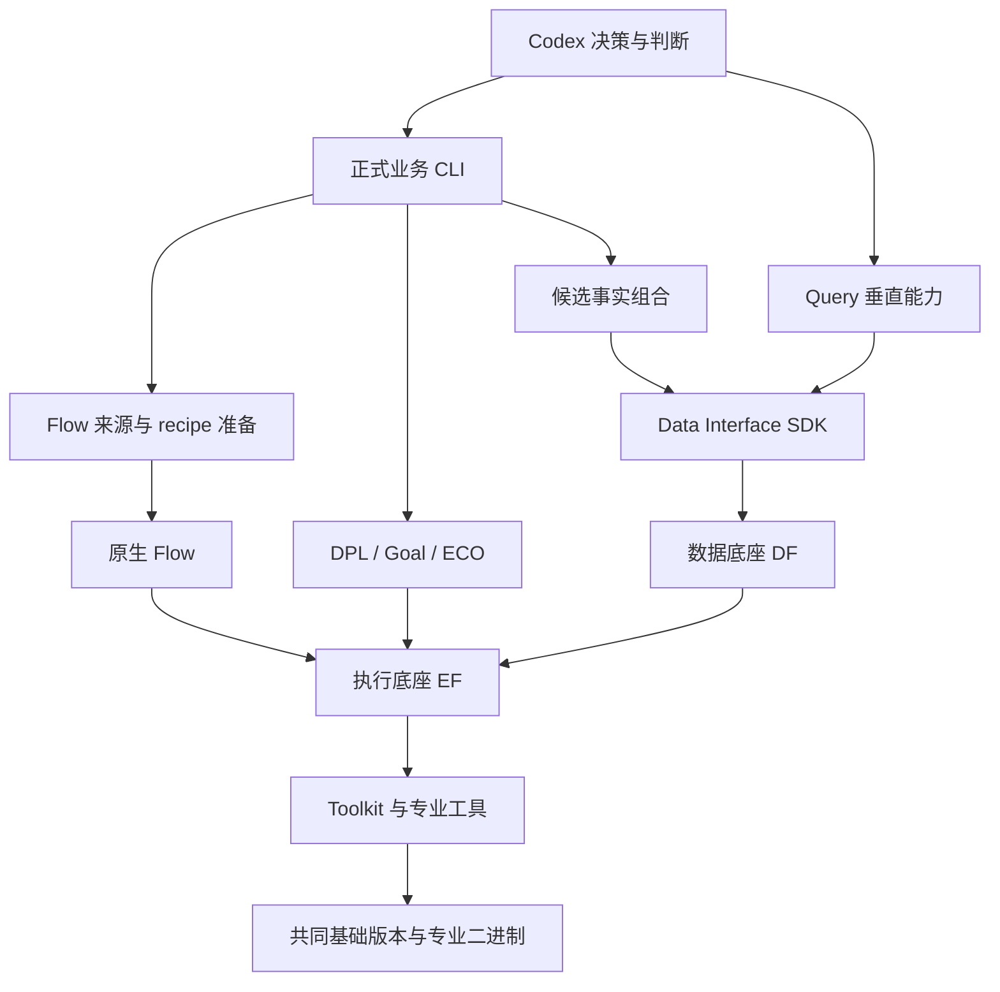
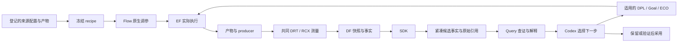
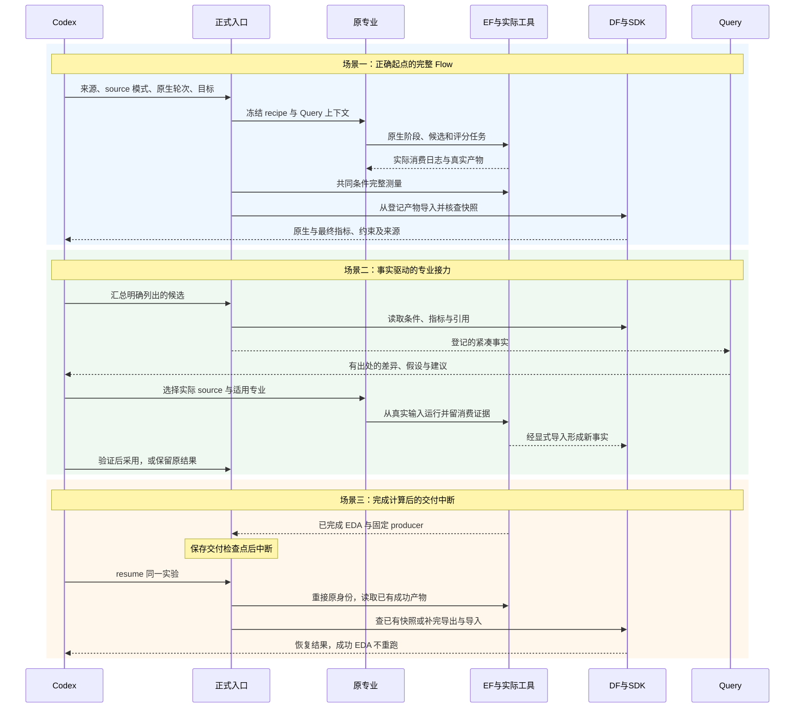

# 下一轮夜间施工计划：修正 Flow 起点，打通最终事实与专业接力

状态：**老板已于 2026-10-15 批准，进入实施。** 实施分支 `a11-flow-source-20261015`，开始时间 2026-10-15 15:31:59 UTC。工作窗口为批准开始后的约 8 小时；表中的时间是排期，不是单个 EDA 任务的强制超时。

2026-10-16 补充决定：老板明确选择保留原完整能力，迁移现代 ORFS/Yosys 来源并跑完整搜索；现代默认内置综合继续标为未通过。迁移来源显式登记完整原旋钮（包括原先未定义的 LB addon、CTS 与阶段布线参数），与默认 ORFS 的差异单独保留；最终业务上限、原专业搜索及评分不变。

规划依据：`PROXY_FINAL_PPA_REPORT_20261015.md`、A8/A9 报告及正式源码。审批基线为 `c78f67454bb8fc983859fdb1ae71c4522983d492`，当前分支 `a10-proxy-final-ppa-20261015`。批准后新建实施分支，保留此前结果、失败记录及用户未提交修改。

## 1. 今晚解决的业务问题

当前三个问题已经有证据：

1. Flow 与现代 ORFS 虽用共同工具二进制，实际物理脚本及配置起点不同。AES 现代 ORFS 基准为 35.108 mW，旧 Flow 默认候选约 87.491 mW；现代流程内的控制实验已证实综合路线是显著因素。不能用旧起点继续调参，再将差距解释为专业能力不足。
2. DPL 的原生 HPWL 胜者是 Student2，完整布线后的功耗、面积和 setup 余量却均不如 Student1。不过 Student1 仍超过原面积上限，不能直接采用。专业晋升与 Codex 选择业务接力输入需要分别记录。
3. 已有 Query 能消费有引用的紧凑事实，但上轮摘要由审计脚本手工组织，尚未成为通用的候选交付能力。

本轮主交付是修正第一个问题，并将第二、三个问题落到可重复使用的事实接口。新增协同实验在主交付通过且时间足够时进行。EF、DF 不承担选优或综合评分，判断仍由 Codex 完成。

当前 AES 合法采用结果仍为 A9 的 DPL Student2 → Goal Student4：功耗较 ORFS 低约 0.502%，cell 面积低约 0.129%，core/die 不变，setup 余量降低但仍合格。新结果未经完整验收，不替换它。

完成后，最终用户应能：

- 指定设计与已登记的流程来源，让 Flow 从该来源的真实物理配置起点调参。
- 在同一个实验中看到原生调参反馈、共同条件下的最终 PPA，以及各自的约束和来源。
- 让 Codex 先读精简的候选对照和原始引用，再决定采用、保留或交给哪个专业继续处理。
- 中断后继续已有确定性交付，查询原 run、产物及设计快照，避免重复已成功的 EDA。
- 获得 GCD/AES 的实测报告，区分环境修复、交接效果、专业优化效果和未完成事项。

## 2. 八小时排期与纵向切片

N0 为施工准备；S1–S6 为六个独立验收的纵向切片。每片包含输入、实际调用、输出和查回验证。时间可以在片间调配，优先保住 S1–S4 及最后的验证交付；S5 是条件任务。

| 时间（自批准起） | 切片 | 用户可见交付与验收标准 | 模块 / 前置 |
|---|---|---|---|
| 0:00–0:15 | N0：保护基线 | 核对当前服务、活跃任务、机器余量和 26 份已有用户文件；建立新分支、新实验根及恢复记录，不停止其他实验 | 根仓库、EF 公共状态；无前置 |
| 0:15–2:15 | S1 / A11.1：GCD 真实起点 | 正式 `run` 的新共同模式从选定来源准备物理流程；未调参 GCD 完整运行至 DRT/RCX、共同测量、DF/SDK 查询；实际日志证明综合路线及配置被消费，旧模式测试通过 | 根 Flow 准备接点、Flow 参数/阶段适配；N0 |
| 2:15–3:15 | S2 / A11.2：AES 迁移资格 | 同一实现用于 AES，无按设计名分支；未调参起点与现代 ORFS 对照，核对 RTL/库/SDC/流程/配置身份及七项 PPA，解释差异；原旋钮都有消费证据 | S1 同一实现、现有 Toolkit/EF/DF/SDK；S1 |
| 3:15–5:15 | S3 / A11.3：完整 Flow 调参 | 优先 AES 原生两轮 × 三候选，真实模型、原阶段继承/淘汰/评分/晋升与正常收尾；输出最终幸存候选的共同 PPA 和约束状态，可按设计查回 | 原 Flow 控制器和现有交付；S2 |
| 5:15–6:15 | S4 / A12.1：候选事实与 Query | 正式入口生成带证据引用的候选对照；用 A10 实测 DPL 候选及本轮 Flow 结果验证，区分 native winner、最终可行性、Codex 决策；Query 能在既定读取预算内完成有引用回答 | 根事实组合/诊断接点，现有 DF/SDK/Query；数据接口可在 S3 等待期开发，实测需 S3 输出或已验收 A10 数据 |
| 6:15–7:00 | S5 / A12.2：有限协同接力（条件任务） | 若存在合格新 Flow 输入且时间足够，从其真实布局交给一份已验证 DPL 源码方法，完成 CTS/route 与共同测量，验证改动实际保留；优先只开一条分支 | S1–S4 与既有 DPL replay/交付；无合格新输入则不强行执行 |
| 7:00–8:00 | S6 / A13：证明、重放及交接 | 对至多一份拟采用新结果完成逻辑证明、独立物理重放、DF/SDK/Query；通过全部工程门禁，提交检查点、更新文档并输出老板报告 | S1 起即可准备，最终依据所有已完成切片 |

S1、S2 中未调参控制使用相同实际配置；旋钮探针另立实验，不能把探针改动混进基准。S3 的“两轮 × 三候选”为完整的原生执行配置，不承诺六个候选都绕过原淘汰进入最终布线。应对所有实际完成的最终候选做共同测量；没有走到最终阶段的候选记录失败或淘汰原因，不凭空补造最终 PPA。

各片均须通过静态检查、对应单测、逐文件差异审查、架构约束及适当回归。工程门禁通过后，在本计划获批的范围内自动进入下一片；业务效果未改善与工程门禁失败分开记录。最终老板业务验收仍由老板确认。

### 主交付、条件交付及排期取舍

- **主交付**：S1–S4，S6 的工程收尾、数据核查和报告。目标是正确的 Flow 产品起点、真实 AES 调参结果和可复用的候选事实交付。
- **条件交付**：S5，以及额外 GCD 两轮 × 三候选搜索。只在前置通过、资源和剩余时间足够时启动；优先不增加新源码构建。
- **不把八小时估计当保证**：如迁移遇到不能等价映射的原专业机制，或完整搜索未正常结束，明确标为未完成并给出可恢复检查点。不能缩减算法、降低验收或以 smoke 代替完整轮次。
- **完整四专业链路不列为本夜必达**：本夜重点修正已证实的协同损失来源。重新完成 DPL 三 Student 和 Goal 四 Student 的全新源码演化，需要另排足够的编译与搜索窗口。

## 3. S1–S3：Flow 的具体改法和影响面

### 文件范围

| 文件 | 计划职责 / 影响 |
|---|---|
| 新增 `chip_evolve/flow_recipe.py` | 从固定共同 ORFS 和所选来源的真实配置准备独立物理工作树，保存 recipe、来源及内容 hash；仅负责确定性准备 |
| `chip_evolve/professional.py` | 为新 Flow 共同模式调用准备器并携带 recipe；保留现有 `flow_source` 的旧调用行为；收尾保存真实候选配置及来源 |
| `chip_evolve/cli.py` | 为 `run --capability flow` 增加显式 `--flow-recipe legacy\|source`，默认 `legacy` 保持原调用兼容；本轮资格实验显式选 `source` |
| `flow-agent/flow/optimize.py` | 必要时适配新流程的参数初值和现有配置生成接点，不改变搜索、阶段继承、淘汰和原评分 |
| `flow-agent/flow/config_recipe.py`、`config_replay.py` | 仅在新流程确需时补齐实际参数/阶段 recipe 的记录与重放映射，不重定义算法参数含义 |
| `flow-agent/flow/run_stage.sh`、`platform_execution.py`、`platform_leaf.py`、`platform_toolchain.py` | 仅处理现代脚本与既有阶段/工具身份交接所需兼容；不新增独立执行通道 |
| 新增 `admin/test_flow_recipe.py`、修改 `admin/test_local_workflow.py` | 测试来源绑定、显式模式、旧调用兼容、交接恢复和不重复成功计算 |
| Flow `flow/test/` 下新增相应测试 | 覆盖每个原旋钮的映射、阶段上下文和恢复，不用“参数字典里有该键”代替工具实际消费 |

物理 Make/Tcl 文件来自固定版本的共同 ORFS，准备到新的运行工作树；必要的兼容片段由准备器生成并登记内容 hash。不会全盘替换正式 Flow 仓库的 `flow/Makefile`、`flow/scripts/` 和平台目录。若必须改动清单外的共享 Toolkit/EF/DF 源码才可继续，应先停在该边界，交付证据及新增方案。

### 审批的最小新增契约

```python
# 新增内部准备接点；返回新工作树位置，旁侧保存 recipe.json。
def prepare_flow_recipe(
    deployment: Deployment,
    source_result: Path,
    experiment: Path,
) -> Path: ...
```

命令扩展：

```text
run --capability flow --source <registered-result.json>
    --flow-recipe source --rounds 2 --candidates 3 ...
```

`--flow-recipe` 只用于 Flow；历史请求缺失此字段按 `legacy` 解释。原 `flow_source(deployment, experiment)` 签名和 DPL 旧收尾接点保持。新共同模式须将实际使用的 recipe 随交付保存，下游按来源 recipe 继续 CTS/route；不能回到全局旧模板。具体物理收尾接点确需适配时限于 `professional.py`，并覆盖旧 / 新两类来源回归。

`recipe.json` 是输入清单，建议包含：

```text
schema_version, source_run_id, source_artifact_refs,
image_sha256, orfs_commit, openroad_commit,
physical_tree_sha256, resolved_config_sha256,
rtl_refs, library_refs, sdc_ref,
baseline_parameters, parameter_mapping_refs
```

清单不改变公共 EF/DF 数据结构。输入来源只能来自已登记产物和已固定的部署材料；如历史结果没有完整流程来源，使用明确标注并校验的 ORFS 配置重建资格实验，不能仅凭最终 ODB 反推“继承了全部 recipe”。任意专业的最终结果不一定能直接成为 Flow 的可重建起点，缺失信息应明确指出。

### 数据流和专业能力保护

1. Codex 指定来源及目标，准备器读取已登记配置/源码/产物身份，建立新的独立工作树。
2. 原 Flow 控制器从真实起点提取参数，继续原阶段屏障、继承、DRP/GWTW、模型和晋升规则。
3. 所有工具探针、物理执行、原生评分、构建及证明仍由 EF 提交和监管；宿主只运行确定性业务组合和文件准备。
4. 工具返回实际参数消费日志、配置、ODB 和 producer；共同测量保留业务库角、SDC、RCX 与条件身份。
5. EF 登记产物，DF 导入设计事实，SDK/Query 查回；Codex 根据原生反馈与最终事实判断。

**CP0 生成方法、折扣和 TT 评价含义保持。** 新实验从正确起点按原方法重新生成并冻结 CP0，不强行沿用旧实验数值，也不能把原 TT/CP0 评分偷偷改成最终 FF/810ps。最终业务上限和原生搜索约束分别记录。

为每个原旋钮建立“原含义 → 现代工具接点 → 阶段 → 实际消费证据”清单。综合路线采用内置综合时，尤其检查 `SYNTH_FLATTEN` 等原综合参数是否仍生效；变量存在或配置成功生成不等于语义保留。无法等价实现时该项不通过，不能删除旋钮或静默忽略来宣布完成。原生缺库、空受约束路径门禁继续有效。

### 验证与门槛

- GCD、AES 使用同一实现，以 design 配置驱动，不写 `if design == gcd/aes` 业务补丁。
- 资格控制先核对全部实际输入及日志路线，再比较七项共同 PPA；相同输入和确定性流程预期同值，不能仅因数值接近就通过。存在差异必须有可定位的实际配置/过程证据，并明确是否仍为同一起点。
- 原旋钮逐一核对实际工具消费；关键旋钮增加单变量探针，不要求每个改变都必须改善 PPA。
- 新共同模式测试通过后，才启动 AES 原生两轮三候选。实际模型失败、原生回退、提前停止、失败成本分别报告。
- 修复后历史 `legacy` 路径及原 DPL 交付回归必须通过。不能在正在运行的副本中打补丁。

## 4. S4：把最终候选事实交给 Codex

### 文件与接口

| 文件 | 职责 |
|---|---|
| 新增 `chip_evolve/candidate_facts.py` | 从明确列出的已登记结果及 SDK 事实生成紧凑对照，验证设计/目标/条件一致，保存原始引用，不输出 winner 或综合分数 |
| `chip_evolve/cli.py` | 新增 `candidates` 确定性命令，返回已登记事实摘要及回执位置 |
| `chip_evolve/diagnosis.py` | 优先向现有 Query 提供该紧凑事实及原始引用，保持固定 scope；不改模型循环或调查框架 |
| 新增 `admin/test_candidate_facts.py` | 验证条件不匹配拒绝混算、超限候选不标可采用、缺失数据显式记录、证据可回溯 |

拟新增命令及内部接口：

```text
candidates --reference <baseline-result.json>
    --result <candidate-result.json> [--result <candidate-result.json> ...]
    --key <new-facts-key>
```

```python
def build_candidate_facts(
    deployment: Deployment,
    reference_path: Path,
    result_paths: list[Path],
    experiment: Path,
) -> Path: ...
```

输出主要字段：`design_id`、`objective_id`、`condition_id`、`reference_run_id`、`candidates[]`。每个候选包含 `run_id`、实际专业方法与原判定、七项最终指标及单位、硬约束违例、快照身份、原始 evidence refs；`native_winner` 仅来自原生回执，不由摘要重算。

数据从 DF/SDK 和已登记专业产物取得，紧凑摘要作为既有 analysis 子运行的事实产物登记，不新建数据库或评分服务。Query 在指定 scope 内读取已登记摘要；需要核查其他候选原始材料时明确使用其已有公开引用和授权 scope，不隐式扩大到整库扫描。

### 实测验收

1. 对 A10 四份 DPL 物理结果自动生成与原始数字一致的对照；保留 Student2 原生胜出事实，同时如实标出 Student1 超面积上限。
2. 同一命令处理本轮 Flow 已完成结果，不包含 AES/GCD 特定字段或手工填收益。
3. 精简视图目标不超过 32 KiB，实际大小登记；超过时保留候选目录和原始引用，按需展开，不能删掉约束、单位、失败或条件身份来满足尺寸。
4. 在上轮相同 512 KiB 读取预算下，让 Query 回答“原生最优为什么不是当前可采用结果，下一步应交给谁”，结论有证据，观察与假设分开。
5. 记录实际读取量、步数和耗时；本夜不据此宣称公平的 token/效率提升，更不以“跑赢 Codex”为目标。

该片优先复用当前公共接口，不修改用户正在开发的 DF/DI 模块，不把路径比较元数据问题顺手混入。

## 5. S5：协同实验的明确边界

启动条件：新 Flow 实际完成，有可重建的布局 checkpoint、正确 recipe、共同事实和可用 Query 上下文；剩余时间应覆盖预计计算及验收。新来源尚未满足最终硬约束时，不将它称为可采用结果；本夜优先验证合法来源的接力。

首选动作：从新 Flow 的真实布局出发，用已有正式 `dpl --operation replay --code-source ...` 对一份已验证源码做新输入实验。优先复用内容身份已核验的构建；不能把 A10 旧 ODB 或旧 PPA 直接当作新输入结果。模型无需重新生成三个 Student，但 DPL 方法必须真实运行，下游 CTS/route 必须消费其真实输出。

保留无 DPL 的相同阶段收尾控制，区分交接流程差异和源码方法影响。结果不合格即保留当前合法 incumbent，不能强迫所有专业串行运行。

**可选的进一步接力**：如果前面提前完成且剩余窗口充足，可从实际新结果运行已有 Goal 原生 baseline/replay，再视适用路径运行 ECO；报告明确为固定方法验证，不计为新源码演化。当前 `--code-source` 只支持 DPL，不能将此参数假装用于 Goal Student4 的新输入重放。`continue-goal` 有原功耗目标和 parent 前置，也不能当作任意新设计的通用重放。新增 Goal 专业源码重放契约及全新四 Student 搜索留待另片。

若新 Flow 无合格输入或时间不足，S5 标记未启动及原因；可以从 A10 既有 DPL 结果完成事实选择演示，但不将它写成新 Flow 协同通过。ECO 没有适用的负裕量路径时明确“无需动作”，不人为制造违例以凑四 Agent 成绩。

## 6. S6：最终验证、恢复与文档

对至多一份拟采用结果执行既有 `validate`：输出非空且完整的逻辑等价证明，独立目录完成 DRT/RCX，共同条件下七项 PPA 重放核查，并通过布局、DRC、电气、setup/hold 及原业务硬约束。确定性重放预期同值；有差异则记录并定位，不静默改容差。未完成验证的结果标记候选，不采用。

在一份已经完成 EDA 的交付上模拟业务交付中断，使用已有 `resume` 恢复；验证原 producer/run_id 不变、成功 EDA 新增任务为零，失败记录保留。这里只验证确定性交付恢复，不宣称通用模型搜索恢复。

预计修改文档：`ARCHITECTURE.md`、`TASKS.md`、`chip_evolve/README.md`，必要时更新 `SOURCE_MANIFEST.json`；产品目标没有变化则不修改 `PROJECT.md`。新增本轮报告，逐片记录工程状态和待老板业务验收状态。每两至三片同步文档，不把一次实验结果写成全部设计上的保证。

## 7. 模块依赖图



最后一条依赖表示 DF 引用 EF 的登记产物；DF 不调度优化，不决定 winner。专业内部状态仍在各原项目内，跨专业事实和产物使用公共边界。

## 8. 核心数据流图



EF 管理任务、进程、资源、日志、输入和原始产物；DF 管理 design/revision/run/snapshot、结构化设计事实和来源；本机 HTTP 传控制与身份，大文件使用已有本地文件材料化路径，不新增远程文件中转。

## 9. 三个关键场景的时序图



## 10. 关键决策与理由

| 决策 | 理由 |
|---|---|
| 先修真实 Flow 起点 | 控制实验已证实起点差异显著影响最终 PPA，继续旧模板搜索会混淆集成问题与算法问题 |
| 在输入准备和阶段接点适配 | 保留专业推理、搜索和原生对照，避免重写 Flow 或全盘替换共享模板 |
| 共同工具版本固定 digest/commit | `latest` 会移动；源码优化项目保留其专业二进制及方法身份 |
| 原生晋升与业务选源分开记录 | HPWL/TT 代理与最终 RCX 指标不同，Codex 应看到两者及硬约束，不能静默改研究规则 |
| 紧凑事实先行、原始引用可展开 | 上轮 Query 已验证该交付方式可用，可以减少重复读取，同时保留核查能力 |
| 不在 EF/DF 增加选优决策 | EF 执行、DF 提供事实、Query 解释、Codex 判断，职责清楚且保持平台轻量 |
| 不用全新 Code 演化填满夜间窗口 | 本轮核心是修正流程起点和交付损失，完整源码搜索应获得独立足量预算 |
| 两个真实设计验证同一实现 | 检查可迁移接点，避免 GCD 特例补丁；尚不能据此声称任意 PDK/设计均已覆盖 |

## 11. 资源、自动推进与止损

1. 批准后先读取公共状态并测量机器余量，再确定单任务与并发预算；不重启共享生产服务，不修改其他运行副本。运行数据使用新的 `var/business/` 目录。
2. 复用已验证共同镜像与源码，不无理由重编全部 OpenROAD。确需大型构建时参考已验证的 64 GiB、2048 进程、8 编译线程和单 LTO worker，并按当时机器余量调整；不能套用早期小任务限额。物理阶段按其真实需求配置。
3. 正常计算中的长任务持续由 EF 监管；耗时长本身不算卡死。按任务日志、进程资源和产物变化判断进展，健康任务不因跨越排期栏就被杀掉。
4. 同一个根因最多两次有证据的修复尝试；约 45 分钟仍无新证据或有效进展时，保存问题、输入、run_id 和恢复方法，停止该分支。已经有新证据的正常诊断可继续，但不能循环改限制、补兜底、重跑同一失败。
5. 关键前置失败则不启动依赖实验。例如 S2 未通过，不启动 S3 的 AES 正式搜索；此时可独立完成基于 A10 事实的 S4 和工程报告。迁移遇到必须改变专业算法含义的缺口，不能自行扩大范围。
6. 第七小时起不再开新的长搜索或全量构建；优先证明、数据核查、文档与检查点。第八小时给出报告。若健康任务仍运行，明确“运行中”、EF 状态与恢复入口，安排有界收尾；不写成已完成，也不悄悄无限延长工作窗口。
7. 额度不是停止条件。无新收益也要如实收尾；不放宽时序、功耗、面积和轮廓上限，不制造 ECO 操作，不把固定方法重放称为新源码晋升。
8. 每片完成后提交独立 `[切片N] ...` 检查点，区分工程通过与待业务验收。涉及子模块时先保存该模块提交，再更新根 gitlink/manifest；不混入已有用户改动。源码检查点按既有 ChipEvolve 远程规则保存，运行数据不推送。

## 12. 每片检查与明早交付

工程检查依次为：修改文件的 lint/format/type → 相应单测 → `git diff` 逐文件原因审查 → 跨模块边界检查 → 已有相关回归。根回归以当前 195 项基线核对新增/删改测试数；Flow 修改需跑该模块适当回归。报告测试范围、失败和条件跳过，不用写几条 mock 测试代替实际 EDA 验收。

26 份已有用户文件以 `var/business/a10-proxy-final-20261015/baseline.json` 为保护依据，开始时再次核对；保留 DF/DI 和 `admin/evaluation/` 当前工作。不在脏模块上直接部署新 wheel，不顺手修其评测代码。每片列出实际改动文件及用途。

明早报告必须能回答：

- **能用了什么**：Flow 起点是否正确，GCD/AES 分别跑到哪里，原生完整轮次是否正常结束，候选事实是否已成为正式能力。
- **有没有变好**：与固定 ORFS 基准及当前合法 incumbent 分别比较；列功耗、cell/core/die 面积、setup/hold，区分原生代理和最终指标。没有合格改善就保留当前结果，不预先承诺收益比例。
- **协同到底做了什么**：新输入、实际运行的方法、下游真实消费、是否新源码、ECO 是否有动作；未启动和未完成明确写出。
- **底座是否帮助了工作**：实际 run/产物/快照能按设计查回、交付恢复是否零重复 EDA、Query 是否从紧凑事实形成有引用回答。
- **留下了什么**：源码检查点、文件清单、工程门禁记录、实际运行状态、复现命令、恢复命令和下一片的最小剩余范围。

不包含 Tutorial、公开部署、论文包装、公开公平 benchmark、新评分底座、全路径索引升级及 DF 导入超时根因修复。后两项仍是独立待办；如本轮再次遇到已完成计算后的导入超时，优先用既有公开身份查询与交付恢复，不扩大公共协议或增加无限重试。

## 13. 本次审批授权范围

同意本计划即授权在上述文件和边界内依次实施 S1–S6，进行必要且保留原专业含义的兼容适配、专项测试、GCD/AES 实验、现有公开 API 的事实交付、确定性交付恢复及独立 Git 检查点；工程门禁通过后自动进入下一片，不再逐项请求同范围批准。

不授权改动用户未提交工作、放宽业务验收、重写原算法、修改公共 EF/DF/SDK 契约、清理历史证据或增加本计划外的共享底座改造。遇到这些边界时停止该分支，继续已授权且独立的任务，并在最终报告提出具体待审批方案。

规划提交审批时仅新增本文件，没有切换运行环境、修改实现或启动实验；批准后的实际状态以本轮报告及 `var/business/a11-flow-source-20261015/progress.json` 为准。
