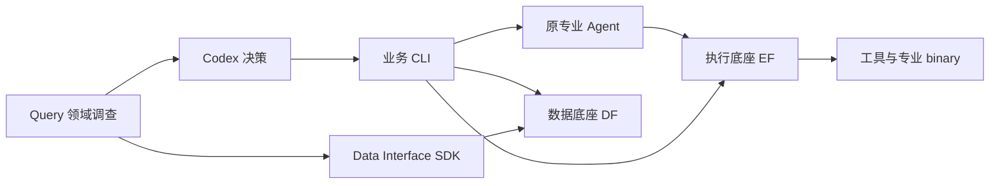
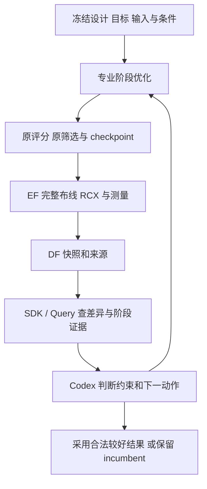
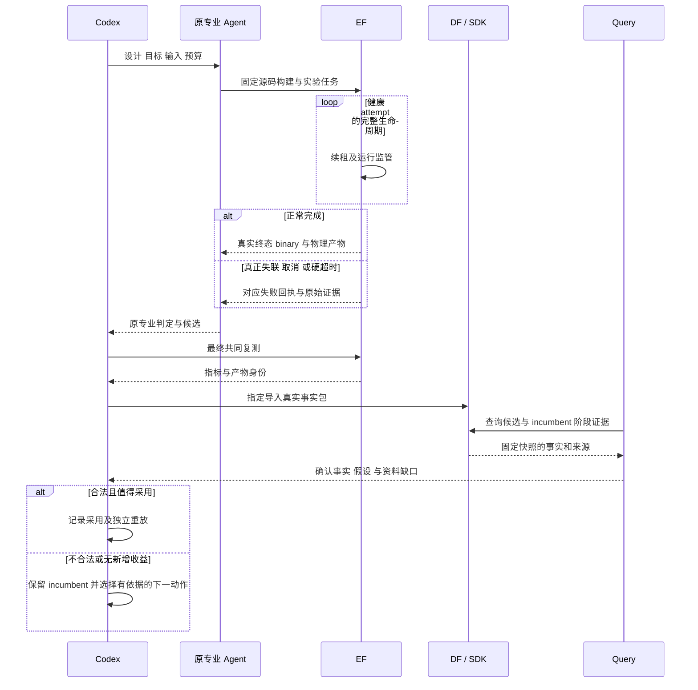

# A6 / A7：长任务可靠性与协同质量施工计划

状态：已完成规划，待确认实施；本轮不修改业务代码，不切换运行服务，不发起新实验。

## 老板最终得到什么

1. 专业 Agent 的长时间源码构建能被统一底座持续管理，取消、超时、失联和真实编译失败可以清楚区分。
2. 按设计查看专业评分、最终 PPA、失败约束和阶段证据，知道“内部说更好”为什么没有变成可用设计。
3. Codex 根据这些证据选择专业能力、保留实验分支和最好合法结果；后续探索不会覆盖已有成果。
4. 获得可复查的 GCD 协同实验结果，以及 AES 对相关公共接点的验证；改善幅度只报告真实测量。

## 当前依据与保留基线

- 根基线 `779fca3`，分支 `local-business-comparisons-20261014`；A4/A5 已推送。26 份既有用户修改已与 `var/business/a4-a5-20261014/baseline.json` 逐 hash 核对，本轮一致，继续保护。
- GCD 的 Goal 新源码单项是当前合法最好结果：相对本轮 ORFS 功耗约降低 36.9%、单元面积约降低 23.2%，core/die 不增；setup/hold、电气、布局、DRC 与网表逻辑等价通过。它不属于四 Agent 联合收益。
- 完整 Flow→DPL→Goal→ECO 已实际执行、测量并入库，最终 setup 未达；DPL→Goal 四个 Student 的最终 setup 均未达。继续堆叠调用没有已证明的收益。
- 三次真实构建以 `lease_expired` 终止。公共回执证明发生了租约过期和进程回收，尚未证明具体心跳阻塞点，也不能将这些失败写成候选编译错误。
- DPL 补充轮次在 10800 秒截止：三个 Student 有真实布局评价，仅两个正常结束，第三个和 Teacher 未收尾。这个历史轮次仍然失败。

依据：[A4 入口报告](LOCAL_BUSINESS_ENTRY_REPORT_20261014.md)、[A5 对照报告](LOCAL_PROFESSIONAL_COMPARISON_REPORT_20261014.md)；运行证据 `var/business/a4-a5-20261014/lease-failures.json`、`dpl-supplement-failure.json`、`comparison-facts.json`、`closeout.json`。

## 两个纵向切片及顺序

| 切片 | 业务交付 | 涉及模块 | 前置 | 状态 |
|---|---|---|---|---|
| A6 长任务可靠性 | 源码长构建→EF 持续监管→真实终态/产物→DF/SDK 可查询；原 DPL 完整轮次重新验收 | EF runtime；根独立验证驱动，沿用 Toolkit/专业桥接/DF/SDK | A4/A5 证据 | 规划，待实施 |
| A7 协同质量 | 最终退化→Query 阶段调查→Codex 选择专业动作→EF→共同复测→DF→采用或保留 | 根比较/诊断/专业组合入口；现有 Query/Toolkit/四专业公共接口 | A6 工程门禁与真实长任务验证通过 | 规划，待实施 |

A6 内部按“复现→最小修复→真实构建→原生轮次”推进，前一步通过才进入后一步。A7 按“查明偏差→有限对照→针对性动作→独立重放”推进。工程通过与老板业务验收分别记录，不把预算截止当作完成。

## A6：让专业长任务正常运行和收尾

### 验收标准

1. 对输入准备、静默执行、日志观察/资源采样、执行后证据及产物处理分别注入跨越租约周期的可控延迟；健康 attempt 不被错误回收。使用短租约加速测试，另验证实际默认配置。
2. 真正退出的 worker 停止续租，任务及其进程树仍按原规则回收；旧 attempt 不能晚到写成成功。取消、工具硬超时、资源违例和真实编译失败保持正确终态，无残留子进程。
3. 选择历史失联中的 DPL 与 Goal 固定源码，各完成一次真实长构建；检查源码/构建配置/binary 身份和 EF 原始日志。随后做真实物理运行、产物登记与 DF/SDK 查询，不能仅用 sleep 测试宣告通过。
4. 新实验完成一轮原生 DPL Teacher / 三 Student / review 收尾，保留原专业评分与晋升规则。无源码晋升可以是正常研究结论，未正常收尾仍算失败。
5. 静态、单元、差异、架构门禁及回归通过；新记录与历史三次失联、旧 DPL 截止记录分别保留。

### 复现后再决定修复

当前 `RuntimeConfig.lease_seconds` 默认 30 秒，`_LeasePulse` 随 guardian 的取消检查续租。源码显示输入准备和执行后处理也在 attempt 生命周期中，需要验证这些阶段的覆盖；guardian 的输出观察与资源采样也需要测量。普通进程树采样已有子进程路径优化，不先假定它遍历整个 `/proc`。

推荐方向：如果复现确认续租依赖慢操作，使用同一个 attempt 级续租机制覆盖完整生命周期，让慢操作不阻塞正常续租；机制随 attempt 收尾停止，并服从取消、失去所有权和任务预算。若证明是共享锁占用或特定观察回调阻塞，则先修对应原因。租约长度、单项工具超时、整个专业搜索预算是三个不同概念。

不以“统一延长超时”替代根因修复。独立续租也不能让已无法推进的控制流程无限存活，必须验证终止路径和预算边界。诊断持续 90 分钟仍无明确复现时，形成证据、候选原因和下一验证动作，停止无依据的补丁叠加。

### 文件职责与影响面

以下是审计锁定的候选范围，不表示全部必改；复现结果确定最小差异。

| 文件 | 职责 / 计划动作 |
|---|---|
| `execution-foundation/core/runtime/src/openroad_platform_runtime/runtime.py` | 首选修复接点：attempt 生命周期与租约续期；保持 TaskSpec、公共调用签名与终态语义 |
| `execution-foundation/core/runtime/src/openroad_platform_runtime/guardian.py` | 仅在证明观察/采样阻塞或停止传播问题时修改；继续监督整个进程树 |
| `execution-foundation/core/runtime/src/openroad_platform_runtime/store.py` | 仅在证明锁/租约竞态时修改对应段；不改数据库结构或弱化失去所有权后的写入约束 |
| `execution-foundation/core/runtime/src/openroad_platform_runtime/worker.py` | 复现与审查失联回收、并发调度；只有证据指向这里才改 |
| `execution-foundation/tests/core/test_runtime.py`、`test_guardian.py`、`test_store.py`、`test_worker.py` | 生命周期延迟、终止、失联及并发回归；按实际变更补充 |
| `execution-foundation/tests/test_local_kernel_http.py` | 安装后公共 HTTP 生命周期/取消/产物验收 |
| `admin/verify_long_task_reliability.py`、`admin/test_long_task_reliability.py`（新增） | 有限真实验证、公共回执核对；不导入 EF 内部源码或读取其数据库 |
| `admin/A6_LONG_TASK_RELIABILITY_REPORT_20261014.md`（新增） | 根因、实际修复、真实长任务/轮次结果及剩余限制 |

`runtime.py` / guardian / store / worker 是所有专业共用的承重墙，影响 Flow、DPL、Goal、ECO 及测量/导出任务。先在独立安装环境验证，不在活跃服务中替换源码。EF 的 G14 要求一次变更只触碰一个架构层，因此 runtime 修复限定 core 层；如果证据要求 gateway 暴露新租约配置，另列具体文件/配置语义并单独提交，不夹带到 core 修复。文件尺寸增长按既有审批规则记录具体增量，不放宽其他门禁。

### 数据流与预算

专业原 Controller → 已安装 EF 客户端 → EF claim / prepare / execute / collect → 注册 binary 与物理产物 → 原有事实导出 → DF 指定导入 → SDK 查设计及来源。租约属于 EF 内部运行状态，专业 Agent 不需要自己管理它。

- 优先复制历史固定源码到新实验目录验证；相同源码的恢复不重新请求模型，也不覆盖旧目录。
- 大构建基线沿用 64 GiB、2048 进程、8 编译线程、单 LTO worker；按机器总量调度，不给所有小任务套同一大限额。
- 单次完整构建验证初始执行预算 90 分钟，排队时间独立记录；实测超过时，先核查阶段与资源，不自动重试。
- 原 DPL 资格轮次初始总预算 6 小时，包含模型、排队、构建、评价和 Teacher 收尾。每次构建记录源码 hash/缓存命中/阶段耗时；仅在依赖与配置一致时复用原生增量构建缓存。6 小时不是成功保证，截止时保留真实完成/未完成部分。
- Goal 此片先验证固定源码构建和物理运行，已有四 Student 正常轮次不因 EF 修复而无条件重跑。

### 验证入口

```bash
cd /home/wjyuan/projects/eda-development
python3 dev.py execution-foundation python -m pytest tests/core/test_runtime.py tests/core/test_guardian.py tests/core/test_store.py tests/core/test_worker.py tests/test_local_kernel_http.py -q
python3 dev.py execution-foundation check
git -C execution-foundation diff --check
```

实施时先确认测试路径和该模块静态/格式配置，再执行完整五项门禁；`dev.py check` 不自动代表 lint/格式全部覆盖。真实验证驱动的 CLI 在切片实施计划中冻结。生成 `var/business/a6-reliability-20261014/acceptance.json`，列每个用例的 expected/actual、公开 run_id、原日志/产物 hash、用户文件核对与工程门禁，不依赖私有数据库。

## A7：把阶段优化变成可判断的协同优化

### 验收标准

1. 同一候选明确展示原 native score/verdict 与共同最终 PPA/约束；设计、objective、实际库/SDC、工具、寄生与单位可核查，异条件拒绝混算。
2. 对 DPL→Goal 的时序退化给出 native→GRT→完整 DRT/RCX→最终 STA 的阶段证据，区分已证实差异、待验证假设与资料缺口。
3. Codex 使用 Query 证据选择一个符合真实能力边界的专业动作，完成 EF→DF/SDK→Query 的反馈闭环。保留原算法、原晋升及最终采用三个独立事实。
4. 最好合法结果持续可查且不被不合法或全面退化分支覆盖；新收益须通过共同物理约束、完整布线、逻辑等价及空目录重放。无新收益也如实报告，不能用放松约束达标。
5. GCD 完成有证据的有限协同对照；AES 验证本片实际改动的公共接点和反馈身份，不将其写成 AES 四专业全搜索通过。工程门禁与差异审查通过。

### 实验顺序与决策

1. 冻结 ORFS 参考、Goal 单项 incumbent、已有 DPL→Goal 四候选和匹配条件，先复用其真实指标/产物，不重做已经完成的四候选最终测量。
2. 最多选择三个代表性候选做阶段调查：合法 incumbent、约 13ps setup 缺口的低功耗 DPL→Goal 候选、一个其他 Student。先查现有阶段事实，缺失时通过 EF 追加只读工具测量和 DF 导入。
3. 检验时序落差出现在哪个阶段：库/corner、时钟状态、早期 RC 估计与提取 SPEF、单元/路径变化。时间与 corner 元数据、活动假设若缺失就明确缺失；早期原研究 RC 参数保留，不伪造共同搜索环境。
4. Codex 根据调查选择下一实验。对小缺口优先使用已有 ECO 原语进行局部修复；若不能在原动作边界修复，则保留 incumbent，把路径/目标上下文交给新 Goal 一轮四 Student，测试源码优化机制能否保留时序裕量。是否进入昂贵搜索取决于调查，不先强制指定。
5. Flow/DPL 只有在证据指向配置/布局瓶颈时才参与新分支。已有全链路说明四项能力可以交接，本片重点验证正确选择与反馈。
6. 每次动作后完整共同复测、DF 入库、Query 查证和 Codex 采用判断；不合法继续留作探索分支，合法但无新增收益则保留旧结果并结束该实验。

初始新增实验范围：一次阶段调查；最多一次 ECO 会话（4 轮、90 分钟）及匹配不改动控制；有证据才运行最多一轮 Goal 四 Student（总预算 6 小时）。测量/重放单任务初始预算 1 小时，阶段间检查实际耗时。避免无依据追加轮数。单项原专业内部轮次机制不改，所有实际用量和失败照常记录。

### 文件职责与接口

| 文件 | 职责 / 计划动作 |
|---|---|
| `chip_evolve/diagnosis.py` | 利用现有固定快照调查入口，提供阶段、原 native 判定与最终约束的具体问题；保持已有 Query 调用机制 |
| `chip_evolve/comparisons.py` | 在现有同条件差值回执中整理 native/final 证据引用；继续只计算事实，不新增综合评分 |
| `chip_evolve/physical.py` | 仅在证据确实缺失时补原测量的阶段/输入身份记录；测量依旧委派 EF，事实继续使用现有 DF 导入 |
| `chip_evolve/professional.py` | 仅在证明反馈未送达时修复现有 context 交接；不重写专业 Controller |
| `chip_evolve/selection.py` | 现有约束与 incumbent 保留逻辑优先复用；只改证据证明的具体缺口 |
| `admin/run_local_quality.py`、`admin/test_local_quality.py`（新增） | 有限实验清单、公开事实验收和决策回执核对；不做长期 Agent 调度循环 |
| `admin/test_local_comparisons.py`、`admin/test_local_business.py` | 对新增反馈/身份及采用行为补充必要回归 |
| `admin/A7_COLLABORATION_QUALITY_REPORT_20261014.md`（新增） | 偏差证据、有限动作、最终 PPA/成本及可复用范围 |

此片主要影响根业务组合层。Query/DF/DI/Toolkit 和原专业模块优先作为既有公共依赖消费，不扩大为共同重构。若调查确认公共字段或专业源码必须变化，先列具体契约/文件与影响，形成独立补充计划。

沿用的函数/入口：

- `compare(reference: dict[str, Any], candidate: dict[str, Any]) -> dict[str, Any]`：同条件事实差值。
- `diagnose(deployment, result_path, question, seconds, steps, *, against=None) -> dict[str, Any]`：固定快照 Query 调查。
- `qualify(jobs, odb, parent, objective, pdk) -> dict[str, Any]`：完整布线/RCX 与共同测量。
- `select(deployment, result_path, reason) -> dict[str, Any]`：记录 Codex 判断并执行既有约束检查。
- 既有 EF TaskSpec/HTTP、DF `POST /snapshots/from-run` 和 SDK 查询不改变。

新片回执按设计/实验存储：现有 design_id/objective_id/condition_id/producer_run_id/snapshot_ids；补充原 native verdict 的出处、阶段证据引用、final constraint_violations、Codex decision/reason/下一能力及 budget。先复用既有数据结构，新增内容限定本片报告回执，不擅自改公共 SDK 模型。GCD 的实例名、缺口数值不写进通用业务代码。

### 验证入口

```bash
cd /home/wjyuan/projects/eda-development
var/business/a4-a5-20261014/runtime/envs/client/bin/python -m pytest admin/test_local_business.py admin/test_local_comparisons.py admin/test_local_quality.py -q
var/business/a4-a5-20261014/runtime/envs/client/bin/python chip-evolve.py --config var/business/a4-a5-20261014/runtime/local.json status --design gcd
var/business/a4-a5-20261014/runtime/envs/client/bin/python -m chip_evolve.comparisons --config var/business/a4-a5-20261014/runtime/local.json compare --reference /absolute/reference/result.json --candidate /absolute/candidate/result.json --output /absolute/comparison.json
git diff --check
```

真实实施使用新实验 key 和 A6 已验证的安装配置，上面的旧配置路径仅标识当前公共入口。空目录重放只接受相同已冻结方法/源码/输入/条件；若不逐值一致，记录差异与可接受依据，不把测试误记为通过。公共结果查询、逻辑等价、工程五项门禁分别保留回执。

## 模块依赖图



EF 管理执行与原始产物；DF 管理结构化设计事实和索引；业务入口沿用已有公共产物导出/指定导入完成二者交接。两片均不增加后台服务。

## 核心数据流



## 两个关键场景时序



## 关键决策与交付纪律

| 决策 | 原因 |
|---|---|
| 先长任务可靠性，后协同质量 | 避免执行失联污染专业能力和预算判断 |
| 复现后做最小修复 | 三个失联证据没有证明唯一根因；不按猜测增加补丁 |
| 保留原评分，Codex 判断最终采用 | 维持原研究算法含义，同时满足实际 PPA 目标 |
| 条件选择专业能力与分支 | 专业代理目标不同，串行调用次数不能代表团队收益 |
| 复用已有候选、固定源码与公共入口 | 降低重复搜索成本，保持统一执行/数据及可追溯性 |
| 新结果全部保留同条件最终验收 | 功耗更低但时序开放仍不可采用；收益不能靠放松条件取得 |

每片保持明确 Git 基线并逐文件审查；EF 模块先提交/推送其平台分支，再更新根 gitlink/manifest，不推原研究上游。两片分别提交实现与验收证据；涉及的架构/任务文档同步更新，用户业务验收仍独立。

本轮规划不加入公开部署、Tutorial、论文包装、公开 benchmark 或 token 节约对照。后续若要严格论证“团队强于单项”，需独立冻结同模型/总预算/起点的公平比较；A7 的有限实验先解决可靠运行、解释退化和有效协作，不能替代该证明。
