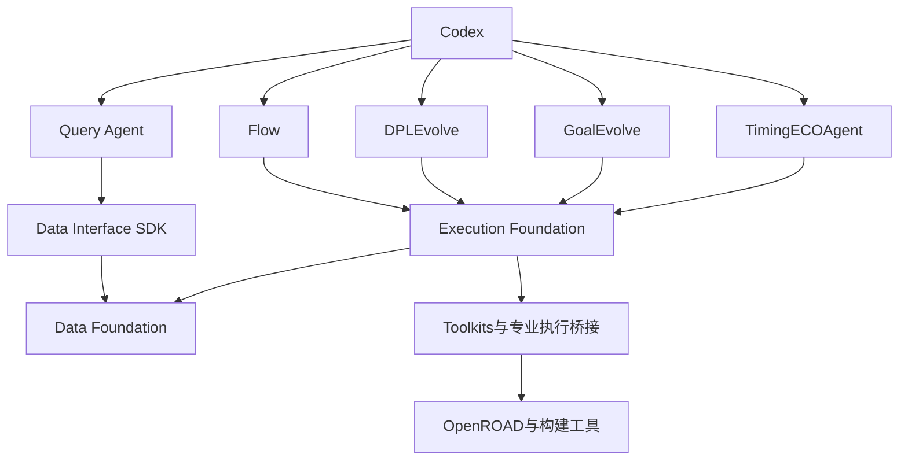
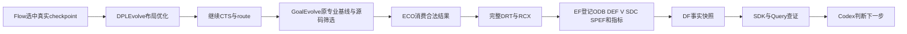
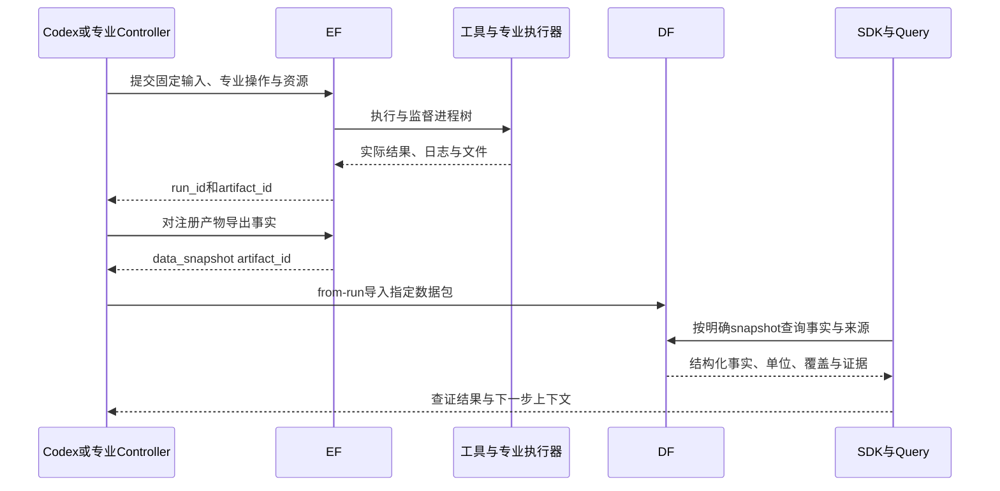
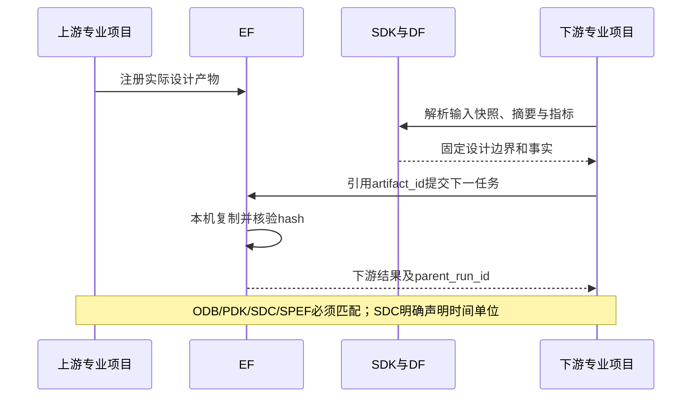

# 本机协同架构、接口与交接

本页说明这轮真实使用的接点，实验终态和指标见同目录的夜间报告。代码模块独立，跨模块使用已安装的公共 wheel / localhost HTTP；运行副本及产物位于 `var/overnight/gcd-20261014`。

## 老板关心的职责边界

| 工作 | 所属模块 |
|---|---|
| 决定目标、选择专业能力、判断是否改善 | Codex |
| 启动 EDA / 编译、排队、资源、进程树、取消、日志、输入身份、注册文件产物 | Execution Foundation |
| 调用实际工具、解析格式、导出设计事实和实际测量 | Toolkits / 专业项目执行桥接 |
| 按设计和运行查快照、对象、关系、指标、摘要与原始来源 | Data Foundation |
| 统一查询语义和客户端 | Data Interface SDK，无独立服务 |
| 把领域工具、查询、查证和诊断上下文交给 Codex | Query Agent |
| 参数优化 / 布局源码优化 / 功耗感知源码优化 / 时序 ECO | Flow / DPLEvolve / GoalEvolve / TimingECOAgent |

EF 是实验调度和文件权威登记处；DF 是设计知识和事实索引处。相同文件不需要由两个服务重复管理。专业原生循环内部的工作文件及上下文仍由原项目管理，最终事实及跨项目交接使用公共数据入口。

## 模块图



## 实际公共接口

以下函数的返回值是已有公共字典契约；字段详情由 contracts / SDK 定义，本轮没有新造远程 RPC 契约。

| 所属 | 函数签名 | HTTP 路径 / 含义 |
|---|---|---|
| EF client | `submit(task: Mapping[str, Any], *, idempotent=False, idempotency_key=None, plugin_version=None) -> dict` | `POST /kernel/runs`，body 为 `{"task": TaskSpec}` |
| EF client | `run(run_id: str) -> dict` | `GET /kernel/runs/{run_id}`，状态、阶段、终止原因 |
| EF client | `cancel(run_id: str) -> dict` | `POST /kernel/runs/{run_id}/cancel` |
| EF client | `artifacts(run_id: str, *, category=None, kind=None) -> list[dict]` | `GET /kernel/runs/{run_id}/artifacts` |
| EF client | `resources(run_id: str) -> dict` | `GET /kernel/runs/{run_id}/resources`，资源实测 |
| EF client | `materialize_artifact(run_id: str, artifact_id: str, destination: str, *, chunk_size=...) -> dict` | 公共 locator + 本机复制 / 远端分块；核验 SHA-256 |
| DF | 指定 EF 数据包导入 | `POST /snapshots/from-run`，body `{"run_id": "...", "artifact_id": "..."}` |
| SDK | `list_designs() -> dict` | `GET /designs` |
| SDK | `list_runs(*, design_id=None, status=None, limit=100, offset=0) -> list[dict]` | `GET /kernel/runs`，由 EF 提供完整实验目录 |
| SDK | `resolve_scope(*, snapshot_id=None, design_id=None, revision_id=None, run_id=None, stage=None, origin="flow") -> dict` | `GET /scope`，明确快照或返回候选 |
| SDK | `get_run_summary(run_id: str) -> dict` | `GET /runs/{run_id}/summary`，该运行已索引的阶段 |
| SDK | `get_stage_summary(snapshot_id: str) -> dict` | `GET /snapshots/{snapshot_id}/summary`，覆盖与来源 |
| SDK | `get_metrics(*, run_id=None, snapshot_id=None, stage=None, name=None, include_raw=False, limit=100, offset=0) -> dict` | `GET /snapshots/{snapshot_id}/metrics` 或 `/runs/{run_id}/metrics` |
| SDK | `query_objects(snapshot_id: str, **filters) -> dict` | `GET /snapshots/{snapshot_id}/objects` |
| SDK | `get_timing_paths(snapshot_id: str, *, check=None, sort=None, order="worst", limit=100, offset=0, detail="summary") -> dict` | `GET /snapshots/{snapshot_id}/timing-paths` |
| SDK | `read_evidence(snapshot_id: str, record_type: str, record_id: str) -> dict` | `GET /snapshots/{snapshot_id}/records/{type}/{id}/fragments` |

专业接点：DPLEvolve 的 `scripts/platform/execution.py` 委派原 helper 操作；GoalEvolve 的 `maybe_delegate(*, command, cwd, policy, output_log, environment) -> ExecutionReport | None` 位于原集中 runner；两个 Code 的 `design_context(profile)` 从 SDK 获取输入 scope / summary / metrics。ECO 的 `platform_execution.submit(profile_path: Path) -> dict` 将整个持续 OpenROAD 会话作为一个 EF 任务；`platform_codex.call_codex(system_prompt: str, user_prompt: str) -> tuple[str, dict]` 保留原提示与解析器。

## 最小数据结构

```text
TaskSpec v3
  task_id / project_id / design_id / experiment_id / plugin_id
  labels: parent_run_id、input_snapshot_id 或 analysis_of_run_id
  inputs: adapter 与专业操作
  staged_inputs: [{artifact_id 或 source, destination}]
  resources: {cpu_cores, memory_bytes, processes}
  timeout_seconds / max_attempts / expected_artifacts

运行回执
  run: {run_id, status, stages, input_manifest_sha256, labels, ...}
  artifacts: [{artifact_id, run_id, kind, store_key, sha256, ...}]
  resources: 实际进程与内存统计

事实边界
  snapshot_id / design_id / revision_id / run_id / stage
  entities / relations / metrics / timing_paths / timing_points
  source artifact refs、记录位置、单位、工艺角与分析条件
```

## 数据流



无合法新源码候选时保留原生合法基线，再交给后续专业能力；这表示工作流能处理拒绝，不表示源码优化获得收益。

## 两个关键场景





## 关键决定

1. 共同基础源码和镜像固定 digest，各 Code 保留定制二进制。直接用 stock binary 会丢掉专业命令；这轮验证实际读写交接。
2. 保留原生优化循环，在确定性执行边界接 EF。ECO 使用持续会话，避免拆成大量进程导致状态丢失。
3. localhost HTTP 传指令和身份，本机大文件走公开 locator 与磁盘复制；没有外网吞吐瓶颈。
4. DF 管知识索引，EF 管任务与原文件。Query增强 Codex的领域理解；判断仍由 Codex完成。
5. 指标显式单位、工艺角和评价条件；导出 SDC 自带 `set_cmd_units -time ps`。禁止混合 TT/FF、ideal-clock/routed 条件计算改善。
6. 原 ECO 的一次 detailed-route 迭代保留为专业校准；另行完整 detailed_route / RCX 验证 DRC 与 PPA。
7. 保留失败、回退和原筛选，保留上游署名。没有降低目标或关闭原能力来取得“通过”。

## 边界与后续

当前交付服务本机实验。跨机器部署、Tutorial、论文公平对照和数据增强节省 token / 时间的因果评测另开切片。运行成功不等于 PPA 三目标均获益；对象 / 时序采样事实不等于覆盖所有设计问题，也不能自动证明某参数的因果作用。
