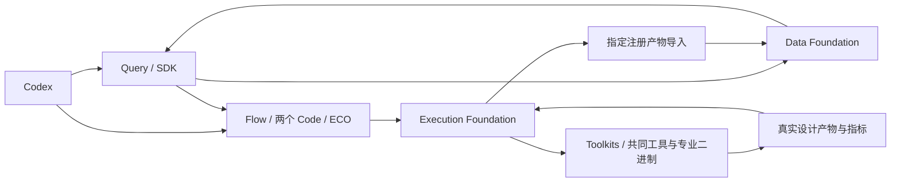

# 本机协同闭环：夜间施工计划

授权：老板于 2026-10-14 要求八小时连续施工，允许阶段验收后自动推进、按推荐方案处理环境兼容，不再逐项审批；随后取消额度限制，要求推进至任务完成。八小时为计划窗口，不使用已过期的 U4 预算。

## 最终业务交付

1. Flow / DPLEvolve / GoalEvolve / TimingECOAgent 能在共同基础工具链下发起真实实验，保留各自的专业算法和分析能力。
2. 所有平台模式下的构建、EDA、测量和补分析经 Execution Foundation；有实验状态、资源、日志、产物、取消和来源。
3. EF 注册的真实设计产物进入 Data Foundation，经 Data Interface 和 Query 查询设计事实、实验差异与证据。
4. 同一个 GCD、同一 PDK / SDC / 工具基础版本完成专业项目间的真实交接；输入继承、阶段输出和最终 PPA 可核对。
5. ECO 使用 ASU-VDA-Lab/TimingECOAgent，来源、作者及原 PDK 许可保留；不将第三方方法包装为本组原创，不删除版权声明。

## 阶段与验收

| 阶段 | 预算 | 业务交付与验收 | 模块 / 前置 |
|---|---:|---|---|
| N0 环境审计 | 0.5h | 固定源提交 / 镜像 / 环境 / 实际入口；GCD 工艺与交接方案依据源码选定；兼容缺口有具体证据。 | 全模块；无 |
| N1 统一执行 | 1.5h | 四专业模块平台入口委派 EF；失败不回落宿主 EDA；状态、取消、日志、产物、资源可公开查询。 | EF / Toolkits / 专业桥接；N0 |
| N2 数据贯通 | 1.5h | 同一 GCD 的运行、快照、事实、指标、原始来源可经 SDK 查询；实际 EF→DF 回流与重启后查询通过。 | DF / DI / Query / Toolkits；N1 |
| N3 ECO 接入 | 1.5h | 保留原上下文压缩、ECO 操作、评分 / 回退、布线校准；复用 Codex 登录可选后端；真实输入经 EF 执行并进入 DF。 | TimingECOAgent / 底座；N0–N2 |
| N4 GCD 协同 | 2h | 真 Flow 优化→Code 专业评价 / 源码候选→Goal 专业优化→ECO；引用前一阶段真实产物，最终合法设计和实际 PPA / 原选择结果完整。 | 四专业模块 / Query / 底座；N1–N3 |
| N5 收尾 | 1h | 静态、对应单测、差异、边界及回归检查；逐阶段证据、Git 检查点、老板报告与恢复指针。 | 各模块；各阶段通过 |

顺序根据源码依赖调整，独立环境准备可以提前；已完成真实构建不重复耗时重建。某项失败不得写成已完成，不用模拟结果代替实际实验。

## 文件与技术边界

- 根目录新增本计划、夜间准备 / 运行 / 验收脚本及对应测试，维护 PROJECT / ARCHITECTURE / TASKS / AGENTS / SOURCE_MANIFEST / 子模块引用。
- 四专业项目：在原确定性执行边界接入 EF，在原数据读取接点消费公开 SDK / Query 上下文；只做必要兼容和运行参数适配，不重造优化循环或修改晋升目标。
- EF：复用公开 client/contracts、现有调度与管理；新增共享修复只针对实际暴露的故障，资源随大构建 / 并发实际配置。
- Toolkits：负责工具调用、物理数据导出及工具格式适配；事实包与纯构建留证包明确区分。
- DF / DI：复用指定注册产物导入、实验目录、对象 / 关系 / 指标 / 来源接口；DI 保持 SDK，不新造服务。
- Query：复用 Codex 通用理解与既有查证 / 比较 / 交接能力，证据不足不宣称因果结论。
- 所有运行状态在 var；跨项目只使用已安装公共 wheel / HTTP，不改 PYTHONPATH / sys.path，不访问 EF 私有数据库。
- 保留既有用户修改、原实验失败、已通过独立重放与发布历史。源码变更以阶段独立提交，可回退。

## 调用与数据流

模块契约以源码审计为准。专业基础版本一致不等于必须用同一个未定制二进制；所有源码 / 二进制身份和 ODB / PDK / SDC 交接需实测。

## 无交互决策与止损

- 当前授权覆盖本计划所需兼容、共享接点和阶段切换，不重复请求审批。关键影响面和选择理由写入阶段记录。
- 某个问题连续 30 分钟没有实质进展，保留现场并记录阻塞，继续独立可交付工作；不堆兜底分支、不关闭原专业功能来伪造通过。
- 额度停止 / 监控已经被老板后续取消；不重置账号限额、不改凭据、不监控额度。
- 八小时用于进度计划；目标未完成不自动记完成。最终明确报告实际完成、未完成、实验质量和技术风险。
