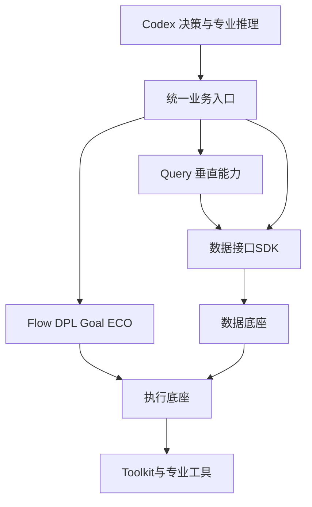
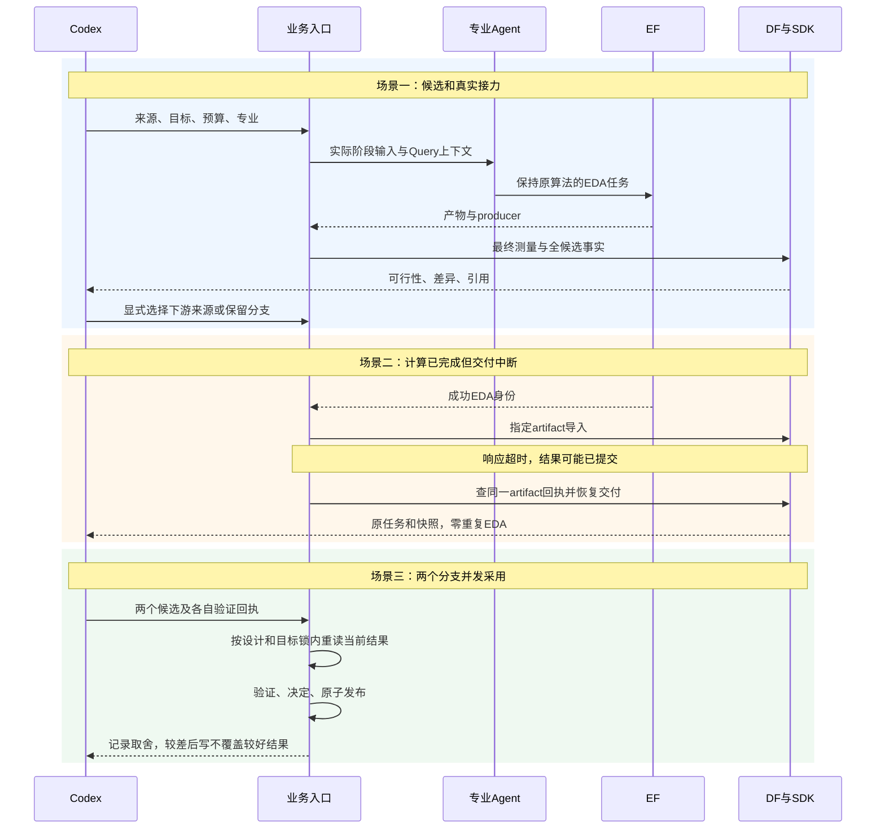

# 正式实验前修正与双核心实验方案

状态：待确认的施工方案，未实现。依据 [2026-10-16 审计](PREFORMAL_COLLABORATION_AUDIT_20261016.md)。本轮核查没有修改生产代码、公共契约、专业算法、DF/DI 用户工作或现有评测脚本。

## 最终用户能做什么

1. 向 Codex 给出设计、目标、来源和预算，专业能力通过统一入口运行，自动留下可查询结果。
2. 看清“计算完成、数据交付、原约束是否通过、是否验证、是否采用”，不把这些状态混为成功。
3. 多个专业并行探索或顺序接力时，已验证的好结果不会被晚到的差结果覆盖，阶段输入不会被无意重置。
4. 无人消费、资源等待、交付中断时得到可解释状态和同一任务恢复入口，无需 Agent 手动排查进程和整理产物。
5. 用同条件实验核查团队的最终 PPA，以及平台给 Codex 带来的正确率、成本和操作简化。

## 五个纵向切片

| 切片 | 端到端交付 | 建议验收标准 | 涉及模块 | 前置 |
|---|---|---|---|---|
| A14 结果采用一致性 | 已测结果→验证回执→Codex 决定→一致采用记录 | 无有效匹配回执不能正式采用；两项并发决定重读当前 incumbent，较差后写不覆盖较好结果；历史结果不改写；按设计／修订／目标／条件明确保留分支 | 根 selection、config、CLI、validation 引用 | 当前审计 |
| A15 候选与接力交付 | 多候选→完整事实→显式选源→适用专业→最终测量 | TNS 相同不再让第一项冒充最优；局部不可行候选可保留探索但不替换正式结果；实际将运行的接点有输入／消费证据和匹配控制；无适用 ECO 动作可以明确跳过 | 根 professional、handoff、native、candidate_facts、diagnosis | A14 |
| A16 正式环境资格 | 指定共同基础版本及方法→启动前能力检查→真实最小流程 | 所用版本／脚本／库／SDC／单位／recipe／算法变体均冻结；source 与 legacy 不混用；每个专业保留原算法；新设计符合所声明 PDK／时钟边界 | 根 flow_recipe、配置和已有专业接点，必要工具解析 | A15；可独立准备清单 |
| A17 执行与数据稳定交付 | 提交→消费→长任务监管→产物→导入→查询，含故障恢复 | 无 worker／资源等待可区分，健康长任务不被误杀；指定故障恢复不新增已成功 EDA；同 artifact 导入幂等；大快照并发查询不挂死；失败回执可读 | 根 jobs、physical、delivery；仅复现证明必要时修改 EF／DF | A16 |
| A18 预实验与冻结 | 两个真实设计完整跑接力／平台任务对照→双实验清单与报告 | 不依赖手动重启、补文件或改运行副本；下游无未解释收益损失；两个实验的设计／基线／目标／预算／重复／失败统计提前冻结；未通过则不启动长轮次 | 根既有业务入口及独立只读评测驱动 | A14–A17 |

这些是拟议验收标准，不把本表写成已通过。每片保留静态检查、必要单测、逐文件差异、架构边界和回归；真实 GCD／AES 接点验证与临时 fixture 分开记录。保护现有 26 份用户文件，部署只使用已审查的构建，不在脏 DF/DI 或其他运行副本上补丁。

## A14：采用事务和验证契约

拟议文件职责：

| 文件 | 职责／影响 |
|---|---|
| `chip_evolve/selection.py` | 核对验证对应当前 result 的内容身份，锁内重读并发布 Codex 采用决定 |
| `chip_evolve/config.py` | 提供范围明确的设计采用锁与原子 JSON 发布；这是共享文件，须审查所有根业务写入消费者，不改各子模块存储 |
| `chip_evolve/cli.py` | 为正式采用显式接收验证引用；清楚返回拒绝原因及保留结果 |
| `chip_evolve/validation.py` | 复用已有证明／重放／SDK 回执；需要时增加可定位引用，不重算评分 |
| 新 `admin/test_adoption_consistency.py`、调整现有采用测试 | 覆盖无验证、回执错配、并发后写和历史不可变性 |

待确认的最小契约：在既有 `select` 增加明确的验证回执引用，例如 `select --result R --validation V --reason ...`。回执必须绑定当前 R 的 hash、完整证明、原约束、独立重放和 SDK 身份；验证从不自动选优，Codex 仍负责取舍。尚未验证的中间探索不会因此被禁止运行，只是不能冒充正式采用。

采用锁仅覆盖短暂的读／核对／原子发布，不串行化 EDA。保留分支身份使用现有文件及 DF/EF 引用，不新增冠军数据库。跨 runtime 的历史结果通过冻结引用进入本轮，不自动扫描并合并不同条件。

同一设计修订指实际功能 RTL／设计输入内容身份，不把当前快照中以实验名填写的 `revision_id` 当作 RTL 等价证明。复用已有输入 hash，在正式清单及采用引用中明确绑定；若需扩展公开 revision 语义，单独确认契约，不静默改 DF 现有字段。

验证：临时目录重跑本次两个复现；实际 GCD 验证回执再次核对后登记一条新决定，真实差候选不能覆盖；并发与完整性检查后执行根相关回归。

## A15：候选、身份与 handoff

拟议文件：`professional.py` 负责候选交付；`handoff.py` 负责已有阶段交接核对；`native.py` 描述 Goal/ECO 实际转换；`candidate_facts.py` 保留全候选及事实；`diagnosis.py` 校核交付中的 source/reference/candidate/retained 结构化身份。新增 `admin/test_candidate_delivery.py`、`admin/test_professional_handoff_contract.py`。

待确认的交付语义：候选集合与代表项分开，正式接力使用明确选定的 candidate 引用；返回计算状态、交付状态、最终可行性和验证／采用引用。不能在 TNS 同分时静默用文件顺序替代业务判断。原专业 winner 保留原意，不在根入口重新训练或改评分。

handoff 复用现有 run、artifact、目标、条件、阶段、recipe 和 native_method 引用，不另造庞大上下文对象。任务写清要优化什么、允许改变的阶段和输入来源；特别区分“源码方法”与“某个设计 checkpoint”。默认由 Codex 选择下一个专业，不实现新的自动决策服务。

验证：用 AES 六份真实候选确认返回值不再伪装最优；GCD/AES 上对拟跑的 Flow→DPL、DPL→Goal、Goal→ECO 接点核查输入和实际消费；允许原专业明确声明的格式变换、清线和重布线，比较相同输入的原方法直行与平台执行，定位额外损失。旧 A11 已有相同控制在输入／实现未变时复用，不无理由重复 EDA。一次对比结果不能覆盖所有设计。

## A16：共同版本与能力资格

拟议文件：`flow_recipe.py` 校核来源；`cli.py` 的正式实验启动检查；`chip_evolve/README.md` 更新推荐路径；新增 `admin/freeze_formal_environment.py` 和对应测试。发现确实未消费的参数时才列出具体专业 Tcl/解析文件，保留算法含义，不先全盘重构。

正式实验固定基础 ORFS/OpenROAD 提交与镜像 digest；Code 允许基于共同版本的私有研究增量和明确二进制 hash。不能把所有 Code 调用强换成无研究增量的同一个 stock binary，这会删掉被测专业能力。

来源模式、脚本／默认值、Make 实际展开参数、原生／最终时钟单位与评分角、库角、OpenDB 读写、CTS/布线接点和输出指标格式均参与资格。已有 Diamond／negotiation、Goal 多 VT／RMP、CP0 和线长适配只核查，不重复改一遍。默认内置综合完整层次能力仍不合格，不删除参数来凑通过；正式实验显式固定已认证 source 路线。

验证：从 EF 执行真实工具能力探针及原脚本最小实验，冻结回执；GCD、AES 加至少一个新真实设计检查准备器。当前 ASAP7／单物理时钟范围作为已验证配置，跨 PDK 或多时钟作为另行资格，避免伪称通用。

## A17：可解释的等待和可靠数据交付

优先文件：`jobs.py`、`physical.py`、`delivery.py` 及新 `admin/test_delivery_lifecycle.py`。先复用现有 EF health/worker/queue、task/run_id 和 DF import receipt。生产 EF、DF 稳定代码不预先重写；若隔离复现证明底层问题，再在其独立模块提交最小修复和专项测试，不能混入用户未提交改动。

目标行为：排队与执行、执行与交付分别可见。没有 worker 或条件不可满足时返回可诊断状态及同一任务引用；健康大构建、长布线按实际预算继续运行，不因几分钟没有新文本就杀掉。超时规则按阶段与健康证据确定，不增加一套统一的小进程／时间死限制。

大快照导入先测明耗时段；客户端超时后先按原 artifact 查导入结果，避免将“结果未知”当“未执行”重新跑 EDA。必要的等待预算配置与客户端/服务生命周期修复单独留证；只有现有接口无法表达所需状态时才提公共契约变更，绝不以无限重试收尾。

隔离故障场景：无 worker、任务能力不匹配、资源暂满、小任务在大任务后、并发任务、长链接／大产物与续租、导入超过客户端等待、响应丢失后实际已提交、驱动中断、取消与重连。测量消费等待、最大无响应时间、租约误杀、重复 EDA、快照幂等及可查回性。本片不重启有消费者的生产服务。

## A18：两项核心实验

拟议新驱动：`admin/freeze_formal_campaign.py` 冻结输入与预算；`admin/run_formal_preflight.py` 调用既有业务入口作预验证；`admin/report_formal_campaign.py` 生成可核查数据表。它们是确定性实验脚本，不是新 Agent harness 或评分底座。已有独立 `admin/evaluation/` 工作只读取可追溯结果，不擅自合并其用户修改。

### 实验一：最终 PPA 与协同

| 对照 | 用途 |
|---|---|
| ORFS 默认 | 产品整体相对传统流程的基准 |
| 冻结的显式完整来源，不调参 | 单独量化来源／综合路线／显式配置差异 |
| Flow、DPL、Goal、适用 ECO 各自单项 | 得到同起点政策、相同总预算下的单项能力 |
| Codex 按事实选择的协同 | 验证任务分工、分支和接力是否产生最终额外收益；允许跳过无适用动作的专业 |
| 固定方法的 A、B、A→B 匹配重放／移除一项 | 分析收益是否保留、边际贡献及交互；另表标明不是新搜索 |

设计建议：3–5 个经过资格验证、规模与瓶颈不同的真实设计；GCD 主要用于工程回归，AES 保留失败例和已有合法基线，再加入未参与修补的新设计。先固定已支持范围，不为扩充样本数临时宣称支持新 PDK。

每个设计固定修订、约束／目标优先级、允许来源政策、基础工具／脚本、物理参数起点、模型设置、随机种子组和资源。各方法使用相同总模型与计算预算口径，团队不能因专业数更多而默认获得数倍预算；均报告实际 token、EDA/编译 CPU 时间、总墙钟、队列／恢复、失败与未完成。最强单项按每项同预算的结果比较，并列出整个比较研究的实际总成本。

原始时序／功耗／面积数值和可行率为主，不临时造综合分数。若主目标为“闭合时序约束下最小功耗及面积”，保持该语义；若追求更短周期，另冻结完整重跑协议，不能把一次正余量直接当作更高频率已实现。SPEF、活动假设和功耗估计口径一致，报告其估计性质。

同条件下团队保留最好合法分支，以免最终交付被差结果替换；这只是保底。**主张协同增益还要求实际正向接力，且与最好单项同预算比较有优势**。少数设计失败／无增益仍全量报告，不能只留下成功 GCD。重复数建议预实验至少 3 组种子检查变异，正式建议 5 组；最终数量和预算在看到正式结果前确认冻结，不能看完输赢再改门槛。

### 实验二：平台统一、集成与封装

相同 Codex 及模型设置，一侧使用原始工具、原项目与文件，另一侧调用平台。双方拥有同等专业方法与可执行能力；不能通过限制直接侧可用工具来制造优势。

任务覆盖：提交并监控真实 EDA、查设计全部相关实验／产物、识别最终超限原因、比较多个候选、选择并执行一个专业接力、处理交付中断、取消、恢复和保留合法结果。查询题及现有组件消融作补充，不能替代完整业务任务。

| 主张 | 指标／控制 |
|---|---|
| 正确可靠 | 任务完成率、事实及引用正确率、最终 PPA 是否一致、输入身份和证据完整性 |
| 封装简单 | Agent 必须处理的内部路径／版本／命令修补次数、业务工具调用次数、人工干预次数、重复 EDA |
| 效率 | 全部模型调用 token／已知计费用量、端到端时间、EDA 时间与平台等待分别记账、数据读取量、失败与恢复成本 |
| 公平 | 同任务／输入／模型／预算、独立上下文、成对重复与随机顺序；冷启动／索引成本和复用热态分别报告；缺用量不记零 |

成本主表同时给全尝试成功率和双方正确且用量完整的配对成本，配对数写明，防止“更快答错”被计作收益。继续观察已有紧凑输出和批处理的负结果；先保证关键事实与必要展开，再优化 token，不以删证据、删专业动作或禁用原生补算换效率。

预实验通过条件：正确性和产物不退化、指定故障自动按同身份恢复、专业只需关心目标／候选／证据，无需修改底层路径或脚本。达到此条件才启动正式预算，不提前承诺某个 PPA 或 token 改善百分比。

## 模块依赖图

最后一条表示 DF 引用 EF 已登记的产物，不表示 DF 决定专业任务或 winner。

## 核心数据流图

## 关键场景时序图

## 关键决策和施工纪律

- 保留 Codex 作为决策者，底座只做确定性身份、执行、事实和采用一致性；不重造通用 harness。
- 用分支和最终事实处理专业冲突，不通过禁止专业正常动作或强制四专业串行掩盖问题。
- 统一基础版本并保留研究增量；真实语义资格优先于版本字符串。
- 先修本次复现的小接点，再对证据指向的 EF/DF 根因动刀；不做预防性平台重构。
- 测试命令按已安装独立环境执行，根 `pytest admin --ignore=admin/evaluation --ignore=admin/legacy-integration -q`，Flow 从自身 `flow/` 目录执行对应回归；改 EF/DF 时另跑其独立测试和真实隔离生命周期验证。
- 每片开始冻结 commit／保护 hash，完成后按 `[切片N] ...` 独立提交；模块先提交发布，再更新根 gitlink 与来源 manifest。每两至三片更新架构和任务清单。

本计划的验收和新增采用／交付契约需要老板确认后实现；本轮交付为审计和可执行的修正范围，不将待做修复记作已完成。
