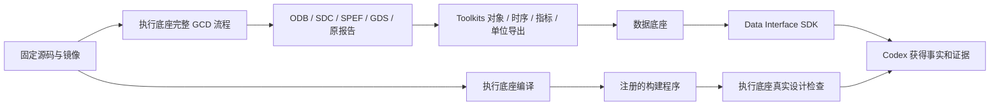

# U1 共同工具链资格验证：工程结果与老板验收

日期：2026-10-12。状态：**工程验收通过，老板业务确认待完成**。根基线 `41635049fb1039a5c711972a414904c68c3d48de`，实施分支 `u1-common-toolchain-20261012`。

## 老板现在得到什么

选定的共同基础环境已有运行证据：源码和依赖可核对，能够经统一执行底座编译 OpenROAD、跑真实芯片设计，并经统一数据入口取回状态、指标、单位和原始证据。后续三个专业项目的迁移有一条可查证的基础基线。

这轮验证的是共同基础工具的可用性。Flow 调参产品在新环境的完整实验、DPLEvolve/GoalEvolve 专业补丁迁移、所有 Agent 的入口收口和组合 PPA workflow 尚未完成，仍按 U2–U5 / L4–L8 分切片执行。ECO、Tutorial、论文对照继续暂缓。

## 实际完成与效果

| 功能 | 实际结果 | 证据 |
|---|---|---|
| 固定工具身份 | SIF `8e6ee7…`、ORFS `5105b0…`、OpenROAD `27288f…` 和全部递归依赖固定；未改算法源码 | `config.json` / `source-manifest.json` |
| 统一执行源码构建 | EF 构建成功，实际程序约 115 MB，SHA256 `d8ecb8fd27aa09e0a4691d4e649477e83c3f0a9de19ce96dfbb50320863c8a95` | `results/build/qualification.json` |
| 真正使用构建程序 | 在同一镜像内加载原厂 GCD 最终 ODB/SDC/SPEF/Liberty；968 实例、759 网络；合法性通过；WNS −0.161583195841 ns；写回 ODB 与原输入 hash 一致 | `results/check/qualification.json` / `check.log` / `roundtrip.odb` |
| 完整物理流程 | 原厂镜像 GCD / Nangate45 经 EF 完成 RTL→GDS，ODB/SDC/SPEF/GDS 等产物注册 | EF `flow` run，约 57.3 秒（该次单设计观测） |
| 统一数据入口 | 5,682 实体、11,805 关系、5,682 物理上下文、76 时序路径、1,882 时序点可查询 | `unit-completion-retry1-runtime-sdk-evidence.json` |
| 原指标与单位查证 | 原最终报告与 floorplan 单位报告分别通过现有 ORFS adapter 导入；14 项指标单位明确；raw value 与注册的原报告一致 | 同上、`metrics_export` / `units_export` |
| 中断后保留计算 | 显式构建检查点关联原 EF run/source/image/flags/hash；数据收尾没有重复构建、物理流程、导出或真实设计检查 | `preparation/checkpoint-manifest.json`、收尾 `only_new_metadata_task=true` |

SDK 实际返回 WNS −0.161583 ns、TNS −7.08646 ns、面积 943.502 µm²、功耗 0.00633406 W、实例数 968。它们是本次原厂 GCD 的测量事实；不是本平台的 PPA 改善结论。WNS 为负表示该示例仍有时序违例，资格验证证明流程可运行并能准确报告状态，没有把违例包装为优化成功。

## 资源策略：落实老板本轮补充

原 24 GiB 限额两次终止 LTO 链接，进程树 RSS 峰值约 37.2 / 40.0 GiB，进程数没有达到 256 上限。老板明确要求单个大任务留更大余量后，本轮构建配置改为 **64 GiB / 2048 进程 / 8 编译线程 / 单 LTO worker**；小型设计检查和元数据任务按实际需求分配。成功构建 RSS 汇总峰值约 31.8 GiB、33 个进程。RSS 汇总是 EF 的统计口径，并非这些进程独占的物理内存。

容器隔离 `/tmp` 原为 64 MiB，实际编译失败后改为本次 EF 工作区自己的 scratch；真实镜像内查询显示可用约 1.9 TB。执行底座接口和内核没有修改，任务请求和工具启动参数体现本次配置。今后的单大任务/多并发分配原则已写入根 `AGENTS.md`，不是要求所有任务固定照搬这个数值。

## 数据流与现有接口



| 交接 | 现有公开接口 / 数据 |
|---|---|
| admin → EF | `KernelClient.submit(task)`，`POST /kernel/runs`；schema v3 TaskSpec，staged inputs 和资源请求 |
| EF → 下一任务 | `run(run_id)`、`artifacts(run_id)`；artifact_id/hash 作为 staged inputs，实际源码/镜像/输入清单留证 |
| 大产物本机交接 | `materialize_artifact(run_id, artifact_id, destination)`；本机文件复制/校验，HTTP 传管理信息 |
| ORFS → DF | Toolkits `export_flow` 加现有 `adapter=orfs`；`POST /snapshots/from-run` 指定已注册包 |
| DF → SDK | 对象/时序 snapshot、最终指标 snapshot、单位 snapshot 均归属同一物理 run；`get_metrics(snapshot_id=...)`、`get_timing_paths`、`resolve_scope`、`read_evidence` |
| SDK → 原始证据 | `artifact_bytes(run_id, artifact_id)` 取小型原报告，核对 hash / 原字段值 |

对象/时序包没有 observations，常规指标不能从空表假装读出。最终指标来自 `6_report.json`，时间/距离等声明来自同一次运行的 `2_1_floorplan.json`；复用已有适配与跨 snapshot 的 run 单位语义，没有新增 DF 服务、数据库类型或公共契约。三个 snapshot 分别用于完整设计事实、最终测量与单位声明，不让 floorplan 数值冒充最终指标。

## 工程门禁与改动清单

最终静态/lint/格式/mypy 通过；**35 项新增测试、137 项相关回归通过，1 项按现有测试条件跳过**。差异与架构审查确认八个项目业务源码和公共契约未改，原有 26 项用户修改 hash 未变。日志在运行目录 `gates/final/`（较早门禁和失败记录保留）。

| 文件 | 职责 |
|---|---|
| `admin/qualify_common_toolchain.py` | 冻结源码/独立 wheel 环境，发起 EF 构建/真实流程/检查/导出及 SDK 查证 |
| `admin/accept_common_toolchain.py` | 核对 source/image/binary/registered bundles、设计所有权、指标/单位和原始证据 |
| `admin/finish_common_toolchain_data.py` | 复用本次成功任务，补齐原报告/单位的导入和公开 SDK 收尾；不重复物理计算 |
| `admin/test_common_toolchain_qualification.py` | 固定源码、声明换行、精确符号链接、失败/超时、检查点不匹配测试 |
| `admin/test_common_toolchain_acceptance.py` | 缺物理产物、错设计/工艺/binary/来源、错误值或单位不得通过 |
| `AGENTS.md` | 老板新增资源分配原则 |
| `TASKS.md`、`admin/STATUS.md` | 真实进度与业务确认状态 |
| `admin/COMMON_TOOLCHAIN_PLAN_20261012.md` | 授权、基线、资源变更和实际新增收尾文件 |
| 本报告 | 老板可核对的结果、失败、限制与复验入口 |

要调整本资格验证的工具版本、构建参数或资源配置，改 qualify 的 prepare/config 并创建新的冻结实验；要调整验收规则，改 accept 及对应测试。专业 Flow/Code 行为仍在各自模块，U1 没有替它们改算法。

## 原失败与局限

所有失败现场保留：ABC 声明 CRLF 的初版字节核验误判；tar data filter 改写符号链接文本；遗漏已批准的内存 label；Slang 隐式 fmt 下载；容器 64 MiB tmp；24 GiB LTO 内存终止；初次数据包未导入指标/单位；单位收尾第一次日志文件名冲突。修复验证工具或明确构建参数，未改研究算法，未把失败任务改成成功。

初版离线回执 `u1-acceptance-before-unit-completion.json` 允许 partial 单位，保留作过程证据；最终门禁要求关键指标 available 且单位明确，最终验收只认 `u1-acceptance.json`。原 `runtime.json` 记录四项成功和 SDK 收尾失败，未被覆盖；最终执行/数据状态由 `unit-completion-retry1-runtime.json` 补充，并核对原四任务记录完全不变。

本次使用镜像现成 CMake/Make 工具完成资格验证；选定源码已提示 CMake deprecated，今后升级须重新审计构建后端。本次资格结果固定在已验证的版本与参数；未来版本以及两个 Code 的专业 overlay 分别验证。

## 老板复验入口与下一步

最终 evidence root：`/home/wjyuan/projects/eda-development/var/toolchains/common-u1-20261012-retry6`。

```bash
cd /home/wjyuan/projects/eda-development
admin/.venv/bin/python admin/accept_common_toolchain.py audit \
  --run-root var/toolchains/common-u1-20261012-retry6 \
  --runtime-receipt /home/wjyuan/projects/eda-development/var/toolchains/common-u1-20261012-retry6/unit-completion-retry1-runtime.json
```

这条命令离线核对已产生的源码/镜像/程序/设计/数据证据，不重新跑 EDA。查看最后三类 snapshot 和六个 run 的具体证据，使用同目录的最终 SDK/收尾回执。当前实验服务已停止，数据和产物保留在 var；教学安装和公开发布不在这轮范围。

下一切片 U2：以这条共同基线迁移 Flow，验证 AES 两轮三候选、完整阶段继承/反馈和四类恢复；先列实际文件与影响面，再由老板确认实施。之后按 U3/U4 保留两个 Code 的专业能力逐项迁移；GoalEvolve 的模型入口、AE-3 与上游九项缺口仍要解决。统一执行/数据入口、同设计/工艺/约束接力和最终 PPA/token/时间收益，在后续切片验收。
