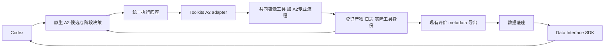
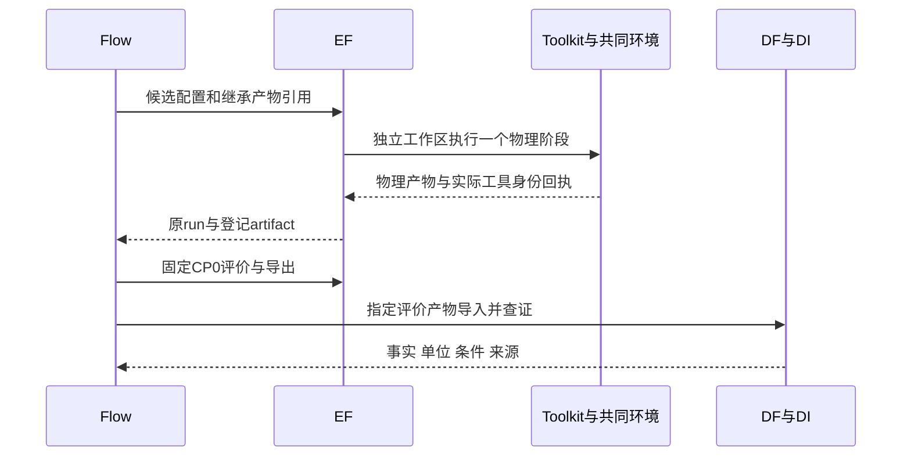
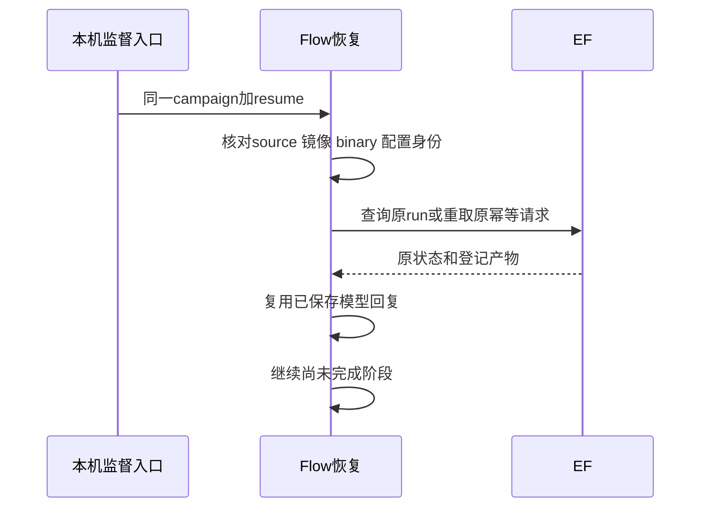

# U2：Flow 共同工具环境迁移施工计划（老板已确认）

日期：2026-10-12。老板以“同意执行”确认本计划，当前进入 U2 实现与验证。U1 已通过工程验收，老板业务确认仍按原报告记录。本计划把已确认的 U2 路线收敛为可审阅的文件、契约和验收步骤。

## 老板最终得到什么

在已验证的 10 月共同工具环境下，本机可以完成一次真实 AES 两轮、每轮三个候选的调参实验；计算由执行底座管理，结果自动进入数据底座，实验中断后继续同一个实验。交付可查询的结果、产物、参数来源与工具版本，以及在新环境重新冻结的基线。

本切片验收运行可靠性、专业算法保留与结果可查证。优化算法可能找到改善，也可能拒绝候选；如实报告最优可行结果及失败，不把完成迁移等同于已经取得 PPA 收益。DPLEvolve、GoalEvolve 的迁移和联合接力仍在 U3–U5，Query 诊断增强和统一 Code 入口按后续切片实施。

## 源码审计依据与方案选择

| 已核实的事实 | 对施工的影响 |
|---|---|
| Flow 当前提交为 `a90bd07e304e2572fbd3e201809d93d6e50cbe1c`，工作树干净；Toolkit 工作树干净 | 可以从明确源码基线创建独立 U2 检查点 |
| `admin/run_platform_campaign.py:prepare` 把物理工具固定到 `/opt/EDAs/OpenROAD-flow-scripts/versions/20260409/tools/install` | 增加共同环境 prepare 入口；保留历史 prepare 用于重放，不覆盖旧实验 |
| `flow/platform_campaign.py:fingerprint` 当前只 hash profile 指向的宿主可执行文件 | 镜像运行时必须同时绑定实际 SIF、镜像内 binary、源码来源及原生 Flow 文件；只 hash 启动脚本不足够 |
| `toolkits/.../a2_stage.py` 当前直接在宿主运行 make/OpenROAD，单候选 staged inputs 与继承包已有 | 在同一个 adapter 内增加显式、可选的容器运行方式；继续使用原 TaskSpec、幂等键和 checkpoint 机制 |
| A2 CTS 脚本注释掉了 CTS 后时序修复；共同镜像原厂 CTS 默认可以开启该修复 | 本轮保留冻结的 A2 Makefile、scripts 和专业 hooks，不全量替换成原厂 ORFS scripts |
| 原厂与 A2 `global_route.tcl` 存在约 200 行 unified diff；Makefile 约 639 行；variables.yaml 约 1,092 行 | 把迁移范围限制为共同工具/runtime，避免同时重写原生物理流程与研究行为。diff 行数仅说明差异规模 |
| A2 与镜像 Nangate45 主 Liberty SHA256 相同：`8d540a4d4cf6d09d27c87ad067857a9c0c2eeb023ab7a56e058cd3113db4e9b1` | 保留 A2 PDK/设计输入并完整登记其身份；不因一个 Liberty 相同就宣称全部 PDK 文件相同 |
| A2 AES RTL 使用普通 Verilog；原生 frontend 默认为 Yosys read_verilog；镜像安装目录未发现独立 slang 插件文件 | 本轮沿用该设计的原生默认 frontend，不从旧环境带入未核对的插件 |
| `PlatformExecution` 当前硬编码 6 GiB / 256 进程；supervisor 硬编码 12 GiB 服务额度 | 用本次实验的显式资源配置替代共同模式的固定小额度；历史模式默认保持兼容 |
| 现有 P3 验收已有完整参数消费、阶段 lineage、四个真实恢复窗口与 SDK 来源检查 | 复用这些检查，补充共同工具身份检查，不另造评测底座或 Agent harness |

方案：**共同镜像中的 OpenROAD/Yosys 与运行依赖 + 冻结的原生 A2 Flow overlay**。镜像 ORFS commit 表示工具来源；实际执行的 Flow Makefile/scripts 明确标为 A2 commit 和文件 hash，不能冒充运行了未修改的官方 ORFS 流程。这是三个专业项目使用共同基础版本时保留各自研究能力的同一原则。

本轮以 U1 已验证的镜像原厂 binary 作为 Flow 工具基线。U1 source-built binary 的资格证据仍保留，但不能把它的 hash 混写成这次 Flow 实际使用的 binary。后续 Code 使用共同基础源码加私有候选构建。

## 验收标准

1. 使用固定 SIF `8e6ee7…`、ORFS `5105b0…`、OpenROAD `27288f…`；实际 OpenROAD/Yosys binary、A2 Flow/PDK/RTL/约束身份有回执，物理任务不得回退到旧工具。
2. AES / Nangate45，两轮 × 三候选，真实 Codex 模型，原生搜索、屏障、DRP donor 继承和候选评价保留；18 个物理阶段以及原生规则需要的评价/导出完成；配置值在真实 floorplan、CTS、routing 日志中确认被消费。
3. 在新工具下重新生成基线，沿用原生 CP0 生成规则（新 baseline 的 ECP × 0.9），生成后全实验固定；功耗预算沿用已确认原生配置与可行性规则，保存具体数值。旧实验的 0.792 ns / 0.400 W 和 5.73% 观测不自动继承为新实验结论。
4. 四个真实中断窗口通过：提交回复丢失、模型回复已落盘、物理阶段提交点、跨轮提交点；恢复保留原 run/请求/产物/模型 call_id，不重复已完成计算或模型决策。镜像或工具身份改变时不得续跑旧 campaign。
5. 每个成功评价经已有 Toolkits → DF → DI 路径回流，TNS/WNS/功耗、单位、评价条件、物理 run 与分析 producer 来源一致；静态、单元、差异、边界、相关回归依次通过。工程通过与老板业务验收分别记录。

完整流程仍运行到最终 ODB/SDC/SPEF/DEF/netlist/GDS，不以简化设计或减少候选代替本切片验收。

## 文件清单与职责

以下是本切片已确认的实施范围。

| 文件 | 职责及影响 |
|---|---|
| 新增 `admin/run_common_flow_campaign.py` | U2 独立 prepare/supervise/query 入口；核对 U1 回执，冻结镜像内工具身份与 A2 输入，准备 committed wheels/独立环境和本机 profile，再复用完整 campaign supervisor |
| 新增 `admin/accept_common_flow_campaign.py` | 复用 P3 全实验审计，另核对共同镜像/实际 binary/源码/profile 与阶段回执；输出独立 `u2-acceptance.json` 和新环境结果 |
| 修改 `admin/run_platform_campaign.py` | 为 supervisor/gateway 增加可选实验环境及资源参数，支持 U2 的隔离 wheel 环境；旧 prepare 与默认执行方式保持兼容，四个真实恢复 gate 复用 |
| 新增 `admin/test_common_flow_campaign.py` | 验证新 prepare 的工具身份绑定、隔离环境、历史状态不被覆盖，以及 supervisor 配置与实际任务预算一致 |
| 新增 `admin/test_common_flow_acceptance.py` | 验证缺 binary 来源、误用旧工具、阶段身份错配、新旧基线混用不能得到 U2 通过回执 |
| 修改 `admin/test_platform_campaign_budget.py` | 保留原预算检查，并验证可选大任务配置通过现有 EF 受理与超额拒绝规则 |
| 新增 `flow-agent/flow/platform_toolchain.py` | 读取共同工具 profile/manifest，生成实际工具来源 fingerprint；普通宿主 profile 仍采用原行为 |
| 修改 `flow-agent/flow/platform_campaign.py` | 恢复 fingerprint 纳入真实镜像/工具/来源身份；这是 Flow 恢复的共享骨架，影响所有平台模式恢复，不改 phase checkpoint 格式或算法 |
| 修改 `flow-agent/flow/platform_execution.py` | 接受可选 ResourceRequest 配置并保存到任务身份；复用原幂等、继承与大产物本机取回 |
| 修改 `flow-agent/flow/platform_leaf.py` | 从本实验 settings 向 executor 交付显式资源配置；候选绑定、评价条件和 donor 来源逻辑保留 |
| 新增 `flow-agent/flow/test/test_platform_toolchain.py` | 验证镜像/binary/来源变化导致身份变化，启动脚本相同不能掩盖工具变更 |
| 修改 `flow-agent/flow/test/test_platform_execution.py` | 验证显式资源进入真实 TaskSpec 与恢复身份，旧调用方式仍兼容 |
| 新增 `toolkits/src/eda_toolkits/openroad/a2_runtime.py` | 只为 A2 adapter 构造显式容器命令、绑定冻结 source 和独立 workspace/scratch、传递所需物理/评价环境并记录实际工具身份 |
| 修改 `toolkits/src/eda_toolkits/openroad/a2_stage.py` | 在既有原生命令外选择显式 runtime；阶段回执记录实际 binary/runtime 身份，make 的 predecessor `-o` 规则保留；这是物理阶段共享骨架 |
| 新增 `toolkits/tests/test_a2_runtime.py` | 验证容器 bind、工作目录、磁盘 tmp、所需环境、真实工具身份与宿主路径隔离 |
| 修改 `toolkits/tests/test_a2_stage.py` | 验证容器方式仍保留 predecessor 冻结、配置/SDC、CP0、SPEF 与反馈语义；历史宿主模式回归 |
| 完成时更新 `TASKS.md`、`admin/STATUS.md`、`admin/COMMON_TOOLCHAIN_PLAN_20261012.md`；新增 `admin/U2_FLOW_COMMON_TOOLCHAIN_REPORT_20261012.md` | 登记真实运行、失败、门禁与老板验收状态。根 `ARCHITECTURE.md` 如接口说明需要补充，只更新共同 runtime/Flow 边界事实 |
| 发布时更新 `SOURCE_MANIFEST.json` 与 Flow/Toolkit gitlinks | 先提交并推送两个自有模块到 ChipEvolve 模块分支，再更新根指针，不触碰两个 Code 上游指针 |

不计划改 A2 专业 Makefile/Tcl/搜索代码。若真实运行发现新版工具 API 不兼容，先保存失败并列出最小修复文件、影响与是否改变算法；新增该范围须按切片协议确认，不能临时换回旧 binary 或移除验收。

## 待确认的内部契约

EF TaskSpec/schema v3、HTTP 路径、DF/DI 公共契约不变。新增的是 Flow/Toolkit 共同消费的 **opt-in 本机 profile 字段**，不是新后台服务：

```text
profile.runtime = {
  kind: "apptainer",
  executable: <本机绝对路径>,
  image: <固定 SIF 绝对路径>
}
profile.toolchain = {
  image_sha256: <SIF SHA256>,
  oci_digest: <U1 已核实 OCI digest>,
  orfs_commit: <固定 40 位 commit>,
  openroad_commit: <固定 40 位 commit>,
  source_manifest_path: <本实验复制的 U1 来源 manifest>,
  source_manifest_sha256: <来源 manifest SHA256>,
  binaries: {
    openroad: {path: <镜像内绝对路径>, sha256: <实际 binary SHA256>},
    yosys: {path: <镜像内绝对路径>, sha256: <实际 binary SHA256>}
  }
}
```

既有 `flow_dir/source_commit/makefile_sha256/eval_tns_sha256` 继续标识实际 A2 flow；`openroad_bin/yosys_bin/python_bin` 在容器 profile 中明确为镜像内路径。普通宿主 profile 没有 `runtime/toolchain` 时沿用现有行为。Flow 内部新增 `PlatformExecution(..., resources=None)` 可选参数，`platform.json.resources` 为 `{memory_bytes, processes}`；cpu 使用已有 `threads`。显式资源也纳入新模式恢复身份，避免续跑时偷偷改变配置。

宿主 controller 使用自己的冻结 Python 环境处理原生算法和 Codex 调用；物理 make/OpenROAD/Yosys 在镜像环境执行。controller 启动检查所需的轻量工具入口只用于身份/可用性查询，实际 EDA 始终由 EF 的 A2 adapter 发起。镜像物理进程不接收模型凭据。

prepare 与恢复时核对实际 SIF 内容；阶段执行核对镜像内工具与原生脚本身份并写入注册回执。身份核验避免在每个短轮询重复 hash 大镜像，不以额外框架替代已有恢复机制。

## 数据流与接口



1. Flow 向 EF 提交已持久化的 TaskSpec；输入为 profile、候选 config/SDC 和已有 predecessor artifact_id，带 campaign/candidate/stage/donor 身份。
2. EF 装入独立任务目录；Toolkit 以固定镜像运行原生命令。冻结 A2 源目录只读绑定、任务目录可写绑定、任务 scratch 绑定 `/tmp`；继承前置结果依旧是 inputs，不重跑上游。
3. EF 登记原始产物和阶段回执；Flow 经 `materialize_artifact` 本机复制/hash 投影到原生目录，沿用大文件路径。
4. 固定 CP0 评价 metadata 经现有导出任务登记，DF `POST /snapshots/from-run` 指定产物导入，DI SDK 查询 TNS/WNS/POWER_TOTAL、评价条件和 evidence；Codex 判断下一步。





## 实施顺序、资源与验证

确认后才创建 U2 根/模块分支、记录干净模块基线及根目录已有用户修改。根基线为 `eaa2d52fd431e112fe990d47681942796c7fc9c4`；DF/DI 及 admin/evaluation 的用户工作保留，不把 dirty 源码装入本切片运行环境。跨模块只使用 committed wheels/公开 HTTP。

1. 落实 opt-in profile/runtime/资源契约及对应测试；以 U1 committed wheels 为底座基线，两个修改模块提交后构建新 wheel。保存依赖版本与 hash。
2. 静态、单元、差异、架构边界、相关回归依次通过；检查历史宿主模式仍能构造原任务，不重跑旧实验。
3. 在新 var 目录，经 EF 跑一条真实 AES baseline 阶段链，先暴露旧 A2 Tcl/新版工具/容器 Python 依赖兼容问题。该资格链单独留证，不冒充两轮实验，不带入旧计算结果。
4. 兼容性通过后新建完整 campaign，执行两轮 × 三候选及四个真实恢复窗口；统一导入、SDK 来源核对和原生模型决策审阅。
5. 输出完整验收/老板报告与离线复核命令，完成门禁和提交；老板业务验收通过后记录完成。

资源初始方案：物理并发 1、每阶段 8 核、24 GiB、2048 进程，专有 gateway 32 GiB / 8 核，scratch 使用本机磁盘。它是本次兼容性预检的显式起点，尚不是新环境实测需求；预检记录实际峰值后冻结完整实验的配置，必要时增加余量。不把 U1 的 64 GiB 构建配置机械套到每次物理评价，也不继续使用写死的 6 GiB / 256 进程。超出机器当时可用资源先调整并发/预算，不减候选或算法。

完整 campaign 初始监督预算 3 小时，单任务上限沿用原平台 90 分钟；新实验模型调用均保存实际账本。预算计入本实验恢复时间，失败不悄悄重置；GoalEvolve 历史预算与模型入口问题保持独立。

下面是确认后新增/复用的预定命令（当前新脚本尚未实现）：

```bash
# 在各项目自己的环境运行静态/单元/相关回归。
# root admin 新脚本用现有 ruff/mypy，runtime 依赖来自独立已安装 wheel。
execution-foundation/.venv/bin/ruff check <本切片新增和修改Python文件>
execution-foundation/.venv/bin/ruff format --check <本切片新增和修改Python文件>
execution-foundation/.venv/bin/mypy --follow-imports=silent --ignore-missing-imports <本切片文件>
admin/.venv/bin/python -m pytest admin/test_common_flow_campaign.py admin/test_common_flow_acceptance.py
# 包含 EF HTTP 的既有检查使用安装公共 wheel 的验证环境。
python3 dev.py flow-agent check
toolkits/.venv/bin/python -m pytest toolkits/tests/test_a2_runtime.py toolkits/tests/test_a2_stage.py
git diff --check --ignore-submodules=all
git diff --name-only --ignore-submodules=all

# 新 U2 本机入口；完整 supervisor 保留实际中断流程。
admin/.venv/bin/python admin/run_common_flow_campaign.py prepare \
  --run-root var/flow-agent/u2-common-<本次身份> \
  --qualification-root var/toolchains/common-u1-20261012-retry6
<U2安装公共wheel的验证环境>/bin/python admin/run_common_flow_campaign.py supervise \
  --run-root var/flow-agent/u2-common-<本次身份>
<U2安装公共wheel的验证环境>/bin/python admin/run_common_flow_campaign.py query \
  --run-root var/flow-agent/u2-common-<本次身份>
admin/.venv/bin/python admin/accept_common_flow_campaign.py audit \
  --run-root var/flow-agent/u2-common-<本次身份>
```

最终报告补充实际测试命令、解释器、版本、通过数与回执；静态工具对原有 legacy 文件已有问题采用明确基线差异检查，不顺手格式化/修复无关逻辑，也不把未通过项记为全部通过。

## 需要老板确认的具体决定

确认本切片的上述文件/opt-in 内部契约与五项验收，采用“共同工具 + 原生 A2 overlay”的迁移方式，保留原生 CP0 新基线生成规则，并按预检实测冻结资源后执行完整实验。业务代码实施前的确认依据是根 `AGENTS.md` 的“新切片先输出文件职责、数据流、验证步骤和影响面，老板确认后实现”；此前 U2 路线已同意，本次确认的是经过源码审计收敛的实际实施方案。
