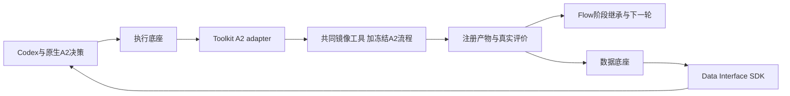

# U2：共同环境下的完整 Flow 调参产品

日期：2026-10-12。**工程验收通过，老板业务确认待完成。** 本切片具体文件、内部契约及验收方案已获老板“同意执行”确认；没有顺手迁移两个 Code 项目。

## 老板现在得到什么

本机可以使用已验证的 10 月共同工具环境，完成真实 AES 两轮、每轮三个候选的完整调参实验。物理任务由执行底座统一执行，结果自动进入数据底座；四类真实中断恢复通过，原任务、产物和已保存模型回复不重复计算。工具来源、参数实际消费和结果均有可查证证据。

本次最优可行方案的总时序违例绝对值从 **1.76 ns 降到 1.47 ns，减少约 16.48%**；功耗报告值仍为 **0.352 W**，芯片面积仍为 **38,927.3 µm²**。这是同一次新环境调参实验中的观测，按原项目报告精度和评价规则成立；不是平台相对 ORFS 的公平收益、两个 Code 的收益或 token/时间节省结论。

## 实际运行与结果

证据根：`/home/wjyuan/projects/eda-development/var/flow-agent/u2-common-20261012`。campaign：`20261012_115104_091669_seed42`。

| 验证项 | 实际结果 |
|---|---|
| 专业源码 | 冻结 Flow `9bdb417`、Toolkit `e7e77c6`；A2 Makefile/Tcl/搜索/屏障/DRP 继承未修改 |
| 共同工具 | SIF SHA256 `8e6ee7…`、ORFS `5105b0…`、OpenROAD `27288f…`；实际镜像 OpenROAD binary `4df330…`、Yosys binary `5cd52b…` |
| 兼容性预检 | 独立 EF 状态中的 AES place → CTS → route_finish → eval_final 全部成功；不导入旧实验计算结果 |
| 完整 campaign | 北京时间 19:50:47–20:29:35，约 38 分 48 秒，含四次主动中断及恢复 |
| 物理/数据任务 | 18 个物理阶段、12 个真实评价、12 个导出，共 42 个 EF run 全部成功 |
| 实际恢复 | 提交回复丢失、模型回复落盘、物理阶段提交点、跨轮提交点四类真实窗口全部通过 |
| 统一事实 | 12 个评价快照通过已安装 DI SDK 核对 TNS/WNS/功耗、单位、评价条件与原始注册来源；API-only 收尾未重跑 EDA |
| 身份与参数 | 30 份注册阶段回执核对实际工具/profile；18 项 floorplan/CTS/routing 参数消费匹配原配置和原始日志 |
| 完整验收 | 180 项工程核查通过；六份面积报告及其单位、注册 hash 另外核对通过；源码与安装环境未变 |

新 baseline 在本实验产生。原生 CP0 生成规则依据 baseline 终态日志的 ECP × 0.9，结果为 **0.8100 ns**，此后固定。功耗预算按原生 `power_budget=0.00`，即不得超过本实验基准的 CP0 功耗 0.352 W。旧环境 0.792 ns / 0.400 W 及其 5.73% 观测保留为历史，不混入本次结论。

| 轮次 / 候选 | signed TNS（ns） | CP0 功耗（W） | 芯片面积（µm²） | 本次原生规则下的判断 |
|---|---:|---:|---:|---|
| 第一轮 / 1 | −1.76 | 0.352 | 38,927.3 | 新环境基准 |
| 第一轮 / 2 | −1.72 | 0.353 | 38,927.3 | 功耗超限，不计改善 |
| 第一轮 / 3 | −1.84 | 0.353 | 38,927.3 | 功耗超限，不计改善 |
| 第二轮 / 1 | −1.47 | 0.352 | 38,927.3 | 最优可行，\|TNS\| 减少约 16.48% |
| 第二轮 / 2 | −1.21 | 0.409 | 64,584.6 | 功耗超限，面积也增大，不计可行改善 |
| 第二轮 / 3 | −1.19 | 0.410 | 64,584.6 | 功耗超限，面积也增大，不计可行改善 |

最佳方案的 stdcell area 为 20,746.1 µm²，基准为 20,749.1 µm²；变化很小，不夸大为显著面积优化。TNS 仍为负，本次减轻了违例，没有达到零违例。

面积来自已由 EF 注册并本机取回的 `6_report.json`，单位来自同一物理 run 的 `2_1_floorplan.json` 中 `distance_units=1um`，离线验收器核对原始 hash。功耗来自固定 CP0 的 `report_power`，共同 OpenSTA 源码明确其输出单位为 W；floorplan 的 Liberty power unit `1nW` 不用于再次缩放这个表。依据在 `power-unit-proof.json`。当前统一评价快照提供 TNS/WNS/功耗；本报告额外核对原始面积报告，不宣称 L5 的完整设计对象索引已经交付。

## 模型决策与局限

17 次模型请求中 16 次成功，1 次 routing `configure_selection` 的 Codex CLI 调用以 code 1 失败，原生机制使用默认 hybrid / 0.7 / 0.2 选择。失败保留为终态，未重置预算或重跑实验来删除失败；不能把这组默认设置写成模型成功选择。

16 次成功调用的已知用量合计 **281,540 token**（已知输入 277,346、输出 4,194、输入缓存 28,800）。失败调用用量未知，因此实际总用量未知。这里也不包含主 Codex 对话、准备、预检及审计成本，不能拿该数字做精确成本或节省对照。

全部成功响应已审阅。跨轮模型确实提出了新配置（48% utilization、addon 0.18、时钟 0.83 ns），并进入第二轮初始 slot 2；原生 DRP 后来将其替换为 full-probe donor，最终结果按真实 lineage 报告。最优可行 slot 1 保留基准 placement 配置，CTS 从 25/100 改成 29/97，routing 从 0.5/0.25 改成 0.4726/0.279。验收验证了组合参数实际执行，没有把单个参数独立认定为改善原因。

第二轮 CTS 的 inspection/model/kmeans 选择有真实成功模型回复；实际参数 origin 为 exploit/lhs/lhs，完整保留，没有改成 LLM 提案。跨轮样本不足时原生 GP 使用 dummy surrogate；CTS GP 还触发了原有 simpler-model 回退；ReAct GPR 因少于四个历史点跳过。本次不证明这些拟合/预测分支的质量。原生 pretrained DRP ranker 在第二轮 place/CTS 均实际用 `promising_cost` 为三个候选打分，未回退。

首次完整审计缺少显式的 CTS 模型配置/选择审阅条目，因此 `round_2_place_model_decision_used=false`。初次回执保留为 `u2-acceptance-initial-stage-review-pending.json`；补齐实际模型回复、执行日志与原参数来源证据后通过，没有改验收规则、重标数值参数或重跑物理任务。

## 文件清单与数据流

| 文件 | 职责 / 为什么改 |
|---|---|
| `admin/run_common_flow_campaign.py` | 固定共同 profile/工具身份，构建 committed Toolkit wheel，复用 U1 已安装底座 wheel 环境；本机 prepare/预检/完整执行/SDK 收尾 |
| `admin/accept_common_flow_campaign.py` | 包装原 P3 完整验收，额外核对实际镜像/工具/阶段来源及原始面积报告 |
| `admin/test_common_flow_campaign.py` | 旧状态保护、共同来源绑定和实际镜像工具检查 |
| `admin/test_common_flow_acceptance.py` | 缺/错工具、宿主误用、失败任务、错面积 hash/单位不能通过 |
| `admin/run_platform_campaign.py` | 可选安装环境与资源配置；冻结安装 wheel 代码，避免把 DF/DI 用户工作树混入实验；保留历史默认方式和四个恢复 gate |
| `admin/test_platform_campaign_budget.py` | 实际 HTTP 受理大单任务配置，保留原 CPU 超额拒绝回归 |
| `flow-agent/flow/platform_toolchain.py` | 对实际 SIF/镜像内工具/来源做 fingerprint，不只 hash 宿主启动脚本 |
| `flow-agent/flow/platform_campaign.py` | 恢复时调用共同工具 fingerprint，原 phase checkpoint/算法不变 |
| `flow-agent/flow/platform_execution.py` | 单任务资源可配置并纳入任务身份，使用既有 TaskSpec 与本机大产物接口 |
| `flow-agent/flow/platform_leaf.py` | 从实验 settings 交付资源，保留候选/donor/评价绑定 |
| `flow-agent/flow/test/test_platform_toolchain.py` | 实际镜像或工具变更不能续跑旧实验 |
| `flow-agent/flow/test/test_platform_execution.py` | 资源请求/恢复身份及旧接口兼容检查 |
| `toolkits/src/eda_toolkits/openroad/a2_runtime.py` | 显式容器命令、实际 binary 核对、冻结 source/workspace 与磁盘 tmp 绑定；不传模型凭据 |
| `toolkits/src/eda_toolkits/openroad/a2_stage.py` | 在原命令外选择 opt-in runtime，记录实际来源；继承前置结果的 `make -o` 保留 |
| `toolkits/tests/test_a2_runtime.py` | 容器绑定、所需环境和真实工具身份检查 |
| `toolkits/tests/test_a2_stage.py` | 容器路径仍保留原 stage inheritance/评价/反馈语义 |
| `admin/U2_FLOW_COMMON_TOOLCHAIN_PLAN_20261012.md` | 老板确认的具体文件/契约/验收及实际授权记录 |
| `TASKS.md`、`ARCHITECTURE.md`、`admin/STATUS.md`、`admin/COMMON_TOOLCHAIN_PLAN_20261012.md` | 同步真实交付与尚未完成的边界 |
| `SOURCE_MANIFEST.json`、Flow/Toolkit gitlinks | 固定已发布两个自有模块的实际提交；两个 Code 上游指针不动 |
| 本报告 | 老板验收、证据、结果、失败及继续工作的检查点 |



公共 EF schema v3/HTTP、DF/DI 契约未改；新增的是老板已确认的 opt-in 内部 profile 字段。宿主身份入口只能查询工具身份，实际 EDA 由 EF adapter 发动。数据验证以 API-only 重开自己的状态，没有访问私有数据库、重跑物理任务或连接旧生产数据库。源码副本、运行状态和安装 wheel 都留在 var，不注入 sibling 源码。

## 门禁、资源和证据

静态 lint/格式/现行类型检查通过。新增文件的增强 `mypy --check-untyped-defs` 通过；旧共享文件在增强模式下有五项既有问题，本次与明确 Git 基线一致，新增错误为零，不顺手改旧逻辑或全量格式化。**136 项对应及相关回归通过**：Flow 53、Toolkit 56、新 admin 13、HTTP/恢复/验收 10、SDK 四项。Toolkit 的 20 项阶段/runtime 重点检查包含在 56 中，不重复计数。

最初将 SDK 检查放在 EF 环境导致 collection 缺 `eda_ai_client`，该次没有执行测试；改在各自安装环境运行后通过，没有注入源码路径。记录在 `var/flow-agent/u2-preparation-20261012` 的 implementation/strict-type/gates 回执。

本实验单物理任务 8 核 / 24 GiB / 2048 进程，并发 1；专有 gateway 8 核 / 32 GiB。完整 AES 预检实际进程树 RSS 峰值为 place 约 559 MiB、CTS 277 MiB、route_finish 1.22 GiB、eval 290 MiB，最多 11 个进程。使用独立 workspace 的磁盘 scratch，不受容器 64 MiB `/tmp` 限制；留有余量，不减少候选、算法或验收来适应资源限制。源码大构建仍按 U1 的独立 64 GiB 配置，不机械套到物理评价。

| 运行目录内的证据 | 证明什么 |
|---|---|
| `u2-acceptance.json` | 最终 180 项核查、六份面积来源及工程通过，业务确认待老板 |
| `receipt.json`、`interruption-*-before/after.json`、`final-execution.json` | 五次 controller 启动、四个真实中断、42 个 run 与原任务/产物/模型保存 |
| `precheck/receipt.json`、`precheck/resource-measurements-final.json` | 独立真实兼容性链和公共资源 API 实测 |
| `profile.json`、`common.json`、`source-manifest.json`、`common-source-manifest.json` | 实际镜像/工具、A2 overlay、安装 wheel 与来源 |
| `stage-receipts/index.json`、30 份阶段回执 | 注册 artifact/hash 与实际工具身份 |
| `sdk-feedback/`、`query-completion/receipt.json` | 12 个快照数值/单位/条件/来源、API-only 查证且原 run 不变 |
| `model-decision-review.json`、`decision-review-evidence/` | 实际模型回复、初始 CSV、参数 origin、lineage 与回退 |
| `area-evidence.json`、`power-unit-proof.json` | 原始面积/单位和固定 CP0 功耗报告语义 |

## 复验、继续工作与三句话交接

离线核对，不重新跑 EDA 或调用模型：

```bash
cd /home/wjyuan/projects/eda-development
admin/.venv/bin/python admin/accept_common_flow_campaign.py audit \
  --run-root var/flow-agent/u2-common-20261012
```

实验专有服务已停止，数据与产物完整保留。根分支 `u2-common-flow-20261012`，两个自有模块已推送到 ChipEvolve 的 `modules/flow-agent` / `modules/toolkits`；根检查点发布到同名 U2 分支。原有 admin/evaluation、DF/DI 用户修改未纳入提交或运行基线。

发布校验发现首次 Flow push 误用了仍指向 `yfz2024/A2-ORFO` 的 source `origin`，在上游创建了 `modules/flow-agent`。已根据 GitHub activity 核实该分支由本次操作新建（before 为零、after 为本次 `9bdb417`），通过指定 SHA 的 lease 删除误发布分支，再显式推送到 `CODA-Team/ChipEvolve`；没有推送上游主分支。修正与清理证据见 `var/flow-agent/u2-preparation-20261012/flow-publication-correction.json`。最终发布按 manifest 的目标 URL 校验根分支、两个模块分支及 gitlink，而不使用研究项目的 source origin 作为发布目标。

下一阶段是 U3：DPLEvolve 在共同基础源码上的专业 overlay 迁移；U4 的 GoalEvolve 仍需解决模型入口/AE-3/九项历史资产缺失问题。统一 Code 执行/数据入口、设计实验与原因视图、真正 Query 交接、三项目同设计/工艺/约束接力及平台 PPA/token/时间对照仍未完成；ECO、教学和论文交付继续暂缓。

1. 本切片修改 Flow 的工具身份/资源入口和 Toolkit 的 A2 runtime，增加本机完整运行/验收工具与对应测试，完整文件职责见上表。
2. Codex/原生 A2 决策 → EF 单阶段执行 → 共同工具产生注册产物 → 原生继承/真实评价 → DF/DI 提供事实和来源 → Codex 判断。
3. 改工具环境看 common profile 与 a2_runtime，改资源看 platform settings/execution，改恢复看 platform_campaign，改验收/结果解释看 accept_common_flow；专业算法仍在原生 A2 文件，修改它需单独确认范围。
