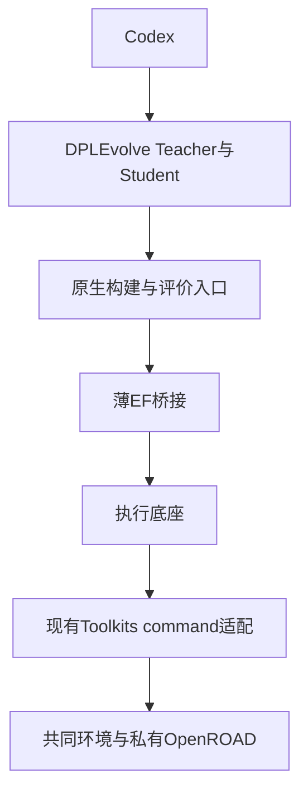
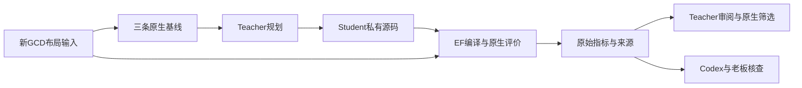
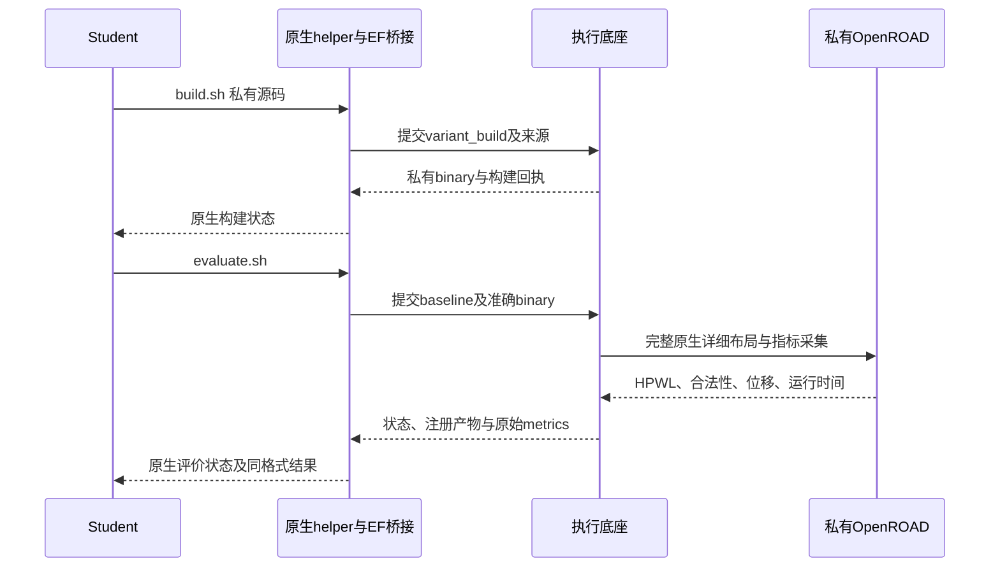
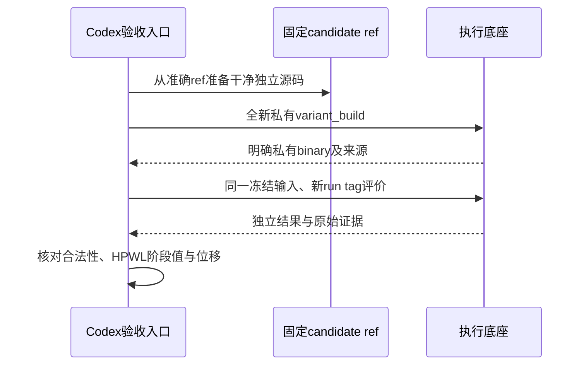

# U3：DPLEvolve 共同工具链迁移与本轮实验托管计划

日期：2026-10-13。状态：老板已确认，U3 实现中。新增基线 Tcl 兼容适配也已获老板明确同意：保持原有算法对照含义。

## 老板验收的业务效果

本轮让 DPLEvolve 在 Flow 已采用的共同基础版本上完成真实源码优化实验，并把本轮的构建、候选编译、EDA 评价交给执行底座。老板能核查每个候选的源码、工具、输入、结果和原生接纳/拒绝原因。

共同基础版本不意味着所有候选使用同一个可执行文件：修改源码必须产生私有工具。统一的是基础源码、依赖、构建环境和实验记录，候选工具另有明确身份。

这是 U3 的具体计划。建议同时完成 DPLEvolve 三个确定性入口的 EF 接入，属于 L4 的 DPLEvolve 部分；这样本轮新实验不再沿用 L2 的独立 EDA 启动器。GoalEvolve 执行接入、设计数据总览、专业 Agent 的统一数据入口、Flow/两个 Code 的最终 PPA 接力仍分别验收。U3 通过不能把整个 L4/L6/L7 记为完成。

建议老板确认以下五条验收标准：

1. 从固定共同 OpenROAD/ORFS 基础准备专业源码，成功构建共享 core 和私有候选；每个实际工具能追到源码、补丁、依赖和镜像。
2. 新生成 GCD/Nangate45 真实布局输入；默认、negotiation、evolve 三条原生基线均合法，完整详细布局评价和 prompt/workspace smoke 通过。
3. 完成一轮真实 Teacher → Student → Teacher review，产生至少一个相对准确起点真正修改算法的源码候选；保留原生合法性、位移、运行预算和晋升规则。
4. 本轮所有源码构建及 EDA/评价经公共 EF 入口运行，包括 Student 调用生成 helper 时；固定候选从干净源码和全新私有构建独立重放，结果可核对。
5. 静态检查、对应测试、差异/架构审查及相关回归通过，失败现场与实际成本留证；工程通过后交老板业务验收。候选不胜出也如实报告，不能为了验收放宽晋升条件。

## 已核实的源码事实

根基线为 `a7205325c1bc264483ee1e9d495a1cb71ac7ef99`，分支 `u2-common-flow-20261012`。DPLEvolve 当前为官方固定提交 `96d8c613d62bf3431083bb5e52c7df8853d5a622`，只读检查未发现该模块工作树修改。根目录已有 evaluation 修改/未跟踪文件及 DF/DI 的用户修改继续保留。

共同镜像固定为 `/home/wjyuan/projects/eda-toolchain/orfs-8e6ee7aac233da07.sif`，SIF SHA256 `8e6ee7aac233da078364649fa8111dac5de33a3589f5445dcffd96f9d6d8dd39`；ORFS `5105b0a77fe8b3ae107bed67112eb5f83caca5d5`，OpenROAD `27288f5c90265ae5296b2f5a9fa6e8714fa191ad`，OpenSTA `e983e15b2cb346badf8f23725fd3914d25312c44`。来源与资格证据沿用 U1；不跟随移动的 latest。

| 源码位置 | 实际职责及审计结论 |
|---|---|
| `metadata/anchors.json`、`scripts/workspace/prepare_workspace.sh` | 当前固定旧 ORFS/OpenROAD，依次准备 diamond、framework、default_negotiation 起点。不能单换可执行文件。 |
| `patches/openroad_dpl_evolve_base.patch` | 新增独立 `src/dpl_evolve/`，并注册六个共享源码接口；共同版本的 `src/CMakeLists.txt`、`src/Main.cc`、`src/OpenRoad.cc` 不能原样应用旧补丁。 |
| `include/ord/Design.h`、`include/ord/OpenRoad.hh`、`src/Design.cc` 的旧补丁 | 有效独立 `git apply --check` 通过；这仅是文本适用性，不是编译资格。 |
| `patches/openroad_dpl_evolve_framework.patch`、negotiation seed | 依赖先准备的 evolve 源码；必须按原顺序处理，不能在未准备的目标源码上作失败结论。 |
| ORFS `flow/Makefile:run` | 官方新版已有 `RUN_CMD --log --tee`，只需补 `RUN_OPENROAD_ARGS` / `RUN_SCRIPT_ARGS`，保留新版启动、日志和退出语义。证据为 `var/audit/common-toolchain-20261012/image-flow-Makefile`。 |
| `build_openroad_only.sh` | 共享 core 实际 CMake configure/build 的入口，可传显式 CMake 参数。 |
| `build_openroad_variant_relink.py` | 读取共享 core 的 `compile_commands.json`、SWIG 生成命令和链接配方，编译私有 evolve 库再 relink 私有 OpenROAD。要求生成器保持 Unix Makefiles；不能盲换 Ninja。 |
| `baseline/run_baseline.sh` | 三条 canonical line、显式 `--openroad-binary`；完整 legalization/improve/mirror 及后续指标采集。 |
| `scripts/teacher_loop/workspace_scripts.py` | Student 的 build、fresh-build、evaluate helper 已调用上述低层入口。因此接入低层入口可以覆盖真实 Student，避免只托管外部演示命令。 |
| `scripts/teacher_loop/evidence.py`、`workspace_scripts.py:child_evaluation_timeout` | HPWL、合法性、位移和原生运行预算参与判断；只对物理流程应用基于默认基线的 timeout，不能把 HTTP 排队、编译或指标收集时间算作算法时间。 |

源码证据还包括 `var/audit/common-toolchain-20261012/dpl-patch-applicability.json` 和 `admin/L2_DPLEVOLVE_REPORT_20261011.md`。L2 三条基线、候选及重放已工程通过，但仍是旧环境且未统一执行/数据；不能拿旧数值替代共同版本的新基线。

尚未验证：新版 OpenDB/Logger/GUI 等 API 与旧 evolve 模块的编译兼容性、新版 CMake 产物与 relinker 的实际适配、共同环境下的新实验结果。进入实现后通过真实构建确定；若需要修改下述六个共享文件以外的公共骨架，先报具体失败与影响面，再确认修复范围。

## 文件清单与影响面

以下是待确认的实现清单，不表示这些文件已经修改。

| 文件 | 单一职责与改动原因 |
|---|---|
| 新增 `dplevolve/metadata/common_toolchain.json` | 固定共同 anchor、专业兼容补丁及准备顺序；旧 `anchors.json` 保留为原生复现入口。 |
| `dplevolve/scripts/workspace/prepare_workspace.sh` | 显式平台 profile 下选择共同 anchor/补丁；没有 profile 时保持旧原生准备方式。只操作新 var 工作区。 |
| 新增 `dplevolve/patches/common_toolchain/openroad_registration.patch` | 对新版 CMake、Main、OpenRoad 三个共享文件注册 evolve；与旧 base patch 的新增模块及另外三处可适用接口一起准备共同源码。 |
| 新增 `dplevolve/patches/common_toolchain/orfs_run_arguments.patch` | 在新版 ORFS run 入口传递原生 evaluator 所需参数。 |
| 按实际编译需要新增 `dplevolve/patches/common_toolchain/evolve_api.patch` | 仅适配 `src/dpl_evolve/` 的新版 API/构建接口；需要时列明每个 hunk，保留专业算法和 seed 语义，不覆盖经典 `src/dpl/`。不需要则不创建。 |
| `dplevolve/patches/PATCH_AUDIT.yaml` | 按原项目工程门禁登记三个新增专业兼容补丁，不绕过补丁来源清单检查。 |
| 新增 `dplevolve/scripts/platform/execution.py` | 薄的 EF client 桥接与确定性 container leaf；不承担模型循环或候选评分。 |
| `dplevolve/scripts/workspace/build_openroad_only.sh` | 平台 profile 下把共享构建交给 EF；leaf 才执行原始构建主体及明确的共同 CMake 参数。 |
| `dplevolve/scripts/workspace/build_openroad_variant_relink.py` | 平台 profile 下把私有编译/relink 交给 EF；保留原生配方，必要的产物路径适配只限当前共同 CMake。 |
| `dplevolve/baseline/run_baseline.sh` | 平台 profile 下把完整原生评价交给 EF；原生指标文件、退出状态和运行时间语义不变。 |
| `dplevolve/baseline/detail_place_openroad.tcl`、`detail_place_openroad_negotiation.tcl` | 老板追加确认：新版默认已切换到 negotiation 且移除旧切换参数；共同版本显式调用 Diamond、negotiation 使用新版默认入口，旧模式保留原调用。 |
| 新增 `dplevolve/validation/test_platform_execution.py` | 验证三个入口委派、失败不能静默退回 host、源码变化产生新任务、重复查询不重跑、私有 binary 及退出状态传递。 |
| 新增 `admin/run_common_dplevolve.py` | 准备独立环境/源码、profile 和 EF 服务；经 EF 生成真实布局输入；执行本轮 smoke、基线、原生演化和独立重放；保存步骤回执。开发验收入口。 |
| 新增 `admin/accept_common_dplevolve.py` | 核查工具/输入/候选/EF run/注册产物及独立重放的一致性，生成工程回执，不替代 Codex 的业务判断或原生晋升。 |
| 新增 `admin/test_common_dplevolve.py` | 验证来源/输入/私有工具错配、缺真实源码变化、遗漏 EDA run、非法结果不能得到成功回执。 |
| `dplevolve/AGENTS.md`、`dplevolve/scripts/README.md` | 说明显式平台 profile、EF 托管边界与保留的原生模式。 |
| `.gitmodules`、`SOURCE_MANIFEST.json`、根 gitlink | 平台适配后改为 ChipEvolve `modules/dplevolve` 固定提交，保留官方 upstream URL/commit 来源。见发布方案。 |
| 本计划、U3 报告、`TASKS.md`、`ARCHITECTURE.md`、`admin/STATUS.md` | 更新真实能力、接口及待业务验收状态；在确认后记录 U3 进行中，完成时记录工程结果。 |

OpenROAD 六个共享骨架文件只在新 var 工具源码应用专业补丁：`include/ord/Design.h`、`include/ord/OpenRoad.hh`、`src/CMakeLists.txt`、`src/Design.cc`、`src/Main.cc`、`src/OpenRoad.cc`。影响面为 evolve 对象的声明/生命周期、Tcl/Python 注册及链接；保留新版原有 synthesis/watermark/web 等注册及生命周期。U1 冻结源码和已交付 Flow 工具保持原身份。

本轮不修改 EF/Toolkits/DF/DI/Query/Flow/GoalEvolve 业务源码或公共契约。DPLEvolve 三个低层入口会影响其所有上层调用，所以使用显式 profile，原生模式有回归；正式平台验收强制启用 profile，EF 不可用时报告失败。

## 接口与数据流（已确认）

新增的内部桥接入口：

```python
maybe_delegate(operation: str, argv: list[str]) -> int | None
# operation: core_build / variant_build / baseline
# 无平台 profile 或已经处于 EF leaf 时返回 None，继续原生主体；
# 平台模式提交并等待 EF，返回原生命令状态；提交失败不得返回 None。
```

平台 profile 使用 `DPL_EVOLVE_PLATFORM_PROFILE=<本实验var/config.json>` 显式指定；包含固定 toolchain/source 身份、EF 地址、设计/实验身份、宿主 client Python、容器 Python、共享 core 路径、资源和操作回执目录。具体本机绝对路径仅写 var，不写入发布代码。原生所有 CLI 参数保持原义。

每个确定性操作保存 `request.json`，其内部数据包含：`operation`、原生 `argv`/`cwd`、输入文件 hash、准确源码起点/候选 ref 与实际源码 hash、工具/共享 core/镜像身份、输出位置、资源、运行预算。原生 Student 在提交后等待该操作结束，现有 workspace 锁覆盖这段时间；编译到评价之间重新核对来源。

调用现有公开接口，不新增服务或 API：

| 接口 | 用途 |
|---|---|
| `KernelClient.submit(task, *, idempotent=True, idempotency_key=...)` / `POST /kernel/runs` | schema v3、`plugin_id=openroad-data`、`inputs.adapter=command`、`extractor_command` 调用确定性 leaf。任务身份包含本实验、操作、准确来源及输入；显式新试验用新身份。 |
| `KernelClient.run(run_id)` / `GET /kernel/runs/{run_id}` | 查询操作状态；已有成功操作在来源不变时复用。 |
| `KernelClient.cancel(run_id)` / `POST /kernel/runs/{run_id}/cancel` | 取消本实验的确定性操作；由 EF 清理其进程树。 |
| `KernelClient.artifacts(run_id)` / `GET /kernel/runs/{run_id}/artifacts` | 查询已注册的回执、日志、原始指标/ODB/SDC 等。 |
| `KernelClient.materialize_artifact(run_id, artifact_id, destination, ...)` | 通过公共定位本机复制并校验 hash；HTTP 主要传控制信息，大文件使用本机磁盘。 |

leaf 在固定镜像内运行原生命令。构建使用独立 var 中稳定绝对路径和相同容器挂载位置，避免共享 core 的编译/链接配方在不同 EF attempt 路径下失效；私有 relink 只读共享 core，写私有构建。源目录只读，实际输出目录可写；独立磁盘 scratch 挂 `/tmp`。不向 EDA 容器挂载模型登录凭据或 Codex 会话库，Teacher/Student 仍使用宿主现有 Codex CLI。

EF attempt 内保存/注册输出证据；使用现有 command adapter 的 manifest、`native_extra_paths` 和注册产物能力。构建证据包不作为芯片事实快照导入 DF。需要构建的大文件保存在 var，回执绑定实际内容 hash；评价的 ODB/SDC/原始 metrics/日志留有公共 artifact 引用。失败退出及原生失败 metrics 一起保存，不能为了生成成功产物包把失败改成成功。

### 模块依赖



### 核心数据流



### Student 的实际实验



### 固定源码独立重放



U3 只保存原生证据和 EF 公共引用。按设计展示全部实验/产物、将原生结果完整建模到 DF/DI、Query 诊断交给其他 Agent，仍按 L5/L6 的契约另行施工。

## 验证顺序、资源与停止条件

1. 记录根/八模块身份、用户修改、已安装 wheel 和文件 hash；确认后建独立 `u3-dplevolve-common-20261013` 分支，所有运行状态在新 `var/code-agent/u3-dplevolve-common-20261013/`。保留全部历史记录。
2. 准备官方共同 ORFS/OpenROAD/递归依赖及专业补丁，核对实际内容和来源；完整构建后再验证 evolve 命令注册。U1 实物可作已校验源码/依赖来源，不覆盖它，也不把无 evolve 的 U1 binary 当候选工具。
3. 通过 EF 生成 GCD/Nangate45 的 `3_4_place_resized.odb` 和 SDC；同一新输入运行三条 canonical baseline：`openroad_dpl_flow`、`openroad_dpl_negotiation`、`evolve_default`。
4. 原项目 `scripts/repo/check_release_readiness.sh`、GCD Teacher dry-run/prompt audit 和生成 helper 语法检查；检查每条实际构建/EDA路径都经过三个平台委派入口。
5. 使用原生 `scripts/optimize_case_with_codex.py`，一轮、一名 Student、`--max-parallel 1`，宿主既有 Codex CLI、不改模型配置。包括真实新源码、私有构建、完整评价和 Teacher review；正确起点 hash 必须单独保存，换预制 seed 不算新源码优化。
6. 从稳定 candidate ref 独立准备源码，使用新私有构建和新 run tag重放。合法性/阶段HPWL/位移按原生输出精度核对；运行时间允许真实波动，仍须符合原生预算。不要求 binary hash 或运行时间完全相等。
7. 依次通过 lint/format/type/compile及shell检查、对应单元测试、逐文件diff、架构约束和相关回归。范围覆盖桥接/恢复/失败、原生 prompt/参数/评价行为、EF资源/进程/公共产物；有未解决错误不得记工程通过。

预定开发命令（文件尚未实现；确认后提供最终可执行命令与实际环境）：

```bash
admin/.venv/bin/python admin/run_common_dplevolve.py prepare --run-root var/code-agent/u3-dplevolve-common-20261013 --image /home/wjyuan/projects/eda-toolchain/orfs-8e6ee7aac233da07.sif
admin/.venv/bin/python admin/run_common_dplevolve.py run --run-root var/code-agent/u3-dplevolve-common-20261013
admin/.venv/bin/python admin/accept_common_dplevolve.py audit --run-root var/code-agent/u3-dplevolve-common-20261013
admin/.venv/bin/python -m pytest admin/test_common_dplevolve.py
git diff --check
git diff --name-only
```

主控与宿主 client 使用独立环境、已提交 EF client wheel；容器的 Python/依赖按其 Python 3.10 单独准备，不直接挂宿主 Python venv充当容器解释器，不注入兄弟项目源码路径。模块新增测试用其独立环境运行。

预算建议：本轮端到端监督上限四小时，共享构建最多90分钟；一次真实原生轮次最多90分钟；失败后的确定性修复/重试使用本轮剩余时间。物理并发1，编译8线程；大构建沿用资格验证的64 GiB/2048进程/单LTO worker，其他操作按规模配置。不复用或重置 GoalEvolve 已过期演化预算。记录模型实际 token/缓存/失败/时间，未知量保留未知。

原生默认基线决定算法 runtime timeout，仍保留原项目规则；EF 的构建/评价外层超时另行覆盖启动及指标收集。新版本导致性能变化时先检查真实原因，不用降低算法或放宽晋升标准来消除失败。

本轮监督预算到期后保存现场并报告未完成项，不为赶验收把 smoke、模拟模型或旧候选算作真实新实验。公共骨架影响范围扩大、必要的 evaluator 指标含义改变时，报告具体方案再确认。

## Git 检查点和发布方案（已确认）

DPLEvolve 平台适配在独立模块分支实现，保留官方 `96d8c61…` 历史及旧原生模式。工程检查点只推送到明确的 `https://github.com/CODA-Team/ChipEvolve.git` 的 `modules/dplevolve`，不使用模块默认 origin，不推送原研究仓库。

模块提交后，根仓库更新 `.gitmodules` 的 DPLEvolve URL/branch、gitlink 与 `SOURCE_MANIFEST.json`，来源 manifest 额外记录官方 upstream URL/commit。提交标题使用 `[切片U3] ...`，报告标记待业务验收。根分支推送到同一 ChipEvolve，并核对远端ref和gitlink。用户修改、凭据、venv、wheel、镜像、var数据均不纳入提交。

回退通过根旧检查点及保留的官方上游提交完成；不覆盖 L2/U1/U2 源码或实验。只有老板业务验收后才把相应任务标成完成。

## 下一步业务顺序

U3 工程通过后先向老板汇报共同环境的三条基线、真实候选、原生筛选原因和重放证据。随后处理 U4/GoalEvolve 的模型入口、AE-3与工具链迁移，再完成两个 Code执行入口收口、按设计的数据管理与 Query交接，最后运行同一设计/工艺/约束下的三项目完整PPA接力及本机收益测量。不会跳过这些缺口直接宣布平台已全部协同。
