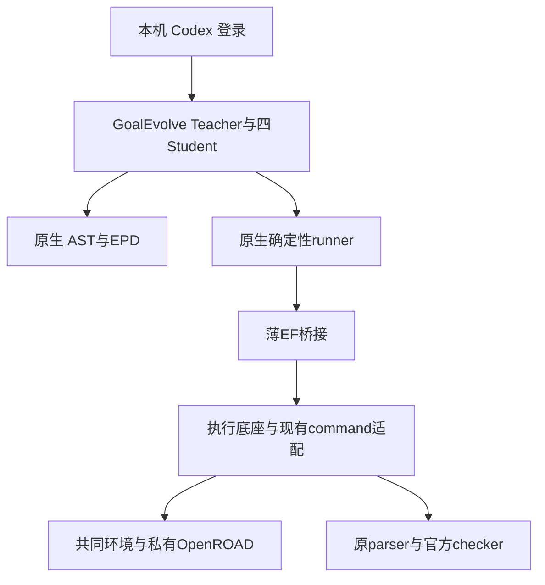
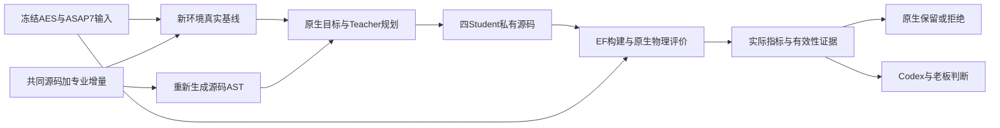
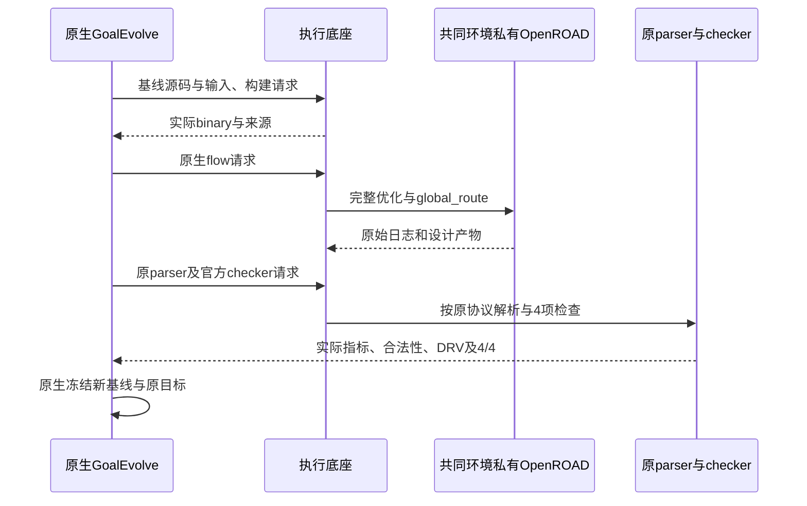
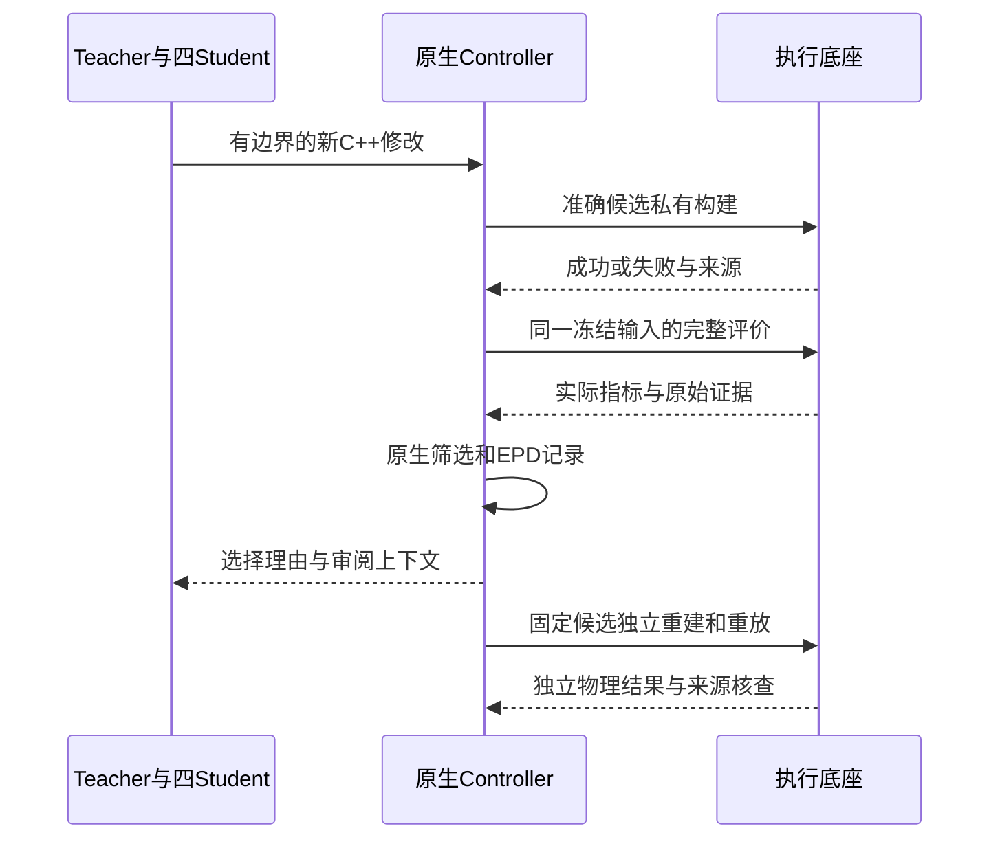

# U4：GoalEvolve 共同工具链、Codex 登录与统一执行施工计划

日期：2026-10-13。老板已授权推进 GoalEvolve；本文件是源码审计后形成的具体文件、内部接口与验收计划。状态：老板已于 2026-10-13 确认全部新增范围，完整 U4 实施中。不是重新确认项目目标。

## 老板得到什么

1. 在本机通过已有 Codex 登录使用 GoalEvolve，不必另外配置项目 API 凭据。
2. 在与 Flow、DPLEvolve 相同的基础版本上，运行 GoalEvolve 的真实 AES / ASAP7 源码优化。
3. Teacher、四个 Student、AST、EPD、原有目标、原生保留/拒绝规则继续有效；构建和物理评价统一交由执行底座。
4. 看见本轮新候选的实际时序、动态功耗、漏电功耗、有效性和选择原因，固定源码可以独立重放。

本切片交付共同环境中的完整单项目实验。两个 Code 的 DF/DI/Query 数据入口、按设计的总览、三项目同工艺接力、最终 PPA 与 token/时间收益仍由后续切片验收。AES / ASAP7 不与 Flow 的 AES / Nangate45 直接比较。

## 源码审计依据

- 根基线 `b629e3f047d323b22315f639799efdf98d4530f0`；GoalEvolve 官方固定 `1cc20aa611e687c2745ff7da6a006a5d25f49f85`，工作树干净。现有评测代码及 DF/DI 用户修改保留。
- 共用基础 ORFS `5105b0a77fe8b3ae107bed67112eb5f83caca5d5`、OpenROAD `27288f5c90265ae5296b2f5a9fa6e8714fa191ad`、OpenSTA `e983e15b2cb346badf8f23725fd3914d25312c44`，SIF SHA256 `8e6ee7aac233da078364649fa8111dac5de33a3589f5445dcffd96f9d6d8dd39`；沿用已验收 U1 来源，不跟随移动 latest。
- L3 已真实复现发布的 AES 候选及本机 p0 基线。新的 AE-3 尚未运行，原六小时预算过期，不能恢复该预算或把发布结果当作新优化收益。
- `agents/codex_runtime.py` 的 `_ensure_home` 和 `_environment` 都强制从项目 dotenv 取 API 凭据；已有本机 Codex 登录不能直接进入此入口。
- `evaluation/contest2026.py` 的真实构建、增量编译、OpenROAD、官方 parser/checker 经 `ResilientCommandRunner.run` 执行；可在此确定性接点委派，保留 evaluator 的测量与原生判断。
- `p0_campaign.py` 默认固定旧 p0 与旧 AST 缓存；`RepositoryGraphIndex` 已有 `p0_source_root` / `p0_artifact_root` 注入接口，可复用其 AST 算法，为共同源码生成新缓存。
- 与共同源码比较，rsz 有 81 个共有源码/接口/构建文件不同，12 个 p0 专业文件缺少对应路径；rmp 三个文件不同。该差异包含上游演进，不能整目录覆盖。具体路径见 `var/audit/u4-goalevolve-plan-20261013/audit.json`。
- 原生 flow 的 `detailed_placement` 在旧 p0 默认 Diamond，新共同版本默认 negotiation。共同模式需要显式 Diamond，保留原评价序列；旧模式调用保持原样。
- 官方四项有效性检查为固定 physical cell、macro、I/O 和触发器/clock 完整性，不是完整逻辑等价证明。原 parser、checker、输入库和测量单位保持。
- 本次正式未修改源码的 unit/artifact 全套复查：399 个 JUnit case（含子测试），9 failure、0 error、0 skip，其余 390 成功；九项仍是原历史资料缺失，源码仍干净。原日志与分项在审计目录，不记作全套通过。完整施工前审计见 `U4_GOALEVOLVE_PREIMPLEMENTATION_AUDIT_20261013.md`。

## 本切片的纵向验收节点

这些是一个 U4 切片内的执行顺序，不自动扩展到其他切片。

| 节点 | 端到端效果与验收 | 前置 |
|---|---|---|
| A：模型入口和资料门禁 | 本机 Codex 登录经原生 runner 完成最小真实协议响应；三种角色均使用同一明确后端；原 API 模式对应回归通过；缺资料的单元测试改为可重建 fixtures，同样的行为断言仍成立 | 已确认契约 |
| B：专业共同源码 | 必需专业补丁在固定共同源码完整构建；原 `repair_power`、实际 timing recipe 和必要 RMP 接口可调用；源码、递归依赖、镜像、binary 有明确身份 | A 可独立准备；进入模型演化前 A 必须通过 |
| C：真实共同基线 | 原 AES / ASAP7 冻结输入，经 EF 构建并运行原生完整 flow；原 parser、零 DRV、布局合法性及官方 4/4 通过；实际本机基线冻结 | B |
| D：真实四 Student 轮次 | 新源码 AST、原生 Teacher/EPD 与四 Student 完成一轮；至少一个真正修改 C++ 的候选经 EF 成功构建/运行；每个候选失败和选择原因留证 | A、C |
| E：独立重放与交付 | 从固定内容快照独立私有构建、同一输入重放，测量及有效性可核对；五项门禁依次通过；提交并发布待业务验收检查点 | D |

最优结果可能改善、持平或被拒绝，都应如实汇报。没有新源码、只有模拟、换预制种子或缺真实物理/checker 结果，不算 D/E 完成。不承诺一轮就达到研究目标。

## 要修改或新增的正式文件

下列模块路径均位于 `goalevolve/` 子模块；大型源码准备和实验产物仅在新的 var 内。

| 文件 | 一句话职责与影响面 |
|---|---|
| 新 `goalevolve/platform/__init__.py`、`profile.py` | 定义显式本机 profile 和共同源/AST/模型设置读取，未启用时保持原生模式。 |
| 新 `goalevolve/platform/execution.py` | 使用独立已安装的公共 EF SDK 委派原生命令，保存输入/source/binary/产物绑定和执行状态。 |
| `goalevolve/execution/execution.py` | 在原生确定性 runner 的尝试边界调用委派；保留其返回结构、原重试语义及完整日志。承重墙：所有原生构建、flow、parser、checker。 |
| `goalevolve/evaluation/contest2026.py` | 提供准确构建/评价操作上下文及输出范围；共同模式显式 Diamond，保持 flow、功耗 cache 刷新、parser/checker 和测量定义。承重墙：所有真实评价及基线。 |
| `goalevolve/config.py` | 共同模式读取本轮模型配置和工具构建设置，保持原生默认和目标/晋升参数。承重墙：Teacher、Student、Narrator、evaluator 的构造。 |
| `goalevolve/agents/codex_runtime.py` | 新增显式 existing-Codex 模式，复用当前登录而不改写登录或复制凭据；保留原 API 模式、session、重试、超时与计数。承重墙：所有模型角色。 |
| `goalevolve/p0_campaign.py` | 为共同模式选择实际新 source/AST 根及来源 manifest，保持 p0 init/baseline/run 业务协议。 |
| `goalevolve/planning/repository_graph.py` | 各构造点一致选择本轮 p0 根，继续使用原 AST 构建/增量算法，不把旧 AST 冒充新源码图。 |
| `pyproject.toml` | 将新的本模块 platform 包列入原安装清单，不加入 sibling 源码依赖。 |
| 新 `toolchain/common_toolchain.json` | 固定共同版本、专业原始 p0 内容身份及准备补丁范围。 |
| 新 `toolchain/common/rsz.patch`、`rmp.patch`、`build_api.patch` | 保存经依赖审计的研究增量和必要新版 API/构建适配，从干净共同版本可重新准备。 |
| 新 `tests/unit/test_platform_execution.py` | 委派、原失败/重试、幂等、取消、资源、来源错配、大产物本机取回及旧模式回归。 |
| 新 `tests/unit/test_platform_codex.py` | 三角色本机登录、API 模式隔离、恢复身份、超时和真实 usage 记录。 |
| `tests/unit/test_core.py`、新 `tests/unit/release_fixtures.py` | 将九项未发布历史资料依赖转换为明确的临时测试 fixtures，保留行为断言；测试资料不得流入真实研究经验库。 |
| `tests/unit/test_p0_campaign.py`、`test_ast_graph_lifecycle.py` | 原 p0 路径和新实际源码/AST 路径分别覆盖，拒绝旧图配新源码。 |
| 新模块 `AGENTS.md`、模块 README / toolchain README | 说明专业行为、显式 profile 和统一执行边界，运行参数和秘密不写入源码。 |
| 新根 `admin/prepare_common_goalevolve.py` | 从固定源码准备专业源、依赖、独立环境、profile、新 AST 和一次性验收状态。 |
| 新根 `admin/run_common_goalevolve.py` | 调用原生 smoke/p0 baseline/run/固定候选重放，管理本次有界监督与 EF 清理。 |
| 新根 `admin/accept_common_goalevolve.py`、`test_common_goalevolve.py` | 核查原始物理结果、source/binary/输入/原生选择、注册产物及独立重放，拒绝模拟和错配。 |
| 根计划/报告、PROJECT/ARCHITECTURE/TASKS/STATUS/AGENTS | 记录实际能力、来源、已知缺口和待老板业务验收状态。 |
| 根 `.gitmodules`、`SOURCE_MANIFEST.json`、GoalEvolve gitlink | 按本计划发布平台 fork 到 ChipEvolve `modules/goalevolve`，保留官方 URL/commit/内容来源。 |

不改变 EF、DF、DI、Query、Toolkits、Flow 或 DPLEvolve 业务代码/公共契约，不将 U3 的实现通过 sibling 源码导入 GoalEvolve。使用现有公开 SDK、TaskSpec 和 command adapter。

### 专业源码的准备范围

专业新增文件是审计发现的 12 个文件：

```text
src/rsz/src/policy/RepairPowerPolicy.{cc,hh}
src/rsz/src/policy/PowerRecoveryPlusPolicy.{cc,hh}
src/rsz/src/policy/MeasuredCriticalPathPolicy.{cc,hh}
src/rsz/src/move/PowerRecoveryCandidate.{cc,hh}
src/rsz/src/move/SizeDownCandidate.{cc,hh}
src/rsz/src/move/SizeDownGenerator.{cc,hh}
```

实际接线/依赖优先检查：`src/rsz/include/rsz/Resizer.hh`、`src/rsz/src/{Resizer.cc,Resizer.tcl,Resizer.i,Optimizer.cc,OptimizerTypes.cc,OptimizerTypes.hh,RepairSetupContext.hh,MoveCommitter.cc,CMakeLists.txt}`、`policy/{OptimizationPolicy.cc,SetupLegacyBase.cc,SetupMt1Policy.cc,SetupLastGaspPolicy.cc}`。RMP 范围为 `src/rmp/include/rmp/Restructure.h`、`src/rmp/src/Restructure.cpp`、`src/rmp/src/rmp-py.i`。

这些共享头、枚举、policy/committer 和 SWIG/CMake 接线会影响 rsz/rmp 的调用者及 binary 布局，需要真实完整构建、原 recipe 调用与私有候选增量构建验证。保留新版原有策略，补入原项目的专业机制，不能用删除 RMP/recipe、替换算法或覆盖整个旧目录消除兼容错误。必要的 OpenDB ID 容器、OpenSTA 接口与绘图 core 适配纳入 `build_api.patch`，不混入新搜索策略。

81 项差异不是批准整目录替换；专业依赖以调用链逐项收敛并列入最终补丁清单。若必须新增此处未列出的共享骨架文件或改变 evaluator 指标含义，先说明具体失败与影响面，再确认。

## 内部接口与本轮 profile（已确认）

```python
load_platform_profile() -> dict[str, object] | None
# 从 GOALEVOLVE_PLATFORM_PROFILE 读取显式 profile；无 profile 为原生模式。

maybe_delegate(
    *, command: list[str], cwd: Path, policy: ExecutionPolicy,
    output_log: Path | None, environment: dict[str, str] | None,
) -> ExecutionReport | None
# 无 profile 或确定性 leaf 返回 None；平台模式失败不得返回 None。
# 保留原生 ExecutionReport：ok、attempts、returncode、stdout_tail、
# stderr_tail、resource_error。不把 EF 失败包装成原生成功。
```

Profile 放新 var，不进入发布源码；包括固定共同源码/SIF/编译配置、专业 seed/AST 实际身份、EF 地址与已安装 client Python、设计/输入/checker/parser 身份、允许输出目录、按操作资源、监督截止时间和明确模型入口。

模型入口采用显式 `codex.auth_mode=existing_codex` 与本机 Codex home；模型为此前本机已验证的 `gpt-6.1-sol` / `xhigh`，Teacher/Student 原 retries=3、timeout=1800 s、Student repair=4、Teacher format repair=2 保留。运行设置只在本轮 var 记录，原发布 `config/codex.json` 保留；无 profile 的 API 模式不自动借用个人登录。模型调用留宿主，EDA 容器不挂载个人 Codex home。

共同 source/AST 只改变本轮专业源码起点和其真实索引，不改变 AST/EPD 算法。基线在新环境重新测量；GoalEvolve 原内容 hash/patch 身份保留，不强迫采用 DPLEvolve 的 candidate git-ref 格式。

跨模块仅复用现有公开接口：

| 接口 | 数据与用途 |
|---|---|
| `KernelClient.submit(task, *, idempotent=True, idempotency_key=...)` / `POST /kernel/runs` | 原 TaskSpec v3、command adapter；任务绑定实际 command/cwd、原生尝试、source/binary/输入/库/checker hash、输出与资源。 |
| `run(run_id)` / `GET /kernel/runs/{run_id}` | 原任务状态与恢复，不重发同一已完成计算。 |
| `cancel(run_id)` / `POST /kernel/runs/{run_id}/cancel` | EF 清理本任务进程树，保存取消状态。 |
| `artifacts(run_id)` / `GET /kernel/runs/{run_id}/artifacts` | 构建、原日志、metrics、ODB/DEF/网表、checker 和来源。 |
| `materialize_artifact(...)` | 公共定位后的本机复制/hash，大文件无需整包 HTTP。 |

物理计算在固定共同镜像中，原 parser/checker 可由 EF 在已有独立 GoalEvolve Python 环境运行，避免把整个 Python 3.12 Agent 搬进镜像的 Python 3.10。保留每一步原语义；测量结果不是平台的新评分底座。源码复制和 AST 是原项目的准备工作，实际编译、OpenROAD、parser/checker 的进程由 EF 托管。

EF leaf 避免递归委派；原生 command retries 保留，EF 单任务 max_attempts=1，不能将两层重试相乘。源、构建图、私有对象与 binary 的实际绑定在增量构建前后核对；特别覆盖头文件变化影响的调用者和共享类布局。构建/运行的大产物及失败记录留 var。设计事实导入 DF/DI/Query 仍未在本切片实现。

## 数据流与图









## 验证与资源

1. 先修复可重建的测试资料依赖，分别验证原 API 模式和新增本机登录；基础测试必须通过后才发动真实模型/EDA。
2. 从固定共同源码完整准备并经 EF 构建，保存专业增量、依赖、实际 CMake/对象/binary；核查原 power/timing/RMP recipe 入口，不将旧 AST 或无定制功能的镜像 binary 当作 GoalEvolve 工具。
3. 原生模拟 smoke 仅作控制检查；真实 AES / ASAP7 新环境 baseline 则必须经 EF、原测量和官方检查，重新冻结。
4. 原 p0 init/baseline/run，一轮、四 Student、AST、EPD、原目标和晋升；至少一个真实新 C++ 候选完成完整评价并固定源码。
5. 独立重放采用同一输入和 frozen recipe，检查阶段与最终时序/功耗、合法性、零 DRV 和四项有效性；既有 L3 容差只用于旧发布重放，不套用到新工具版本。
6. 依次通过 lint/类型/格式/Shell、对应单元、逐文件差异、架构边界、全套原生及相关 EF/Toolkit 回归。所有新失败解决；缺资料单元测试不通过就不记完成。原发布历史资料缺失仍如实单列，不伪造已找回。

建议新的 U4 独立监督上限八小时（包含准备/构建/演化/收尾），开始实现时一次记录，重试不重置；旧 L3 六小时记录不动。单大构建先沿用实测安全的 64 GiB、2048 进程、8 编译线程、单 LTRANS worker。四 Student 保留，源码推理/编辑并行能力保留；编译按 EF 总资源调度，物理测量继续原生串行。每个命令/模型保留原有 timeout/retries；资源按实际规模调整，不为适应额度削减算法或有效性检查。预算到期保存现场，不补算模拟或老候选。

最终提供本机 prepare/run/audit 命令及真实回执；验收工具仅核事实，不覆盖原生决策或替代老板业务验收。代码实现前，这些命令不假装已存在。

## 发布与停止边界

确认后创建根/模块 U4 独立分支和新的 `var/code-agent/u4-goalevolve-common-20261013/`，固定开始基线与用户修改。完成时模块、根分别提交 `[切片U4] ...`；模块仅推明确的 `https://github.com/CODA-Team/ChipEvolve.git` 的 `modules/goalevolve`，不使用默认 origin，不推原 GoalEvolve 研究仓库。根固定 gitlink 与官方 upstream 来源，再发布 U4 检查点并核对远端。

工程通过后先汇报，业务验收待老板；本轮停在 U4，不自动进入统一数据或最终三项目协同。未实际完成的功能不写进论文实现列表。

## 本次需确认的具体新增范围

推进 GoalEvolve 的业务目标已经授权。按照项目协作协议，这次确认的是：显式 existing-Codex 模型入口、内部 runner→EF 委派契约、新源码/AST 起点、共同模式 Diamond 评价、九项测试资料依赖修复，以及上述承重墙和平台 fork 发布范围。确认后实施，不再重复询问已确认内容。

## 施工中依赖补充（老板已确认）

2026-10-13 老板两次确认保留原功耗感知时序算法：补入 SizeUpGenerator、SizeUpMtGenerator、VtSwapGenerator、VtSwapMtGenerator 的研究实现，SizeUpMtCandidate/VtSwapMtCandidate 声明与评分实现，以及 SetupCritVtSwapPolicy.cc/.hh；同步对应私有方法声明（SizeUpGenerator.hh、SizeUpMtGenerator.hh、VtSwapMtGenerator.hh）。影响限于 rsz 的内部构建与候选生成，不变更平台公共接口。新版共享 MoveGenerator 的排序接口保留，研究排序逻辑在两个专业生成器内部适配。

另经完整构建与入口审计，老板已确认：RerouteCandidate.cc/.hh、RerouteGenerator.cc 的原研究评分/回滚，以及 GlobalRouter.h/.cpp 中保留原最低时钟层电阻估计；core/provenance.py 通过平台接点统一实际工具身份查询；cut/blif.h 与 blif.cpp 的目标输出过滤、ASAP7 表达和替换位置恢复。配套 VtSwapGenerator.hh 私有声明同步。RMP/CUT 使用新版 odb::PtrSet 适配，保留原专业流程与保护机制，目标和原生筛选不变。

老板另行确认 U4 并发实测暴露的 EF 修复：仅让 RuntimeStore.resource_totals 在已有 RLock 内完成 execute/fetch，store.py 1493→1494 行，核心总额度 8981→8982 行；添加并发事务回归并记录尺寸审批。公共 API、资源策略和 schema 不变。只用新 runtime wheel 更新 U4 专属服务，保留已运行计算和原 HTTP 500 / 取消 / 原生修复证据，不触碰其他服务。此项是原计划之外的明确授权扩展。

首轮实测后的切片内修复：GoalEvolve 平台桥接区分 `cmake -B` 的构建目录参数和 `make -B` 的强制编译参数，避免遗漏真实源码身份；独立原生命令调用分配独立 invocation_id，同一次调用的 EF 提交重试保留同一身份，不将幂等当作长期命令缓存。保留原对象重编译、DRV、时序与原生筛选检查。U4 私有插件承接原 7200 秒命令和 60 秒收尾，不改公共超时规则。首轮四失败不可晋升，原记录、基线和 EPD 保留；使用原 `p0 extend` 调度接口追加一轮工程重试，原八小时绝对截止时间不增加。独立重放可对已有效的原生候选提前启动，不改变最终原生晋升。
