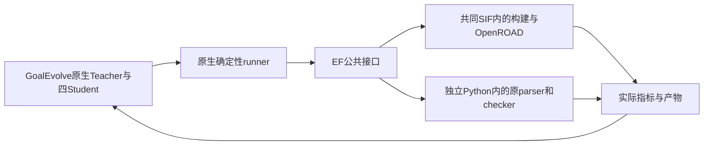
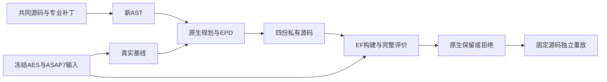

# U4：GoalEvolve 共同工具链与统一执行报告

状态：实施中，未完成工程或业务验收。本文件随实际实验结果更新；不将基线成功记作演化成功。

最新：首轮已结束，四个候选全部无效，原生未晋升，不能声称 PPA 改善。修复后的 control-r5 / 模块 `879a3a31fc496c118da6d2aa4bfa3c167651d151` 正在第二轮工程重试；继续同一原生 campaign、同一冻结基线与 EPD，原八小时绝对截止时间不变。工程与业务验收仍未完成。

GoalEvolve 已使用本机 Codex 登录、固定共同工具链与公共 Execution Foundation 完成真实 AES / ASAP7 基线。Teacher 和四个 Student 已完成两轮真实规划/编辑；首轮全部无效，第二轮四份新源码均已链接，Student 4 已完成合法物理测量，其他原生结果和独立重放仍在收尾。两个 Code 的 DF/DI/Query 入口及最终三项目 PPA 接力属于后续切片。

## 已验证的效果

- 共同专业源码完整编译链接成功；源自共同 OpenROAD `27288f5c90265ae5296b2f5a9fa6e8714fa191ad`，保留 GoalEvolve 的功耗、时序、重布线和 RMP/BLIF 专业机制。48 份专业文件及三个可重建补丁有内容身份；重放准备补丁与实际源码逐字节一致，15,858 项源码记录核对通过。
- 新 AST 为 160 个文件、1,986 个符号，源码身份 `c9f33cd2e8d9e74264cc43980c812aac91cc05d1f1053fe20d14213040bdfc7b`，不是旧 p0 图。
- 本机 Codex 登录真实协议调用成功；原 API 模式保留。Teacher 与四 Student 的调用、原重试/修复、AST、EPD、目标及晋升由原项目负责。
- AES 基线：|TNS| 18.390079498291016 ns、动态功耗 425,774,918,185.19775 pW（约 0.425775 W）、漏电功耗 92,758,549.72656816 pW（约 92.75855 µW），DRV=0；布局合法，官方 4/4 通过。4/4 检查是固定单元、宏、I/O、FF/clock 结构检查。
- 原生完整基线使用已在 EF 独立完整构建的同源 donor，私有构建与实际二进制有来源绑定。最终新候选还必须独立空目录重建和测量才能验收。

## 接口与分工

| 接口 | 责任 |
|---|---|
| `load_platform_profile() -> dict[str, Any] \| None` | 显式共同运行设置；无 profile 保持原生模式。 |
| `maybe_delegate(*, command: list[str], cwd: Path, policy: ExecutionPolicy, output_log: Path \| None, environment: dict[str,str] \| None) -> ExecutionReport \| None` | 原生确定性执行入口委派；平台失败不回退到非托管计算。 |
| `ExecutionReport(ok, attempts, returncode, stdout_tail, stderr_tail, resource_error)` | 保留原 runner 返回契约及原重试含义；完整日志另外留存。 |
| `record_build(source: Path, binary: Path) -> None` | 固定源码与实际二进制，物理评价前核对。 |
| `toolchain_fingerprint(*, source_root: Path \| None) -> dict[str, Any]` | 签名及返回字段保留；平台模式下经 EF 查询容器二进制身份。 |
| `KernelClient.submit(...)` / `POST /kernel/runs` | 原 TaskSpec v3 与 command adapter；任务、资源、输入和来源。 |
| `run(run_id)` / `GET /kernel/runs/{run_id}` | 查询实际状态与恢复原请求。 |
| `cancel(run_id)` / `POST /kernel/runs/{run_id}/cancel` | 清理本轮所属计算进程。 |
| `artifacts(run_id)` / `GET /kernel/runs/{run_id}/artifacts` | 公开注册产物与来源。 |
| `materialize_artifact(...)` | 公共定位后的本机复制/hash；大产物不整包走 HTTP。 |

## 关键决策与当前限制

- 复用 Codex 的成熟执行环境与已有登录，不新造通用 Agent harness；专业项目原生 Teacher/Student 逻辑保留。
- 固定基础源码和 SIF，按依赖合并研究增量，不整目录覆盖旧 OpenROAD，也不使用缺少专业功能的原厂 binary。
- 在原 runner 集中收口编译、OpenROAD、parser、checker 与工具身份查询；SDK 使用独立已安装 wheels，EDA 容器不挂载个人 Codex home。
- C++/OpenROAD 留共同 SIF，原 parser/checker 经 EF 在独立 Python 3.12 中运行；保留原测量单位和判断。
- 共同模式显式 `detailed_placement -use_diamond_legalizer`；原评价顺序、功耗 cache 刷新、目标和筛选不变。
- 执行产物的 evidence archive 是留证包，不冒充 DF 的设计事实快照。统一数据入口仍未交付。
- 控制目录只取本輪需要的代码、配置和冻结输入（约 598 MB，含 Git）；17 GB 发布历史资料仍留正式项目，没有削减真实实验或四 Student。
- 单大构建 64 GiB / 2048 进程 / 8 线程 / 单 LTRANS；物理任务 16 GiB / 512 进程，EF 统一调度。原八小时监督截止时间不重置，历史 L3 不重启。

## 已知失败与门禁进度

构建失败曾暴露未迁入的重布线、私有方法声明及 RMP/BLIF 依赖；老板确认后合并。准备脚本的重复常量已修正。第一次 AES 流程使用了错误 Diamond 选项，已按实际共同版本修正并成功重跑；失败未冻结为基线。所有原始失败留在新的 var。

- 最新全套原生回归：416 个 JUnit 记录（含子测试），0 failure/error/skip；原行为断言和 Diamond 流程对照保留。
- 模块与根控制器定向测试：23 项通过。Toolkits 相关回归 26 项通过；EF 相关回归 40 项通过，另 1 项按本机能力条件跳过。
- 新文件 lint/格式/类型通过。原共享文件基线有 33 项风格诊断，本轮为 32，未引入新诊断；未将其伪称为全库风格整治完成。
- 差异与架构最终审查、真实四候选结果、独立重放、发布与业务验收仍待完成。

## 并发实测新增修复（老板已批准）

四 Student 共用 EF 时，GET run 状态曾返回 HTTP 500：`NoneType` 下标错误，导致部分原生工程修复和对应 run 取消。这是执行基础设施问题，不能记作 C++ 候选错误或正常搜索成本；原日志、取消状态和原生修复记录保留。

`RuntimeStore.resource_totals` 原来绕过共享连接的线程锁，现只增加一层既有 RLock，使 execute/fetch 与工作线程写事务互斥。新增回归在旧实现上明确失败（观察到未提交的资源删除），修复后等待事务回滚并返回正确资源总量。公共 API、数据库结构和资源规则没有改变；生产文件仅增加一行，尺寸审批分别为 1494 / 8982 行。

EF 全套回归 369 通过、1 项条件跳过，定向与架构门禁 107 通过、1 项条件跳过，41 份源码类型检查及 lint 通过。新测试格式通过；两个既有共享文件在改动前已不满足整文件 Black，保留原格式债，未作无关批量重排。修复提交 `8b7a50093961e947974679bf97f31b8768de4aaa` 已发布到 ChipEvolve `modules/execution-foundation`。

本轮专属 runtime wheel 为 `869806c2d31cb8a88a9209eaee2167a119dc7149f21f21a3c7660771eb4495c8`；服务升级只作用于 U4 独立服务。首次采用暂停本轮客户端轮询、旧 worker 结算当前任务后退出、原状态目录新服务启动并恢复轮询的顺序，实际回执见 `ef-lock/restart.json`。该次暂停持续约 50.7 分钟，影响了 Student 3/4 正在进行的工程修复模型调用，恢复时原 30 分钟超时已过，按原逻辑记录 returncode=124。这是本轮接入与切换开销，不是候选算法质量结论；失败不能抹掉。后续切换先等待长计算结束，再短暂暂停客户端。其他服务不动，原八小时监督截止时间不重置。

新 wheel 服务公开接口并发实测 400 次 GET run，零错误，覆盖 queued/running/succeeded/failed/cancelled/timed_out 六种状态；`ef-lock/live_queries.json` 保存服务与结果。SDK 补收的中断终态回执也已保留。

Student 1 的首次功耗流程并非成功结束，而是被已有 EF `min(task.timeout_seconds, manifest.default_timeout_seconds)` 在 3600 秒终止；原 GoalEvolve 命令为 7200 秒。这是 U4 私有插件配置未承接原超时。只调整本轮插件上限为 7260 秒，保留原 7200 秒命令、60 秒收尾和八小时总监督；不修改 EF 公共超时规则或其他服务。根服务准备脚本与真实 ProcessAdapter 超时交接测试一并补齐，配置切换回执为 `ef-lock/adapter-cap-restart.json`。

验收控制器新增实际证据包检查：包内 request/receipt 必须与 leaf 回执相同，所有包内产物逐项核对字节 hash；伪造内容的负例会被拒绝。根控制器测试现为 10 项通过，使用独立已安装公共 SDK 的 client 环境。

## 首轮结果及桥接修复

| Student | 实际结果 |
|---|---|
| 1 | 编译链接成功；功耗流程被错误的 3600 秒适配器上限截断，无最终指标。 |
| 2 | 初次物理流程与原检查完成：动态功耗 260,362,983,441.15494 pW、漏电 39,934,420.78353837 pW、TNS 82.4016342163086 ns、DRV 99，原生拒绝其约束违例；后续电气修复遇到桥接复用旧对象的错误，最终候选无效。 |
| 3 / 4 | 共用 EF 读失败/取消后进入原生工程修复；长暂停影响模型超时，最终无效。 |

定位到 `build_root` 把 make 的 `-B` 当作 CMake 构建目录，误取 `-j8`，使对象编译请求未绑定真实 source。现限定只有 cmake 的 `-B/--build` 才用于目录识别，make 从实际 cwd 的 CMakeCache 定位。独立原生命令调用另有独立 invocation_id；同一调用内保持稳定提交身份，避免把强制重编译当作可复用的旧任务。原对象检查不放宽，新增真实参数和两次独立调用回归。

最新 Goal 全套回归 JUnit 416（含子测试）通过；首次重跑中的 dashboard 502 是 localhost 被宿主代理转发，使用原本的 NO_PROXY 设置后全套通过，没有改 dashboard。桥接定向 17 项、根控制器 10 项通过；新源码 lint/格式/类型检查通过。SDK wheel 未发布 py.typed，消费者类型门禁只关闭 import-untyped，EF 自身 41 份源码独立类型检查仍通过。

第二次服务配置切换在当前链接结算后开始，暂停约 1 秒；回执 `ef-lock/adapter-cap-restart.json`。第二轮与独立重放尚待真实结果，当前数据不构成优化收益。

证据根：`var/code-agent/u4-goalevolve-common-20261013/`。用户原有 26 份修改截至当前逐字节未变。原研究仓库不推送，正式发布仅使用 ChipEvolve 平台分支。

## 第二轮实测及独立重放进度

修复后的原生第二轮四份源码均已编译链接。Student 4 完整物理评价通过，原检查 `SUMMARY: 4/4 checks passed` / `RESULT: VALID`，DRV=0、布局合法：

| 指标 | 同条件基线 | Student 4 | 业务含义 |
|---|---:|---:|---|
| 动态功耗 pW | 425774918185.19775 | 422270954739.3606 | 降约 0.823%。 |
| 漏电功耗 pW | 92758549.72656816 | 89048255.17674908 | 降约 4.000%。 |
| 绝对 TNS ns | 18.390079498291016 | 23.248600006103516 | 增约 26.42%，时序变差。 |

原冻结业务目标是动态功耗 ≤0.35 W、漏电 ≤35 µW、|TNS| ≤12 ns；该候选尚未满足三项目标。60 ns 是物理功耗阶段的安全上限，不是业务目标。

这是本轮真实的新源码候选，既不是发布历史结果，也不是 baseline 重命名。因原生四 future 尚未全部收尾，使用原 `recover_completed_candidate` 从已完成且有来源的不可变物理产物恢复单个见证，文件为 `round_002/students/student_4/artifacts/engineering_recovered_candidate.json`。不改原 `candidate.json`、轮次结果、筛选、EPD 或晋升；不能提前宣称原生晋升或总体优化达标。

第二轮专属 EF 容量曾调为 32 CPU / 96 GiB / 4 worker，但 Toolkits 私有 manifest 的可选 `EDA_ACTIVITY_LOCK` 将构建、OpenROAD、版本查询和 parser 全部串行。原短版本查询和第一次重放 configure 因而等待长物理任务。此瓶颈是 U4 配置问题，不能写成 SQLite 修复无效，也不能用它评判算法质量。主实验仍保留该配置和实际阻塞记录。

只调整 U4 准备脚本的私有 manifest：不配置可选宿主串行锁，由 EF 做资源准入，源码/构建/输出使用私有目录；Toolkits 与 EF 公共接口、资源保护和其他服务不改。回归同时确认原 timeout、adapter 及其余 environment 保留。原重放经公共 cancel 终止并保留为 `replay-failed-host-lease`；没有删除被占用的锁或注入运行中的 worker。

独立重放使用单独 U4 EF 服务（`replay-service/service.json`），8 CPU / 64 GiB / 1 worker；主服务 32 CPU / 96 GiB。启动时本机可用内存约 128 GiB，新额度 64 GiB，仍保留任务进程与内存监管。输入来自已测 Student 4 的源码快照，空构建目录、无 donor，原完整 recipe/parser/checker 不减。两监督器共享原八小时绝对截止时间 `1791906224.4836223`，不追加预算。当前空目录 configure 已成功，完整编译运行中，重放测量尚未产生。

根控制器新增防止误验收的检查：最新原生轮次未完成时，不用前一轮的终态替它验收；重放候选必须属于本次被审轮次；独立服务的实际 EF 产物也纳入审计。11 项根控制器回归通过，lint/格式/类型检查通过。最终轮次和重放状态还需更新，U4 不算完成。
